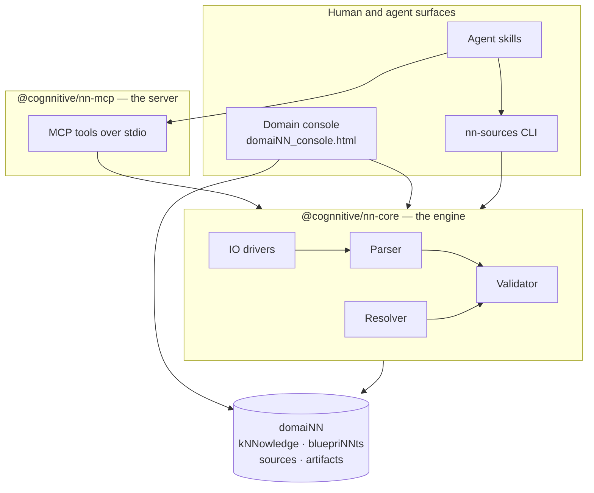

# Ecosystem architecture

cogNNitive is not one program. It is a small set of parts with a clear division of
labour: an engine that understands the format, a server that exposes it to AI agents, a
console that lets a human review it, a set of agent skills that drive it, and the
`domaiNN` containers that hold the actual knowledge. This page explains how they fit
together and where each responsibility stops.

## The problem

A validated knowledge system must serve three very different consumers at once: a
human who needs to read and review, an AI agent that needs structured tools, and a
script or CI job that needs deterministic checks. If any one of them owns the format
logic, the other two drift. cogNNitive puts the format logic in exactly one place and
makes everything else a client of it.

## The layers

## `@cognnitive/nn-core` — the engine

The engine is a library, not a service. It owns the meaning of the format:

- **Parser** — turns a Markdown document into a structured `kNNowledge` model:
  frontmatter, `# NN <Concept>` sections, `## NN <Concept>: <Element>` elements,
  `slug::` identities, and `key:: value` fields.
- **Validator** — checks a document against its resolved parent, producing a
  deterministic list of diagnostics. See [Validator behavior](validator-behavior.md).
- **Resolver** — walks the parent chain and locates bluepriNNt packages. See
  [The specification chain](specifications.md).
- **IO drivers** — read and write documents on disk without changing their bytes
  beyond the intended edit.

The engine is the single source of truth. The console and the MCP server both call it,
so a document is held to the same rules everywhere.

## `@cognnitive/nn-mcp` — the server

`nn-mcp` is an MCP (Model Context Protocol) server that wraps the engine and exposes it
over stdio as tools an AI agent can call: listing and reading kNNowledge, resolving a
specification or a bluepriNNt, validating, proposing and applying changesets, running
queries, cognitivizing sources, and syncing lineage. The tool inventory lives in the
[Reference](../reference/mcp-tools.md) section; it is generated, so it is never
duplicated by hand here.

## The domain console

The **domain console** is a self-contained `domaiNN_console.html` generated per
`domaiNN`. It browses kNNowledge, renders matrices, and reviews changesets, with each
specialized surface shown as a view (a tab). It is produced from the same engine, so it
never disagrees with validation. It replaces the retired Vue editor and hosted web
application. See [Use the domain console](../how-to/domain-console.md).

## The agent skills

The skills are instruction sets an AI coding agent loads to drive the ecosystem: the
front controller, source ingestion, iNNfo authoring, environment preflight, upgrades,
site generation, design presets, and skill lifecycle management. They orchestrate the
MCP tools and the CLI; they do not reimplement the format. See the
[Agent Skills overview](../skills/README.md).

## The `domaiNN`

Everything converges on the `domaiNN`: the container directory that holds
`kNNowledge/`, adopted bluepriNNts, `sources/`, `procedures/`, and `artifacts/`. The
engine reads and validates it, the console renders it, the server mutates it through
changesets, and the skills populate it. A `domaiNN` is itself a `kNNowledge` document —
see [The four levels](levels.md).

## Why it matters

- **One format authority.** Format logic lives only in the engine; every surface is a
  client, so they cannot drift apart.
- **Stable seams.** Agents talk to the server; humans talk to the console; CI talks to
  the engine. Each seam can change without disturbing the others.
- **Portable knowledge.** Because the `domaiNN` is plain Markdown on disk, no layer is
  required to keep the knowledge alive.

## See also

- [The four levels](levels.md)
- [The specification chain](specifications.md)
- [Validator behavior](validator-behavior.md)
- [Integrations and discipline overlaps](integrations.md)
- [MCP tools](../reference/mcp-tools.md)
- [CLI and scripts](../reference/cli.md)
