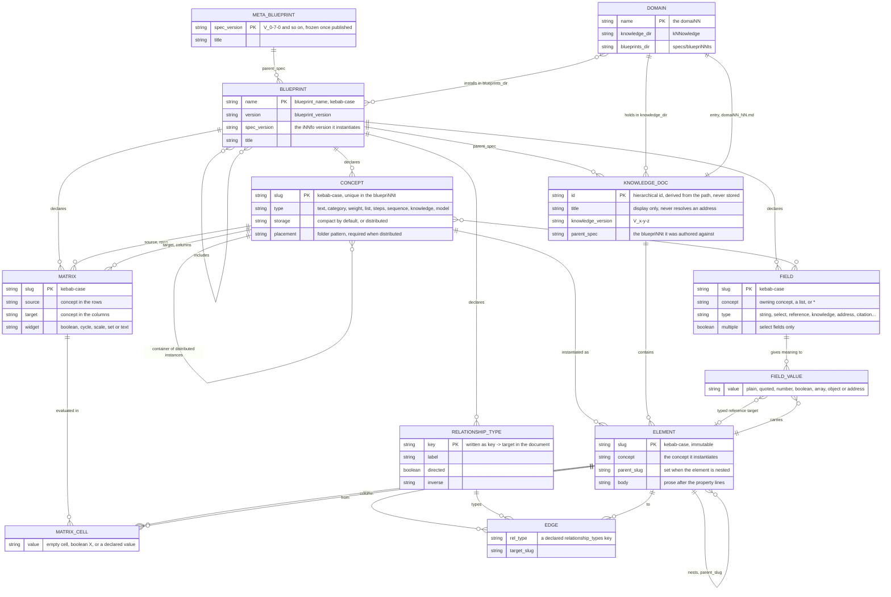
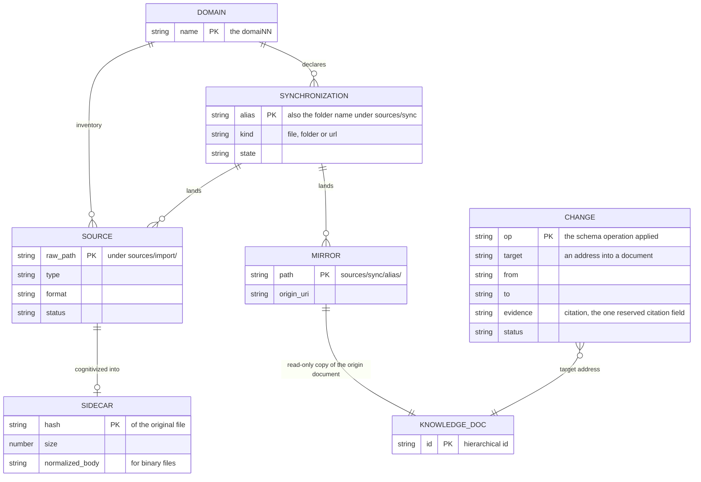

# The entity-relationship model

Every box in the diagrams below is a construct a published specification already
defines — none of them is invented for this page. Read it as a map of the repo's own
data model: the schema a bluepriNNt declares, the data a kNNowledge document holds, and
the inventory a domaiNN keeps around them.

The model has two views, so it is drawn twice: one view follows the specification chain
down to values, the other shows what a domaiNN contains.

## Diagram 1 — from the schema to the values

## Diagram 2 — what the domaiNN keeps around the documents

## How to read it

- **Two worlds in one diagram.** `CONCEPT`, `FIELD`, `MATRIX` and `RELATIONSHIP_TYPE`
  are what a bluepriNNt *declares*. `ELEMENT`, `FIELD_VALUE`, `EDGE` and `MATRIX_CELL`
  are what a kNNowledge document *holds*. An element only means something against the
  concept it instantiates, which is why `CONCEPT ||--o{ ELEMENT` is the central edge.
- **Crow's foot.** `||--o{` is one-to-many, `||--||` one-to-one, `}o--o{` many-to-many,
  `}o--o|` many-to-zero-or-one. The label names the role, not a column.
- **`PK` marks identity, not storage.** No entity has a stored primary key: a document is
  identified by its hierarchical id and an element by its slug, both derived. The marker
  says what makes two instances different.
- **The source and change boxes are concept instances.** `Source`, `Synchronization`,
  `Change` and `Mirror` are elements of concepts declared by the `sources` and `changes`
  bluepriNNts; they appear as entities here only because they carry relations the reader
  cares about. Their storage is the same `ELEMENT` machinery as everything else.
- **History is not stored.** `CHANGE` records what was applied and where; the lineage and
  the history of a document are computed from those changes, so no edge in the diagram
  represents a cache.

## Where each box comes from

| Box | Level | Defined by |
|---|---|---|
| `META_BLUEPRINT` | 1 | `iNNfo/specs/iNNfo_V_0-7-0_NN.md` (the meta-bluepriNNt) |
| `BLUEPRINT` | 2 | the meta-bluepriNNt: frontmatter plus the three root primitives |
| `CONCEPT` | 2 | `# NN Concept Definition` |
| `FIELD` | 2 | `# NN Field Definition` |
| `MATRIX` | 2 | `# NN Matrix Definition` |
| `RELATIONSHIP_TYPE` | 2 | the `relationship_types:` frontmatter block |
| `KNOWLEDGE_DOC`, `ELEMENT`, `FIELD_VALUE`, `EDGE`, `MATRIX_CELL` | 3 | the meta-bluepriNNt's Level 3 structure |
| `DOMAIN` | 3 | `iNNfo/specs/bluepriNNts/domaiNN/spec_NN.md` |
| `SOURCE`, `SYNCHRONIZATION` | 3 | `iNNfo/specs/bluepriNNts/sources/spec_NN.md` |
| `SIDECAR` | 3 | `iNNfo/specs/bluepriNNts/sidecar/spec_NN.md` |
| `CHANGE` | 3 | `iNNfo/specs/bluepriNNts/changes/spec_NN.md` |

## The three identities the diagram relies on

1. **Hierarchical id** — the identity of a document, derived only from its own path and
   its bluepriNNt's declarations: the stem without `_NN` for a compact document, a
   container chain plus slug for an instance model. A stem, a path and a title are never
   ids.
2. **Element slug** — the identity of an element inside its document, immutable: renaming
   the element changes its display name and leaves the slug alone.
3. **Title** — display only. Two documents may share a title without conflict, because no
   address ever resolves through it.

## Storage shows up as cardinality

`CONCEPT.storage` changes how the diagram is populated, not its shape:

- **compact** (the default): every instance of the concept is an `ELEMENT` inside one
  `KNOWLEDGE_DOC`.
- **distributed**: every instance is the root `ELEMENT` of its own `KNOWLEDGE_DOC` — an
  instance model — placed by the concept's `placement` rule, with `slug::` equal to its
  folder slug. Its child concepts stay elements of that same document.

Either way one `COLLECTION` exists — the domaiNN-wide set of instances of one concept,
ordered by id — and it is computed, never stored, so it has no box.

## Deliberately absent

| Not drawn | Why |
|---|---|
| addresses (`doc@element&field`, `matrix&row&col`) | a value grammar, not a table; they live in `FIELD_VALUE` and `CHANGE.target` |
| lineage, collections, index | computed on demand from documents and applied changes |
| `artifacts/` and its write-once families | producer output, outside the schema: no concept declares it |
| the bluepriNNt catalog | a folder of `BLUEPRINT` instances, not a new entity |

## See also

- [The four levels](levels.md) — what each level is allowed to say
- [The specification chain](specifications.md) — `parent_spec`, `includes` and freezing
- [Storage and identity](storage-and-identity.md) — hierarchical ids and instance models
- [Sources, citations and lineage](sources-citations-lineage.md) — the second diagram in prose
- [The knowledge lifecycle](knowledge-lifecycle.md) — how `CHANGE` entries accumulate
- [Canonical vocabulary](../vocabulary.md) — the canonical name of every box above
