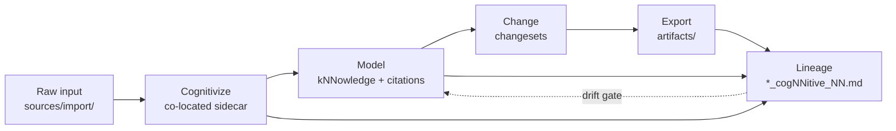

# The knowledge lifecycle

Knowledge in cogNNitive does not sit in one file. It moves through a defined path: raw
input enters as a **Source**, is cognitivized, is modelled as **kNNowledge** that cites
its sources, is changed through reviewed **changesets**, is exported as **artifacts**,
and is traced end to end in a **lineage record**. This page follows that path and explains what happens at each stage.

## The problem

A document pipeline that only ingests and outputs loses the thread between a claim and
the evidence behind it. cogNNitive keeps that thread explicit: every modelled element
points back to the exact source anchor it came from, and every generated file records
what it was derived from. Nothing is orphaned.

## The lifecycle

## 1. Enter — import

Raw files land in `sources/import/`. They arrive by hand (a file dropped in the folder),
fetched from the web, or picked up from a watched folder. Imports are **write-once**: a
changed external file lands as a new UTC-suffixed family member
(`<stem>_<YYYYMMDDTHHmmssZ>.<ext>`), and identical bytes are deduplicated. The
raw file is never moved or rewritten. See
[Import and cite sources](../how-to/import-sources.md).

## 2. Cognitivize

`cognitivize` makes a raw file citable **in place** by writing a co-located sidecar
`<file>.<ext>_sidecar_NN.md` next to it. The sidecar records the raw file's `sha256`,
`size_bytes`, `source_format`, and `normalized_at`; for binary formats it also carries a
normalized Markdown body, so every heading becomes an addressable unit. There is no
mirror tree — the sidecar sits beside its subject. When the raw bytes change, a re-run
refreshes the sidecar and flags the downstream impact. See
[Cognitivize documents with sidecars](../how-to/cognitivize.md).

## 3. Model — kNNowledge citing sources

The model step turns cognitivized sources into a `kNNowledge` document under
`kNNowledge/`. Each element carries explicit citation pointers via `sources::`, using the
pointer grammar `<path>@## <Heading>`, `<csv>@<row>`, or `<json>@/<pointer>`. Because
the citations point at stable anchors rather than line numbers, they survive edits to the
source. See [Sources, citations and lineage](sources-citations-lineage.md).

## 4. Change — changesets

Mutations do not edit a model in place. They are proposed as a **changeset**: a sealed,
recorded list of operations (add an element, update a field, rename a concept, bump a
version, and so on) written under `changes/`. The changeset is validated before any write
and reviewed before it is applied, so every change to a model is auditable. See
[Review changesets](../how-to/review-changesets.md).

## 5. Export — artifacts

Producers write their output to `artifacts/`. Like imports, artifacts are **write-once**:
each output is a new family member named with a UTC suffix `_YYYYMMDDTHHmmssZ` before the
extension, and existing bytes are never overwritten. A non-`_NN.md` file is an artifact
lineage node only if it is a timestamped family member or declares upstream sources.

## 6. Trace — lineage

The **lineage record**, `<project>_cogNNitive_NN.md`, is the map of the whole `domaiNN`.
Three of its sections — `# NN Sources`, `# NN ModelRecords`, `# NN Artifacts` — are
re-synced from the filesystem on every build; a fourth, `# NN Procedures`, is an
append-only run log. The record is found by its role, never by its file name. A
**drift gate** compares the managed sections against a fresh projection and reports any
disagreement. See [Sync lineage and back up a domaiNN](../how-to/sync-and-backup.md).

## Why it matters

- **Every claim is traceable.** A modelled element points to a source anchor; a generated
  artifact points to its inputs.
- **Nothing is lost on re-import.** Write-once families mean an old citation stays valid
  even when the source is updated.
- **Changes are reviewable.** A model only changes through a recorded, validated
  changeset, not a silent edit.

## See also

- [Sources, citations and lineage](sources-citations-lineage.md)
- [The four levels](levels.md)
- [Ecosystem architecture](ecosystem.md)
- [Import and cite sources](../how-to/import-sources.md)
- [Review changesets](../how-to/review-changesets.md)
