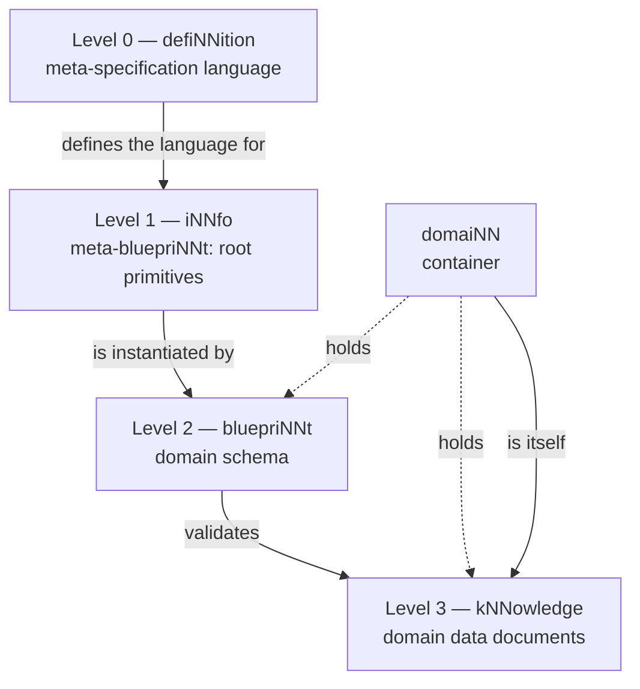

# The four levels

A knowledge system has to answer two different questions at once: *what shape may a
document take?* and *what does this particular document actually say?* Mixing the two
in one file makes every model as heavy as the language that describes it, and makes a
change to the language break every model. cogNNitive separates them into a chain of
four levels, each one a document that conforms to the level above it.

## The problem

Most tools either enforce a schema the data cannot carry with it, or store free-form
text that no machine can check. cogNNitive's answer is a **parent chain**: a data
document declares the schema it follows, that schema declares the language it follows,
and the language declares the meta-language that defines it. Every level is a plain
Markdown file, so the whole chain is readable, diffable, and portable.

## The model

| Level | Term | Role |
|---|---|---|
| 0 | `defiNNition` | The meta-specification language. Defines levels, versioning conventions, normative language, terminology discipline, and how a parent chain resolves. |
| 1 | `iNNfo` | The concrete specification (a *meta-bluepriNNt*). Defines the root primitives — `Concept Definition`, `Field Definition`, `Matrix Definition` — and the unified `NN` syntax. |
| 2 | `bluepriNNt` | A domain schema. An ordinary iNNfo document that instantiates the root primitives to declare the Concepts, Fields, and Matrices of a domain. |
| 3 | `kNNowledge` | A domain data document. Lightweight: it carries only data and a pointer to its parent bluepriNNt. |

Each level **adds** constraints; it never relaxes the ones above it. The level-1
`iNNfo` document is itself written in the syntax it constrains (a self-describing
metaschema), and every level-2 `bluepriNNt` is an ordinary iNNfo document whose
`… Definition` elements *are* its schema. There is no separate declaration format.

## A bluepriNNt validates kNNowledge

A `bluepriNNt` is not documentation about a domain — it is an executable contract. It
declares which Concepts exist, which Fields each Concept carries, which values are
allowed, and which relationships are legal. A `kNNowledge` document is then checked
against that contract: unknown Concepts, out-of-set `select` values, duplicate slugs,
and undeclared nesting are all rejected deterministically. The validator is described
in [Validator behavior](validator-behavior.md).

## A domaiNN is itself a kNNowledge document

A **`domaiNN`** is the container: the directory that holds `kNNowledge/`, the adopted
bluepriNNts, `sources/`, `procedures/`, and `artifacts/`. Its entry point is a
`domaiNN_NN.md` file. Crucially, that container is **not a special kind of thing** —
it is itself a level-3 `kNNowledge` document, governed by the `domaiNN` bluepriNNt.
The system's own container follows the same rules as the data inside it.

## Why it matters

- **Rich specs, lean data.** Only levels 0–2 carry semantics. A level-3 document is a
  few fields plus a parent pointer, so it stays cheap to read and to diff.
- **One resolver for everything.** Because every document points at its parent, the
  engine can walk from any data file up to level 0 and cache the chain.
- **No duplicated schema.** A model never repeats the specification; it references it.
- **Uniform tooling.** The same parser, validator, and console handle every level.

## See also

- [Ecosystem architecture](ecosystem.md)
- [The specification chain](specifications.md)
- [Canonical vocabulary](../vocabulary.md)
- [Create your first domaiNN](../tutorials/first-domain.md)
- [Home](../../README.md)
