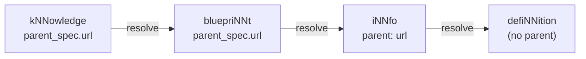

# The specification chain

Every cogNNitive document declares what it conforms to. That declaration is not a
convention — it is the mechanism the engine uses to find, load, and check the schema a
document was written against. This page explains how a document resolves its parent
chain, how the versions work, and why the parent URL is never baked into the code.

## The problem

If a tool "just knows" which schema to use, then two things go wrong. First, a document
becomes impossible to validate in isolation: you have to run the *right* tool version.
Second, the moment the schema changes, every stored document is silently reinterpreted
against the new shape. cogNNitive avoids both by making the document itself carry a
pointer to the exact, immutable version of its parent.

## The parent chain

Each document names its parent in frontmatter:

- A **level-1** document (`iNNfo`) declares its level-0 parent as a string `parent:` URL.
- A **level-2** `bluepriNNt` and a **level-3** `kNNowledge` document declare
  `parent_spec:` as an object with `name` and `url`:

```yaml
parent_spec:
  name: "iNNfo_V_0-5-0"
  url: "https://raw.githubusercontent.com/cogNNitive/cogNNitive-web/main/iNNfo/specs/iNNfo_V_0-5-0_NN.md"
```

From any document the engine can walk upward: `kNNowledge → bluepriNNt → iNNfo →
defiNNition`. Each step resolves the parent it names and caches the result, so a model
is functionally self-contained without duplicating any specification text.



## Versions: three keys, three scopes

cogNNitive versions are written `V_x-y-z` (SemVer-style, e.g. `V_0-5-0`). The same
document can carry more than one version key, and they mean different things:

| Key | Level | What it versions |
|---|---|---|
| `spec_version` | L2, L3 | The iNNfo specification format the document conforms to. |
| `blueprint_version` | L2 | The bluepriNNt package itself. |
| `knowledge_version` | L3 | The individual kNNowledge document. |

So a level-2 bluepriNNt carries both `spec_version` (the iNNfo version it follows) and
`blueprint_version` (its own package version). A level-3 document carries `spec_version`
and `knowledge_version` — never `blueprint_version` and never a version in its filename.

> [!NOTE]
> The level-3 version key is `knowledge_version`. The retired key `model_version` is not
> read; the version also never appears in the file name. See
> [Canonical vocabulary](vocabulary.md).

## Why the URL is never hardcoded

The engine resolves a specification **from an explicit URL
or from a loaded document's `parent_spec.url`** — never from an internal constant, and
never from a hardcoded blueprint name (the `get_spec` and `get_blueprint` tools expose
this to your agent). This is deliberate:

- **The document is the authority.** The version a model was authored against is the
  version the engine resolves, so old documents keep validating against old schemas.
- **Immutability makes it safe.** Published specs are frozen: a released version file is
  never modified. Corrections require a new version, and migrating a document means
  creating a new copy adapted to the new version.
- **No hidden coupling.** There is no "current spec" constant in the engine that could
  disagree with what a document declares.

## Resolution order

When a bluepriNNt is referenced by name rather than by URL, the resolver searches in a
fixed precedence: the local `domaiNN`'s `specs/bluepriNNts/` package directory first, then
the flat `specs/` fallback, then the global `~/.agents/bluepriNNts/` store, then the
bluepriNNts bundled with installed skills. The search paths and the "searched:"
diagnostic come from one shared list, so where a bluepriNNt is *found* cannot drift from
where the engine claims to have *looked*. See [Validator behavior](validator-behavior.md)
for how resolution failures surface as diagnostics.

## See also

- [The four levels](levels.md)
- [Ecosystem architecture](ecosystem.md)
- [Canonical vocabulary](vocabulary.md)
- [bluepriNNts catalog](../reference/blueprints.md)
- [MCP tools](../reference/mcp-tools.md)
