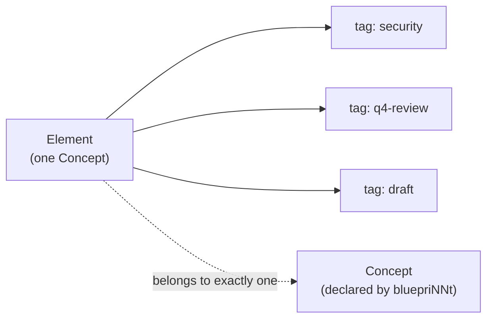

# Tags and open taxonomy

cogNNitive has two layers of classification. The first is **structural**: a bluepriNNt
declares a taxonomy of Concepts and the parent-child edges between them. The second is
**cross-cutting**: `tags`, a free-form label an author attaches to any element. This page
explains why tags are deliberately ordinary, and what "no reserved primitive" means.

## The problem

A strict taxonomy is necessary — it is what makes validation possible — but it is a bad
fit for questions that cut across the structure: "show me everything that touches
security", "which elements came from this quarter's review?". Forcing those into the
schema would mean inventing a Concept for every passing concern. The answer is a second,
open layer that does not disturb the schema.

## The model

`tags` is **not a reserved property and not a primitive**. It is an ordinary Field of type
`select` with `multiple:: true`, declared by a bluepriNNt exactly like any other Field:

```markdown
# NN Field Definition

## NN Field Definition: tags
concept:: *
type:: select
multiple:: true
```

- Because it is a normal Field, it validates like any other: an element's tag values are
  checked against the Field's declared `options`, and it can be queried and filtered like
  any other Field.
- A tag is simply **a value of the `tags` Field**. There is no special tag object, no tag
  registry, and no dedicated primitive behind it.
- A **flag** is a single tag value (e.g. `tags:: [reviewed]`); a **valued** marker is just
  a normal declared Field.



## No Marker primitive

Older versions of the format had a dedicated **Marker** primitive — `Marker Definition`
elements and an `item-markers` matrix. That primitive was **retired in iNNfo V_0-5-0**.
A document that still carries one fails validation with `MARKERS_REMOVED`, and the fix is
mechanical: a flag marker becomes a value of the `tags` Field, and a valued marker becomes
a normal declared Field. There is no migration flag and no legacy mode — the construct is
simply gone.

## Cross-cutting classification and view filtering

Because a tag is independent of the Concept an element belongs to, one tag can span many
Concepts and one element can carry many tags. That is what makes tags *cross-cutting*:
they express concerns the structural taxonomy does not.

And because `tags` is an ordinary Field, the ordinary tooling works on it — no special
case required. Query and filter operations select elements by tag value the same way they
select by any other Field, and the domain console's views can group or filter by tag. The
open vocabulary is what lets a team invent a label today and start filtering on it without
a schema change.

## Why it matters

- **The taxonomy stays honest.** Structural meaning lives in the bluepriNNt; passing
  concerns do not pollute it.
- **Nothing is special-cased.** Treating tags as a plain Field means one grammar, one
  validator, one query engine — fewer moving parts, fewer surprises.
- **The layer is open.** New classifications are additive; they never require a new
  primitive.

## See also

- [Canonical vocabulary](../vocabulary.md)
- [Validator behavior](validator-behavior.md)
- [The four levels](levels.md)
- [MCP tools](../reference/mcp-tools.md)
