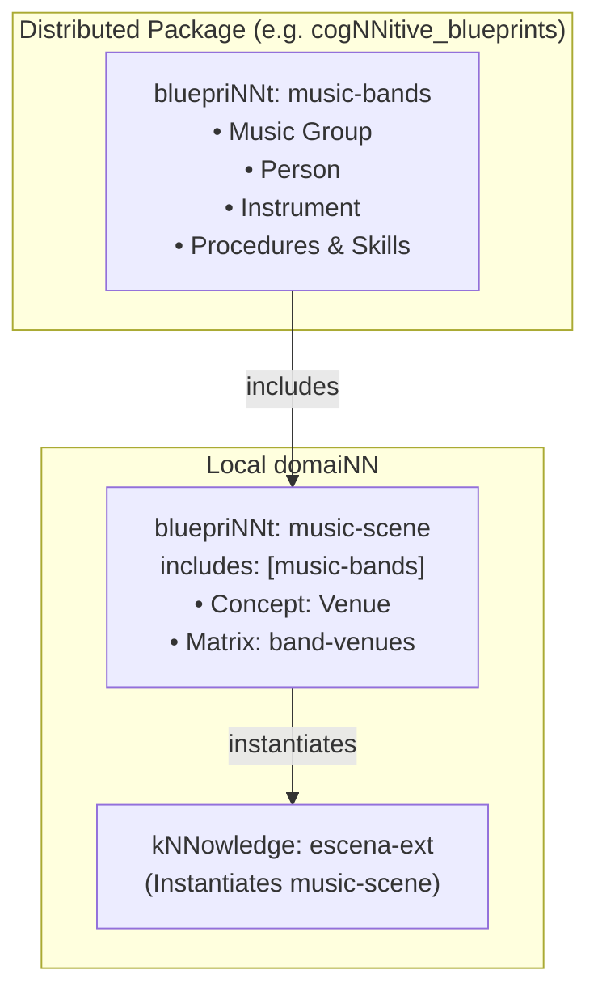

# Compose distributed bluepriNNts

Extend an independent or upstream **bluepriNNt** (Level-2 schema) by composing it in a local bluepriNNt with `includes`. This guide shows how to import distributed packages, add domain-specific concepts, wire cross-cutting matrices, and inherit operational procedures and agent skills without copying or modifying the original package.

Read [The specification chain](../concepts/specifications.md) and [The four levels](../concepts/levels.md) first if the level hierarchy or `parent_spec` resolution are new.

## Quick path

1. **Obtain the distributed package**: place or clone the distributed bluepriNNt into `specs/bluepriNNts/<package-name>/`.
2. **Declare the local bluepriNNt**: create `specs/bluepriNNts/<local-name>/spec_NN.md` and declare `includes:` referencing the distributed package.
3. **Add local concepts and fields**: declare only your domain-specific concepts and fields. Use a consistent prefix to avoid collision.
4. **Wire cross-cutting matrices**: create evaluable matrices that cross imported concepts with local concepts.
5. **Instantiate in kNNowledge (Level 3)**: create a kNNowledge document whose `parent_spec` points to your local composite bluepriNNt.
6. **Validate**: run your agent's domain validation check and review in the domain console.

---

## The copy-paste trap vs. additive composition

When modeling a domain, you will often find an existing, well-tested bluepriNNt (such as `music-bands` in the `cogNNitive_blueprints` repository) that provides 80% of what your project needs.

Without composition, authors fall into the **copy-paste trap**:
- Copying the entire upstream `spec_NN.md` file into the local domaiNN to add one or two custom concepts.
- **Why this fails**: The moment the file is copied, all connection to upstream updates, bugfixes, and schema improvements is severed. If the upstream package updates its validation rules or adds new standard fields, the local copy is frozen in time.
- **Why monolithic blueprints fail**: Requesting that every edge-case concept be added to the canonical upstream package bloats it into an unmaintainable monolith.

**Additive composition with `includes`** solves both problems: the upstream package remains canonical, lean, and independently versioned, while your local domaiNN authors only the differential concepts it uniquely requires.



---

## 1. Place the distributed package (Tier-1 resolution)

A distributed bluepriNNt is packaged as a directory containing its specification, procedures, and skills:

```
specs/bluepriNNts/music-bands/
  ├── spec_NN.md
  ├── procedures/
  │   └── add_music_group_procedures_NN.md
  └── skills/
      └── nn-music/
          ├── SKILL.md
          └── scripts/
```

When placed inside your domaiNN's `specs/bluepriNNts/` folder, cogNNitive's resolver recognizes it as a **Tier-1 Workspace Blueprint** (`resolveBlueprintPackage`). It resolves immediately in memory with **zero network requests**, allowing completely offline operation.

---

## 2. Declare the composite bluepriNNt with `includes`

Create your local bluepriNNt at `specs/bluepriNNts/music-scene/spec_NN.md`. Use the `includes` key in the frontmatter:

```markdown
---
spec_version: "V_0-9-0"
spec_url: "specs/bluepriNNts/music-scene/spec_NN.md"
level: 2
parent_spec:
  name: "iNNfo_V_0-9-0"
  url: "https://raw.githubusercontent.com/cogNNitive/cogNNitive-web/main/iNNfo/specs/iNNfo_V_0-9-0_NN.md"
blueprint_name: "music-scene"
blueprint_version: "V_0-1-0"
title: "Music Scene (Composite Extension)"
includes:
  - name: "music-bands"
    url: "https://raw.githubusercontent.com/cogNNitive/cogNNitive_blueprints/main/iNNfo/specs/bluepriNNts/music-bands/spec_NN.md"
relationship_types:
  hierarchy:
    enabled: true
    via: "index block"
  evaluable_matrix:
    enabled: true
  graph_edge:
    enabled: true
  sequence:
    enabled: false
---

# NN index

* [[Venue]]

# NN Concept Definition

## NN Concept Definition: Venue
slug:: venue
icon:: building-2
type:: list
color:: emerald
weight:: 70

# NN Field Definition

## NN Field Definition: venue-city
slug:: venue-city
concept:: Venue
type:: string
description:: City where the venue is located.

## NN Field Definition: venue-capacity
slug:: venue-capacity
concept:: Venue
type:: number
description:: Maximum patron capacity.
```

> [!TIP]
> **Naming convention**: Prefix local field slugs with the local concept name (e.g. `venue-city` instead of a generic `city`). This guarantees that if the upstream package later introduces a field with a similar semantic role (e.g. `origin-city` on `Music Group`), no collision occurs.

---

## 3. Wire cross-cutting matrices

One of the most powerful features of bluepriNNt composition is that imported concepts and local concepts share a single unified namespace. You can declare evaluable matrices that cross an imported concept with a local concept:

```markdown
# NN Matrix Definition

## NN Matrix Definition: band-venues
slug:: band-venues
source:: Music Group
target:: Venue
widget:: text
widget_config:: {"max_length": 80}
description:: Historical concert performances: records which bands played at which venues and when.
```

Here, `Music Group` is declared in the distributed `music-bands` package, and `Venue` is declared in the local `music-scene` bluepriNNt. The engine validates the matrix coordinates across both boundaries seamlessly.

---

## 4. Transitive procedure and skill inheritance

Distributed bluepriNNt packages are not passive schemas — they carry operational knowledge:
- **Executable procedures** under `procedures/` (such as guided workflows to ingest or verify data).
- **Specialized agent skills** under `skills/` (such as `nn-music` with validation and rendering scripts).

When your local bluepriNNt includes `music-bands`, the ecosystem's MCP tools (`list_blueprint_procedures`, `list_blueprint_skills`, `execute_procedure`) discover and expose all included procedures and skills transitively. Your AI agents can run upstream procedures directly in your composite domaiNN.

---

## 5. Instantiate in kNNowledge (Level 3)

Create your domain data model under `kNNowledge/escena-ext_music-scene_NN.md`. Its `parent_spec` points to your local composite bluepriNNt:

```markdown
---
spec_version: "V_0-9-0"
spec_url: "https://raw.githubusercontent.com/cogNNitive/cogNNitive-web/main/iNNfo/specs/iNNfo_V_0-9-0_NN.md"
knowledge_slug: "escena-ext-music-scene"
level: 3
parent_spec:
  name: "music-scene"
  url: "specs/bluepriNNts/music-scene/spec_NN.md"
knowledge_version: "V_0-1-0"
blueprint_version: "V_0-1-0"
title: "Escena Extendida"
---

# NN Music Group

## NN Music Group: The Beatles
slug:: the-beatles
name:: The Beatles
origin-city:: Liverpool
origin-country:: United Kingdom
genres:: [rock, pop]
status:: disbanded
formed-year:: 1960
dissolved-year:: 1970

# NN Venue

## NN Venue: Cavern Club
slug:: cavern-club
name:: Cavern Club
venue-city:: Liverpool
venue-capacity:: 250

# NN matrices: band-venues
| Music Group \ Venue | Cavern Club |
| :--- | :---: |
| The Beatles | 1961-1963 |
```

Remember to register the document in your [`domaiNN_NN.md`](../../../domaiNN_NN.md) manifest:

```markdown
# NN kNNowledge

## NN kNNowledge: Escena Extendida
path:: kNNowledge/escena-ext_music-scene_NN.md
blueprint:: [[music-scene]]
status:: active
```

---

## 6. Schema mutations vs. data changesets

When extending and maintaining a composite domaiNN:

- **Schema changes (Level 2)**: Operations such as `add_concept`, `add_field`, or `add_matrix` target the bluepriNNt file in `specs/bluepriNNts/`. Attempting schema operations on a Level-3 kNNowledge document is strictly refused by the engine (`SCHEMA_OP_ON_LEVEL3`).
- **Data changes (Level 3)**: Content mutations (`add_element`, `update_field`, `update_matrix_cell`) are proposed and applied via changesets under `changes/`. Matrix cell targets use the compound syntax:
  `<model-id>@<matrix-slug>&<row-element>&<col-element>`.

---

## See also

- [bluepriNNts catalog](../reference/blueprints.md)
- [The four levels](../concepts/levels.md)
- [The specification chain](../concepts/specifications.md)
- [Review changesets](review-changesets.md)
- [Distribute a concept](distribute-a-concept.md)
