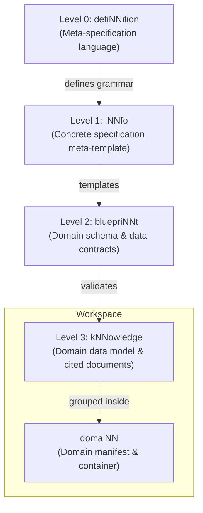

# The Levels of cogNNitive

cogNNitive organizes information into four strictly typed abstraction layers, from foundational meta-specifications down to real-world domain data.

## Level Breakdown

### Level 0: defiNNition
The bedrock grammar. It specifies how comments, headings, property blocks (`key:: value`), and brackets are parsed across all tools.

### Level 1: iNNfo
The meta-blueprint standard. It defines how schemas, field types, enums, and inheritance work.

### Level 2: bluepriNNt
Schemas tailored to specific business domains (e.g. `business`, `code-architecture`, `meetings`, `site`). A bluepriNNt dictates which entities exist and which fields are required.

### Level 3: kNNowledge
The actual documents you write and query every day. Each kNNowledge document references a Level 2 bluepriNNt in its frontmatter (`parent_spec`), declaring conformance.
