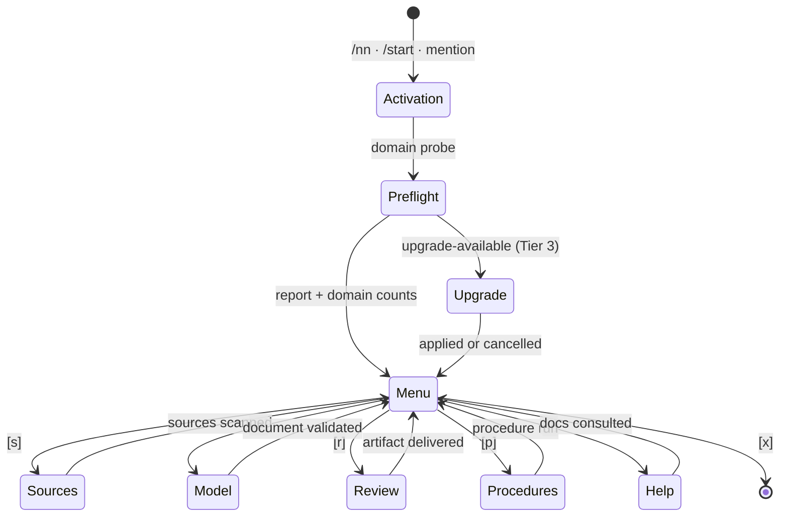
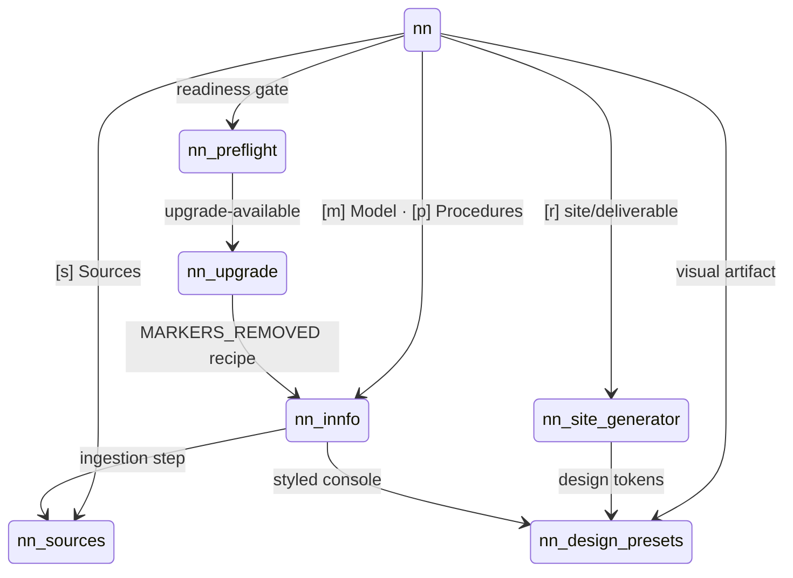

# Interaction flows

The cogNNitive skills are not independent commands: they form a routing graph whose hub is
[nn](nn.md). `nn` owns the job loop, and each stage hands off to the skill that owns the actual
work. This page maps the real hand-offs.

## Entry and job loop

`nn` is the sole gate owner for a session: it runs the [nn-preflight](nn-preflight.md) domain probe
once, then presents the loop. The other skills delegate their activation gate to `nn-preflight` and
skip it when `nn` already ran it.

## Skill hand-offs

## Transitions

| From | Trigger | To |
|---|---|---|
| Entry | `/nn`, `/start`, or a mention of `cognnitive`/`cogNNitive` | [nn](nn.md) |
| [nn](nn.md) | Activation → domain probe | [nn-preflight](nn-preflight.md) |
| [nn](nn.md) | `[s] Sources` selected | [nn-sources](nn-sources.md) |
| [nn](nn.md) | `[m] Model` selected | [nn-innfo](nn-innfo.md) |
| [nn](nn.md) | `[r] Review & Deliverables` → site or web deliverable | [nn-site-generator](nn-site-generator.md) |
| [nn](nn.md) | `[p] Procedures` → procedure selected | [nn-innfo](nn-innfo.md) (Procedure Execution Protocol) |
| [nn](nn.md) | Visual artifact requested (console, dashboard, site) | [nn-design-presets](nn-design-presets.md) |
| [nn-preflight](nn-preflight.md) | Tier-3 scan reports `upgrade-available` | [nn-upgrade](nn-upgrade.md) |
| [nn-upgrade](nn-upgrade.md) | Impact analysis finds a marker-bearing document | [nn-innfo](nn-innfo.md) (`MARKERS_REMOVED` recipe) |
| [nn-innfo](nn-innfo.md) | A procedure step declares CLI ingestion | [nn-sources](nn-sources.md) |
| [nn-innfo](nn-innfo.md) | Console/HTML artifact must be styled | [nn-design-presets](nn-design-presets.md) |
| [nn-site-generator](nn-site-generator.md) | Design tokens needed for generated pages | [nn-design-presets](nn-design-presets.md) |
| [nn-skills-lifecycle](nn-skills-lifecycle.md) | Activation gate / path lookup | [nn-preflight](nn-preflight.md) |

## Declared dependencies

Beyond runtime hand-offs, skills declare hard dependencies in the distribution manifest. Those
dependencies are installed and updated together, and they define the minimum working set for a
workflow:

- [nn-sources](nn-sources.md) requires [nn-innfo](nn-innfo.md) and [nn-preflight](nn-preflight.md).
- [nn-upgrade](nn-upgrade.md) requires [nn-preflight](nn-preflight.md).
- [nn-skills-lifecycle](nn-skills-lifecycle.md) requires [nn-preflight](nn-preflight.md).

## See also

- [Agent skills overview](README.md) — what a skill is and how the ecosystem is composed.
- [nn](nn.md) — the front controller that owns the loop.
- [nn-preflight](nn-preflight.md) — the shared activation gate and Tier-3 detection.
