# cogNNitive Documentation: master document

Every page of this documentation suite in one file, in the order the sidebar shows them.
Generated from the DocSite model (`documentation_NN.md`) by
`node scripts/generate-docs-master.mjs`, which `npm run regen` runs: do not edit it by hand,
and do not copy it back into the pages below it.

39 pages.

## Contents

- [Home](README.md)
- [Agent skills overview](content/skills/README.md)

**🚀 Tutorials**

- [Create your first domaiNN](content/tutorials/first-domain.md)
- [Model a domain from scratch](content/tutorials/domain-from-scratch.md)

**📖 How-To Guides**

- [Install and connect an AI agent](content/how-to/install-agent.md)
- [Validate a domaiNN](content/how-to/validate-domain.md)
- [Import and cite sources](content/how-to/import-sources.md)
- [Cognitivize documents with sidecars](content/how-to/cognitivize.md)
- [Use the domain console](content/how-to/domain-console.md)
- [Review changesets](content/how-to/review-changesets.md)
- [Distribute a concept](content/how-to/distribute-a-concept.md)
- [Sync lineage and back up a domaiNN](content/how-to/sync-and-backup.md)
- [Synchronize an external origin](content/how-to/synchronize-an-origin.md)
- [Collaborate with Git](content/how-to/collaborate-git.md)
- [Execute a procedure](content/how-to/execute-procedure.md)

**💡 Architecture & Concepts**

- [The mental model: from raw source to audited knowledge](content/concepts/mental-model.md)
- [The four levels](content/concepts/levels.md)
- [The entity-relationship model](content/concepts/entity-relationship.md)
- [Ecosystem architecture](content/concepts/ecosystem.md)
- [The specification chain](content/concepts/specifications.md)
- [Canonical vocabulary](content/vocabulary.md)
- [The knowledge lifecycle](content/concepts/knowledge-lifecycle.md)
- [Sources, citations and lineage](content/concepts/sources-citations-lineage.md)
- [Storage and identity](content/concepts/storage-and-identity.md)
- [Tags and open taxonomy](content/concepts/tags-and-taxonomy.md)
- [Validator behavior](content/concepts/validator-behavior.md)
- [Integrations and discipline overlaps](content/concepts/integrations.md)
- [Interaction flows](content/skills/interaction-flows.md)

**🛠 Reference**

- [MCP tools](content/reference/mcp-tools.md)
- [bluepriNNts catalog](content/reference/blueprints.md)
- [CLI and scripts](content/reference/cli.md)
- [Glossary](content/reference/glossary.md)

**⚡ Agent Skills**

- [nn](content/skills/nn.md)
- [nn-sources](content/skills/nn-sources.md)
- [nn-innfo](content/skills/nn-innfo.md)
- [nn-preflight](content/skills/nn-preflight.md)
- [nn-update](content/skills/nn-update.md)
- [nn-site-generator](content/skills/nn-site-generator.md)
- [nn-skills-lifecycle](content/skills/nn-skills-lifecycle.md)

---

# cogNNitive Documentation

Welcome to the **cogNNitive Documentation**.

This documentation site is powered by **Docsify Zero-Build**:
- The catalog, categorization and order are defined in the domaiNN metadata (`documentation_NN.md`).
- The content is standard Markdown files with full support for tables, lists, callouts, and Mermaid diagrams.
- **Zero build steps**: Edit any `.md` file, refresh your browser, and you are done.

Select any guide or tutorial from the sidebar to get started!

---

# Agent skills overview

An **agent skill** is a self-contained instruction package that extends an AI coding agent with a
cogNNitive workflow. A skill is a directory with a `SKILL.md` file — Markdown with YAML
frontmatter — plus any scripts, packaged bluepriNNts, and reference material the workflow needs. The agent
loads a skill on demand (by trigger phrase or by explicit invocation) and follows it like an
operating procedure.

Skills are the interface between a plain coding agent and the cogNNitive ecosystem. They do not
reimplement the engine: they drive the deterministic tools — the `nn-mcp` server and the CLI
scripts — and keep the agent inside the consent and provenance rules of the platform.

## How the ecosystem is composed

A skill package has three parts:

1. **`SKILL.md`** — the instructions. The frontmatter declares the skill `name`, a `description`
   (which doubles as its activation trigger list), and metadata such as `requires`, `mcp`, and
   `bundled_blueprints`.
2. **Scripts** — deterministic helpers under the skill folder (for example the source scanner in
   `nn-sources/scripts/index.js`, or the skill manager in `nn-skills-lifecycle/scripts/`).
3. **Reference material** — presets, reference sheets, and any bluepriNNts the skill ships.

Skills compose through declared dependencies. The `requires` list in the distribution manifest
names the skills a skill depends on, and `nn-preflight` is the common dependency because it owns
the activation gate every skill delegates to. See [Interaction flows](content/skills/interaction-flows.md) for
the full hand-off map.

## Skills

The catalog below is generated from `manifest/source.yaml`, so it lists exactly the skills the ecosystem distributes, with their pinned versions.

<!-- generated:skills-catalog (source: manifest/source.yaml; run node scripts/generate-docs-facts.mjs) -->
**7** skills

| Skill | Version | Description |
|-------|---------|-------------|
| [`nn`](content/skills/nn.md) | `V_3-4-3` | Primary Front Controller, ecosystem entry point, job loop menu ([s] Sources, [m] Models, [r] Review/Artifacts, [p] Procedures, [h] Help, [x] Cancel), system governance, and preflight readiness gate. Triggers: /nn, NN, nn, cognnitive, cognitive, start, router. |
| [`nn-sources`](content/skills/nn-sources.md) | `V_3-5-4` | Ingest documents (PDF, DOCX, XLSX), normalize them into citable sources with mandatory sidecar provenance, and keep source lineage in sync. |
| [`nn-innfo`](content/skills/nn-innfo.md) | `V_0-5-13` | Author, edit, and validate iNNfo knowledge with built-in step-by-step Model Creation Wizard. |
| [`nn-preflight`](content/skills/nn-preflight.md) | `V_0-2-5` | Environment readiness gate (Tier 1/Tier 2/Tier 3) and canonical skill-location reference. |
| [`nn-update`](content/skills/nn-update.md) | `V_0-4-2` | Guided, consent-gated migration of a domaiNN to the latest adopted iNNfo Level-2 blueprints. |
| [`nn-site-generator`](content/skills/nn-site-generator.md) | `V_0-3-0` | Create or edit websites, add analytics, add contact forms, and apply the cogNNitive visual design presets — palettes, typography, spacing. |
| [`nn-skills-lifecycle`](content/skills/nn-skills-lifecycle.md) | `V_1-3-1` | Audit, update, and maintain cogNNitive skills. |
<!-- /generated:skills-catalog -->

A skill may also be **embedded** inside a bluepriNNt package under `skills/<name>/SKILL.md`, or
**referenced** as an opt-in third-party skill pinned to a commit. Embedded and
referenced skills are discovered through the parent chain rather than installed from the manifest;
see [nn-skills-lifecycle](content/skills/nn-skills-lifecycle.md) for the difference.

## Installing and bootstrapping skills

Skills are distributed from the cogNNitive repository and pinned by commit in a bootstrap
manifest. The manifest is the **desired state**; what is actually installed on a machine is
recorded locally per skill in `~/.agents/bootstrap-state.json` (the "installed state"). The two
must agree — a skill is only up to date when its installed commit matches the pinned commit.

To install or update the manifest-pinned skills, use [nn-skills-lifecycle](content/skills/nn-skills-lifecycle.md),
which wraps the bundled, zero-dependency manager:

```bash
node scripts/skills-manager.js status    # compare installed commits against the pins
node scripts/skills-manager.js install   # install missing skills at their pinned commit
node scripts/skills-manager.js update    # update outdated skills at their pinned commit
```

Every mutating command requires explicit consent; without a TTY and without `--yes`, the manager
prints `needs decision: ...` and exits without applying anything. The bootstrap manifest also
declares the `nn-mcp` bundle, which is downloaded into the agent's MCP directory and registered in
the agent's MCP configuration. For a full walkthrough, see
[Install and connect an AI agent](content/how-to/install-agent.md).

> [!NOTE]
> Skills never link or symlink back to their source. Every install, update, and sync is a plain
> copy, so an installed skill cannot be edited by accident.

## Activation and the `nn` entry point

Every cogNNitive skill executes the same **canonical activation gate**, owned by
[nn-preflight](content/skills/nn-preflight.md): a session greeting banner followed by a deterministic integrity
check. A consumer skill delegates to that protocol instead of duplicating it, and skips the check
when `nn` already ran it in the same session.

The ecosystem entry point is [nn](content/skills/nn.md). It activates on `/nn`, `/start`, or any mention of
`cognnitive`/`cogNNitive`, runs the domain probe, and presents the job-loop menu
(`[s] Sources`, `[m] Models`, `[r] Review/Artifacts`, `[p] Procedures`, `[h] Help`, `[x] Cancel`).
From there it routes the user's intent to the owning skill. Most users only ever need to start
`nn`; the specialized skills are reached through it.

## See also

- [Interaction flows](content/skills/interaction-flows.md) — how the skills hand off to one another from `nn`.
- [Install and connect an AI agent](content/how-to/install-agent.md) — register the MCP server and download the skills.
- [Ecosystem architecture](content/concepts/ecosystem.md) — where skills sit among the engine, MCP server, and console.

---

# Create your first domaiNN

> [!NOTE]
> This tutorial takes about five minutes. You drive a local AI coding agent — Claude Code, OpenCode, Antigravity, or Cursor — that has the cogNNitive skills and the `nn-mcp` server installed. You express intent in plain language; the agent does the work, and you review the result in the console.

A **domaiNN** is the container that holds your knowledge: kNNowledge documents, bluepriNNts, sources, procedures, and artifacts. In this tutorial you create one, bring in a single raw file, and turn it into a cited kNNowledge document that passes validation — all by talking to your agent.

> [!TIP]
> The agent works in whatever language you write in. The prompts below are in English; use your own language and the agent answers and acts in it.

## 1. Connect your agent

Open your agent in the folder where you want to work and paste this single instruction:

> I want to use https://cognnitive.com/use

The agent fetches the bootstrap manifest, installs the cogNNitive skills, and registers the `nn-mcp` server. When it is ready, start the job loop by typing `/nn` — the agent greets you and offers the menu:

```text
[s] Sources  ·  [m] Model  ·  [r] Review & Deliverables  ·  [p] Procedures  ·  [h] Help  ·  [x] Cancel
```

**How you check it worked:** the agent lists its capabilities and shows the `nn` menu without errors. If something is missing, see [Install and connect an AI agent](content/how-to/install-agent.md).

## 2. Create the domaiNN

> Create a new domaiNN here called "My Domain".

The agent scaffolds the standard layout and announces what it created. You will see:

| Path | What it holds |
|---|---|
| `domaiNN_NN.md` | The domain manifest (itself a kNNowledge document). |
| `kNNowledge/` | Your Level-3 kNNowledge documents. |
| `sources/import/` | The drop box for raw files you bring in. |
| `sources/conversations/` | Promoted conversation transcripts. |
| `artifacts/` | Every generated or curated output. |
| `procedures/` | Procedure definitions. |
| `changes/` | Proposed and applied changesets. |
| `staging/` | Scratch space (never citable). |

**How you approve:** building the standard layout is safe and reversible, so the agent proceeds without stopping you. It tells you where the domaiNN landed; if you wanted a different name or location, say so before it continues. It will not scaffold into a folder that already holds other work.

## 3. Bring in a source

Knowledge starts outside the tool. Save any text file — meeting notes, a short brief, a spec — into `sources/import/`:

```text
My-Domain/sources/import/meeting-notes.md
```

Then tell your agent:

> Import everything in `sources/import` and make it citable.

The agent scans the folder and, for each file, writes a **sidecar** next to it (`meeting-notes.md_sidecar_NN.md`) that records the file's hash and metadata. The raw file is never moved, renamed, or rewritten — it stays exactly as you saved it.

**How you check it worked:** a sidecar appears beside each raw file, and the console's Sources view lists them as citable.

## 4. Create your first kNNowledge document

A kNNowledge document is modeled from a **bluepriNNt** — a reusable domain schema. Ask your agent:

> Create a business kNNowledge document for My Domain, and model a customer element that cites the meeting notes.

The agent scaffolds the document from the `business` bluepriNNt, adds the element, and points its source at the exact heading the claim came from. It records the creation as a proposed change — never a silent edit.

**How you approve:** see the next step.

## 5. Review and approve

Every change the agent makes to your knowledge is a **changeset**: proposed, reviewed, then applied. The agent writes the proposal, regenerates the domain console, and opens it.

**How you review:** the console shows the change as a diff you can inspect. Add comments or corrections there if you want. When it looks right, reply **OK** to your agent; it applies the change atomically, bumps the document's version once, and re-points the citation at the change that touched it. Nothing is applied until you approve. See [Review changesets](content/how-to/review-changesets.md).

## 6. Validate

Ask your agent to check the result:

> Validate the domaiNN and fix anything that is wrong.

The agent reports in plain language. A clean domaiNN resolves every citation. If a heading was mistyped, it tells you which element and heading do not match and offers the closest match; if a file moved, it flags the broken link. You approve any fix as a new changeset.

## What you built

You now have a domaiNN with a manifest, a citable source, and a validated kNNowledge document that cites a heading of that source. That is the smallest complete cogNNitive unit: a claim, its evidence, and a container that tracks both.

## Next steps

- [Model a domain from scratch](content/tutorials/domain-from-scratch.md) — a longer walkthrough that adds an artifact and the change that records it.
- [The four levels](content/concepts/levels.md) — the concepts behind `defiNNition`, `iNNfo`, `bluepriNNt`, and `kNNowledge`.
- [Import and cite sources](content/how-to/import-sources.md) — the full citation grammar.

## Under the hood

The agent works through the `nn-mcp` server and the cogNNitive skills; you never call them yourself. For the exact tool and command surface behind these steps, see [MCP tools](content/reference/mcp-tools.md) and the [CLI reference](content/reference/cli.md).

---

# Model a domain from scratch

This is the full hands-on walkthrough, driven entirely by prompts to your local AI coding agent. You will scaffold a domaiNN, bring in a source, model an element that cites it, produce an artifact, propose a change, and read the computed lineage that ties it all together.

The example is a small coffee-subscription business, **Aurora Roasters**, so every step stays easy to follow. The agent works in your language; the prompts below are shown in English.

## What you will build

By the end, your domaiNN holds a manifest, a citable source, a kNNowledge document that cites it, a write-once artifact, the change that recorded it, and the computed lineage:

```text
Aurora/
├── domaiNN_NN.md                     # the manifest (Level-3 container)
├── kNNowledge/
│   └── Aurora_business_NN.md         # a kNNowledge document
├── sources/
│   └── import/
│       ├── discovery-call.md         # raw source
│       └── discovery-call.md_sidecar_NN.md   # its co-located sidecar
├── artifacts/
│   └── Aurora_Monthly_Review_<stamp>.md      # a write-once deliverable
├── changes/
│   └── Aurora_<stamp>_changes_NN.md  # a recorded change
└── changes/                        # the applied changes (provenance)
```

## Step 1 — Scaffold the domaiNN

> Create a domaiNN called Aurora.

The agent builds the manifest, the folder skeleton, and the small bits that keep source fingerprints stable across machines. An empty domaiNN is always scaffolded, never hand-built.

**How you approve:** scaffolding the standard layout is safe and reversible, so the agent proceeds and tells you where the domaiNN landed. Interrupt if you wanted a different name or location.

## Step 2 — Bring in a raw source

Knowledge starts outside the tool. Save an ordinary file into `sources/import/` — untouched, exactly as your team produced it:

```text
Aurora/sources/import/discovery-call.md
```

```markdown
# Discovery call — Aurora Roasters

## Founding team
Maya Ortiz (head roaster) and Tomás Reyes (operations) are equal co-founders.

## The offer
Two 250 g bags a month, roaster's choice, 32 USD per month, shipping included.
```

Nothing has touched this file yet — it is bytes on disk, not a citable Source. Tell your agent:

> Import everything in `sources/import` and make it citable.

The agent scans the folder and writes a **sidecar** next to each raw file. The sidecar carries the file's origin metadata — its hash, size, and format — and the raw file itself is never moved, renamed, or rewritten. For text files like this one, the raw file is the citation target; a binary (PDF, DOCX, XLSX, image) instead carries a normalized text body in its sidecar, and only that body is citable.

**How you check it worked:** a sidecar appears beside the raw file, and the console's Sources view lists it as citable.

## Step 3 — Model an element that cites a heading

A kNNowledge document is modeled from a **bluepriNNt**. Ask your agent:

> Create a business kNNowledge document for Aurora and add a Founding Team element that cites the discovery call.

The agent scaffolds the document from the `business` bluepriNNt and adds the element, pointing its source at the exact heading the claim came from (`## Founding team`). The heading text after the anchor is matched against the source, so the citation resolves to that precise section — no line numbers, and the path is always written in full.

**How you approve:** the agent records the new document and element as a proposed change rather than writing files directly. You review it in Step 5.

## Step 4 — Produce an artifact

An **artifact** is a deliverable the agent generates under `artifacts/`. Ask for one:

> Produce a monthly review artifact for Aurora from the business model.

The agent writes a **write-once** deliverable whose name carries a UTC timestamp, and it cites the kNNowledge document it drew from. Re-run it on unchanged input and it writes nothing; change the input and it writes a new family member beside the old one, so earlier citations still resolve.

**How you check it worked:** the new file appears under `artifacts/` and the console lists it as a deliverable.

## Step 5 — Propose and apply a change

The supported way to mutate a kNNowledge document is a **changeset** — never a direct edit. Ask your agent:

> Change the founding team's relationship to "Equal Co-founders (50/50)", citing the discovery call.

The agent writes a sealed changeset with status *proposed* under `changes/`, regenerates the domain console, and opens it so you can review the diff.

**How you review:** inspect the change in the console and add comments if you want. When you are satisfied, reply **OK**; the agent applies the change atomically, re-validates, bumps the document's version once, and re-points the mutated element's source at the change that touched it — which in turn carries the evidence. The agent never applies anything without your approval. See [Review changesets](content/how-to/review-changesets.md).

## Step 6 — Read the computed lineage

`read_lineage` ties everything together: the inventory from the files and the edges from the applied changes. Ask your agent:

> Show me the lineage of this domain.

It presents three **projected** sections — Sources, ModelRecords, and Artifacts — each derived from the files on disk, plus an append-only journal of every pipeline run. The projected sections are a pure function of the domaiNN's files: if someone edits one by hand, the drift gate reports the mismatch, and the fix is always regeneration by the agent, never a hand edit. See [Sync lineage and back up a domaiNN](content/how-to/sync-and-backup.md).

## Where everything lives

| Path | Role | How it may change |
|---|---|---|
| `domaiNN_NN.md` | Domain manifest (Level-3 container). | Through a changeset. |
| `sources/import/` | Raw, immutable sources and their co-located sidecars. | Write-once; new members, never edits. |
| `kNNowledge/*_NN.md` | Level-3 kNNowledge documents with citations. | Through a changeset. |
| `artifacts/` | Generated and curated outputs. | Write-once (UTC-suffixed). |
| `changes/` | The record of every proposed and applied change. | Append-only. |
| `changes/*_changes_NN.md` | The applied changes: the only provenance record. | Append-only; never edited by hand. |
| `staging/` | Ephemeral extraction buffer. | Never citable, never projected. |

## See also

- [Create your first domaiNN](content/tutorials/first-domain.md) — the five-minute version.
- [Import and cite sources](content/how-to/import-sources.md) — the citation grammar.
- [Sources, citations and lineage](content/concepts/sources-citations-lineage.md) — the provenance chain.

## Under the hood

The agent drives all of this through the `nn-mcp` server and the cogNNitive skills. For the exact tool and command surface — changeset operations, the scan and lineage commands, and the sidecar format — see [MCP tools](content/reference/mcp-tools.md) and the [CLI reference](content/reference/cli.md). You never need to run any of it yourself.

---

# Install and connect an AI agent

cogNNitive is driven by a local AI coding agent. The agent talks to the `nn-mcp` server over the Model Context Protocol (MCP) to validate documents, resolve bluepriNNts, and mutate a domaiNN through changesets. This guide registers the server and installs the agent skills.

## 1. Bootstrap with a single instruction

Open your agent in the folder where you want to work and paste this instruction:

```text
I want to use https://cognnitive.com/use
```

That URL serves the **bootstrap manifest**, which declares the skills, bluepriNNts, the MCP server, and the console assets to install. The agent follows it: it downloads the skills, registers the `nn-mcp` server, and records what it installed.

## 2. What the bootstrap installs

| Artifact | Location | Notes |
|---|---|---|
| Agent skills | `~/.agents/skills/<name>/` | One canonical copy per skill, projected into each agent's skill directory. |
| Install record | `~/.agents/bootstrap-state.json` | One entry per installed skill, with its pinned commit and a per-file content hash. |
| MCP server bundle | `~/.agents/mcp/nn-mcp.bundle.js` | The stdio server the agent launches. |
| Console assets | `~/.agents/console/` | Used when regenerating the domain console outside a checkout. |

The bundle also ships inside the cogNNitive repository at `iNNfo/packages/nn-mcp/bin/nn-mcp.bundle.js`; the installed copy under `~/.agents/mcp/` is what the agent runs day to day.

> [!NOTE]
> The canonical skill under `~/.agents/skills/<name>/` is a real directory copied from the manifest pin. Each agent's skill directory (for example `~/.claude/skills/<name>`) is a **junction/symlink** to that canonical copy so an update is visible everywhere at once. When the OS or filesystem refuses a link — Windows without developer mode, a non-privileged user, or a filesystem that does not support links — the projection falls back to a **mirror copy**, and the install record notes the method so the next update can detect drift. Either way, every install, update, and sync is reproducible from the manifest.

## 3. Register the MCP server

The bootstrap registers `nn-mcp` automatically. The registration writes a `nn-mcp` entry that launches the installed bundle over stdio:

```json
{
  "mcp": {
    "nn-mcp": {
      "type": "local",
      "command": ["node", "/home/<user>/.agents/mcp/nn-mcp.bundle.js"]
    }
  }
}
```

The exact config file depends on the agent:

| Agent | Config file | Shape |
|---|---|---|
| OpenCode | `~/.config/opencode/opencode.json` (or `opencode.jsonc`) | `mcp` block |
| Claude Code | `~/.claude.json` | `mcpServers` block |
| Antigravity | `~/.gemini/antigravity/mcp_config.json` | `mcpServers` block |
| Cursor | Cursor's MCP settings file | `mcpServers` block |

The server binary path is always the installed `~/.agents/mcp/nn-mcp.bundle.js` (or the repo copy at `iNNfo/packages/nn-mcp/bin/nn-mcp.bundle.js` when running from a checkout).

## 4. Verify the connection

Ask the agent to list its tools. You should see the `nn-mcp` tool set — `list_knowledge`, `init_domain`, `validate_knowledge`, `cognitivize`, `propose_changeset`, `apply_change`, and the rest. If the tools are missing:

1. Confirm the bundle exists at `~/.agents/mcp/nn-mcp.bundle.js`.
2. Confirm the config file has an `nn-mcp` entry pointing at that path.
3. Restart the agent so it reloads the MCP configuration.

## See also

- [Agent skills overview](content/skills/README.md) — what the bootstrap installs.
- [MCP tools](content/reference/mcp-tools.md) — the full tool reference.
- [Create your first domaiNN](content/tutorials/first-domain.md) — use the tools end to end.

---

# Validate a domaiNN

Validation is how you know your domaiNN is still sound: every document matches its bluepriNNt, every citation still points at something real, and the domain's internal map agrees with the files. You do not run the checks yourself — you ask your agent, and it reports back in plain language.

## Ask your agent to validate

Tell your agent what you want checked. From the `nn` job loop this is the `[m] Model` stage, but a plain sentence works just as well:

> Validate my domain.

> Check this document against its bluepriNNt.

> Does anything in Aurora look broken?

The agent runs the checks and gives you a summary: which documents are sound, which have problems, and what each problem means for you. Validating changes nothing — it is a read-only health check.

## What you can ask it to check

- **One document** — the agent checks it against the bluepriNNt it declares.
- **The whole domain** — the agent checks every document and the links between them.
- **A single citation** — the agent follows one source reference end to end and tells you whether the file and the section it points at still exist.

## Reading what comes back

Every problem carries the same short code each time it appears, so you can search for it and act on it. You do not need to know the codes — the agent translates them — but here is what the common ones mean and how to react.

| What the agent may report | What it means | What to do |
|---|---|---|
| A cited document moved or is missing | A document cites a source file that is no longer at the recorded path. | Restore the file, or ask the agent to re-point the citation. |
| A cited section no longer exists | The source file is there, but the heading it points at was renamed or removed. | Ask the agent to re-point the citation at the right section. |
| A citation is malformed | The reference does not follow the citation grammar. | Ask the agent to fix the reference. |
| A binary file is cited directly | Media and office files must be cited through their citable companion, not the binary itself. | Ask the agent to cite the companion document. |
| A citation points into scratch space | Files in scratch folders are not part of the record and cannot be cited. | Ask the agent to bring the file into the domain's sources properly. |
| A spreadsheet has no usable key | Row-level citations need a unique, non-empty first column. | Ask the agent to curate the file so it can be cited row by row. |
| Two elements share an identity | Each element needs its own unique slug. | Ask the agent to give each element a distinct slug. |
| A document is missing its bluepriNNt link or version | The document header is incomplete or invalid. | Ask the agent to repair the header. |
| A document's structure does not match its bluepriNNt | Required sections or concepts are absent. | Ask the agent to realign the document with its bluepriNNt. |
| A field or cell drifted | A value was edited by hand after the change that set it. | Report the change that owns the value, or revert the edit. |
| A document is in the wrong folder, or two documents share an identity | A concept stored one document per instance must sit at the path its bluepriNNt declares, and each document needs a unique id. | Ask the agent to move or rename the instance. See [Distribute a concept](content/how-to/distribute-a-concept.md). |
| The same bluepriNNt is pinned at several versions | Within a domaiNN every document must pin the same version of a given bluepriNNt. | Ask the agent to run the upgrade, which repins them all together. |
| A reference does not resolve | A reference field must hold an address (`<hierarchical-id>[@<slug>]`); a title or a file path does not resolve. | Ask the agent to rewrite the reference as an address. |
| A source companion does not match its file | The sidecar's recorded subject disagrees with its name. | Ask the agent to re-run the source's cognitivization. |

> [!NOTE]
> Validation never blocks you and never edits anything. When it finds a problem, the fix goes through the normal review flow — the agent proposes the change, you approve it. See [Review changesets](content/how-to/review-changesets.md).

## See also

- [Validator behavior](content/concepts/validator-behavior.md) — severity, ordering, and the resolution order.
- [Import and cite sources](content/how-to/import-sources.md) — the citation grammar the diagnostics refer to.
- [Storage and identity](content/concepts/storage-and-identity.md) — the layout, identity and version checks.
- [Sync lineage and back up a domaiNN](content/how-to/sync-and-backup.md) — the drift gate in practice.

## Under the hood

The agent drives validation through the `nn-mcp` server — a single-document check, a whole-domain pass, and a citation-resolution step — and relays the results in user terms. The repository's own build gate is separate and not part of your domaiNN. See [MCP tools](content/reference/mcp-tools.md).

---

# Import and cite sources

A **Source** is a file that lives inside your domaiNN and can be cited. You never place or format these files yourself: you tell your agent what to bring in, and the agent puts the file in the right place and makes it citable.

## Tell your agent what to bring in

From the `nn` job loop this is the `[s] Sources` stage. You can also just say what you want:

> Add this folder of meeting notes to the domain.

> Bring in the PDF I just downloaded.

> Import this page: https://example.com/report

The agent takes the file (or folder, or link), places it inside the domain, and makes it citable. You do not copy files or convert anything by hand.

## What "citable" means

Once a file is in the domain, the agent makes it **citable** by writing a small companion document next to it — a **sidecar**. The original file is never changed, moved, or renamed: the sidecar records where the file came from, and the file itself stays exactly as you gave it. See [Cognitivize documents with sidecars](content/how-to/cognitivize.md).

Formats the agent handles directly include text, Markdown, CSV, JSON, HTML, Word, PDF, and Excel. Media like images and audio is not converted — instead, give the agent a transcript or a written description of it, and the agent makes that citable while leaving the media untouched.

## How a citation points at a heading

When the agent builds your model, each element records where its content came from as a **citation**. A citation is not a line number and not an opaque id: it points at a *named unit* inside the source, so it stays readable and survives edits above it.

- In a Markdown or text file, a citation points at a **heading** — for example, the section titled *Key Feedback*.
- In a spreadsheet, it points at a **row** by its key, optionally at a single column.
- In a JSON file, it points at a specific value.
- A whole file can be cited as-is.

Binary files (PDF, Word, Excel, images) are never cited directly — the agent cites their companion document instead, which holds the readable text.

## The rules that keep citations honest

The agent applies these automatically, but they explain why some references are refused:

- A citation names a real unit, never a line range.
- It points at a file inside the domain — scratch folders are not citable.
- It points at real content, never a query or a filter.
- A source is cited once; if an element has no real source, the agent omits the citation entirely.

## See also

- [Cognitivize documents with sidecars](content/how-to/cognitivize.md) — the sidecar in detail.
- [Sources, citations and lineage](content/concepts/sources-citations-lineage.md) — how the three provenance terms relate.
- [Model a domain from scratch](content/tutorials/domain-from-scratch.md) — the full walkthrough.

## Under the hood

The agent ingests through the `nn-sources` skill and the `nn-mcp` server; citations follow the `@` pointer grammar (`path@## Heading`, `csv@RowID&col`, `json@/pointer`). See [CLI and scripts](content/reference/cli.md) and [MCP tools](content/reference/mcp-tools.md).

---

# Cognitivize documents with sidecars

**Cognitivize** is what your agent does to make a raw file citable without touching it: it reads the file and writes a small **sidecar** document next to it. The original file keeps its name, its location, and its exact bytes.

## What a sidecar is

A sidecar is a companion document named after the file it describes and placed right beside it:

```text
<file>.<ext>_sidecar_NN.md
```

For example, a notes file named `discovery-call.md` gets `discovery-call.md_sidecar_NN.md` next to it. The `_sidecar_NN.md` suffix marks it as a kNNowledge document; it is not a copy of your content, just the record that makes the file addressable.

## What the sidecar records

The sidecar holds the file's origin metadata — its name, its size, its detected format, when it was made citable, and a **fingerprint** of the file's exact bytes. That fingerprint is the change-detection key: it lets the agent tell whether the file has changed since it was last recorded.

For text-like files (Markdown, CSV, JSON) the sidecar is just metadata — the raw file itself is what gets cited. For binary files (PDF, Word, Excel) the sidecar also carries the **readable text** the agent extracted, and it is that text that gets cited.

## Why the original is never modified

Your raw file is the evidence. If it were rewritten, its fingerprint would no longer describe what you actually provided, and the whole audit trail would break. So cognitivizing:

- **reads** the file and writes only the sidecar;
- **never** moves, renames, or deletes the file;
- refreshes the sidecar **in place** when the file's bytes change.

Nothing is archived and nothing is snapshotted: a changed file simply gets its sidecar refreshed and a new fingerprint. A file the agent brought in from a link or a conversation is written once with a timestamp, so a later change to the external original lands as a separate entry and your earlier citations stay valid.

## How you trigger it

You do not run anything. Tell your agent what to make citable:

> Make these files citable.

> Refresh the sources for Aurora — some of them changed.

The agent finds the new and changed files and records them. Re-running on an unchanged file does nothing.

## When a source changes

If you edit a file that is already cited, its fingerprint no longer matches. The agent notices, refreshes the record, and warns you if any document cited a section that changed or disappeared. If a cited file is deleted, the agent reports it and keeps the sidecar rather than deleting anything without your consent.

> [!NOTE]
> The agent never rewrites or deletes a source on its own. Cleanup of superseded entries is only ever proposed for your approval.

## See also

- [Import and cite sources](content/how-to/import-sources.md) — how to cite the sidecar and the raw file.
- [Back up a domaiNN](content/how-to/sync-and-backup.md) — the sidecar is the source's normalized evidence.

## Under the hood

The agent cognitivizes through the `nn-sources` skill (any format) and the `nn-mcp` server (text, CSV, and JSON). See [CLI and scripts](content/reference/cli.md) and [MCP tools](content/reference/mcp-tools.md).

---

# Use the domain console

The **domain console** is the window into your domaiNN: a single, self-contained page where you browse your kNNowledge and review proposed changes. It opens in your browser and needs no server, no network, and no install.

## Ask your agent to open it

You do not build or export the console. Ask your agent:

> Open the console for Aurora.

> Show me my domain.

The agent generates the page (or reports that it is already up to date) and opens it in a browser tab. The console is one file — `domaiNN_console.html` at the domain root — that carries everything it needs inside it, so it keeps working even after you archive it or move it to another machine.

## What you see

- **Your kNNowledge** — every document in the domain, with its concepts and elements.
- **Concept colors and icons** — each concept gets a stable color and icon, so the shape of a document is readable at a glance.
- **A review view** — where a proposed change appears as a diff you can inspect before approving it.

## What you do there

The console is where the review half of every change happens. When your agent proposes a change, the console opens showing it as a diff. You read it, and you can add your own drafts — edit a field, leave a comment, or add a new element. When you are happy, you approve back in the chat with your agent (replying **OK**), and the agent applies the change. See [Review changesets](content/how-to/review-changesets.md).

The console is **static**: it cannot talk back to your agent on its own, so approvals always travel through the conversation. That is what makes it safe to archive.

Open **Changes · N** in the top-right corner to review pending drafts and the applied history together. The counter follows your edits. You can discard a draft, return to its element, or propose a reversal of an applied field update.

Enter your reviewer identifier to **Copy changes** or **Download changes**, then give the change document to your agent. Copying and downloading keep the pending drafts; they do not apply them. **Discard all** asks for confirmation. **Save Snapshot** saves a self-contained copy of the console, including its drafts.

## Works offline

Because the page is self-contained, you can open it directly from disk — no web server required — and it keeps working with no toolchain installed. That is also what makes it a durable deliverable you can hand to someone else.

## See also

- [Review changesets](content/how-to/review-changesets.md) — the workflow the review view serves.
- [Agent skills overview](content/skills/README.md) — the console skill and custom views.

## Under the hood

The agent compiles and opens the console through the `nn-mcp` server (or the console export script when running from a checkout). See [MCP tools](content/reference/mcp-tools.md).

---

# Review changesets

A **changeset** is how every meaningful change to your domaiNN happens: your agent proposes it, you review it in the console, you approve it, and the agent applies it — one recorded, reversible step. You never edit the domain's files by hand, and you never need to.

## Why changes go through a changeset

Editing a file by hand looks harmless and quietly breaks the guarantees your domain rests on: it leaves no record of who changed what, it lets citations go stale, it skips the version bump, it can detach an element from its identity, and it makes the domain's internal map disagree with the files. A changeset avoids all of that: the change is recorded, validated before anything is written, applied in one atomic step, and checked again afterward.

## The flow, from your seat

1. **You ask for a change.** Say what you want in your own words:

   > Update the founding team's equity split to 50/50.

   The agent works out the exact change, validates it, and writes a **proposal**. Nothing in your domain has changed yet.

2. **The console opens on the proposal.** The agent regenerates and opens the console, where the change appears as a diff you can inspect. You can also add your own drafts there — edit a field, leave a comment, or add a new element.

3. **You approve.** Back in the chat, reply **OK**.

4. **The agent applies it.** The change is written atomically, each touched document's version is bumped once, and the citations are updated to point at the change. The console refreshes to show the result.

> [!NOTE]
> The console is static and cannot call your agent on its own, so approval always comes back through the conversation. When the agent proposes or applies a change, it relays a short numbered notice telling you exactly what happened and what to do next.

## What you can change

You express changes as intent, and the agent turns them into the right operations. The kinds of change you can ask for include: updating an element field or a concept-level field, adding or removing an element, renaming an element or a concept, editing concept prose, adding, editing, or removing a matrix, leaving a comment for review, creating a whole new document, freezing element identities, and bumping a version. For a concept stored one document per instance you can also create an instance, move or rename one, and extract instances out of a compact document; see [Distribute a concept](content/how-to/distribute-a-concept.md). Some changes are refused when they would break a reference — the agent tells you why and offers an alternative.

## A changeset is itself a document

Every proposal is stored in the domain as a sealed, dated document under the changes area, carrying its status, its author, and the operations it contains. That record is the audit trail: because it already explains the change, a later commit or review does not need to restate the reasoning — it just links to it.

> [!NOTE]
> For large, mechanical batches, the agent can prepare the change document directly and apply it once you approve. For day-to-day work, the propose-and-review flow above is the norm.

## See also

- [Use the domain console](content/how-to/domain-console.md) — where the review happens.
- [Validate a domaiNN](content/how-to/validate-domain.md) — the diagnostics a rejected change returns.
- [Collaborate with Git](content/how-to/collaborate-git.md) — how changesets map onto commits.
- [Distribute a concept](content/how-to/distribute-a-concept.md) — create, move and extract instance models.

## Under the hood

The agent proposes and applies changes through the `nn-mcp` server; the operation names and their parameters live in [MCP tools](content/reference/mcp-tools.md).

---

# Distribute a concept

Give each instance of a concept its own kNNowledge document: declare the storage in the
bluepriNNt, create instance models, move or rename them, extract instances out of an existing
compact document, and remove them as recorded changes. This guide uses the `coNNtent` shape: a
Series that contains Videos.

Read [Storage and identity](content/concepts/storage-and-identity.md) first if the terms *instance
model*, *placement pattern* or *hierarchical id* are new.

## Quick path

1. Declare `storage`, `container` and `placement` on the concept in the bluepriNNt.
2. Create each instance with `add_model` and a hierarchical id, container first.
3. Rename or move an instance with `move_model`, retargeting its referrers in the same changeset.
4. Convert instances that sit in a compact document with `extract_instance`.
5. Remove an instance with `remove_model`, clearing or retargeting its referrers in the same changeset.
6. Ask your agent to run the domain check and fix anything it reports.

> [!NOTE]
> You normally ask your agent in plain words and review the proposal in the console, as described
> in [Review changesets](content/how-to/review-changesets.md). The change blocks below show what the agent writes
> and what you will see in that review. Every operation here is applied atomically and recorded,
> like any other change.

Operation failures come back as `errors[]` entries, each with a stable `code` and a message that
starts with that code; the changeset is `rejected` and nothing is written unless the table says
otherwise. A domain-check finding carries a `severity` of `error` or `warning`, and a message of
the form `<CODE>: <path or subject> - <what is wrong>; <fix>`.

## 1. Declare storage on a concept

Add the three properties to the concept's definition and bump the bluepriNNt's `blueprint_version`.
The bluepriNNt must pin iNNfo `V_0-7-0` or later.

```markdown
## NN Concept Definition: Series
slug:: series
type:: list
storage:: distributed
placement:: "series/{slug}/"

## NN Concept Definition: Video
slug:: video
type:: list
storage:: distributed
container:: Series
placement:: "{container}/assets/{slug}/"
```

- Leave `storage` out for a compact concept. `Scene` and `Layer` stay compact: they are elements of
  the Video instance model.
- A contained concept names its container with `container::` and starts its pattern with
  `{container}`.
- The pattern ends in `/`, has exactly one `{slug}` and uses lowercase kebab-case literals.

Ask your agent to validate the bluepriNNt. These are the diagnostics you can meet:

| Diagnostic | Fix |
|---|---|
| `STORAGE_UNKNOWN_MODE` | Use `compact` or `distributed`, or remove the property. |
| `PLACEMENT_REQUIRED` | Add `placement` to the distributed concept. |
| `PLACEMENT_FORBIDDEN` | Remove `placement` and `container` from a compact concept, or make it distributed. |
| `PLACEMENT_INVALID` | Correct the pattern: one `{slug}`, `{container}` first, no reserved segment (`archive`, `staging`, `specs`, `backups`, `kNNowledge`), trailing `/`. |
| `CONTAINER_NOT_DISTRIBUTED` | Declare the container concept distributed, or remove `container`. |
| `CONTAINER_CYCLE` | Break the loop: a container cannot sit, directly or indirectly, under its own contents. |
| `PLACEMENT_OVERLAP` | Change a pattern so two concepts of the bluepriNNt never match the same folder. |

## 2. Create an instance model

`add_model` with a `concept` creates the instance model at its placement path. The target is the
hierarchical id; its last segment is the slug and the rest must be an existing container.

```markdown
## NN Change: c-01
op:: add_model
target:: villabotijos-today/new-episode
concept:: Video
blueprint_name:: coNNtent
blueprint_url:: https://raw.githubusercontent.com/cogNNitive/cogNNitive-web/main/iNNfo/specs/bluepriNNts/coNNtent/spec_NN.md
name:: New Episode
evidence:: decision
author:: agent
```

Result:

```
series/villabotijos-today/assets/new-episode/new-episode_coNNtent_NN.md
```

The file starts with its instance root already in it (`## NN Video: New Episode` with the slug
`new-episode`), so it is valid immediately. Nothing is written under `kNNowledge/`.

- Name the concept explicitly with `concept::`. Without it, or with a compact concept, the target is
  a plain id with no `/` and the file goes to `kNNowledge/` as before.
- **Create the container first.** In one changeset, an `add_model` for the Series must come before
  the `add_model` for `new-series/intro`. Otherwise `ADD_MODEL_ORDER`.
- Elements of the instance are added afterwards with `add_element` and `update_field`, as for any
  document.

| Diagnostic | Meaning | Fix |
|---|---|---|
| `CONTAINER_MISSING` | The id's prefix is not an existing instance, for example `no-such-series`. Nothing is written. | Create the container first, in the same or an earlier changeset. |
| `ADD_MODEL_ORDER` | The container is created later in the changeset. | Reorder so the container comes first. |
| `ADD_MODEL_INVALID_TARGET` | The id is unsafe, the `concept::` does not belong to the bluepriNNt, or the placement rule rejects the id. | Fix the target or the `concept::` named in the message. |
| `ADD_MODEL_DUPLICATE` | Two `add_model` changes target the same id. | Merge them, or give one a different slug. |
| `MODEL_EXISTS` | The id is taken, or the placement folder is occupied. The existing file is untouched and dependent changes are conflicted. | Pick another slug, or edit the existing instance. |
| `BLUEPRINT_UNRESOLVED` | The bluepriNNt could not be resolved. Nothing is written. | Check `blueprint_name` and `blueprint_url`. |
| `VALIDATION_FAILED` | The created model fails whole-file validation. Nothing is written. | Read the diagnostics it carries and correct the change. |

## 3. Move or rename an instance

`move_model` changes an instance's slug, its container, or both, in one atomic step. It moves the
instance root folder, renames the file stem if the slug changed, and rewrites the root `slug::`.
Instances nested under it move with it. Its id, and the ids of those nested instances, change.

Rename `innteresante/intro` to `innteresante/welcome`:

```markdown
## NN Change: c-01
op:: move_model
target:: innteresante/intro
to:: innteresante/welcome
evidence:: decision
author:: agent
```

Move it to another series by changing the container part of `to`:

```markdown
## NN Change: c-01
op:: move_model
target:: innteresante/intro
to:: villabotijos-today/intro
evidence:: decision
author:: agent
```

**Retarget every referrer in the same changeset.** A reference to the old id that is left
unchanged is rejected with `MOVE_LEAVES_DANGLING_REFERENCES`. Add one `update_field` per referrer.
`propose_changeset` runs the same check and returns the missing `update_field` changes ready to
merge, so you do not have to find them by hand. For a hypothetical field `related_video` in
`innteresante/pitch`:

```markdown
## NN Change: c-02
op:: update_field
target:: innteresante/pitch@opening&related_video
from:: innteresante/intro
to:: villabotijos-today/intro
evidence:: decision
author:: agent
```

What to expect:

- Element slugs do not change: `innteresante/intro@00-gancho` becomes
  `villabotijos-today/intro@00-gancho`.
- Earlier changes recorded against the old id keep resolving, and `check_domain` reports no drift
  because of the move. Sealed changesets are never edited.
- The moved model's version is bumped only if its body changed. Nested instances are relocated
  without a version change.
- Changing a **title** is not a move. Use `update_field` on the title, or `rename_element` on the
  root.

| Diagnostic | Meaning | Fix |
|---|---|---|
| `MOVE_REQUIRES_INSTANCE` | The target is a compact model, not an instance model. | `move_model` applies to instance models only. For elements of a compact model, use `extract_instance`. |
| `MOVE_INVALID_TARGET` | The target or `to` is not a usable id, or the placement rule rejects the new id. | Fix the id the message names. |
| `MODEL_EXISTS` | The new id is taken. Nothing changes. | Choose a different slug or container. |
| `CONTAINER_MISSING` | The new container does not exist. | Create it first. |
| `MOVE_DESTINATION_OCCUPIED` | The destination folder already exists. The original folder and file are untouched. | Choose another slug, or move the existing folder first. |
| `MOVE_LEAVES_DANGLING_REFERENCES` | A reference to the old id is not retargeted. | Add the `update_field` changes, or take them from `propose_changeset`. |
| `VALIDATION_FAILED` | The result would be invalid, for example the new name breaks the naming rule. No file or folder changes. | Fix what the diagnostic names. |

If the destination folder is already occupied, the move is rejected and the original folder and
file are left as they were.

## 4. Extract instances from a compact document

Use `extract_instance` when a compact document, such as a registry of Videos, holds instances of a
concept that is now distributed. It creates the instance model, moves the element and its
descendants (for a Video: Scenes and Layers) into it with their slugs unchanged, and removes them
from the source.

```markdown
## NN Change: c-01
op:: extract_instance
target:: InnteresanteVideos@intro
to:: innteresante/intro
blueprint_name:: coNNtent
blueprint_url:: https://raw.githubusercontent.com/cogNNitive/cogNNitive-web/main/iNNfo/specs/bluepriNNts/coNNtent/spec_NN.md
evidence:: decision
author:: agent
```

`InnteresanteVideos` is the illustrative id of a compact registry. The target is
`<compact-id>@<slug>`, and `to` is the new instance id.

What to expect:

- Field values, descendant slugs and citations are copied unchanged. `innteresante/intro@00-gancho`
  keeps its slug.
- The operation is recorded, so the moved units raise neither `UNIT_WITHOUT_RECORD` nor
  `EDITED_WITHOUT_RECORD`. Doing the same move by hand does raise them.
- Targets recorded for `InnteresanteVideos@intro` keep resolving to `innteresante/intro`.
- The source document is bumped once. Each new instance model records only a result version.
- Extractions of one changeset that share a source are all-or-nothing: if one destination is
  occupied, none is created and every element stays.

| Diagnostic | Meaning | Fix |
|---|---|---|
| `EXTRACT_INVALID_TARGET` | The target is not `<compact-id>@<slug>`, `to` is not a hierarchical id, or the destination placement rejects the id. | Fix the target or `to` the message names. |
| `EXTRACT_REQUIRES_COMPACT` | The source is already an instance model. | Use `move_model`; extraction converts a compact element only. |
| `EXTRACT_ELEMENT_NOT_FOUND` | The source holds no element with that slug; the message lists the slugs it holds. | Use one of the listed slugs. |
| `EXTRACT_NOT_DISTRIBUTED` | The element's concept is not distributed in the bluepriNNt. | Declare the concept distributed first, or do not extract. |
| `EXTRACT_SLUG_MISMATCH` | `to` does not end in the element's slug. | Keep the slug: extraction never renames an instance. |
| `CONTAINER_MISSING` | The destination container does not exist. | Create it first. |
| `MODEL_EXISTS` | The instance already exists, so the registry holds a duplicate. | Do not extract. Remove the registry copy with `remove_element`. |
| `EXTRACT_DESTINATION_OCCUPIED` | The destination folder exists but holds no model with that id. | Clear or move that folder first. |
| `DISTRIBUTED_CONCEPT_IN_COMPACT_MODEL` | Reported by the domain check for a distributed concept still stored in a compact document. | `extract_instance`, or `remove_element` when an instance model already exists. |

The operation is also rejected, naming the problem, when the destination container is missing, when
an element cannot become a valid instance model, or when the element belongs to a concept that is
not distributed.

## 5. Remove an instance model

`remove_model` removes one instance model as a recorded change. `target` is the model id and the
change carries nothing else; `to` would make it a move, and an element payload would make it an
element change.

```markdown
## NN Change: c-01
op:: remove_model
target:: villabotijos-today/intro
evidence:: decision
author:: agent
```

What to expect:

- The file is deleted inside the same atomic apply that records the change. No copy is kept in an
  archive folder: the change block, the model's earlier changes and git history hold the content.
- The id becomes a terminal state. `check_domain` stops reporting `MODEL_WITHOUT_FILE` for it, and
  its units leave the live graph. The change log still answers for the removed units.
- An address to the removed id is `REF_MODEL_NOT_FOUND`, and the message names the changeset that
  recorded the removal. There is no successor: a move names one, a removal does not.
- No version is bumped and the changeset records no version transition for the id — a removed model
  has no next version.
- The folder the removal empties is pruned, stopping at the first folder that still holds something.

**Clear or retarget every referrer in the same changeset.** A reference that addresses the removed
id (or a descendant) is rejected with `REMOVE_LEAVES_DANGLING_REFERENCES`. Add one `update_field`
per referrer, with `to::` empty to clear it or the new target to retarget it. `propose_changeset`
runs the same scan and returns the missing `update_field` changes ready to merge.

| Diagnostic | Meaning | Fix |
|---|---|---|
| `REMOVE_REQUIRES_INSTANCE` | The target is a compact model. | `remove_model` removes an instance model only. Remove its elements with `remove_element`. |
| `REMOVE_INVALID_TARGET` | The target or `to` is not a usable id. | Fix the id the message names. |
| `REMOVE_MODEL_HAS_DESCENDANTS` | The model's folder still holds other models. The message names them. | Remove the children first, in their own changes. |
| `REMOVE_LEAVES_DANGLING_REFERENCES` | A reference to the removed id is not cleared. | Add the `update_field` changes, or take them from `propose_changeset`. |
| `MODEL_NOT_FOUND` | No instance model has that id. | Check the id, or `list_knowledge`. |

## 6. Check the domaiNN

Ask your agent to run the domain check. Layout problems appear in its `layout` section. Each
message names the path, the id when there is one, and the fix.

| Diagnostic | Fix |
|---|---|
| `PLACEMENT_MISMATCH` | Move the file to the folder the message shows. |
| `INSTANCE_NAME_MISMATCH` | Rename the file to the expected name shown. |
| `INSTANCE_SLUG_MISMATCH` | Make the root element's `slug::` equal the folder slug. |
| `CONTAINER_MISSING` | Create the container instance, or move the instance under an existing one. |
| `DUPLICATE_MODEL_ID` | Two documents derive the same id. Give one a different slug through `move_model`. |
| `DISTRIBUTED_CONCEPT_IN_COMPACT_MODEL` | Extract the instances, or remove the duplicate elements. |
| `MIXED_INSTANCE_MODEL` | Keep one distributed concept per instance model. |
| `MODEL_UNADDRESSABLE` | Make the document's bluepriNNt resolvable. Such a document has no id. |
| `RESERVED_MODEL_ID` | The id starts with `specs`; rename the file or its folder. |
| `MODEL_ID_INVALID` | Fix the id: the message names the segment or segment count the concept expects. |
| `DUPLICATE_SLUG` | Give each element of the model its own `slug::`. |
| `INSTANCE_SHADOWS_ELEMENT_ASSETS` | Warning. Rename the element or the instance so they do not share an `assets/` folder. |
| `BLUEPRINT_VERSION_SKEW` | Ask your agent to run [nn-update](content/skills/nn-update.md). It repins every document of the bluepriNNt, or none. |
| `MODEL_WITHOUT_FILE` | A document touched by changes has no file. Restore it, or record the removal with `remove_model`. See the limit below. |
| `STALE_TARGET_MOVED` | A pending change names an instance renamed after its `base_version`; retarget it to the id the message names. |

References have their own codes (`REF_MODEL_NOT_FOUND`, `ADDRESS_MALFORMED` and others), listed in
[Storage and identity](content/concepts/storage-and-identity.md) under *Reference diagnostics*.

## Limitations

- **Merging or splitting models is out of scope.** `move_model` keeps one model, `extract_instance`
  splits along a concept boundary, and `remove_model` removes one. Merging two instance models into
  one has no operation.
- **A removal is not a cascade.** The children of a container are removed by their own changes, and a
  referrer must be cleared or retargeted in the same changeset.
- **Migrating existing domaiNNs is a separate change.** `move_model` and `extract_instance` are the
  tools it will use. Until then a domaiNN that stores a concept both ways fails the domain check.
- **Scene and Layer cannot be split** into their own files.
- **Extraction only goes from compact to distributed.**

## See also

- [Storage and identity](content/concepts/storage-and-identity.md)
- [Review changesets](content/how-to/review-changesets.md)
- [Validate a domaiNN](content/how-to/validate-domain.md)
- [nn-update](content/skills/nn-update.md)
- [MCP tools](content/reference/mcp-tools.md)

---

# Sync lineage and back up a domaiNN

Lineage is computed, never persisted: `read_lineage` projects your domaiNN's map (sources, models, artifacts, changes and their edges) from the files and the applied changes. This guide is about backing up that workspace and keeping it in sync with its sources.

## Keep the map in sync

The record has four sections. Three of them are **projected** — regenerated from what is actually on disk every time a source is added, cognitivized, or a change is applied:

- the list of **Sources**,
- the list of **documents**,
- the list of **artifacts**.

The fourth section is a **journal** of what has run, and it is only ever appended to, never regenerated.

You normally do not have to think about this — the agent keeps the projection current as part of its work. If you want to be sure, just ask:

> Is my domain's record in sync?

> Rebuild the domain map.

The agent recomputes the three projected sections from the files and reports the result.

## The drift problem

Because the record is derived, its only real failure is **drift**: the stored text disagreeing with a fresh projection. That happens when a managed section is edited by hand. When the agent checks, it compares the managed sections against a fresh projection and reports drift if they differ.

**The fix is always regeneration, never a hand edit.** Ask your agent:

> Fix the drift in my domain's record.

The same drift is surfaced in a full validation pass and in the optional Git layer's checks.

> [!NOTE]
> The drift check depends on the domain keeping its line endings exactly as written; a settings file the domain ships pins this. If that file is ever missing, the agent's preflight warns you — leave it in place.

## Reconcile the document list

The domain also keeps a manifest listing its documents. When documents are added, removed, or renamed outside the normal flow, the manifest can fall out of step. Ask the agent to reconcile it:

> Reconcile my domain's manifest.

The agent first shows you the difference it would make, then applies it once you approve. It appends new entries, archives entries whose file is gone, and brings back entries whose file returned — and it never touches entries you wrote by hand.

## Back up before a risky change

Back up **before** the first mutation of anything risky, and keep the copy outside the domain folder. Because a domain is just files, an ordinary copy of the folder is a complete snapshot.

Tell your agent:

> Back up my domain before we start.

For a guided migration or upgrade, the agent takes a **verified** backup: a timestamped full copy outside the domain, together with a fingerprint manifest so the copy can be checked. It leaves out `.git`, dependency folders, and build output.

> [!NOTE]
> cogNNitive never deletes on its own. Superseded entries are only ever *proposed* for cleanup, and removal happens only with your explicit consent. A backup is additive safety, not a substitute for consent.

## The optional Git layer

Git is an optional review and collaboration layer on top of a domain. It never replaces the record or the changesets. If you use it, treat branches as review gates. See [Collaborate with Git](content/how-to/collaborate-git.md).

## See also

- [Validate a domaiNN](content/how-to/validate-domain.md) — the diagnostics that surface drift.
- [Collaborate with Git](content/how-to/collaborate-git.md) — the optional Git review layer.
- [Sources, citations and lineage](content/concepts/sources-citations-lineage.md) — the provenance chain behind the record.

## Under the hood

The agent syncs the record and reconciles the manifest through the `nn-mcp` server, and takes migration backups with the `nn-update` skill. See [MCP tools](content/reference/mcp-tools.md) and [CLI and scripts](content/reference/cli.md).

---

# Synchronize an external origin

A **Synchronization** keeps a local copy of something that lives outside your domaiNN (another domaiNN on a shared drive, a folder of reference files, a file behind an `https://` URL). It is explicit: nothing runs in the background and nothing is scanned when a session starts. You decide when to refresh, and the refresh is recorded.

## Declare it

Add one element per origin to the sources catalog `sources/sources_NN.md` (`init_domain` scaffolds the file):

```markdown
## NN Synchronization: Organization
alias:: org
origin_uri:: D:/Shared/Organization
kind:: folder
state:: active
```

| Field | Meaning |
|---|---|
| `alias` | A slug that names the mirror folder. It must be unique and a safe path segment (`SYNC_ALIAS_INVALID`, `SYNC_ALIAS_DUPLICATE`). |
| `origin_uri` | A local path or an `https://` URL. A URL needs `kind: file`. |
| `kind` | `file` or `folder`. |
| `state` | `active` is refreshed; `paused` is skipped. |

## Refresh it

```bash
node skills/nn-sources/scripts/index.js --sync          # every active Synchronization
node skills/nn-sources/scripts/index.js --sync org      # only the alias "org"
```

The origin is only read, never written. An origin inside your domaiNN, or your domaiNN inside the origin, is refused. If the origin is unreachable, the existing mirror is kept, a warning is printed and the command exits with 1.

Where things land:

- **Models** (the `_NN.md` documents the origin itself would discover) are mirrored under `sources/sync/<alias>/`, keeping their relative path. A file that disappeared at the origin disappears from the mirror. Do not edit a mirror by hand: the next refresh replaces it.
- **Other files** of a plain folder, or a downloaded URL, become write-once members of `sources/import/<alias>/` with a sidecar that records `synchronization`, `origin_uri`, `origin_path` and `retrieved_at`.
- A domaiNN origin (a folder holding `domaiNN_NN.md`) contributes models only.

## Record the refresh

When something changed, the command prints a ready `propose_changeset` payload: one `comment` change targeting `sources/sync/<alias>`, with the per-file `before -> after` sha256 values in its notes. Ask your agent to apply it. The command never writes the change itself, and when nothing changed it prints nothing.

## Point at a mirrored element

Use a `reference` field whose value is the path form `sources/sync/<alias>/<path>_NN.md@<slug>`:

```markdown
responsable:: sources/sync/org/organization_NN.md@gerente
```

`check_domain` resolves it against the mirror. If the origin renames or removes the target you get `REF_ELEMENT_NOT_FOUND` (or `REF_MODEL_NOT_FOUND` when the file or alias is gone) on your field after the next refresh, which is exactly the signal you want.

### Freeze slugs at the origin

An element slug is derived from its title until it is frozen. If the origin owner edits a title, every reference to the old slug breaks. Run the freeze at the origin so the slugs stay stable:

```bash
node skills/nn-update/scripts/migrate-domain.js --domain-dir <origin-dir> --freeze-slugs --apply
```

## See also

- [Sync lineage and back up a domaiNN](content/how-to/sync-and-backup.md)
- [Import and cite sources](content/how-to/import-sources.md)
- [nn-sources](content/skills/nn-sources.md)

---

# Collaborate with Git

Git is an **optional** review and collaboration layer on top of your domaiNN. It carries branches and pull requests so people can review changes, but it never replaces the domain's own versions or changesets. Your domaiNN is the system of record; Git is transport.

No cogNNitive skill owns this workflow. If you want it, you use Git directly — a domain is ordinary files — or ask your agent to handle the Git steps for you.

## Private by default

A domaiNN routinely holds drafts, raw sources, and conversation transcripts that must not leak. Treat every new remote as **private**:

- If your host defaults new repositories to public, make it private **before** the first upload.
- Keep credentials out of the domain entirely.
- Keep scratch folders out of the record — they are never citable.

## Keep the bytes stable

Every domain ships with a small settings file that pins line endings. This is not cosmetic: a source's fingerprint is computed over its exact bytes, and the record is compared byte for byte. If Git rewrote line endings on checkout, a fingerprint would change even though the content did not, and the domain would look drifted on a clean machine. The pinned-line-endings setting prevents that.

> [!NOTE]
> Never remove the line-endings setting from a domain. If it goes missing, the agent's preflight reports a warning.

## Branch per change, review before merge

If you use Git, give each change its own branch and open a pull request rather than committing straight to the main branch. Before merging, have the change checked:

- the touched document validates against its bluepriNNt,
- the whole domain passes an integrity pass (which includes the drift gate),
- the byte-policy settings file is still in place.

Protect the main branch and require at least one approval, so a change cannot land unreviewed. You can ask your agent to run any of these checks for you.

## How changesets map onto commits

The changeset workflow and Git are complementary, not competing:

| Layer | Unit | Role |
|---|---|---|
| cogNNitive | the changeset | The semantic change: what changed, the evidence, the version bump, the audit trail. |
| cogNNitive | the document version | The system of record for a document's version. |
| Git | commit / branch / pull request | The transport and human review surface. |

A clean mapping is **one changeset per commit**:

1. Your agent proposes the change; it is recorded as a proposal.
2. You review it in the console and approve it, and the agent applies it. The applied change, the mutated documents, and the refreshed record move together.
3. Commit exactly those files on a branch, naming the changeset in the commit message.

Because the changeset is already the audit record, the commit does not need to restate the reasoning — link to it. And because a document's version is never the same as a commit id, do not try to derive one from the other: the changeset stays the source of truth.

## See also

- [Review changesets](content/how-to/review-changesets.md) — the changeset workflow in full.
- [Sync lineage and back up a domaiNN](content/how-to/sync-and-backup.md) — the drift gate and backups.
- [Validate a domaiNN](content/how-to/validate-domain.md) — the checks a PR should run.

---

# Execute a procedure

A **procedure** is a reusable, step-by-step way of working that lives inside your domaiNN. You do not run it yourself: you ask your agent to run it, and the agent follows the procedure's declared steps in order, writing each output where the procedure says.

## What a procedure is

A procedure is a Level-3 kNNowledge document that conforms to the `procedures` bluepriNNt. Its body declares ordered **Work** steps, each with an input, an output, and a `next::` pointer to the following step. Because it is an ordinary kNNowledge document, it validates, versions, and is cited like any other.

## 1. Ask for the available procedures

Tell your agent something like *"what procedures can I run here?"* or *"run the monthly review procedure"*. The agent discovers the candidates from three scopes:

| Scope | Where procedures come from | Badge |
|---|---|---|
| **Model** | `## NN Procedure:` sections inside an active kNNowledge document. | `[model]` |
| **Blueprint** | The `procedures:` frontmatter of the parent bluepriNNt (also listed by the `list_blueprint_procedures` tool). | `[blueprint]` |
| **Domain** | `procedures/*_NN.md` files at the domaiNN root. | `[domain]` |

When the same name appears in more than one scope, the agent resolves it by precedence: **model → nearest scope → … → domaiNN root (`procedures/`) → bluepriNNt**. The bluepriNNt is the floor, so a procedure of your domaiNN always outranks the one the bluepriNNt ships. A procedure that loses the clash is reported as shadowed, naming the winner; it is never dropped silently, and only the selected one is offered to run. If nothing declares the procedure you named, the agent says so — it never invents one.

## 2. Let the agent follow the steps

The agent reads the procedure's steps and works out the order: the **start step** is the one no other step points to, and each step's `next::` leads to the next. If a `next::` targets a step that does not exist, the agent stops and reports the broken reference instead of guessing.

Each step may declare:
- an **input** (a source, a document, or a value),
- an **output** (where the result is written),
- a **tool or embedded skill** that performs it.

## 3. Review the outputs

When a step declares an output destination, the agent writes the result there — usually **write-once** under `artifacts/`, with a UTC-suffixed name so earlier runs stay intact. When a step declares no destination, the agent asks you where to put it before writing.

If a step delegates to another skill (for example CLI ingestion to `nn-sources`), the agent loads that skill and lets it run the step rather than re-implementing it.

## 4. Keep the record

Every run records `produce_artifact` changes for the artifacts it writes, so the domain keeps a trace of what ran and when. If execution had to deviate from the declared steps, the agent captures the deviation and offers to update the procedure so the spec stays true.

> [!NOTE]
> Procedures are the agent's SOPs, not a script you maintain by hand. If a procedure is missing or wrong, ask your agent to create or edit it — that change goes through a changeset like any other model change.

## See also

- [Review changesets](content/how-to/review-changesets.md) — how the agent proposes and applies changes to a procedure.
- [Sync lineage and back up a domaiNN](content/how-to/sync-and-backup.md) — the record the runs append to.
- [nn-innfo](content/skills/nn-innfo.md) — the skill that owns procedure discovery and execution.

---

# The mental model: from raw source to audited knowledge

cogNNitive is not a database, not a static site generator, and not an opaque AI memory store.
It is an **auditable knowledge ecosystem built entirely on plain text files** (Markdown with YAML frontmatter), versioned in Git, and designed so that humans and AI agents share the exact same mental model without drift or hallucination.

This page explains how cogNNitive works under the hood, clarifies common misconceptions, and walks through a complete end-to-end lifecycle.

---

## The problem

Knowledge workflows usually suffer from one of two extremes:

1. **Unstructured chaos:** Notes and documents are dumped into folders. AI assistants edit files directly, overwriting paragraphs and hallucinating claims without citing where the data came from.
2. **Proprietary black boxes:** Data is locked inside database engines or vector embeddings where humans cannot review the raw facts or inspect Git diffs.

cogNNitive solves this by enforcing three foundational rules:
* **The original evidence is immutable:** Raw files are never modified.
* **The knowledge unit is clean:** A model contains structured facts, not inline citation clutter.
* **The change is the only provenance:** Every mutation is an atomic, auditable transaction backed by explicit evidence.

---

## The five architectural pillars

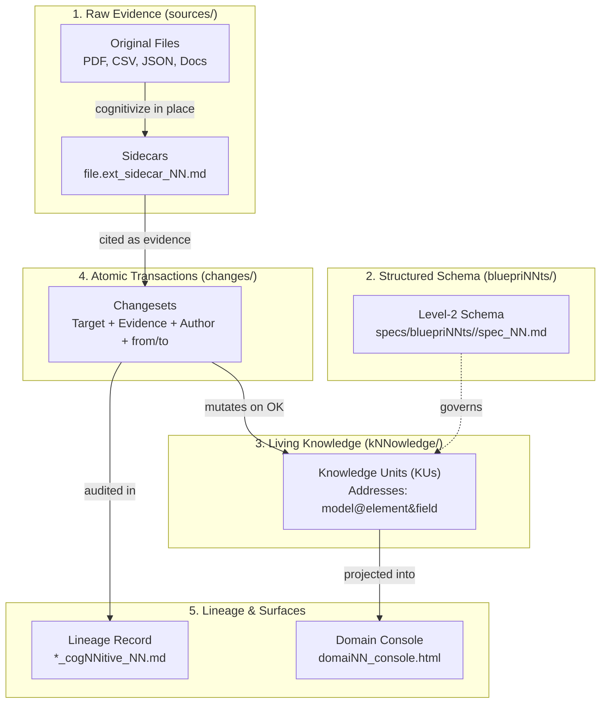

### 1. Raw Sources and the Sidecar bridge

A **Source** (`sources/import/`) is any raw file brought from the outside world: a customer contract PDF, an exported sales CSV, an API JSON payload, or interview transcripts.

* **Rule of thumb:** A raw file is **never converted, renamed, or modified**.
* **The Sidecar bridge:** To make arbitrary formats citable by AI and tools, running `cognitivize` creates a companion file right next to the original:
  `<filename>.<ext>_sidecar_NN.md`
* The sidecar stores physical metadata (SHA-256 hash, byte size, timestamp) and a normalized Markdown text representation for binary formats. Agents and validators read the sidecar; your original file stays byte-for-byte untouched.

### 2. Can a Model be a CSV or JSON?

A common point of confusion is whether a knowledge model can be stored as a CSV or JSON file:

* **No. A model (`kNNowledge`) is always a structured Markdown document (`_NN.md`) with YAML frontmatter.**
  It represents a typed conceptual graph (concepts, elements, relationships, and matrices) defined by a Level-2 **blueprint** (`bluepriNNt`).
* **Where CSV and JSON belong:**
  * As **Sources** (`sources/import/`): Raw tabular or structured evidence.
  * As **Artifacts** (`artifacts/`): Curated tabular exports produced from the knowledge graph.

### 3. Knowledge Units (KU): Semantic Addressing

Instead of relying on fragile line numbers (`#L42-L50`) that break whenever text is edited, cogNNitive addresses every piece of information semantically as an atomic **Knowledge Unit (KU)**:

| Scope | Syntax | Example |
| :--- | :--- | :--- |
| **Domain** | `domaiNN_NN.md` | `domaiNN_NN.md` |
| **Document** | `<model-id>` | `business` |
| **Concept section** | `<model-id>@concept:<slug>` | `business@concept:objectives` |
| **Element** | `<model-id>@<element>` | `business@q3-revenue-target` |
| **Field value** | `<model-id>@<element>&<field>` | `business@q3-revenue-target&amount` |
| **Matrix cell** | `<model-id>@<matrix>&<row>&<col>` | `business@swot-matrix&strength-1&opportunity-2` |

A model id is never a path or a title. For a compact document it is the file name without `_NN`; for a document that holds a single instance of a distributed concept it is hierarchical, such as `villabotijos-today/intro`. See [Storage and identity](content/concepts/storage-and-identity.md).

Raw sources are cited with the same precision:
* **Markdown:** `sources/import/brief.md@## Target Audience`
* **CSV row/cell:** `sources/import/prices.csv@SKU-101&price_usd`
* **JSON pointer:** `sources/import/payload.json@/company/billing/tax_id`

---

## The change is the only provenance

In earlier versions of knowledge systems, each data field carried a companion citation tag directly inside the model file. This caused excessive churn and merge conflicts on every update.

In cogNNitive:
1. **The Knowledge Unit is provenance-free:** The model file contains only the current validated state.
2. **Provenance is derived from the Changeset log:** 
   When an agent or human updates a field, they create a **Changeset** (`changes/`). Each operation records:
   * `target`: The exact Knowledge Unit (`business@q3-revenue-target&amount`).
   * `from → to`: Previous value and new value.
   * `author`: Agent or human identifier.
   * `applied_at`: ISO UTC timestamp.
   * `evidence`: Mandatory source citation backing the change (`evidence:: sources/import/prices.csv@SKU-101&price_usd`).
3. **Audit on demand:** When viewing a field in the domain console or via CLI, the system derives its entire timeline by querying the chronological chain of changes pointing to that KU target.

Two writes sit outside that rule, and they are named rather than implied: `generate_index`
rewrites a model's index block in place, and the Level-2 bluepriNNt authoring operations
(`add_concept`, `add_field`, and `bump_version` on a bluepriNNt) edit a schema document directly.
Neither produces a changeset, so neither carries changeset provenance; for Level-3 content the rule
above holds without exception.

---

## The conversational loop: agility meets safety

A common question is: *“Do I have to open the console and inspect visual diffs for every single update?”*

**No.** The workflow balances conversational velocity with formal auditability:

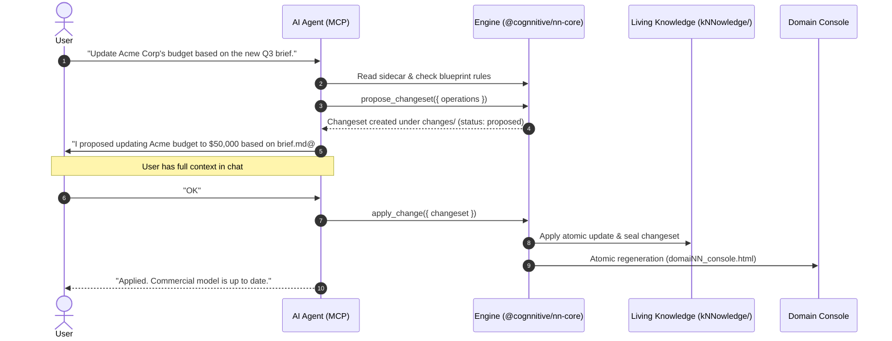

1. **Dialogue & Proposal:** You discuss requirements naturally with your AI assistant. The assistant formulates a structured `propose_changeset` with verified evidence.
2. **Chat approval:** If you already discussed the context in chat, you simply reply **`OK`**. You do not need to switch windows or leave your terminal/chat.
3. **The safety net:** If a change is complex, touching dozens of elements across multiple models, the Domain Console (`domaiNN_console.html`) is right there, allowing you to review visual diffs and relational impact graphs before approving.

---

## Synchronizations and External Ingestion

When external files live on a shared drive, in another domaiNN, or behind a URL, cogNNitive handles them through a **Synchronization** declared in `sources/sources_NN.md`:

* **No background daemons:** nothing runs on session start. A refresh happens only when you ask for it with `--sync [alias]`.
* **Mirrors and imports:** models of the origin are mirrored under `sources/sync/<alias>/`; other files become write-once members of `sources/import/<alias>/`.
* **Recorded refresh:** the command prints a `propose_changeset` payload with the before/after sha256 of every changed file, and your agent applies it. See [Synchronize an external origin](content/how-to/synchronize-an-origin.md).

---

## Summary of principles

| Concept | What it is | What it is NOT |
| :--- | :--- | :--- |
| **`sources/`** | Raw external evidence (PDF, CSV, JSON, images). | Modifiable working drafts. |
| **`_sidecar_NN.md`** | Co-located metadata and normalized text representation. | A separate database or mirror tree. |
| **`kNNowledge/`** | Validated Markdown data model governed by a blueprint. | A raw dump or flat CSV table. |
| **`changes/`** | Sealed, append-only transaction log and provenance source. | Ephemeral scratch notes. |
| **`domaiNN_console.html`** | Offline, self-contained interactive web review UI. | A mandatory roadblock for every chat operation. |

## See also

- [The knowledge lifecycle](content/concepts/knowledge-lifecycle.md) — the operational pipeline from import to export.
- [Sources, citations and lineage](content/concepts/sources-citations-lineage.md) — deep dive into citation grammars.
- [Review changesets](content/how-to/review-changesets.md) — step-by-step changeset approval guide.
- [Use the domain console](content/how-to/domain-console.md) — exploring knowledge offline in your browser.

---

# The four levels

A knowledge system has to answer two different questions at once: *what shape may a
document take?* and *what does this particular document actually say?* Mixing the two
in one file makes every model as heavy as the language that describes it, and makes a
change to the language break every model. cogNNitive separates them into a chain of
four levels, each one a document that conforms to the level above it.

## The problem

Most tools either enforce a schema the data cannot carry with it, or store free-form
text that no machine can check. cogNNitive's answer is a **parent chain**: a data
document declares the schema it follows, that schema declares the language it follows,
and the language declares the meta-language that defines it. Every level is a plain
Markdown file, so the whole chain is readable, diffable, and portable.

## The model

| Level | Term | Role |
|---|---|---|
| 0 | `defiNNition` | The meta-specification language. Defines levels, versioning conventions, normative language, terminology discipline, and how a parent chain resolves. |
| 1 | `iNNfo` | The concrete specification (a *meta-bluepriNNt*). Defines the root primitives — `Concept Definition`, `Field Definition`, `Matrix Definition` — and the unified `NN` syntax. |
| 2 | `bluepriNNt` | A domain schema. An ordinary iNNfo document that instantiates the root primitives to declare the Concepts, Fields, and Matrices of a domain. |
| 3 | `kNNowledge` | A domain data document. Lightweight: it carries only data and a pointer to its parent bluepriNNt. |

Each level **adds** constraints; it never relaxes the ones above it. The level-1
`iNNfo` document is itself written in the syntax it constrains (a self-describing
metaschema), and every level-2 `bluepriNNt` is an ordinary iNNfo document whose
`… Definition` elements *are* its schema. There is no separate declaration format.

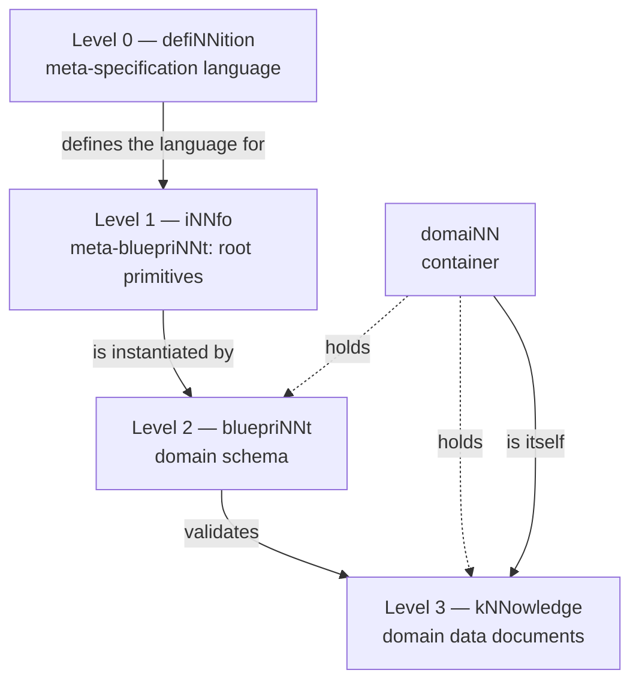

## A bluepriNNt validates kNNowledge

A `bluepriNNt` is not documentation about a domain — it is an executable contract. It
declares which Concepts exist, which Fields each Concept carries, which values are
allowed, and which relationships are legal. A `kNNowledge` document is then checked
against that contract: unknown Concepts, out-of-set `select` values, duplicate slugs,
and undeclared nesting are all rejected deterministically. The validator is described
in [Validator behavior](content/concepts/validator-behavior.md).

A bluepriNNt also declares, **per concept**, where the instances of that concept are stored: all
as elements of one kNNowledge document (compact storage), or one kNNowledge document per instance
(distributed storage). The validator then checks that each document sits where the declaration
says. See [Storage and identity](content/concepts/storage-and-identity.md).

## A domaiNN is itself a kNNowledge document

A **`domaiNN`** is the container: the directory that holds `kNNowledge/`, the adopted
bluepriNNts, `sources/`, `procedures/`, and `artifacts/`. Its entry point is a
`domaiNN_NN.md` file. Crucially, that container is **not a special kind of thing** —
it is itself a level-3 `kNNowledge` document, governed by the `domaiNN` bluepriNNt.
The system's own container follows the same rules as the data inside it.

## Why it matters

- **Rich specs, lean data.** Only levels 0–2 carry semantics. A level-3 document is a
  few fields plus a parent pointer, so it stays cheap to read and to diff.
- **One resolver for everything.** Because every document points at its parent, the
  engine can walk from any data file up to level 0 and cache the chain.
- **No duplicated schema.** A model never repeats the specification; it references it.
- **Uniform tooling.** The same parser, validator, and console handle every level.

## See also

- [Ecosystem architecture](content/concepts/ecosystem.md)
- [The specification chain](content/concepts/specifications.md)
- [Storage and identity](content/concepts/storage-and-identity.md)
- [Canonical vocabulary](content/vocabulary.md)
- [Create your first domaiNN](content/tutorials/first-domain.md)
- [Home](README.md)

---

# The entity-relationship model

Every box in the diagrams below is a construct a published specification already
defines — none of them is invented for this page. Read it as a map of the repo's own
data model: the schema a bluepriNNt declares, the data a kNNowledge document holds, and
the inventory a domaiNN keeps around them.

The model has two views, so it is drawn twice: one view follows the specification chain
down to values, the other shows what a domaiNN contains.

## Diagram 1 — from the schema to the values

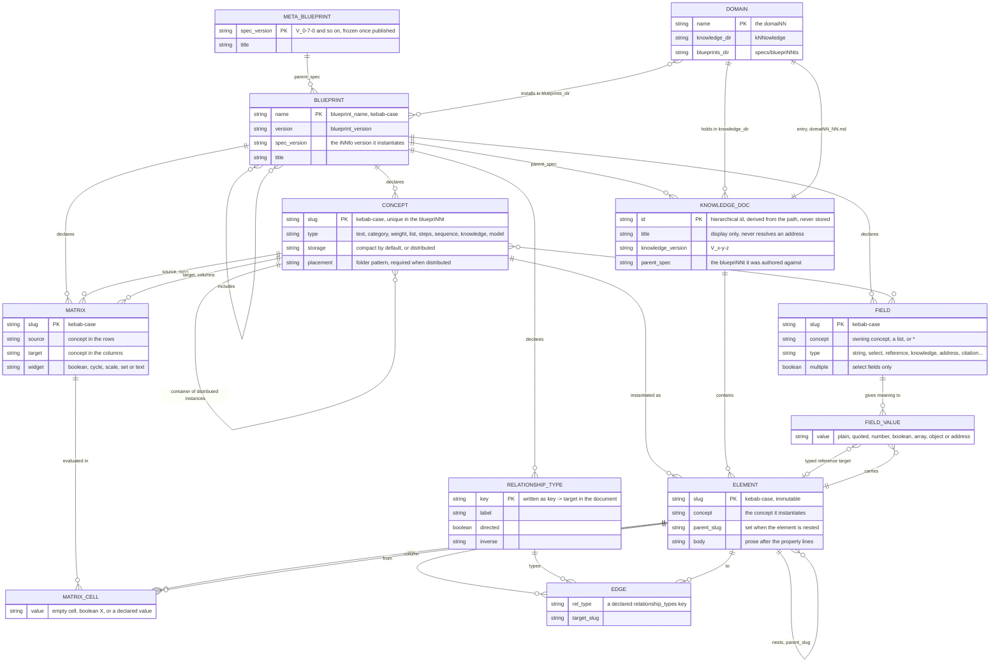

## Diagram 2 — what the domaiNN keeps around the documents

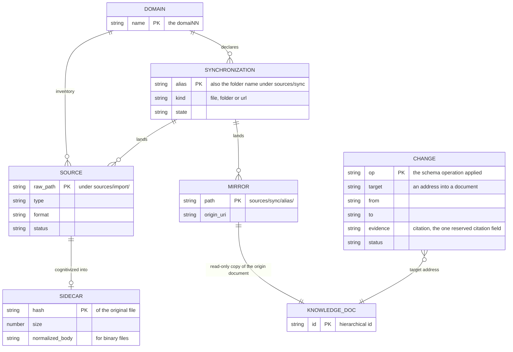

## How to read it

- **Two worlds in one diagram.** `CONCEPT`, `FIELD`, `MATRIX` and `RELATIONSHIP_TYPE`
  are what a bluepriNNt *declares*. `ELEMENT`, `FIELD_VALUE`, `EDGE` and `MATRIX_CELL`
  are what a kNNowledge document *holds*. An element only means something against the
  concept it instantiates, which is why `CONCEPT ||--o{ ELEMENT` is the central edge.
- **Crow's foot.** `||--o{` is one-to-many, `||--||` one-to-one, `}o--o{` many-to-many,
  `}o--o|` many-to-zero-or-one. The label names the role, not a column.
- **`PK` marks identity, not storage.** No entity has a stored primary key: a document is
  identified by its hierarchical id and an element by its slug, both derived. The marker
  says what makes two instances different.
- **The source and change boxes are concept instances.** `Source`, `Synchronization`,
  `Change` and `Mirror` are elements of concepts declared by the `sources` and `changes`
  bluepriNNts; they appear as entities here only because they carry relations the reader
  cares about. Their storage is the same `ELEMENT` machinery as everything else.
- **History is not stored.** `CHANGE` records what was applied and where; the lineage and
  the history of a document are computed from those changes, so no edge in the diagram
  represents a cache.

## Where each box comes from

| Box | Level | Defined by |
|---|---|---|
| `META_BLUEPRINT` | 1 | `iNNfo/specs/iNNfo_V_0-7-0_NN.md` (the meta-bluepriNNt) |
| `BLUEPRINT` | 2 | the meta-bluepriNNt: frontmatter plus the three root primitives |
| `CONCEPT` | 2 | `# NN Concept Definition` |
| `FIELD` | 2 | `# NN Field Definition` |
| `MATRIX` | 2 | `# NN Matrix Definition` |
| `RELATIONSHIP_TYPE` | 2 | the `relationship_types:` frontmatter block |
| `KNOWLEDGE_DOC`, `ELEMENT`, `FIELD_VALUE`, `EDGE`, `MATRIX_CELL` | 3 | the meta-bluepriNNt's Level 3 structure |
| `DOMAIN` | 3 | `iNNfo/specs/bluepriNNts/domaiNN/spec_NN.md` |
| `SOURCE`, `SYNCHRONIZATION` | 3 | `iNNfo/specs/bluepriNNts/sources/spec_NN.md` |
| `SIDECAR` | 3 | `iNNfo/specs/bluepriNNts/sidecar/spec_NN.md` |
| `CHANGE` | 3 | `iNNfo/specs/bluepriNNts/changes/spec_NN.md` |

## The three identities the diagram relies on

1. **Hierarchical id** — the identity of a document, derived only from its own path and
   its bluepriNNt's declarations: the stem without `_NN` for a compact document, a
   container chain plus slug for an instance model. A stem, a path and a title are never
   ids.
2. **Element slug** — the identity of an element inside its document, immutable: renaming
   the element changes its display name and leaves the slug alone.
3. **Title** — display only. Two documents may share a title without conflict, because no
   address ever resolves through it.

## Storage shows up as cardinality

`CONCEPT.storage` changes how the diagram is populated, not its shape:

- **compact** (the default): every instance of the concept is an `ELEMENT` inside one
  `KNOWLEDGE_DOC`.
- **distributed**: every instance is the root `ELEMENT` of its own `KNOWLEDGE_DOC` — an
  instance model — placed by the concept's `placement` rule, with `slug::` equal to its
  folder slug. Its child concepts stay elements of that same document.

Either way one `COLLECTION` exists — the domaiNN-wide set of instances of one concept,
ordered by id — and it is computed, never stored, so it has no box.

## Deliberately absent

| Not drawn | Why |
|---|---|
| addresses (`doc@element&field`, `matrix&row&col`) | a value grammar, not a table; they live in `FIELD_VALUE` and `CHANGE.target` |
| lineage, collections, index | computed on demand from documents and applied changes |
| `artifacts/` and its write-once families | producer output, outside the schema: no concept declares it |
| the bluepriNNt catalog | a folder of `BLUEPRINT` instances, not a new entity |

## See also

- [The four levels](content/concepts/levels.md) — what each level is allowed to say
- [The specification chain](content/concepts/specifications.md) — `parent_spec`, `includes` and freezing
- [Storage and identity](content/concepts/storage-and-identity.md) — hierarchical ids and instance models
- [Sources, citations and lineage](content/concepts/sources-citations-lineage.md) — the second diagram in prose
- [The knowledge lifecycle](content/concepts/knowledge-lifecycle.md) — how `CHANGE` entries accumulate
- [Canonical vocabulary](content/vocabulary.md) — the canonical name of every box above

---

# Ecosystem architecture

cogNNitive is not one program. It is a small set of parts with a clear division of
labour: an engine that understands the format, a server that exposes it to AI agents, a
console that lets a human review it, a set of agent skills that drive it, and the
`domaiNN` containers that hold the actual knowledge. This page explains how they fit
together and where each responsibility stops.

## The problem

A validated knowledge system must serve three very different consumers at once: a
human who needs to read and review, an AI agent that needs structured tools, and a
script or CI job that needs deterministic checks. If any one of them owns the format
logic, the other two drift. cogNNitive puts the format logic in exactly one place and
makes everything else a client of it.

## The layers

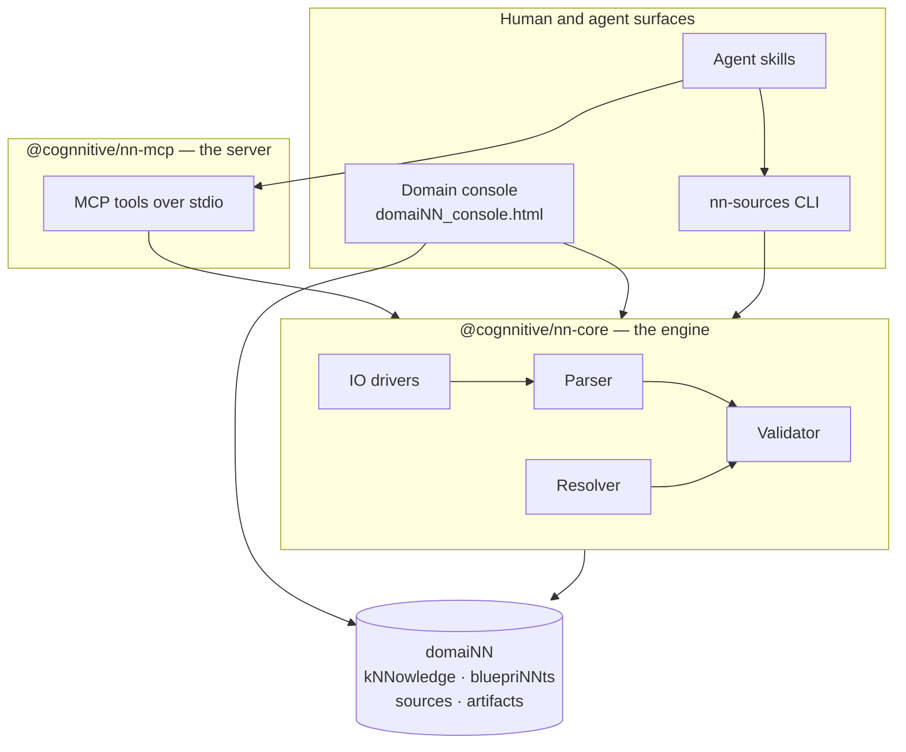

## `@cognnitive/nn-core` — the engine

The engine is a library, not a service. It owns the meaning of the format:

- **Parser** — turns a Markdown document into a structured `kNNowledge` model:
  frontmatter, `# NN <Concept>` sections, `## NN <Concept>: <Element>` elements,
  `slug::` identities, and `key:: value` fields.
- **Validator** — checks a document against its resolved parent, producing a
  deterministic list of diagnostics. See [Validator behavior](content/concepts/validator-behavior.md).
- **Resolver** — walks the parent chain and locates bluepriNNt packages. See
  [The specification chain](content/concepts/specifications.md).
- **IO drivers** — read and write documents on disk without changing their bytes
  beyond the intended edit.

The engine is the single source of truth. The console and the MCP server both call it,
so a document is held to the same rules everywhere.

## `@cognnitive/nn-mcp` — the server

`nn-mcp` is an MCP (Model Context Protocol) server that wraps the engine and exposes it
over stdio as tools an AI agent can call: listing and reading kNNowledge, resolving a
specification or a bluepriNNt, validating, proposing and applying changesets, running
queries, cognitivizing sources, and syncing lineage. The tool inventory lives in the
[Reference](content/reference/mcp-tools.md) section; it is generated, so it is never
duplicated by hand here.

## The domain console

The **domain console** is a self-contained `domaiNN_console.html` generated per
`domaiNN`. It browses kNNowledge, renders matrices, and reviews changesets, with each
specialized surface shown as a view (a tab). It is produced from the same engine, so it
never disagrees with validation. It replaces the retired Vue editor and hosted web
application. See [Use the domain console](content/how-to/domain-console.md).

## The agent skills

The skills are instruction sets an AI coding agent loads to drive the ecosystem: the
front controller, source ingestion, iNNfo authoring, environment preflight, upgrades,
site generation, design presets, and skill lifecycle management. They orchestrate the
MCP tools and the CLI; they do not reimplement the format. See the
[Agent Skills overview](content/skills/README.md).

## The `domaiNN`

Everything converges on the `domaiNN`: the container directory that holds
`kNNowledge/`, adopted bluepriNNts, `sources/`, `procedures/`, and `artifacts/`. The
engine reads and validates it, the console renders it, the server mutates it through
changesets, and the skills populate it. A `domaiNN` is itself a `kNNowledge` document —
see [The four levels](content/concepts/levels.md).

## Why it matters

- **One format authority.** Format logic lives only in the engine; every surface is a
  client, so they cannot drift apart.
- **Stable seams.** Agents talk to the server; humans talk to the console; CI talks to
  the engine. Each seam can change without disturbing the others.
- **Portable knowledge.** Because the `domaiNN` is plain Markdown on disk, no layer is
  required to keep the knowledge alive.

## See also

- [The four levels](content/concepts/levels.md)
- [The specification chain](content/concepts/specifications.md)
- [Validator behavior](content/concepts/validator-behavior.md)
- [Integrations and discipline overlaps](content/concepts/integrations.md)
- [MCP tools](content/reference/mcp-tools.md)
- [CLI and scripts](content/reference/cli.md)

---

# The specification chain

Every cogNNitive document declares what it conforms to. That declaration is not a
convention — it is the mechanism the engine uses to find, load, and check the schema a
document was written against. This page explains how a document resolves its parent
chain, how the versions work, and why the parent URL is never baked into the code.

## The problem

If a tool "just knows" which schema to use, then two things go wrong. First, a document
becomes impossible to validate in isolation: you have to run the *right* tool version.
Second, the moment the schema changes, every stored document is silently reinterpreted
against the new shape. cogNNitive avoids both by making the document itself carry a
pointer to the exact, immutable version of its parent.

## The parent chain

Each document names its parent in frontmatter:

- A **level-1** document (`iNNfo`) declares its level-0 parent as a string `parent:` URL.
- A **level-2** `bluepriNNt` and a **level-3** `kNNowledge` document declare
  `parent_spec:` as an object with `name` and `url`:

```yaml
parent_spec:
  name: "iNNfo_V_0-5-0"
  url: "https://raw.githubusercontent.com/cogNNitive/cogNNitive-web/main/iNNfo/specs/iNNfo_V_0-5-0_NN.md"
```

From any document the engine can walk upward: `kNNowledge → bluepriNNt → iNNfo →
defiNNition`. Each step resolves the parent it names and caches the result, so a model
is functionally self-contained without duplicating any specification text.

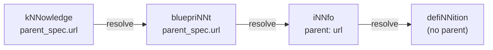

## Versions: three keys, three scopes

cogNNitive versions are written `V_x-y-z` (SemVer-style, e.g. `V_0-5-0`). The same
document can carry more than one version key, and they mean different things:

| Key | Level | What it versions |
|---|---|---|
| `spec_version` | L2, L3 | The iNNfo specification format the document conforms to. |
| `blueprint_version` | L2 | The bluepriNNt package itself. |
| `knowledge_version` | L3 | The individual kNNowledge document. |

So a level-2 bluepriNNt carries both `spec_version` (the iNNfo version it follows) and
`blueprint_version` (its own package version). A level-3 document carries `spec_version`
and `knowledge_version` — never `blueprint_version` and never a version in its filename.

> [!NOTE]
> The level-3 version key is `knowledge_version`. The retired key `model_version` is not
> read; the version also never appears in the file name. See
> [Canonical vocabulary](content/vocabulary.md).

## One version per bluepriNNt in a domaiNN

Each level-3 document pins one bluepriNNt version in `parent_spec.name`. Within one domaiNN, every
document that pins a given bluepriNNt must pin the **same** version. `check_domain` reports
`BLUEPRINT_VERSION_SKEW` as an error, once per bluepriNNt, when documents disagree, and lists a
bare name (no version token) or an unclassifiable URL as an incomparable pin. The check is
domain-level: validating a single file never reports it, and it applies to compact and
distributed storage alike. The [nn-update](content/skills/nn-update.md) skill repins every document
of a bluepriNNt together, or none. See *Version uniformity* in [Storage and identity](content/concepts/storage-and-identity.md).

## Why the URL is never hardcoded

The engine resolves a specification **from an explicit URL
or from a loaded document's `parent_spec.url`** — never from an internal constant, and
never from a hardcoded blueprint name (the `get_spec` and `get_blueprint` tools expose
this to your agent). This is deliberate:

- **The document is the authority.** The version a model was authored against is the
  version the engine resolves, so old documents keep validating against old schemas.
- **Immutability makes it safe.** Published specs are frozen: a released version file is
  never modified. Corrections require a new version, and migrating a document means
  creating a new copy adapted to the new version.
- **No hidden coupling.** There is no "current spec" constant in the engine that could
  disagree with what a document declares.

## Resolution order

When a bluepriNNt is referenced by name rather than by URL, the resolver searches in a
fixed precedence: the local `domaiNN`'s `specs/bluepriNNts/` package directory first, then
the flat `specs/` fallback, then the global `~/.agents/bluepriNNts/` store, then the
bluepriNNts bundled with installed skills. The search paths and the "searched:"
diagnostic come from one shared list, so where a bluepriNNt is *found* cannot drift from
where the engine claims to have *looked*. See [Validator behavior](content/concepts/validator-behavior.md)
for how resolution failures surface as diagnostics.

## See also

- [The four levels](content/concepts/levels.md)
- [Storage and identity](content/concepts/storage-and-identity.md)
- [Ecosystem architecture](content/concepts/ecosystem.md)
- [Canonical vocabulary](content/vocabulary.md)
- [bluepriNNts catalog](content/reference/blueprints.md)
- [MCP tools](content/reference/mcp-tools.md)

---

# Vocabulary: Canonical Terms

The cogNNitive ecosystem pins a canonical vocabulary so every editor label, doc, and
skill refers to the same concept by the same name. The authoritative source is the
machine-readable dictionary at
[`iNNfo/specs/vocabulary.json`](https://github.com/cogNNitive/cogNNitive-web/blob/main/iNNfo/specs/vocabulary.json);
this page is the human-readable rendering of it.

## Level Hierarchy & Canonical Terms

| Level | Canonical Term | Deprecated / Former Aliases | Sense |
|---|---|---|---|
| Level 0 | **defiNNition** | `defiNNe` | Level-0 meta-specification language (formerly defiNNe) |
| Level 1 | **iNNfo** | *(none)* | Level-1 concrete specification meta-template defining root primitives (Concept Definition, Field Definition, Matrix Definition) |
| Ecosystem / Role | **tag** | *(none)* | A value of the `tags` Field, an ordinary multi-valued select Field; there is no reserved `tags` property and no Marker primitive |
| Level 1 | **meta-bluepriNNt** | `meta-template` | Level-1 specification describing the structure of bluepriNNts |
| Level 2 | **bluepriNNt** | `app`, `template` | Level-2 domain schema specification file (formerly Template / App; e.g. specs/bluepriNNts/business/spec_NN.md) |
| Level 3 | **kNNowledge** | `model` | Level-3 domain data model (formerly Model). Uncountable noun. The version lives in the `knowledge_version` frontmatter, never in the filename (`_V_` names are retired). |
| Level 3 | **domaiNN** | `workspace` | Container of kNNowledge, bluepriNNts, sources, procedures and related assets (formerly Workspace). A domaiNN is itself a kNNowledge document. |
| Ecosystem / Role | **compact storage** | *(none)* | Storage form in which every instance of a concept is an element of one kNNowledge document. A concept with no `storage` declaration is compact. A kNNowledge-level concept, not a new level: the document that holds the elements is an ordinary kNNowledge document. |
| Ecosystem / Role | **distributed storage** | *(none)* | Storage form in which each instance of a concept is the root element of its own kNNowledge document, called an instance model, in its own folder placed by the concept's placement rule. Declared with `storage:: distributed`. A kNNowledge-level concept, not a new level. |
| Ecosystem / Role | **instance model** | *(none)* | A kNNowledge document that is itself one instance of a distributed concept: its root element is that concept and its `slug::` equals its folder slug. Addressed by a hierarchical id. It is a kNNowledge document, not a new level. |
| Ecosystem / Role | **collection** | *(none)* | The domaiNN-wide set of instances of one concept, ordered by id and identical whatever the storage form: instance models and compact elements are members alike. Same word and one meaning as the `members` collection of the `changes` bluepriNNt: the set of units of one kind, grouped by the concept or document that defines them. A kNNowledge-level concept, not a new level. |
| Ecosystem / Role | **placement rule** | *(none)* | The `placement::` path pattern a distributed concept declares: where each of its instance models lives relative to the domaiNN root, with exactly one `{slug}` and an optional leading `{container}`. It says where an instance lives, never what it inherits. A kNNowledge-level declaration, not a new level. |
| Ecosystem / Role | **synchronization** | *(none)* | A concept of the sources catalog that declares an origin (a file, a folder or a URL) landed into a domaiNN on demand by `nn-sources --sync [alias]`. Models land as mirrors, other files as sources. A kNNowledge-level concept, not a new level. |
| Ecosystem / Role | **mirror** | *(none)* | A read-only copy of an origin's kNNowledge document under `sources/sync/<alias>/`, replaced in place on each synchronization. A consumer addresses its elements with a `reference` path such as `sources/sync/org/organization_NN.md@manager`. Never a model of the consumer domaiNN. |
| Ecosystem / Role | **hierarchical id** | `model id` | The identity of a kNNowledge document, derived only from its own path and the declarations of its bluepriNNt: the stem without `_NN` for a compact model, or a container chain plus slug (`<container-id>/<slug>`) for an instance model. A stem, a title and a path are never ids. A kNNowledge-level concept, not a new level. |
| Ecosystem / Role | **title** | *(none)* | The human label of a kNNowledge document or element. Display-only: it never resolves an address, and two documents may share a title without conflict. Addressing always uses the hierarchical id and the element slug. |
| Ecosystem / Role | **ageNNt** | `actioNN` | Skill ecosystem, execution engine, and dynamic AI persona framework for cogNNitive |
| Ecosystem / Role | **referenced skill** | `external skill` | A third-party agent skill a bluepriNNt declares in its frontmatter `skills:` array, pinned to a commit with an SPDX license, and fetched from its upstream repo at install time (never vendored, never fetched at runtime). Its guarantee is bounded to reproducible + license-declared; the maintainer does not vouch for the author. Distinct from an embedded skill, which is vendored and curated. |
| Level 3 | **sidecar** | *(none)* | Co-located <file>.<ext>_sidecar_NN.md document that carries a file's hash, size, metadata and, for binary files, a normalized body. A concept, not a new level: a kNNowledge-level document that is never a model and is never mirrored into a separate `sources/nn/` tree (that tree is retired). |
| Ecosystem / Role | **cognitivize** | *(none)* | Operation that creates or refreshes a sidecar in place, leaving the original file untouched. One @cognnitive/nn-core operation (cognitivize), surfaced through the nn-sources CLI (--cognitivize <file|dir>) and the nn-mcp tool; raw imports land verbatim in sources/import/ and are cognitivized there. |
| Ecosystem / Role | **artifacts** | *(none)* | The single write destination for every producer output (consoles, reports, curated CSVs, briefs). Replaces the retired `export/` folder: one rename, no fallback. A non-_NN.md file is an artifact lineage node only if it is a timestamped write-once family member or declares upstream sources. |
| Ecosystem / Role | **write-once** | *(none)* | Producer rule: each output is a new family member named with a UTC suffix _YYYYMMDDTHHmmssZ (with -2, -3... same-second tie-breaks) placed before the extension; existing bytes are never overwritten, and latest-of-family is resolved by name. GC only proposes deletions and deletes only with explicit user consent. |
| Ecosystem / Role | **assistant** | `coach`, `architecture coach` | Interactive architecture mentor and modeling guide persona in iNNfo |
| Ecosystem / Role | **console** | *(none)* | User-facing UI that shows and reviews a domaiNN: the domain console (`domaiNN_console.html`, one per domaiNN) whose specialized surfaces are views shown as tabs. Replaces the retired Vue "editor" and the retired hosted web app. |
| Ecosystem / Role | **lineage** | *(none)* | The computed view of a domaiNN: the inventory of sources, models, artifacts and changes, with edges derived from the applied changes (live evidence by default, all-time on request). Nothing is persisted, so there is nothing to drift. |

## Level Terms Detail

### **defiNNition**

- **Sense**: Level-0 meta-specification language (formerly defiNNe)
- **Deprecated Aliases**: `defiNNe`
- **Excluded Senses** (not renamed): `ordinary-english-definition`

### **iNNfo**

- **Sense**: Level-1 concrete specification meta-template defining root primitives (Concept Definition, Field Definition, Matrix Definition)

### **tag**

- **Sense**: A value of the `tags` Field, an ordinary multi-valued select Field; there is no reserved `tags` property and no Marker primitive
- **Excluded Senses** (not renamed): `git-tag`, `release-tag`, `html-tag`

### **meta-bluepriNNt**

- **Sense**: Level-1 specification describing the structure of bluepriNNts
- **Deprecated Aliases**: `meta-template`

### **bluepriNNt**

- **Sense**: Level-2 domain schema specification file (formerly Template / App; e.g. specs/bluepriNNts/business/spec_NN.md)
- **Deprecated Aliases**: `app`, `template`
- **Excluded Senses** (not renamed): `vue-sfc-template`, `generic-english`

### **kNNowledge**

- **Sense**: Level-3 domain data model (formerly Model). Uncountable noun. The version lives in the `knowledge_version` frontmatter, never in the filename (`_V_` names are retired).
- **Deprecated Aliases**: `model`
- **Grammar Rule**: Uncountable noun. Written as `N kNNowledge documents`.
- **Distinct Senses**: "knowledge unit"
- **Excluded Senses** (not renamed): `llm-model`, `statistical-model`

### **domaiNN**

- **Sense**: Container of kNNowledge, bluepriNNts, sources, procedures and related assets (formerly Workspace). A domaiNN is itself a kNNowledge document.
- **Deprecated Aliases**: `workspace`
- **Container Nature**: A domaiNN is itself a kNNowledge document containing other documents.
- **Excluded Senses** (not renamed): `npm workspace`, `VS Code workspace`, `git worktree`, `IndexedDB workspace`, `subject-area domain`

### **compact storage**

- **Sense**: Storage form in which every instance of a concept is an element of one kNNowledge document. A concept with no `storage` declaration is compact. A kNNowledge-level concept, not a new level: the document that holds the elements is an ordinary kNNowledge document.
- **Excluded Senses** (not renamed): `compressed-storage`, `database-storage`

### **distributed storage**

- **Sense**: Storage form in which each instance of a concept is the root element of its own kNNowledge document, called an instance model, in its own folder placed by the concept's placement rule. Declared with `storage:: distributed`. A kNNowledge-level concept, not a new level.
- **Excluded Senses** (not renamed): `distributed-database`, `object-storage`

### **instance model**

- **Sense**: A kNNowledge document that is itself one instance of a distributed concept: its root element is that concept and its `slug::` equals its folder slug. Addressed by a hierarchical id. It is a kNNowledge document, not a new level.
- **Excluded Senses** (not renamed): `instance-in-an-object-model`

### **collection**

- **Sense**: The domaiNN-wide set of instances of one concept, ordered by id and identical whatever the storage form: instance models and compact elements are members alike. Same word and one meaning as the `members` collection of the `changes` bluepriNNt: the set of units of one kind, grouped by the concept or document that defines them. A kNNowledge-level concept, not a new level.
- **Excluded Senses** (not renamed): `data-structure-collection`, `database-table`

### **placement rule**

- **Sense**: The `placement::` path pattern a distributed concept declares: where each of its instance models lives relative to the domaiNN root, with exactly one `{slug}` and an optional leading `{container}`. It says where an instance lives, never what it inherits. A kNNowledge-level declaration, not a new level.
- **Excluded Senses** (not renamed): `css-placement`, `ad-placement`

### **synchronization**

- **Sense**: A concept of the sources catalog that declares an origin (a file, a folder or a URL) landed into a domaiNN on demand by `nn-sources --sync [alias]`. Models land as mirrors, other files as sources. A kNNowledge-level concept, not a new level.
- **Excluded Senses** (not renamed): `sync_domain_manifest`, `file-sync-daemon`

### **mirror**

- **Sense**: A read-only copy of an origin's kNNowledge document under `sources/sync/<alias>/`, replaced in place on each synchronization. A consumer addresses its elements with a `reference` path such as `sources/sync/org/organization_NN.md@manager`. Never a model of the consumer domaiNN.
- **Excluded Senses** (not renamed): `git-mirror`, `network-mirror`

### **hierarchical id**

- **Sense**: The identity of a kNNowledge document, derived only from its own path and the declarations of its bluepriNNt: the stem without `_NN` for a compact model, or a container chain plus slug (`<container-id>/<slug>`) for an instance model. A stem, a title and a path are never ids. A kNNowledge-level concept, not a new level.
- **Deprecated Aliases**: `model id`
- **Excluded Senses** (not renamed): `database-id`, `uuid`

### **title**

- **Sense**: The human label of a kNNowledge document or element. Display-only: it never resolves an address, and two documents may share a title without conflict. Addressing always uses the hierarchical id and the element slug.
- **Excluded Senses** (not renamed): `html-title`, `frontmatter-property`

### **ageNNt**

- **Sense**: Skill ecosystem, execution engine, and dynamic AI persona framework for cogNNitive
- **Deprecated Aliases**: `actioNN`
- **Excluded Senses** (not renamed): `generic-agent`, `subagent-runtime`

### **referenced skill**

- **Sense**: A third-party agent skill a bluepriNNt declares in its frontmatter `skills:` array, pinned to a commit with an SPDX license, and fetched from its upstream repo at install time (never vendored, never fetched at runtime). Its guarantee is bounded to reproducible + license-declared; the maintainer does not vouch for the author. Distinct from an embedded skill, which is vendored and curated.
- **Deprecated Aliases**: `external skill`
- **Excluded Senses** (not renamed): `embedded skill`, `vendored skill`

### **sidecar**

- **Sense**: Co-located <file>.<ext>_sidecar_NN.md document that carries a file's hash, size, metadata and, for binary files, a normalized body. A concept, not a new level: a kNNowledge-level document that is never a model and is never mirrored into a separate `sources/nn/` tree (that tree is retired).
- **Excluded Senses** (not renamed): `motorcycle-sidecar`, `sidecar-container`

### **cognitivize**

- **Sense**: Operation that creates or refreshes a sidecar in place, leaving the original file untouched. One @cognnitive/nn-core operation (cognitivize), surfaced through the nn-sources CLI (--cognitivize <file|dir>) and the nn-mcp tool; raw imports land verbatim in sources/import/ and are cognitivized there.

### **artifacts**

- **Sense**: The single write destination for every producer output (consoles, reports, curated CSVs, briefs). Replaces the retired `export/` folder: one rename, no fallback. A non-_NN.md file is an artifact lineage node only if it is a timestamped write-once family member or declares upstream sources.
- **Excluded Senses** (not renamed): `git-artifacts`, `build-artifacts`

### **write-once**

- **Sense**: Producer rule: each output is a new family member named with a UTC suffix _YYYYMMDDTHHmmssZ (with -2, -3... same-second tie-breaks) placed before the extension; existing bytes are never overwritten, and latest-of-family is resolved by name. GC only proposes deletions and deletes only with explicit user consent.
- **Excluded Senses** (not renamed): `write-once-memory`

### **assistant**

- **Sense**: Interactive architecture mentor and modeling guide persona in iNNfo
- **Deprecated Aliases**: `coach`, `architecture coach`
- **Excluded Senses** (not renamed): `system-prompt-generic`

### **console**

- **Sense**: User-facing UI that shows and reviews a domaiNN: the domain console (`domaiNN_console.html`, one per domaiNN) whose specialized surfaces are views shown as tabs. Replaces the retired Vue "editor" and the retired hosted web app.
- **Excluded Senses** (not renamed): `terminal-console`, `browser-dev-console`, `game-console`

### **lineage**

- **Sense**: The computed view of a domaiNN: the inventory of sources, models, artifacts and changes, with edges derived from the applied changes (live evidence by default, all-time on request). Nothing is persisted, so there is nothing to drift.
- **Excluded Senses** (not renamed): `lineage-cache`

## Retired Identifiers (Documentation Only)

The following table lists retired identifiers and their canonical replacements.
This mapping is documentation-only; no runtime aliases exist.

| Old Identifier / Name | Canonical Replacement | Kind | Notes |
|---|---|---|---|
| `Marker Definition` | ``tags` Field value (flag) or a declared Field (valued)` | primitive | Retired in iNNfo V_0-5-0: a flag marker becomes a value of the tags Field, a valued marker becomes a normal Field; a document that still carries one fails with MARKERS_REMOVED |
| `item-markers matrix` | `declared Fields + concept-level values` | primitive | Retired in iNNfo V_0-5-0: removed with remove_matrix; cells become field values and concept rows become concept-level values |
| `set_marker` | `update_field / update_concept_field` | operation | Retired schema operation; apply_change now rejects it with UNKNOWN_OPERATION |
| `specs/templates/` | `specs/bluepriNNts/` | path | Relocated under iNNfo/specs/bluepriNNts/ and domain specs/bluepriNNts/ |
| `models/` | `kNNowledge/` | path | Domain models directory renamed to kNNowledge/ |
| `export/` | `artifacts/` | path | Producer output folder renamed once to artifacts/, with no fallback; runtime never resolves export/ |
| `sources/nn/` | `sources/import/ + co-located sidecars` | path | Retired mirror tree; raw files live in sources/import/ and are cognitivized in place |
| `sources/original/` | `sources/import/` | path | Retired legacy fallback; sources/import/ is the only canonical raw-import location |
| `sources/export/` | `artifacts/` | path | Retired promotion folder; an artifact reused as input is cognitivized where it lives |
| `sources/archive/` | `write-once families` | path | Retired; a changed source becomes a new suffixed family member, so no snapshot is needed. Any pre-existing content is inert |
| `<name>_V_<x-y-z>_<bp>_NN.md` | `knowledge_version frontmatter` | naming | kNNowledge names drop _V_; the version lives in the knowledge_version frontmatter key |
| `~/.agents/templates` | `~/.agents/bluepriNNts` | path | Global template storage location renamed to bluepriNNts |
| `model_version` | `knowledge_version` | key | Level-3 frontmatter version property |
| `template_version` | `blueprint_version` | key | Level-2 frontmatter version property |
| `template_name` | `blueprint_name` | key | Level-2 schema name property |
| `models_dir` | `knowledge_dir` | key | Domain layout configuration key |
| `templates_dir` | `blueprints_dir` | key | Domain layout configuration key |
| `target_template` | `target_blueprint` | key | Field definition property naming target blueprint |
| `type:: model` | `type:: knowledge` | keyword | Grammar keyword for submodel references |
| `workflow: model` | `workflow: knowledge` | key | Manifest workflow definition key |
| `workflow: template` | `workflow: blueprint` | key | Manifest workflow template parameter key |
| `INNFO_MODELS_DIR` | `INNFO_DOMAIN_DIR` | env_var | Domain root environment variable (no fallback) |
| `templates-v*` | `blueprints-v*` | tag_namespace | Tag namespace for blueprint releases |
| `workspace_NN.md` | `domaiNN_NN.md` | entrypoint | Domain container entrypoint document |
| `nn-workspace-git` | `nn-domain-git` | skill | Skill renamed to reflect domaiNN terminology |
| `capability_folders` | `capability_folders` | mapping | Openspec capability folders retain their existing kebab-case names per D13 |
| `13 legacy tool names` | `13 canonical blueprint/knowledge tool names` | mcp_tools | list_knowledge, read_knowledge, init_knowledge, validate_knowledge, validate_knowledge_url, get_blueprint, validate_blueprint, list_blueprints, hydrate_blueprint, list_blueprint_procedures, list_blueprint_skills, sync_domain_manifest, check_domain |
| `editor` | `console` | ui_term | Retired user-facing UI term: the Vue editor app is replaced by the domain console (see the console term). Not used in user-facing copy. |
| `hosted app` | `console` | ui_term | Retired user-facing UI term for the hosted web application; the domain console replaces it. Distinct from the "app" alias of bluepriNNt, which keeps its entry and is untouched. |
| `innfo-mcp` | `nn-mcp` | release_key | Distribution prefix rename. Existing `innfo-mcp-v*` git tags, published CDN files and stamped exports remain valid and are not renamed; only new releases use `nn-mcp-v*`. |
| `innfo-console` | `nn-console` | release_key | Distribution prefix rename. Existing `innfo-console-v*` git tags, published CDN files and stamped exports remain valid and are not renamed; only new releases use `nn-console-v*`. |
| `@cognnitive/innfo-core` | `@cognnitive/nn-core` | package | npm workspace package renamed to the nn- prefix; workspace-only, never published to the npm registry. |
| `@cognnitive/innfo-mcp` | `@cognnitive/nn-mcp` | package | npm workspace package renamed to the nn- prefix. |
| `@cognnitive/innfo-console` | `@cognnitive/nn-console` | package | npm workspace package renamed to the nn- prefix. |
| `iNNfo/packages/innfo-core` | `iNNfo/packages/nn-core` | path | Package directory renamed to the nn- prefix. |
| `iNNfo/packages/innfo-mcp` | `iNNfo/packages/nn-mcp` | path | Package directory renamed to the nn- prefix. |
| `innfo-mcp` | `nn-mcp` | mcp_server | The MCP `bin` name and the `Server({name})` identity. The old bundle `bin/innfo-mcp.bundle.js` is deleted; existing `innfo-mcp-v*` CDN files and stamped exports remain valid and resolvable. |
| `innfo-mcp_` | `nn-mcp_` | tool_prefix | The MCP tool prefix in skills and documentation. The client builds the prefix from the registered server name; tool names after the prefix are unchanged. |
| `@innfo-console-v` | `@nn-console-v` | console_pin | The console shell pin. Readers still accept `@innfo-console-v*` so already-stamped exports keep resolving; nothing emits it. |
| `innfo-` | `nn-` | prefix | Console assets, generated mirrors and wrapper scripts renamed to the nn- prefix. Existing published files under the old name are never moved or deleted, so old stamps and CDN URLs keep resolving. |
| `[[Title :: Name]]` | `<hierarchical-id>@<slug> address` | reference_syntax | Removed by distributed-storage: a type:: reference value is an address, and a title is display-only. The parser reports ADDRESS_MALFORMED naming the removed form. |
| `key:: [[Name]]` | `@slug (same document) or <hierarchical-id>@<slug>` | reference_syntax | Removed by distributed-storage for typed reference fields. Prose and index wikilinks stay display text and are untouched. |
| `<stem> used as a model id` | `<hierarchical-id>` | identity | A bare stem such as intro_video-script is not an id and never resolves. The stem derives from the folder slug and equal stems in different folders are legal. |
| `a model id rewritten to a path when two stems collided` | `<hierarchical-id>, never rewritten` | identity | The old collision flip is gone: an id depends only on the file's own path and its bluepriNNt declarations. Two documents that derive the same id are DUPLICATE_MODEL_ID. |
| `AMBIGUOUS_MODEL_ID` | `REF_MODEL_NOT_FOUND with the candidate ids` | diagnostic_code | Retired by distributed-storage together with the package-stem alias and the stem-collision module. An unresolved address lists the candidate ids that share its last segment. |

## Consumer Notes

- **Editor labels**: read `vocabulary.json` (read-only) to drive user-facing copy.
- **Skill copy**: references the same dictionary for consistency.
- **Agent Ubiquitous Language**: `AGENTS.md` points to this dictionary and vocabulary page.

---

# The knowledge lifecycle

Knowledge in cogNNitive does not sit in one file. It moves through a defined path: raw
input enters as a **Source**, is cognitivized, is modelled as **kNNowledge** that cites
its sources, is changed through reviewed **changesets**, is exported as **artifacts**,
and is traced end to end in the **computed lineage**: every value's origin is the applied change that set it. This page follows that path and explains what happens at each stage.

## The problem

A document pipeline that only ingests and outputs loses the thread between a claim and
the evidence behind it. cogNNitive keeps that thread explicit: every modelled element
points back to the exact source anchor it came from, and every generated file records
what it was derived from. Nothing is orphaned.

## The lifecycle

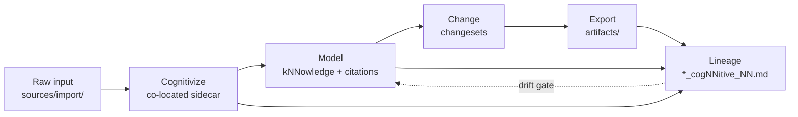

## 1. Enter — import

Raw files land in `sources/import/`. They arrive by hand (a file dropped in the folder),
fetched from the web, or refreshed from a Synchronization. Imports are **write-once**: a
changed external file lands as a new UTC-suffixed family member
(`<stem>_<YYYYMMDDTHHmmssZ>.<ext>`), and identical bytes are deduplicated. The
raw file is never moved or rewritten. See
[Import and cite sources](content/how-to/import-sources.md).

## 2. Cognitivize

`cognitivize` makes a raw file citable **in place** by writing a co-located sidecar
`<file>.<ext>_sidecar_NN.md` next to it. The sidecar records the raw file's `sha256`,
`size_bytes`, `source_format`, and `normalized_at`; for binary formats it also carries a
normalized Markdown body, so every heading becomes an addressable unit. There is no
mirror tree — the sidecar sits beside its subject. When the raw bytes change, a re-run
refreshes the sidecar and flags the downstream impact. See
[Cognitivize documents with sidecars](content/how-to/cognitivize.md).

## 3. Model — kNNowledge citing sources

The model step turns cognitivized sources into a `kNNowledge` document under
`kNNowledge/`. Each change carries an explicit `evidence::` pointer, using the
pointer grammar `<path>@## <Heading>`, `<csv>@<row>`, or `<json>@/<pointer>`. Because
the citations point at stable anchors rather than line numbers, they survive edits to the
source. See [Sources, citations and lineage](content/concepts/sources-citations-lineage.md).

## 4. Change — changesets

Mutations do not edit a model in place. They are proposed as a **changeset**: a sealed,
recorded list of operations (add an element, update a field, rename a concept, bump a
version, and so on) written under `changes/`. The changeset is validated before any write
and reviewed before it is applied, so every change to a model is auditable. See
[Review changesets](content/how-to/review-changesets.md).

The seal (`proposal_sha`) is an integrity check: it catches an accidental edit of the
proposal between proposal and apply. It carries no key, so it is not an authentication —
anyone who can edit the file can recompute it. Fields that share one evidence (an imported
row, for example) are set by one `set_fields` change; the facts every change of an apply
shares (`applied_at`, `batch`, `status`, the evidence hashes) are written once, in the
changeset frontmatter.

## 5. Export — artifacts

Producers write their output to `artifacts/`. Like imports, artifacts are **write-once**:
each output is a new family member named with a UTC suffix `_YYYYMMDDTHHmmssZ` before the
extension, and existing bytes are never overwritten. A non-`_NN.md` file is an artifact
lineage node only if it is a timestamped family member or declares upstream sources.

## 6. Trace — lineage

The **computed lineage** (`read_lineage`) is the map of the whole `domaiNN`; nothing is persisted.
Three of its sections — `# NN Sources`, `# NN ModelRecords`, `# NN Artifacts` — are
re-synced from the filesystem on every build; a fourth, `# NN Procedures`, is an
append-only run log. The record is found by its role, never by its file name. A
**drift gate** compares the managed sections against a fresh projection and reports any
disagreement. See [Sync lineage and back up a domaiNN](content/how-to/sync-and-backup.md).

## Why it matters

- **Every claim is traceable.** A modelled element points to a source anchor; a generated
  artifact points to its inputs.
- **Nothing is lost on re-import.** Write-once families mean an old citation stays valid
  even when the source is updated.
- **Changes are reviewable.** A model only changes through a recorded, validated
  changeset, not a silent edit.

## See also

- [Sources, citations and lineage](content/concepts/sources-citations-lineage.md)
- [The four levels](content/concepts/levels.md)
- [Ecosystem architecture](content/concepts/ecosystem.md)
- [Import and cite sources](content/how-to/import-sources.md)
- [Review changesets](content/how-to/review-changesets.md)

---

# Sources, citations and lineage

Provenance in cogNNitive rests on three words that are easy to blur together: **Source**,
**Citation**, and **Lineage**. They are distinct objects at distinct layers. Getting them
straight is what makes "where did this claim come from?" a mechanical question rather
than a research task.

## The problem

A knowledge base is only as trustworthy as its ability to answer: *what evidence backs
this element, and what did we build from it?* If a tool stores only the text of a claim,
that question is unanswerable. cogNNitive separates the evidence (a Source), the pointer
to it (a Citation), and the record of everything derived (the Lineage).

## Source

A **Source** is a file that lives under `sources/`. Concretely:

- **Raw imports** sit in `sources/import/`, exactly as they arrived.
- Each raw file is **cognitivized in place**: a co-located sidecar
  `<file>.<ext>_sidecar_NN.md` records its `sha256`, `size_bytes`, `source_format`, and
  `normalized_at`, and carries a normalized body for binary formats.
- Promoted conversation transcripts live in `sources/conversations/`.
- A **synthetic** source is a derived deliverable under `artifacts/`, cognitivized in
  place; its upstream is the `sources` it declares.

A Source is never a Citation and never a model. It is the ground truth a Citation points
at.

## Citation

A **Citation** is a pointer from a kNNowledge element to an anchor inside a Source. It
uses the `@` pointer grammar:

| Target | Grammar | Example |
|---|---|---|
| Markdown heading | `<path>@## <Heading>` | `sources/import/notes.md@## Key Clients` |
| CSV row | `<csv>@<row>` | `sources/import/prices.csv@SKU-42` |
| CSV cell | `<csv>@<row>&<column>` | `sources/import/prices.csv@SKU-42&amount` |
| JSON value | `<json>@/<pointer>` | `sources/import/data.json@/items/0/name` |
| kNNowledge unit | `<hierarchical-id>@<slug>` | `villabotijos-today/pepper-mapache@00-gancho` |

Rules that hold everywhere:

- The path is **`domaiNN`-relative and written in full** — there is no implicit prefix.
- A change cites one source per `evidence::` line; a change that needs several evidence items
  repeats the key (or uses a bracketed list `[a.md@## Intro, b.csv@SKU-42]`).
- A **binary** file cannot be cited directly; cite its sidecar instead.
- There is **no `src-NNN` identifier system and no line-number anchors** (`#L1-L10`).
  Anchors are human-readable headings, CSV row keys, or JSON Pointers.
- The path grammar is for **raw files** (including a sidecar's headings, such as
  `report.pdf_sidecar_NN.md@## Findings`). A kNNowledge document is cited with its
  [address](content/concepts/storage-and-identity.md), never by path and heading: `kNNowledge/x_NN.md@## A` is
  rejected as `MODEL_CITED_BY_PATH`, and a changeset cited by one of its headings is rejected as
  `NN_DOCUMENT_CITED_BY_HEADING`.

A Citation appears as the `evidence::` of an **applied change**. A kNNowledge unit has no
citation field of its own: the reserved property and `type:: citation` are banned on Level 3,
and its provenance is derived from the change log. A document that still carries one is
repaired the same way every other field is cleared: an `update_field` on the field with an
empty `to:: ""` (not `null`, not `undefined`), applied as a sealed change, so the removal is
itself recorded.

## Lineage

The **Lineage** is **computed, never persisted**. `read_lineage` projects the inventory from
the filesystem and the edges from the applied changes:

- **sources** — one entry per cognitivized raw file, with its sidecar and family version.
- **models** — one entry per knowledge document, with its `knowledge_version` and template.
- **artifacts** — one entry per generated file that is a write-once family member or has a
  `produce_artifact` change.
- **changes** — the changesets, each with its changes and status.
- **edges** — `evidence` (cited file → owner), `target` (unit → owner) and `produced`
  (artifact → changeset), all derived from the applied changes; live evidence by default,
  all-time on request.

There is no record to refresh, so there is nothing to drift: the projection is recomputed on
every call.

## `resolve_sources`

`resolve_sources` is the read-only tool that turns a Citation back into evidence. Given
an element, it resolves its citation-typed field(s) to the underlying file, anchor, and
content, returning one entry per reference with fields such as `path`, `anchor`,
`exists`, `field`, `origin`, `excerpt`, and `sha256`. The `origin` classifies who
produced the cited content (`agent`, `human`, or `document`), resolved from the `author::`
of the change block the citation anchors to. It never writes files.

## The drift check

Drift is the difference between the applied changes and the files on disk. `check_domain`
returns a `provenance` report: `EDITED_WITHOUT_RECORD` for a value edited by hand after the
change that set it, `UNIT_WITHOUT_RECORD` for a unit no change accounts for,
`EVIDENCE_UNKNOWN` for a change with no evidence, and `EVIDENCE_SOURCE_CHANGED` when the
cited bytes moved. `strict: true` replays the changes and compares the serialized body, so a
whitespace-only edit is drift there and not in the default fold. A model that applied changes
touched but that has no file (for example an instance model deleted by hand) is reported as `MODEL_WITHOUT_FILE`: a
warning in the default fold and an error in strict mode. Moving or renaming an instance model, or
extracting instances from a compact document, is recorded as a change, so it raises no drift. The
check is read-only.

---

# Storage and identity

A domaiNN can keep the instances of a concept in one kNNowledge document or spread them over
one document per instance. This page explains how a bluepriNNt declares that choice, how every
document gets an identity that does not depend on its neighbours, and the single address form
that references, change targets and citations of kNNowledge all share.

> [!NOTE]
> This page describes distributed storage as designed for the release that introduces it.
> Existing domaiNNs are **not** migrated by that release. See *Limitations* at the end of this page.

## The problem

Some information is naturally a list inside one document: the Programas of a tutoring business.
Some is naturally a set of independent units, each with its own folder, assets and lifecycle: the
Videos of a series. Until now the system had no way to declare which is which, so the second
shape lived on convention and workarounds:

- The same video was stored twice: as its own document and again as an element of a registry.
- File names carried the parent series so that two videos called `intro` would not collide.
- When two file names did collide, **both** ids silently changed to a path form, which orphaned
  every recorded change target.
- Three address syntaxes coexisted, one of them resolved by title.

The fix separates two questions. *What are the instances of this concept?* must have one answer,
whatever the physical layout. *Where does an instance live?* is declared in the bluepriNNt and
validated.

## Compact and distributed storage

| Form | Where the instances of a concept live |
|---|---|
| **Compact storage** | All instances are elements of one kNNowledge document. |
| **Distributed storage** | Each instance is the root of its own kNNowledge document, called an **instance model**, in its own folder. |

The child concepts of a distributed concept are **elements** of the instance model. They are never
files of their own.

### Distributed: a Series and its Videos

In the `video-script` bluepriNNt, `Series` and `Video` are distributed. `Scene` and `Layer` stay
compact: they are elements inside the Video instance model.

```
series/villabotijos-today/villabotijos-today_video-script_NN.md        Series instance model
series/villabotijos-today/assets/intro/intro_video-script_NN.md        Video instance model
  ## NN Video: Intro                      slug:: intro
  ## NN Scene: 00 Gancho                  slug:: 00-gancho
  ### NN Layer: Gancho Presenter          slug:: 00-gancho-presenter
series/innteresante/innteresante_video-script_NN.md                    Series instance model
series/innteresante/assets/intro/intro_video-script_NN.md              Video instance model
```

Two series, each with a Video `intro`. Both stay legal because identity is hierarchical (see
*Hierarchical identity* below).

### Compact: Programas in one document

The `tutorias` bluepriNNt of a tutoring business declares no storage for `Programa`, `Tutor` or
`Prestación de Servicios`, so all three are compact. They live as elements of one document,
`kNNowledge/LC_programas_Tutorias_NN.md`, whose model id is `LC_programas_Tutorias` (frontmatter
excerpt):

```markdown
---
scope_elements:
  - concept: Programa
  - concept: "Prestación de Servicios"
    parent: programa_ref
---
## NN Programa: Programa Alfa
slug:: programa-alfa

## NN Prestación de Servicios: Pedido 001
slug:: pedido-001
programa_ref:: @programa-alfa
```

A document in another folder cites the program as `LC_programas_Tutorias@programa-alfa`.

> [!NOTE]
> A folder of its own does not make a concept distributed. Only a declaration in the bluepriNNt
> does. A document in a per-instance folder whose concept declares no storage is an ordinary
> compact document and gets no placement checks.

### One collection, whatever the layout

A **collection** is the domain-wide set of instances of a concept, ordered by id. It is the same
whether the instances are instance models or compact elements. Reads see the collection, not the
layout:

| Read | How |
|---|---|
| `list_knowledge` | Returns every model with its `id`, `path`, `version`, `blueprint` and `storage` (`compact`, or the concept and container). It can also return the collection of a concept. |
| `query_units` | Accepts `collection:<Concept>?<filter>`, for example `collection:Video?status=published`. It evaluates the filter over every Video, in every instance model and every compact registry. |
| Domain console | Builds one collection per concept from the bluepriNNt declarations. Two copies of a domaiNN, one compact and one distributed, show the same titles and field values. |

An instance model that violates placement is still discovered and listed. It is flagged, never
silently dropped from its collection.

## Declaring storage per concept

Storage is declared on the **concept**, not on the bluepriNNt. One bluepriNNt can mix both forms,
and a concept with no declaration is compact. The declaration is three properties on the
`## NN Concept Definition:` element:

| Property | Meaning |
|---|---|
| `storage:: distributed` | Each instance is its own instance model. Omit it for compact. |
| `container:: <Concept>` | Optional. The distributed concept this concept's instances are stored under. |
| `placement:: "<path pattern>"` | Required when distributed, forbidden when compact. Where an instance lives. |

Worked example, from `video-script`:

```markdown
## NN Concept Definition: Series
slug:: series
type:: list
storage:: distributed
placement:: "series/{slug}/"

## NN Concept Definition: Video
slug:: video
type:: list
storage:: distributed
container:: Series
placement:: "{container}/assets/{slug}/"

## NN Concept Definition: Scene
slug:: scene
type:: list
```

`Scene` has no `storage`, so it is compact and lives inside the Video instance model.

Per concept, not per bluepriNNt, is what makes this work: `Series` and `Video` are promoted to
documents while `Scene`, `Layer` and `Preset` stay elements, all in one bluepriNNt. A local
bluepriNNt that includes `video-script` inherits the declarations through normal composition.
The three properties are declared by iNNfo `V_0-7-0`; a bluepriNNt that pins an older iNNfo
gets a warning for each of them as an unknown property.

### The placement pattern

The pattern is a path relative to the domaiNN root, ending in `/`.

| Rule | Detail |
|---|---|
| Literal segments | Lowercase kebab-case, for example `series` or `assets`. |
| `{slug}` | Exactly one. It becomes the instance's own slug. |
| `{container}` | Optional, only as the **first** segment, and only when `container::` is declared. It expands to the container instance's folder, so a contained instance is physically nested in its container. |
| Reserved | `..`, a segment starting with `.`, `archive`, `staging`, `specs`, `backups`, `sources` at the root, and `kNNowledge` (reserved for compact documents) are rejected. |

The folder that ends at `{slug}` is the **instance root folder**. It is the unit that moves, and
the instance model file sits directly in it, named `<slug>_<bluepriNNt-name>_NN.md`. The
concept is not part of the file name, and the parent is not either: that was the old workaround.

Inside the instance model, the **instance root** is the element of the distributed concept. Its
`slug::` must equal the folder slug.

### Declaration diagnostics

| Code | Raised when |
|---|---|
| `STORAGE_UNKNOWN_MODE` | `storage` is not `compact` or `distributed`. |
| `PLACEMENT_REQUIRED` | A distributed concept has no `placement`. |
| `PLACEMENT_FORBIDDEN` | A compact concept declares `placement` or `container`. |
| `PLACEMENT_INVALID` | The pattern breaks a rule of the table above. |
| `CONTAINER_NOT_DISTRIBUTED` | `container` names a concept that is not distributed. |
| `CONTAINER_CYCLE` | Containers form a cycle. |
| `PLACEMENT_OVERLAP` | Two patterns of one bluepriNNt can match the same folder. |

A compact document may not hold elements of a distributed concept, and a distributed concept's
container must itself be distributed.

## Storage is not inheritance

Placement says **where** an instance lives. The scope chain says **from whom it inherits values**.
The two are orthogonal, and declaring storage does not change the scope chain at all.

| Question | Answered by |
|---|---|
| Where must a Video document sit? | The `placement` of the `Video` concept. |
| Which values does it inherit? | The scope chain of its own path: enclosing folders that hold a document with `scope: true`, up to the domaiNN root. |

Two real settings documents show the chain:

- The series scope of `villabotijos-today` carries `voice_id`, `music`, `fps`, `resolution` and
  `output_formats`. Every episode of the series inherits them.
- `LC_programas_settings_NN.md` is a root-level scope with `precio_hora_tutoria: 84`, inherited by
  everything below it.

With the new `video-script`, the Series instance model **is** the series scope document: it
carries `scope: true`, and its root element's fields are the `series` level of the cascade.
`resolve_effective` still resolves `fps` for `villabotijos-today/pepper-mapache` from that
document, and being a member of a collection adds, removes or reorders no supplier. A folder that
holds an instance model but no `scope: true` document is not part of the chain.

## Terms: stem, title, slug, id, address

Five words name five different things. Taking one Video:

| Term | Meaning | Example |
|---|---|---|
| **stem** | The file name without `.md`. For instance models it derives from the folder slug and is **not** an identity. Equal stems in different folders are legal. | `pepper-mapache_video-script_NN` |
| **title** | The human label, shown in the console and in diagnostics. It is never used to resolve anything. | `El mapache fuera de la ley` |
| **slug** | The immutable identity of a concept, element or matrix, declared with `slug::`. For an instance it is also the last id segment and the folder name. | `pepper-mapache` |
| **id** | The identity of a kNNowledge document, derived from its path and the declarations of its bluepriNNt. | `villabotijos-today/pepper-mapache` |
| **address** | An id plus, optionally, an element and a field. | `villabotijos-today/pepper-mapache@00-gancho&voice` |

## Hierarchical identity

A model id carries its container, so it never depends on which other files exist.

| Kind | Id | Example |
|---|---|---|
| Compact model | The file name without `_NN`. Unchanged from before. | `LC_programas_Tutorias` |
| Instance model, no container | `<slug>` | `villabotijos-today` |
| Instance model in a container | `<container-id>/<slug>` | `villabotijos-today/intro` |

The two `intro` Videos of the example are `villabotijos-today/intro` and `innteresante/intro`.
Their stems are equal and that is fine: the stem is not the id.

Rules that hold everywhere:

- An id is derived **only** from the file's own path and the declarations of its bluepriNNt.
  Adding, removing or reordering other files never changes it.
- Ids are case-sensitive. Instance segments are lowercase slugs.
- Two models that derive the same id are an error, `DUPLICATE_MODEL_ID`, listing every path.
  Neither is preferred.
- The old collision rule is gone: no id ever flips to a path form and `AMBIGUOUS_MODEL_ID` no
  longer exists.
- A bare stem (`intro_video-script`) and a bare slug (`intro`) are not ids and do not resolve. An
  unresolved address lists the candidate ids that share its last segment.
- A path where an id is expected (a value ending in `.md`, or containing `\`) is
  `MODEL_ADDRESSED_BY_PATH`.
- `specs` is reserved as the first segment of an id (`RESERVED_MODEL_ID`), because
  `specs/<family>@...` addresses a bluepriNNt.
- A model whose bluepriNNt cannot be resolved gets no id: `MODEL_UNADDRESSABLE`. Tools refuse to
  address it, and there is no fallback id.

### Element identity

An element is addressed by its model id plus its slug. Slugs are unique within a model and may
repeat across models, so `00-gancho` can exist in every Video:

```
villabotijos-today/pepper-mapache@00-gancho
villabotijos-today/intro@00-gancho
```

Element **names** are display text. Repeating a name is legal; a repeated **slug** in one model is
still `DUPLICATE_SLUG`.

### When an instance moves

Moving an instance to another container, or changing its slug, changes its id and the id of every
instance nested under it. Element slugs inside the model never change:

| Before | After moving `innteresante/intro` into `villabotijos-today` |
|---|---|
| `innteresante/intro` | `villabotijos-today/intro` |
| `innteresante/intro@00-gancho` | `villabotijos-today/intro@00-gancho` |

The old id stops resolving. A move happens only through the `move_model` operation (see
[Distribute a concept](content/how-to/distribute-a-concept.md)). Targets recorded in earlier changesets
keep resolving to the moved instance, so history stays attached and no drift is reported. The
sealed changesets are never edited.

If the new id is taken, the move is rejected with `MODEL_EXISTS`. Here `villabotijos-today/intro`
already exists, so moving `innteresante/intro` there would fail.

### When an instance is removed

A removal is a change too. `remove_model` names the instance model id and nothing else, and applying
it deletes the model file; the change block, the model's earlier changes and git history are what
keep the old content recoverable, so nothing is copied into an archive folder.

The id becomes a **terminal** state instead of a reported loss: `MODEL_WITHOUT_FILE` no longer fires
for it, while a file that disappears with no recorded removal is still reported. An address to the
removed id is `REF_MODEL_NOT_FOUND`, and the message names the changeset that recorded the removal —
there is no successor to retarget to. The model's units leave the live graph, so `check_domain` and
the console show no units for it, and its history stays queryable from the change log.

Two guards make the removal deliberate. A model whose folder still holds another model is refused
with `REMOVE_MODEL_HAS_DESCENDANTS`: remove the children first. A model a live typed reference
addresses is refused with `REMOVE_LEAVES_DANGLING_REFERENCES`, and the same changeset must carry the
`update_field` that retargets or clears each reference. A compact model is
`REMOVE_REQUIRES_INSTANCE`: `remove_model` removes an instance model only.

## One reference grammar

Every kNNowledge unit is addressed with one syntax:

```
<hierarchical-id>[@<slug>[&<field>]]
```

It is used by reference fields, by the `target` of every change, by the recorded `resolved_target`,
and by citations whose target is a kNNowledge unit.

| Address | Points at |
|---|---|
| `villabotijos-today/pepper-mapache` | A model. In a field that expects an element, an instance model id alone means its instance root. |
| `villabotijos-today/pepper-mapache@00-gancho` | An element. |
| `villabotijos-today/pepper-mapache@00-gancho&voice` | A field of an element. |
| `villabotijos-today/pepper-mapache@00-gancho&#body` | The prose body of an element. |
| `villabotijos-today@villabotijos-today&voice_id` | A field of the Series root. `villabotijos-today&voice_id` is invalid because it names no element. |

The unit forms `@concept:<slug>`, `@matrix:<slug>` and matrix cells `@<matrix>&<row>&<col>` are
unchanged.

Rules:

- **Titles are display-only.** Resolution never uses a title, and two documents with the same
  title are not an error. A field stores the address and the console shows the target's title.
- **An address resolves exactly or not at all.** A partial id never resolves, even when only one
  model has that slug today, because adding a second would change its meaning.
- **Inside a document, same-document references are relative**: `@programa-alfa`, not the full
  address. An absolute self-reference is `ADDRESS_NOT_CANONICAL`, so internal references survive a
  move.
- **Nobody types ids by hand.** The console reference editor searches by title and writes the
  address of the selected target. When several targets share a title, each is shown with its
  address and none is picked for you.
- Concept and bluepriNNt membership checks (`target_concepts`, `target_template`) apply to the
  target an address resolves to, whatever its storage form.

### What was removed

There is no second form and no compatibility mode. The old forms are rejected:

| Removed form | Use instead |
|---|---|
| `[[Villabotijos Today :: Celedonio Full]]` (title-qualified reference) | The address of the target. |
| `[[Programa Alfa]]` as the value of a reference field | `@programa-alfa` (same document) or the full address. |
| A file name stem, or a path, as a model id | The hierarchical id. |
| `kNNowledge/x_NN.md@## Revenue` (a model cited by path and heading) | `<model-id>@<slug>`. Rejected as `MODEL_CITED_BY_PATH`. |
| `changes/x_changes_NN.md@## NN Change: c-09` (a changeset cited by heading) | Rejected as `NN_DOCUMENT_CITED_BY_HEADING`. |

Wikilinks in prose and descriptions are display text, not addressing, and are untouched. So are
citations of raw files: `sources/import/notes.md@## Heading`, CSV rows, JSON pointers and
`<file>_sidecar_NN.md` headings keep the path grammar described in
[Sources, citations and lineage](content/concepts/sources-citations-lineage.md).

### Reference diagnostics

| Code | Meaning |
|---|---|
| `ADDRESS_MALFORMED` | A segment breaks the grammar. The message names the segment. |
| `ADDRESS_NOT_CANONICAL` | A same-document reference written as an absolute address. |
| `REF_MODEL_NOT_FOUND` | No model has that id. The message lists candidates and, after a move, names the recorded successor; after a recorded removal, it names the changeset that removed the model. |
| `REF_ELEMENT_NOT_FOUND` | The model exists but not the element. |
| `REF_CONCEPT_MISMATCH` | Warning: the target's concept is not in `target_concepts`. |
| `REF_BLUEPRINT_MISMATCH` | Warning: the target's bluepriNNt does not match. |

## Placement validation

Discovery stays path-agnostic: any `_NN.md` file that qualifies as a model is a model. Placement
validation then compares what was found with the bluepriNNt declarations. For instances of
distributed concepts it checks four things:

1. The file sits where the placement pattern says.
2. Its name satisfies the naming contract.
3. Its identity is unique.
4. The instance is **not** also stored as an element of another document.

`check_domain` reports them in a `layout` section. `validate_knowledge {workspace: true}` files each
one against the model it names. Plain `validate_knowledge` on one file reports only what one file
can know: placement, naming and cardinality.

| Code | Severity | Meaning |
|---|---|---|
| `PLACEMENT_MISMATCH` | error | The instance is not at its expected folder. The message shows the folder. |
| `INSTANCE_NAME_MISMATCH` | error | The file name is not the one the folder slug requires. |
| `INSTANCE_SLUG_MISMATCH` | error | The root element's `slug::` differs from the folder slug. |
| `CONTAINER_MISSING` | error | The container instance does not exist. |
| `DUPLICATE_MODEL_ID` | error | Two documents derive the same id. |
| `DISTRIBUTED_CONCEPT_IN_COMPACT_MODEL` | error | Elements of a distributed concept sit in a compact document, including a registry that duplicates an instance model. |
| `MIXED_INSTANCE_MODEL` | error | One instance model holds roots of two distributed concepts. |
| `MODEL_UNADDRESSABLE` | error | The bluepriNNt cannot be resolved, so there is no id. |
| `RESERVED_MODEL_ID` | error | The derived id starts with `specs`, which is reserved for blueprint addresses. |
| `MODEL_ID_INVALID` | error | An id cannot be placed: wrong segment count, a non-slug segment, or a `/` on a compact concept. |
| `DUPLICATE_SLUG` | error | Two elements in one model carry the same `slug::`; the second is dropped from the graph. |
| `INSTANCE_SHADOWS_ELEMENT_ASSETS` | warning | An element of the container model has the same slug as a contained instance, so both use that folder under `assets/`. |
| `BLUEPRINT_VERSION_SKEW` | error | See the next section. |
| `MODEL_WITHOUT_FILE` | warning in `check_domain`, error in strict replay | A model touched by applied changes has no file and no recorded change — a move that ends in a live model, or a removal — that explains it. |
| `STALE_TARGET_MOVED` | error | A pending change names an instance that was renamed after the change's `base_version`; retarget it to the new id. |

Messages have the form `<CODE>: <subject> - <what is wrong>; <fix>`, always name the path, and
carry a `severity` of `error` or `warning` on the finding itself (`check_domain.layout`). For
example:

```
PLACEMENT_MISMATCH: series/x/videos/intro/intro_video-script_NN.md holds Video "intro" - Video instances live at series/x/assets/intro/; move the file there
```

Two or more roots of one concept in a single document also fail, with a cardinality error naming
the concept.

## Version uniformity

A domaiNN uses **one version per bluepriNNt**. A document pins exactly one bluepriNNt, so this is
the same as one version per concept, for compact and distributed storage alike.

`check_domain` reports `BLUEPRINT_VERSION_SKEW` as an error, **once per bluepriNNt**, not once per
document:

```
BLUEPRINT_VERSION_SKEW: bluepriNNt "video-script" (concepts: Series, Video) - pinned at 2 versions across 24 models: V_0-15-0 (20: <first 3 paths>...), unpinned (4: <paths>); a domaiNN uses one version per bluepriNNt, run nn-update
```

- A bare name such as `video-script`, or a pin whose URL cannot be classified, is listed as an
  **incomparable** pin. It is never counted as uniform.
- Two different bluepriNNts, for example `villabotijos-today` and `innteresante`, are never
  compared with each other.
- Single-file `validate_knowledge` does not report skew. It sees one document.
- A new instance model pinned to an older version makes the finding appear again.

> [!IMPORTANT]
> The rule is not limited to distributed concepts. Any domaiNN whose documents pin one bluepriNNt
> at several versions now fails `check_domain`.

[nn-update](content/skills/nn-update.md) fixes skew: its upgrade unit is the whole bluepriNNt group.
It repins and re-validates every member, or none, and a document added after the plan was made
aborts the run. When a group is already skewed, the whole group goes to the adopted version.

## Limitations

- **Existing domaiNNs are not migrated.** The `video_NN` and `LC_programas` domaiNNs fail
  validation once their documents pin a bluepriNNt version that declares storage, and no flag
  silences the errors. Migrating them is a separate, later change.
- **Removing an instance model is a recorded change.** `remove_model` deletes the file and keeps the
  record; deleting a file by hand is still reported as `MODEL_WITHOUT_FILE` (a warning in the default
  check, an error in strict replay).
- **Scene and Layer cannot be split into their own files.** Children of a distributed concept stay
  elements.
- **Compact to distributed only.** `extract_instance` converts in that direction. Converting back
  is not specified.
- **No per-instance or lazy upgrades.** Version uniformity is all-or-nothing.
- **Skew between different local bluepriNNts** that compose one shared bluepriNNt at different
  versions is not detected.
- **Staleness checks scan the newest 50 changesets.** A pending change older than that window is
  not checked for a stale target. This was already the case.

## See also

- [Distribute a concept](content/how-to/distribute-a-concept.md) - declare, create, move and extract.
- [The four levels](content/concepts/levels.md)
- [The specification chain](content/concepts/specifications.md)
- [Validator behavior](content/concepts/validator-behavior.md)
- [Sources, citations and lineage](content/concepts/sources-citations-lineage.md)
- [Review changesets](content/how-to/review-changesets.md)
- [Glossary](content/reference/glossary.md)

---

# Tags and open taxonomy

cogNNitive has two layers of classification. The first is **structural**: a bluepriNNt
declares a taxonomy of Concepts and the parent-child edges between them. The second is
**cross-cutting**: `tags`, a free-form label an author attaches to any element. This page
explains why tags are deliberately ordinary, and what "no reserved primitive" means.

## The problem

A strict taxonomy is necessary — it is what makes validation possible — but it is a bad
fit for questions that cut across the structure: "show me everything that touches
security", "which elements came from this quarter's review?". Forcing those into the
schema would mean inventing a Concept for every passing concern. The answer is a second,
open layer that does not disturb the schema.

## The model

`tags` is **not a reserved property and not a primitive**. It is an ordinary Field of type
`select` with `multiple:: true`, declared by a bluepriNNt exactly like any other Field:

```markdown
# NN Field Definition

## NN Field Definition: tags
concept:: *
type:: select
multiple:: true
```

- Because it is a normal Field, it validates like any other: an element's tag values are
  checked against the Field's declared `options`, and it can be queried and filtered like
  any other Field.
- A tag is simply **a value of the `tags` Field**. There is no special tag object, no tag
  registry, and no dedicated primitive behind it.
- A **flag** is a single tag value (e.g. `tags:: [reviewed]`); a **valued** marker is just
  a normal declared Field.

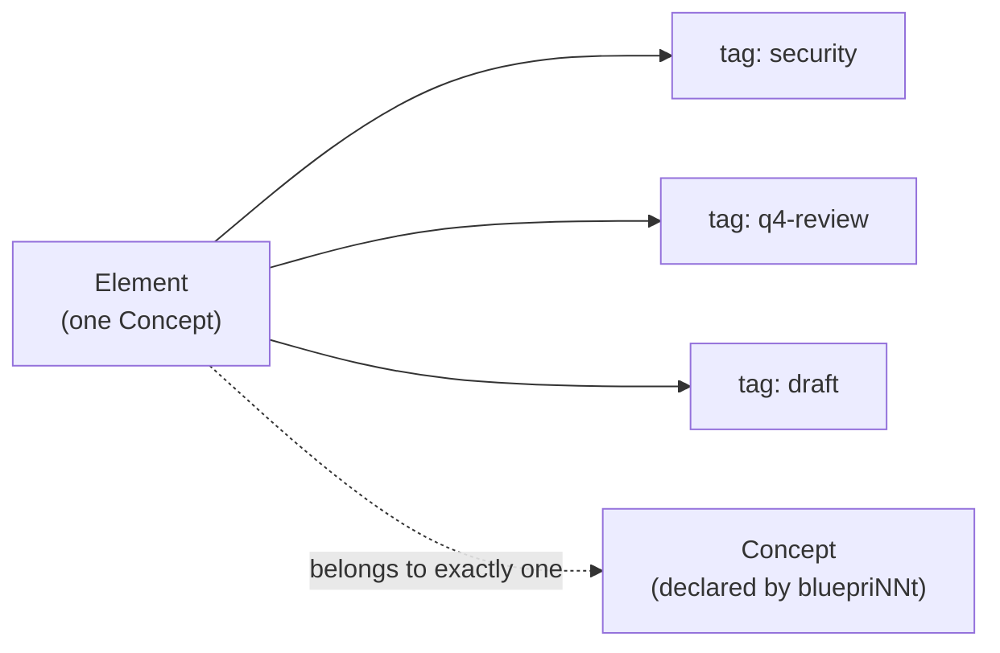

## No Marker primitive

Older versions of the format had a dedicated **Marker** primitive — `Marker Definition`
elements and an `item-markers` matrix. That primitive was **retired in iNNfo V_0-5-0**.
A document that still carries one fails validation with `MARKERS_REMOVED`, and the fix is
mechanical: a flag marker becomes a value of the `tags` Field, and a valued marker becomes
a normal declared Field. There is no migration flag and no legacy mode — the construct is
simply gone.

## Cross-cutting classification and view filtering

Because a tag is independent of the Concept an element belongs to, one tag can span many
Concepts and one element can carry many tags. That is what makes tags *cross-cutting*:
they express concerns the structural taxonomy does not.

And because `tags` is an ordinary Field, the ordinary tooling works on it — no special
case required. Query and filter operations select elements by tag value the same way they
select by any other Field, and the domain console's views can group or filter by tag. The
open vocabulary is what lets a team invent a label today and start filtering on it without
a schema change.

## Why it matters

- **The taxonomy stays honest.** Structural meaning lives in the bluepriNNt; passing
  concerns do not pollute it.
- **Nothing is special-cased.** Treating tags as a plain Field means one grammar, one
  validator, one query engine — fewer moving parts, fewer surprises.
- **The layer is open.** New classifications are additive; they never require a new
  primitive.

## See also

- [Canonical vocabulary](content/vocabulary.md)
- [Validator behavior](content/concepts/validator-behavior.md)
- [The four levels](content/concepts/levels.md)
- [MCP tools](content/reference/mcp-tools.md)

---

# Validator behavior

Validation is where cogNNitive's guarantees actually live. A model is not "probably
fine" — it is either conformant or it is not, and the reasons are a deterministic list of
diagnostics. This page explains what the validator checks, how it ranks findings, how it
resolves the schema to check against, and how the per-document validator differs from the
repository-wide gate.

## The problem

An AI agent can produce a document that *looks* right and is structurally wrong: a
duplicate slug, an unknown Concept, a `select` value outside its allowed set, a citation
to a heading that no longer exists. Without a deterministic checker, those defects are
found late, by a human, by accident. cogNNitive validates on every read, write, and
build, with the same rules everywhere.

## Deterministic validation

The validator is a pure function of the document and its resolved parent. Given the same
inputs it produces the same diagnostics, in a stable order — no randomness, no network,
no clock. It runs as a single entry point so that the MCP server, the console, and the
skills all hold a document to one set of rules:

- A **document-hygiene** pass checks frontmatter keys, body structure, and naming
  conventions.
- A **schema-conformance** pass (for level-2 and level-3 documents with a resolved
  parent) checks the document against the Concepts, Fields, and Matrices its parent
  declares.

The two passes are merged into one flat view of `errors` and `warnings`.

## Severity levels

Every diagnostic is routed to a bucket by its severity:

| Severity | Effect | Examples |
|---|---|---|
| `error` | The document is invalid. | `MARKERS_REMOVED`, `DUPLICATE_SLUG`, `RESERVED_CONCEPT_NAME`, `L3_SCHEMA_COMPONENTS`, `INVALID_NESTED_CONCEPT`, `AMBIGUOUS_ELEMENT_NAME`, `QU_NOT_PROVENANCE`, `PLACEMENT_MISMATCH`, `DUPLICATE_MODEL_ID`, `BLUEPRINT_VERSION_SKEW` |
| `warning` | Reported, but does not affect validity. | `UNFROZEN_MODEL`, `PARENT_CONCEPT_GUIDANCE_INCOMPLETE`, `TEMPLATE_CACHE_STALE`, `NN_NAME_INVARIANT` |
| `info` | An informational notice, reported but never blocking. | `BOM_WARNING` (a byte-order mark was stripped before parsing) |

A document is valid when it has **no errors**. Warnings and informational notices are
surfaced so they stay visible, but they do not fail validation. The citation checks
(`KU_*`) sit in this system too — for example `KU_BINARY_TARGET` tells you to cite a
binary's sidecar, and `KU_EXCLUDED_PATH` reports that a `staging/` path is scratch, not
missing.

## The diagnostic list

A diagnostic carries a stable `code`, a `path` into the document, a human-readable
`message`, and often a `promptHint` describing the fix. Representative codes by area:

| Area | Codes |
|---|---|
| Removed constructs | `MARKERS_REMOVED` |
| Identity and naming | `DUPLICATE_SLUG`, `UNFROZEN_MODEL`, `RESERVED_CONCEPT_NAME`, `NN_NAME_INVARIANT` |
| Structure | `INVALID_NESTED_CONCEPT`, `SECTION_CONCEPT_MISMATCH`, `L3_SCHEMA_COMPONENTS` |
| References | `AMBIGUOUS_ELEMENT_NAME`, `SUBMODEL_NOT_FOUND`, `SUBMODEL_TEMPLATE_MISMATCH`, `ADDRESS_MALFORMED`, `ADDRESS_NOT_CANONICAL`, `REF_MODEL_NOT_FOUND`, `REF_ELEMENT_NOT_FOUND` |
| Layout and identity | `PLACEMENT_MISMATCH`, `INSTANCE_NAME_MISMATCH`, `INSTANCE_SLUG_MISMATCH`, `CONTAINER_MISSING`, `DUPLICATE_MODEL_ID`, `DISTRIBUTED_CONCEPT_IN_COMPACT_MODEL`, `MIXED_INSTANCE_MODEL`, `MODEL_UNADDRESSABLE`, `RESERVED_MODEL_ID`, `MODEL_ID_INVALID`, `INSTANCE_SHADOWS_ELEMENT_ASSETS`, `BLUEPRINT_VERSION_SKEW` |
| Citations | `KU_DANGLING_FILE`, `KU_UNKNOWN_SLUG`, `KU_UNKNOWN_ROW`, `KU_UNKNOWN_POINTER`, `KU_BINARY_TARGET`, `KU_EXCLUDED_PATH`, `QU_NOT_PROVENANCE`, `MODEL_CITED_BY_PATH`, `NN_DOCUMENT_CITED_BY_HEADING` |
| Freshness | `TEMPLATE_CACHE_STALE`, `BOM_WARNING` |

The full set is produced by the validator; treat this table as a map of the areas, not an
exhaustive list. See [Validator behavior](content/how-to/validate-domain.md) in practice, and
[Sources, citations and lineage](content/concepts/sources-citations-lineage.md) for the citation codes.

## File-level and domain-level findings

Some findings can only be made with the whole domaiNN in view. Validating one file reports what
one file can know: for an instance model, its placement, its naming and its cardinality. Findings
across files (a duplicate id, a container that does not exist, an instance stored twice, a
bluepriNNt pinned at several versions) are reported by `check_domain` in its `layout` section, and
by `validate_knowledge` with `workspace: true`, filed against the document they name. See *Placement validation* in
[Storage and identity](content/concepts/storage-and-identity.md).

## Resolution order

Before a document can be checked, its parent bluepriNNt must be found. Resolution is
**domain-first**, then outward:

1. The `domaiNN`'s `specs/bluepriNNts/<name>/` package directory.
2. The flat `specs/` fallback under the domain root.
3. The global `~/.agents/bluepriNNts/` store.
4. The bluepriNNts bundled with installed skills.

The same ordered list drives both the actual lookup and the "searched:" paths shown when
resolution fails, so where a bluepriNNt is found cannot drift from where the engine
claims to have looked. See [The specification chain](content/concepts/specifications.md).

## Two gates, two jobs

There are two validators, and it is important not to conflate them:

- **The per-document validator** checks **one document** against its resolved parent and
  returns diagnostics. This is the one your agent runs (through the `validate_knowledge`
  and `validate_blueprint` tools) and the one the console runs when it renders a model.
- **The repository gate** (`node scripts/verify.js`) is a contributor-facing check for the
  cogNNitive source repository itself: blueprint inventory parity, drift guards between
  generated artifacts and their sources, static type checking, license checks, the
  discovered test suites, and the hand-typed-facts and lineage-drift guards. It is not part
  of your domaiNN.

The first answers "is this document valid?"; the second answers "is the cogNNitive
repository internally consistent and buildable?". They share the engine underneath but
serve different scopes.

## See also

- [The specification chain](content/concepts/specifications.md)
- [Sources, citations and lineage](content/concepts/sources-citations-lineage.md)
- [Storage and identity](content/concepts/storage-and-identity.md)
- [Tags and open taxonomy](content/concepts/tags-and-taxonomy.md)
- [Validate a domaiNN](content/how-to/validate-domain.md)
- [MCP tools](content/reference/mcp-tools.md)

---

# Integrations and discipline overlaps

cogNNitive sits at the intersection of two questions: *how do we plug external tools into
an agent's workflow?* and *which established disciplines is this actually built on?* This
page answers both precisely, without pretending cogNNitive replaces any of them.

## Part A — MCP vs CLI

An external capability can reach an AI agent in two ways. They are not competitors; each
fits a different shape of work.

| | **MCP server** | **CLI** |
|---|---|---|
| Interface | Tools with declared input schemas, called over a protocol | Commands run in a shell |
| Agent sees | A typed tool with named arguments | Free-form command line and raw stdout/stderr |
| Discovery | The agent introspects the tool's schema before calling | The agent must know the command and parse its output |
| Configuration | Declared once in the client's MCP config | Depends on the shell environment |
| Best for | Structured, interactive, exploratory calls | Batch jobs, pipelines, and heavy local processing |

cogNNitive uses **both, on purpose**:

- Its semantic operations — reading, resolving, validating, proposing and applying
  changesets, querying, cognitivizing — are exposed through the `nn-mcp` server, so an
  agent can call them with typed arguments. See [MCP tools](content/reference/mcp-tools.md).
- Its heavy ingestion and batch work — scanning a folder, converting a PDF, refreshing a
  single source, curating a CSV — runs through the `nn-sources` CLI, where a long-running
  local process is the right tool. See
  [CLI and scripts](content/reference/cli.md).

The same split applies to third-party tools. A media-generation or cloud service that
publishes an MCP server can be called with schema-checked arguments and credentials kept
in the MCP process environment; the same service as a CLI is invoked from the shell and
its text output parsed. Neither is "better" in the abstract — the choice follows whether
the work is interactive and typed (MCP) or batch and local (CLI).

## Part B — Discipline overlaps

cogNNitive does not invent a new discipline. It recombines several established ones on a
shared substrate: plain Markdown, optional Git, and deterministic validation. What
follows is what each shares — and where the overlap stops.

### Model-Driven Engineering

The four-level chain (`defiNNition → iNNfo → bluepriNNt → kNNowledge`) is a
**metamodeling architecture**: a meta-specification defines the language used to describe
bluepriNNts, which are the metamodels against which concrete kNNowledge is validated. The
resolver walks the parent chain and validation is deterministic. This is the same problem
solved by OMG's MOF/MDA layers and by DSL tooling.

*Where it stops:* cogNNitive does not generate code and does not perform PIM-to-PSM
transformations. Its output is validated knowledge and derived artifacts, not executable
software.

### Knowledge Management

The lifecycle turns **tacit** input (what is in people's heads and meetings) and
**explicit** input (documents and spreadsheets) into a living base that is enriched on
each pass — the classic tacit/explicit cycle.

*Where it stops:* classic knowledge management usually stops at capture, classification,
and search. cogNNitive adds a verifiable contract (validation against a bluepriNNt) and
origin traceability, but it does not replace an organisation's knowledge-management
practice.

### Enterprise Architecture

The level-2 bluepriNNts act as domain **viewpoints**, and matrices act as typed
relationship matrices between domains — the same conceptual scaffolding found in
frameworks such as TOGAF and notations such as ArchiMate.

*Where it stops:* cogNNitive provides the **language** to model architecture. It does not
implement an architecture development method or a governed enterprise repository.

### Ontology Engineering

Concepts, elements, typed fields, and references compose a directed graph with backlinks
and an open, cross-cutting tag layer — structurally analogous to a knowledge graph or a
controlled vocabulary.

*Where it stops:* the graph is **descriptive**. There is no inference engine, no axioms,
and no automated reasoning.

### Docs as Code

Documentation is treated as source code: plain Markdown, versioned in Git, reviewed
through branches and pull requests, and built automatically, with the repository as the
single source of truth. cogNNitive's own site is generated this way.

*Where it stops:* Docs as Code optimises authoring and publishing. cogNNitive layers a
validated semantic model and an agent-consumption channel on top, which Docs as Code does
not prescribe.

### Personal Knowledge Management

Local-first Markdown, `[[WikiLinks]]`, a navigable graph, and index notes are shared with
personal knowledge-management tools.

*Where it stops:* those tools are personal and schema-free. cogNNitive keeps the same
linking intuition but adds a mandatory schema, deterministic validation, and source
traceability, so the knowledge scales from one person to a team and to an agent.

## The differentiator

The value is not any single overlap but their **intersection**: metamodeling plus
knowledge management plus deterministic validation, on a Markdown and Git substrate, with
an agent-consumption channel. No one of these disciplines covers all of it at once — and
cogNNitive does not claim to.

## See also

- [Ecosystem architecture](content/concepts/ecosystem.md)
- [The four levels](content/concepts/levels.md)
- [The knowledge lifecycle](content/concepts/knowledge-lifecycle.md)
- [MCP tools](content/reference/mcp-tools.md)
- [CLI and scripts](content/reference/cli.md)

---

# Interaction flows

The cogNNitive skills are not independent commands: they form a routing graph whose hub is
[nn](content/skills/nn.md). `nn` owns the job loop, and each stage hands off to the skill that owns the actual
work. This page maps the real hand-offs.

## Entry and job loop

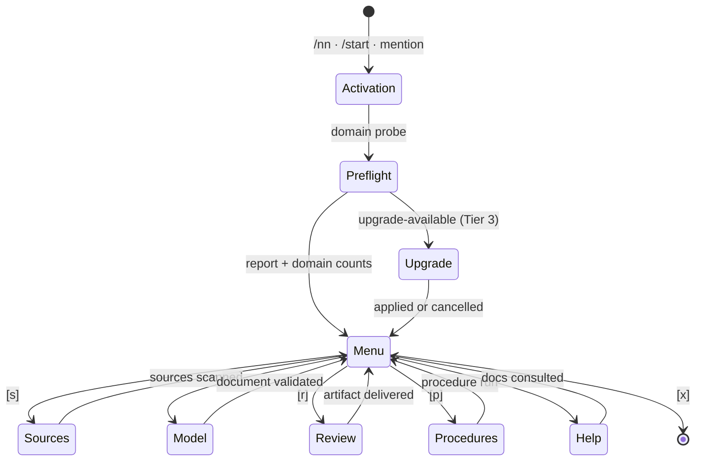

`nn` is the sole gate owner for a session: it runs the [nn-preflight](content/skills/nn-preflight.md) domain probe
once, then presents the loop. The other skills delegate their activation gate to `nn-preflight` and
skip it when `nn` already ran it.

## Skill hand-offs

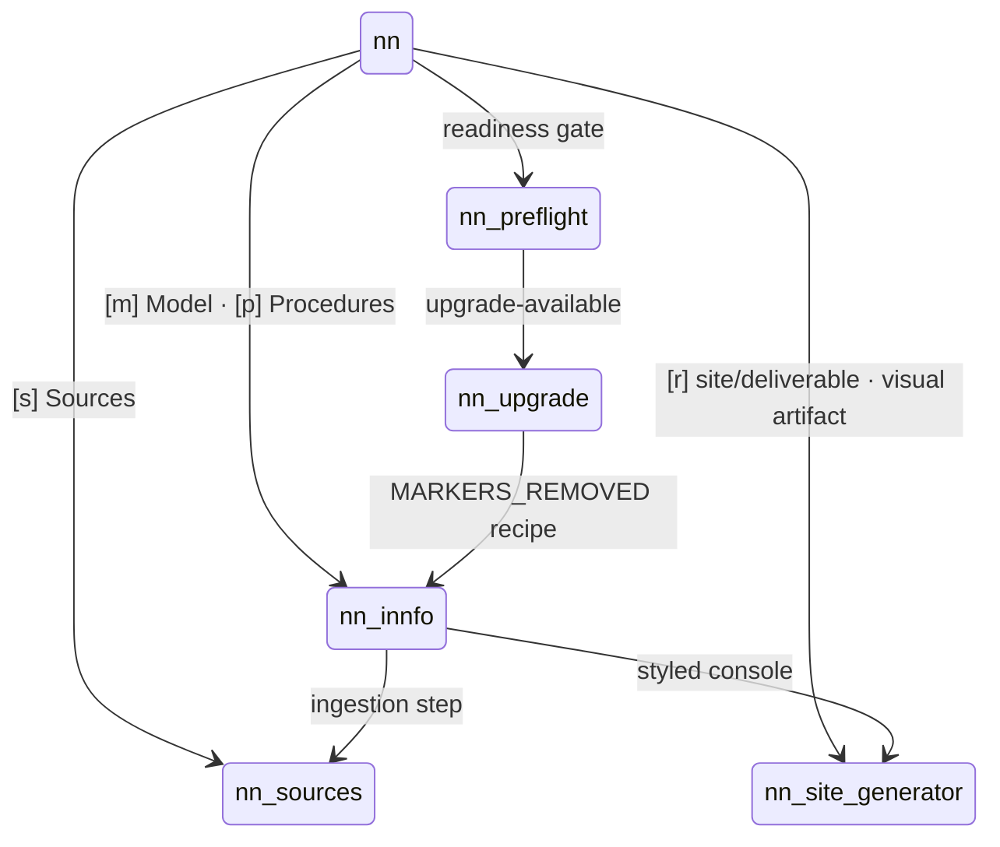

## Transitions

| From | Trigger | To |
|---|---|---|
| Entry | `/nn`, `/start`, or a mention of `cognnitive`/`cogNNitive` | [nn](content/skills/nn.md) |
| [nn](content/skills/nn.md) | Activation → domain probe | [nn-preflight](content/skills/nn-preflight.md) |
| [nn](content/skills/nn.md) | `[s] Sources` selected | [nn-sources](content/skills/nn-sources.md) |
| [nn](content/skills/nn.md) | `[m] Model` selected | [nn-innfo](content/skills/nn-innfo.md) |
| [nn](content/skills/nn.md) | `[r] Review & Deliverables` → site or web deliverable | [nn-site-generator](content/skills/nn-site-generator.md) |
| [nn](content/skills/nn.md) | `[p] Procedures` → procedure selected | [nn-innfo](content/skills/nn-innfo.md) (Procedure Execution Protocol) |
| [nn](content/skills/nn.md) | Visual artifact requested (console, dashboard, site) | [nn-site-generator](content/skills/nn-site-generator.md) (design presets) |
| [nn-preflight](content/skills/nn-preflight.md) | Tier-3 scan reports `upgrade-available` | [nn-update](content/skills/nn-update.md) |
| [nn-update](content/skills/nn-update.md) | Impact analysis finds a marker-bearing document | [nn-innfo](content/skills/nn-innfo.md) (`MARKERS_REMOVED` recipe) |
| [nn-innfo](content/skills/nn-innfo.md) | A procedure step declares CLI ingestion | [nn-sources](content/skills/nn-sources.md) |
| [nn-innfo](content/skills/nn-innfo.md) | Console/HTML artifact must be styled | [nn-site-generator](content/skills/nn-site-generator.md) (design presets) |
| [nn-site-generator](content/skills/nn-site-generator.md) | Design tokens needed for generated pages | its own `presets/` directory |
| [nn-skills-lifecycle](content/skills/nn-skills-lifecycle.md) | Activation gate / path lookup | [nn-preflight](content/skills/nn-preflight.md) |

## Declared dependencies

Beyond runtime hand-offs, skills declare hard dependencies in the distribution manifest. Those
dependencies are installed and updated together, and they define the minimum working set for a
workflow:

- [nn-sources](content/skills/nn-sources.md) requires [nn-innfo](content/skills/nn-innfo.md) and [nn-preflight](content/skills/nn-preflight.md).
- [nn-update](content/skills/nn-update.md) requires [nn-preflight](content/skills/nn-preflight.md).
- [nn-skills-lifecycle](content/skills/nn-skills-lifecycle.md) requires [nn-preflight](content/skills/nn-preflight.md).

## See also

- [Agent skills overview](content/skills/README.md) — what a skill is and how the ecosystem is composed.
- [nn](content/skills/nn.md) — the front controller that owns the loop.
- [nn-preflight](content/skills/nn-preflight.md) — the shared activation gate and Tier-3 detection.

---

# MCP tools

`nn-mcp` is a **stdio MCP server** that wraps the `@cognnitive/nn-core` engine. An MCP client (OpenCode, Claude Code, or any MCP-compatible agent) starts it as a child process and talks to it over the standard input/output streams — there is no HTTP endpoint and no daemon. The server exposes the iNNfo operations an agent needs to read, validate, and mutate a domaiNN through structured tool calls instead of freeform file edits.

> [!NOTE]
> You normally never call these tools yourself — your agent does, driven by the cogNNitive skills. This page is the reference for what the agent runs behind the scenes (and for contributors wiring new tools). To get something done, start from the [How-To Guides](content/how-to/install-agent.md).

## Tool inventory

The table below is generated from the `nn-mcp` tool registry, so it always reflects the tools the built server actually exposes.

<!-- generated:mcp-tools (source: nn-mcp tool registry; run node scripts/generate-docs-facts.mjs) -->
**24** tools

| Tool | Description |
|------|-------------|
| `list_knowledge` | Scan the knowledge directory and list every iNNfo knowledge document with its id, path, version, blueprint and storage. Pass `collection` to list one concept's members instead (it spans distributed instances and compact copies; each item then carries its placement finding, if any) |
| `read_knowledge` | Parse and return an iNNfo knowledge document's full structure by its id. For surgical work prefer bounded slices: pass concept (+ element) with max_lines (default 150); slices over the cap truncate with truncated=true unless override_reason records a manual override |
| `get_spec` | Resolve the iNNfo specification (level-1) from an explicit url or from a loaded knowledge document. Provide either url or knowledge_id — the URL is never taken from an internal constant |
| `get_blueprint` | Resolve an iNNfo blueprint (level-2) from an explicit url or from a loaded knowledge document. Provide either url or knowledge_id — blueprint names/URLs are never hardcoded |
| `validate_knowledge` | Validate an iNNfo knowledge document against its blueprint. Provide id (file on disk) or content (raw text). The blueprint is resolved from the knowledge parent_spec.url, or from an optional blueprint_url |
| `apply_change` | Apply an intent-level change or changeset to knowledge documents and re-validate. Supports two-phase execution (validate, then persist atomically) from changes/ documents or bare intent operations. Every operation that mutates a Level-3 kNNowledge model (including freeze_slugs and bump_version) is synthesized into a sealed, recorded changeset; only generate_index and the Level-2 bluepriNNt authoring operations (add_concept, add_field, bump_version on a bluepriNNt) write directly. After an applied or partially applied changeset the domain console is regenerated (pass open: true to also open it in a browser tab). The result carries console (the regeneration outcome) and next_steps: you MUST relay next_steps.notice to the user. |
| `regenerate_console` | Regenerate the domain console (or one model-scoped console); pass open: true to also open it in a browser tab. Idempotent: an up-to-date console is reported as unchanged. Also the retry path after an apply whose console regeneration failed. The result carries console and next_steps: you MUST relay next_steps.notice to the user. |
| `propose_changeset` | Write a sealed changeset with status proposed under changes/ from a structured list of operations, then regenerate the domain console so the user can review it (pass open: true to also open it in a browser tab). It never applies the changeset. You derive the operations (update_field, set_fields, add_element, remove_element, rename_element, rename_concept, update_matrix_cell, update_concept_text, update_element_text, remove_matrix, add_matrix, comment, add_model, move_model, remove_model, freeze_slugs, bump_version, produce_artifact); the tool does not interpret conversations. Validation runs before any write: an unknown model, an add_model on an existing model, or an operation missing required keys returns errors and writes nothing. The result carries changeset, console and next_steps: you MUST relay next_steps.notice to the user. When the user replies OK, call apply_change with next_steps.approve.changeset. |
| `init_domain` | Create an empty, conformant domaiNN container in a new directory: the canonical folders (kNNowledge/, sources/import/, sources/conversations/, conversations/, artifacts/, procedures/, staging/, changes/), a .gitattributes with * -text and a domaiNN_NN.md manifest listing no models. Refuses a directory that exists and is not empty. It is not a changeset; add models afterwards with an add_model changeset (propose_changeset) or init_knowledge. Migration recipe: init_domain for a NEW domain, import the old domain as a source (migrate-domain.js --import-as-source), derive add_model/add_element changes whose evidence cites it, propose_changeset, review, apply_change. |
| `validate_knowledge_url` | Validate an iNNfo knowledge document fetched from a URL without writing to disk. Accepts a knowledge URL and optional blueprint_url. Returns validation results. |
| `validate_blueprint` | Validate a Level 2 blueprint against its Level 1 parent spec with frontmatter level-2 auto-detection and parent resolution failure diagnostics |
| `init_knowledge` | Create a new level-3 knowledge document. Create-only: it is a wrapper over a one-change add_model changeset (written to changes/ and applied), so the creation is recorded as a change. It scaffolds canonical YAML frontmatter and a starter body (one section per Concept, no index block: taxonomy lives in the blueprint) from the resolved blueprint schema; an unresolvable blueprint fails and writes nothing. The model id is `<name>_<blueprint>` and carries no version (the version lives in knowledge_version): the server canonicalizes the id you pass (drops any `_V_x-y-z` token, appends `_<blueprint>` when missing) and returns the canonical id. An existing id fails with MODEL_EXISTS and the file is untouched (it never repairs or rewrites a document). Returns filePath, content and changeset on success (none of them on failure), plus console and next_steps: you MUST relay next_steps.notice to the user. |
| `list_blueprints` | List all available Level 2 spec blueprints across local domain, global environment, and installed skills |
| `hydrate_blueprint` | Hydrate (copy) a Level 2 spec blueprint from global or skill store into active domain blueprints directory |
| `sync_domain_manifest` | Reconcile the domain manifest against the documents the domain is made of. The ## NN kNNowledge section (legacy ## NN Models) is an inventory: additively appends new entries, archives entries whose file disappeared, and reactivates tool-owned entries whose file returned. The # NN Sources, # NN Procedures and # NN Artifacts sections are single pointers: appends a tool-owned path:: entry for a discovered catalog document, never adds a status:: field, never creates a section the manifest does not declare, and reports a pointer whose catalog document is missing as missing-target without editing it. Never touches hand-authored entries lacking the <!-- nn:auto --> ownership marker. Defaults to a dry run. |
| `check_domain` | Run one consolidated domain integrity pass over every Level-3 knowledge document: validate each against its blueprint and traceability, self-heal missing blueprint packages/specs (write-once hydration), classify each pinned blueprint version against the published catalog, check provenance (evidence warnings, drift between the applied changes and the files, and ARTIFACT_WITHOUT_RECORD; read-only), and return one report with a per-knowledge status and a domain aggregate. Non-blocking and informational — validation failures never fail the tool. |
| `query_units` | Run a read-only content query over one workspace file and return matching knowledge-unit URIs: "path?filter=value[&filter...][&projection]". Filters use exact match (trimmed, case-insensitive); a trailing bare segment projects one column/field over the matches. Capped at 100 results with truncated=true. Pass max_values_chars to cap projected value characters for slice-only surgical reads. Never writes files. |
| `cognitivize` | Create or refresh the sidecar (`<file>_sidecar_NN.md`) of one raw file in place, so it can be cited. Markdown, CSV, and JSON files are handled directly; binary formats (PDF, DOCX, XLSX, images) are converted when the environment has converter adapters available. Paths outside the workspace, sidecars, and NN documents are rejected. |
| `read_lineage` | Read-only computed lineage view of the domain: {sources, models, artifacts, changes, edges, diagnostics}. Inventory comes from the filesystem; edges come from the applied changes (evidence: cited file -> model/artifact, target: unit -> owner, produced: artifact -> changeset). `scope` selects live evidence (the last applied change of each unit, default) or all-time evidence; `focus` narrows every section to refs containing it. A non-regenerable artifact with no produce_artifact change is ARTIFACT_WITHOUT_RECORD. Never writes files. |
| `resolve_sources` | Read-only: resolve an element's citation-typed field(s) to their underlying file, anchor, and content. Returns one entry per citation reference: {path, anchor, exists, field, origin, author?, excerpt?, sha256?, version?, error?}. `origin` classifies who produced the cited content ("agent" \| "human" \| "document"), resolved from the `author::` of the `## NN Change:` block the citation anchors to. Omit fieldName to resolve across every citation-typed field on the element (name-based sources/source plus any schema-declared type:: citation field). Never writes files. |
| `list_blueprint_procedures` | List all procedures defined in a blueprint and its transitively included blueprints up to depth 10. A procedure that loses a name clash is returned with status shadowed (shadowed_by names the winner), never dropped. With path (a document or scope directory) the listing is scope-aware: the procedures visible from that scope, selected and shadowed (model > nearest scope > ... > root procedures/ > the bluepriNNt package), each with its source, slots, fork record and warnings; a path outside any domaiNN returns NO_DOMAIN_ROOT with the directories searched. The scoped listing is bound to the server domain root: path cannot be combined with domain or root (INVALID_ARGUMENT), and path must be a non-empty string. |
| `list_blueprint_skills` | List all agent skills defined in a blueprint and its transitively included blueprints up to depth 10. Skills shipped inside a package under skills/<name>/SKILL.md are returned with embedded: true and a resolved absolute path. |
| `resolve_effective` | Read-only: the effective value of a key at a document (or at one scope element of it), folded over the scope chain with a merge strategy, plus the trace that explains it. Strategies: override (nearest declaration wins), union (named entries accumulate, nearer shadows farther) and none (only the target node supplies the value; ancestors and the bluepriNNt floor are reported under notInherited, never inherited). The floor is the single document under the defaults/ folder of the bluepriNNt package named by the innermost scope document. Returns {present, value, winner, trace}, or a structured error (NO_DOMAIN_ROOT, PATH_OUTSIDE_SCOPE, UNSUPPORTED_STRATEGY, UNKNOWN_ELEMENT, ...). Never writes files. |
| `explain` | Read-only: why a key resolves the way it does at a document (or at one scope element of it). Takes the same inputs as resolve_effective and returns the same trace, plus the chain of scopes it was computed over (node ids and kinds, outermost first) and the floor supplier. Never writes files. |
<!-- /generated:mcp-tools -->

The registry is the single source of truth: each tool's name, description, and JSON input schema are defined once in the server's `TOOL_REGISTRY`, and the ListTools result, the call dispatcher, and any count are all derived from that one table. Parameters are documented per tool in its input schema; several tools accept a `domain` argument with a `root` alias (see below).

## The `domain` / `root` argument convention

Most tools that read or write a domaiNN accept an optional `domain` argument naming the domain root directory. When omitted, the tool uses the server root (the directory the server was started in, resolved by walking up to the repository root). `root` is an exact alias for `domain` — passing either has the same effect, and passing both is not needed. A handful of tools also accept other aliases for compatibility, such as `id` / `knowledge_id` for a document id.

`resolve_effective` and `explain` are the exception to that convention: they take no `domain` or `root` override, because every `path` is checked against the server's own domain root (`PATH_OUTSIDE_SCOPE`). Both return a structured error (`{ ok: false, code, detail }`) instead of failing, and both fold values over the scope chain with the same nn-core resolver the drift CLI uses.

## Read-only vs mutating tools

Tools fall into two groups:

- **Read-only** — scanning, reading, resolving, and validating. Examples: `list_knowledge`, `read_knowledge`, `get_spec`, `get_blueprint`, `list_blueprints`, `list_blueprint_procedures`, `list_blueprint_skills`, `validate_knowledge`, `validate_knowledge_url`, `validate_blueprint`, `check_domain`, `query_units`, `resolve_sources`, `resolve_effective`, `explain`, `read_lineage`. These never write to disk: `read_lineage` computes the lineage view from the filesystem and the applied changes and returns it, nothing more.
- **Mutating** — creating or changing files. Examples: `init_domain`, `init_knowledge`, `apply_change`, `propose_changeset`, `regenerate_console`, `cognitivize`, `hydrate_blueprint`, `sync_domain_manifest`. A mutation of a Level-3 kNNowledge model is synthesized into a sealed, recorded changeset rather than written directly — including `remove_model`, which deletes the model file only as part of the recorded change. Two writes sit outside that rule: `generate_index` rewrites a model's index block in place, and the Level-2 authoring operations (`add_concept`, `add_field`, `bump_version` on a bluepriNNt) edit a schema document directly. Neither records a changeset, so neither carries changeset provenance.

## The `next_steps.notice` contract

Every mutating tool that regenerates (or tries to regenerate) the domain console returns a `next_steps` object. Its `notice` field is a numbered, human-readable summary of what happened and what to do next, and the calling agent **MUST relay `next_steps.notice` to the user** verbatim. The console is static HTML and cannot call the MCP server, so approval always travels back through the agent: a proposal result also carries `next_steps.approve` (the reply and tool to invoke), while an apply result does not.

A tool result is a versioned machine envelope: payload keys sit at the top level alongside a `version` field of the form `innfo-<tool>@<major>`. Consumers must check the version before parsing.

## See also

- [Install and connect an AI agent](content/how-to/install-agent.md)
- [Ecosystem architecture](content/concepts/ecosystem.md)
- [CLI and scripts](content/reference/cli.md)

---

# bluepriNNts catalog

A **bluepriNNt** is a Level-2 (L2) domain schema: a specification file that declares the concepts, elements, fields, and matrices a domaiNN's kNNowledge documents must conform to. A kNNowledge document names its bluepriNNt in its `parent_spec`, and the validator resolves the schema from there. For the full abstraction chain, see [The four levels](content/concepts/levels.md).

The catalog below is distributed with the ecosystem and is the authoritative list at [`iNNfo/specs/bluepriNNts/catalog.json`](../../iNNfo/specs/bluepriNNts/catalog.json). Each entry's **adopted** column is the `blueprint_version` currently published; the **tier** column is the distribution tier (`core` or `free`).

## Distributed bluepriNNts

| bluepriNNt | Adopted version | Tier |
|---|---|---|
| `analysis` | `V_0-4-0` | free |
| `artifacts` | `V_0-5-0` | core |
| `blank` | `V_0-4-0` | core |
| `business` | `V_0-5-0` | free |
| `business-model` | `V_0-4-0` | free |
| `changes` | `V_0-5-2` | core |
| `design-presets` | `V_0-4-0` | free |
| `documentation` | `V_0-4-0` | free |
| `domaiNN` | `V_0-4-0` | core |
| `innovation` | `V_0-4-0` | free |
| `metrics` | `V_0-5-0` | free |
| `organization` | `V_0-4-0` | free |
| `procedures` | `V_0-5-0` | core |
| `projects` | `V_0-4-0` | free |
| `repository` | `V_0-3-0` | free |
| `sidecar` | `V_0-1-1` | core |
| `sources` | `V_0-3-0` | core |
| `coNNtent` | `V_0-2-2` | free |
| `visual-catalog` | `V_0-3-0` | free |

## Frozen bluepriNNts

Two bluepriNNts are **frozen**: they are pinned to a fixed version and no longer receive new releases, because they define structural identities the rest of the ecosystem depends on.

| bluepriNNt | Adopted version | Notes |
|---|---|---|
| `cogNNitive` | `V_0-5-0` | The root blueprint every other blueprint and kNNowledge document ultimately traces to. |
| `workspace` | `V_0-10-0` | Frozen legacy blueprint for the domaiNN container. The container concept is now named `domaiNN`; the frozen `workspace` identifier is retained for legacy resolution only. |

## See also

- [The four levels](content/concepts/levels.md)
- [The specification chain](content/concepts/specifications.md)
- [MCP tools](content/reference/mcp-tools.md)

---

# CLI and scripts

Reference for the command-line interfaces shipped with the ecosystem: the `nn-sources` ingestion CLI and the repository scripts that build, generate, and verify the project.

> [!NOTE]
> You normally never run these commands yourself — your agent does. This page is the reference for the command surface behind the agent-first guides (and for contributors). For everyday use, see the [How-To Guides](content/how-to/import-sources.md).

## `nn-sources` CLI

The ingestion CLI lives in the `nn-sources` skill at `skills/nn-sources/scripts/index.js`. It normalizes raw documents into citable sources and audits their citations. Run it from the repository root, or from the skill's own directory as `node scripts/index.js`.

```bash
node skills/nn-sources/scripts/index.js <flags> --src <project-dir>
```

| Flag | Purpose |
|---|---|
| `--cognitivize <file\|dir>` | Create or refresh the co-located sidecar of a file, or of every file in a directory (recursive; skips sidecars, `_NN.md` documents, `staging/`, and dot entries). The raw file is never modified. |
| `--normalize-file <file>` | Atomic single-file refresh: cognitivize one file in place and audit downstream citations. |
| `--scan` | Walk `sources/import/` and `sources/conversations/` recursively and cognitivize every raw file without an up-to-date sidecar. Non-interactive: never mutates sources. |
| `--check-impact` | Verify every change `evidence` in `kNNowledge/` resolves to an existing file and anchor; print `[IMPACT WARNING]` for drifted anchors. Exits non-zero on drift errors. |
| `--import-url <url>` | Download a resource into `sources/import/` as a write-once, UTC-suffixed family member. |
| `--sync [alias]` | Refresh the `## NN Synchronization:` elements declared in `sources/sources_NN.md` (all active ones, or one alias): mirror models under `sources/sync/<alias>/`, land other files under `sources/import/<alias>/`, and print a `propose_changeset` payload recording the before/after sha256. Exits 1 when an origin is unreachable. |
| `--curate-csv <path> --key <column> [--dedup]` | Produce a citation-ready RFC-4180 CSV with a unique first-column key under `artifacts/curated/`. |
| `--converge <family> [--plan]` / `--converge-mark <family> --version <V_x-y-z>` | Compare the two newest members of a timestamped source family and emit a read-only proposal, optionally as a `propose_changeset` payload; mark a proposal applied. |
| `--gc [--json]` / `--gc --apply --yes --paths <paths>` | List superseded, uncited write-once family members (dry run), or delete the confirmed paths. |
| `--unlink <path-or-stem>` | Remove a source, its co-located sidecar, and matching assets. Consent-gated. |
| `--promote-conv <file> --format full` | Promote a session transcript into `sources/conversations/`. |

The skill also ships `skills/nn-sources/scripts/extract.js` for quick text extraction without ingestion:

```bash
node skills/nn-sources/scripts/extract.js "<file>" [--format pdf|docx|xlsx|doc|txt|md|csv|json|html]
```

## Repository scripts

| Script | Purpose | Invocation |
|---|---|---|
| `scripts/generate-docsify-suite.mjs` | Generate the Docsify navigation and index artifacts (`_sidebar.md`, `_navbar.md`, `llms.txt`, `ai-index.yaml`) from a domain model. | `node scripts/generate-docsify-suite.mjs <model-path> [--output-dir <dir>] [--dry-run]` |
| `scripts/generate-docs-facts.mjs` | Regenerate the generated documentation regions (the `mcp-tools` inventory and the `skills-catalog`) from their canonical sources. | `node scripts/generate-docs-facts.mjs [--check] [--against <git-ref>]` |
| `scripts/export-console.mjs` | Compile the self-contained domain console (`domaiNN_console.html`) from a workspace's Level-3 kNNowledge documents. A domain may raise or lower its own size ceiling with `console_size_budget_warn` / `console_size_budget_fail` (bytes) in the `domaiNN_NN.md` frontmatter; above the fail threshold the export drops resolved citations, then per-element provenance, instead of aborting. | `node scripts/export-console.mjs <workspaceRoot> --domain [--no-open]` |
| `scripts/verify.js` | Deterministic, offline verification runner: inventory parity, static type checks, and generated-manifest freshness. | `node scripts/verify.js [--fast] [--only=<substring>] [--jobs=N] [--verbose]` |
| `scripts/build-docs.mjs` | Build orchestration for the docs site: build `@cognnitive/nn-core` and `@cognnitive/nn-mcp`, then stage the blueprint catalog. | `node scripts/build-docs.mjs` (honors `INNFO_DOCS_OUT`) |
| `scripts/nn-session.mjs` | Manage per-session git worktrees cut from `main` for isolated development. | `node scripts/nn-session.mjs start\|list\|status\|stop\|sweep [--id <id>] [--no-install]` |

## See also

- [MCP tools](content/reference/mcp-tools.md)
- [Sources, citations and lineage](content/concepts/sources-citations-lineage.md)

---

# Glossary

Short definitions of the terms used across this documentation. The canonical vocabulary is defined machine-readably in [`iNNfo/specs/vocabulary.json`](../../iNNfo/specs/vocabulary.json); this page is the human-readable index.

| Term | Definition |
|---|---|
| **address** | The one syntax that points at a kNNowledge unit: `<hierarchical-id>[@<slug>[&<field>]]`, for example `villabotijos-today/pepper-mapache@00-gancho&voice`. References, change targets and citations of kNNowledge all use it. A title is never an address. See [Storage and identity](content/concepts/storage-and-identity.md). |
| **artifact** | A producer output written under `artifacts/`. Artifacts are write-once: each output is a new family member named with a UTC suffix `_YYYYMMDDTHHmmssZ`, and existing bytes are never overwritten. |
| **blueprint_version** | The Level-2 frontmatter key that carries a bluepriNNt's version. It replaces the retired `template_version` key. |
| **bluepriNNt** | A Level-2 (L2) domain schema specification file that declares the concepts, elements, fields, and matrices a kNNowledge document must conform to. The retired aliases `template` and `app` are not used. |
| **changeset** | A sealed, recorded set of proposed graph mutations (operations) written under `changes/`. A mutating change to a kNNowledge model is synthesized into a changeset, reviewed, then applied. |
| **citation** | The `evidence` of an applied change: a pointer to a Source anchor, written with the pointer grammar `<path>@## <Heading>` (Markdown), `<csv>@<row>`, or `<json>@/<pointer>`. It is carried by the applied change, never by a model field. A citation whose target is a kNNowledge unit is an address, not a path. |
| **cognitivize** | The operation that creates or refreshes a raw file's co-located sidecar in place, leaving the original file untouched. It is surfaced through the `nn-sources` CLI (`--cognitivize <file\|dir>`) and the `cognitivize` MCP tool. |
| **collection** | The domain-wide set of instances of a concept, ordered by id. It is the same whether the instances are instance models or compact elements. |
| **compact storage** | A storage form declared per concept: all instances of the concept are elements of one kNNowledge document. A concept with no storage declaration is compact. |
| **concept** | A top-level section of an iNNfo document, introduced by the `# NN <Concept>` heading. A concept groups the elements that belong to it. |
| **console** | The user-facing UI that shows and reviews a domaiNN: the self-contained domain console (`domaiNN_console.html`, one per domaiNN). It replaces the retired Vue editor and hosted web app. |
| **defiNNition** | The Level-0 (L0) meta-specification language in which specifications are written. It is the root of the abstraction chain. |
| **distributed storage** | A storage form declared per concept (`storage:: distributed`): each instance is the root of its own kNNowledge document, an instance model, in its own folder. Child concepts stay elements of that document. |
| **domaiNN** | The container that holds a project's kNNowledge, bluepriNNts, sources, procedures, and artifacts. A domaiNN is itself a kNNowledge document. |
| **drift** | A divergence between the applied changes and the files on disk: a value edited by hand after the change that set it. `check_domain.provenance` reports it as `EDITED_WITHOUT_RECORD` in `check_domain.provenance` and `validate_knowledge`. |
| **element** | A named entry inside a concept, introduced by the `## NN <Concept>: <Element>` heading. An element carries fields and free-form prose. |
| **field** | A `key:: value` property declared on an element, concept, or document. Fields are the atomic values a schema defines and a document populates. |
| **hierarchical id** | The id of a kNNowledge document, derived only from its path and the declarations of its bluepriNNt. An instance model id is `<container-id>/<slug>`, for example `villabotijos-today/intro`. It changes when the instance moves. |
| **iNNfo** | The Level-1 (L1) concrete specification meta-template that defines the root primitives (Concept Definition, Field Definition, Matrix Definition). It is the language every bluepriNNt and kNNowledge document is written in. |
| **instance model** | The kNNowledge document of one instance of a distributed concept. Its root element is that instance, and its child concepts are elements. It lives at the path the placement rule gives. |
| **kNNowledge** | The Level-3 (L3) domain data model that conforms to a bluepriNNt. It is an uncountable noun: write "N kNNowledge documents". The retired alias `model` is not used. |
| **knowledge_version** | The Level-3 frontmatter key that carries a kNNowledge document's version. The version never appears in the file name; the retired key is `model_version`. |
| **lineage** | The record `<project>_cogNNitive_NN.md` that traces every Source, kNNowledge document, and artifact, together with the Synchronizations and an append-only procedures log. |
| **model id** | The identifier of a kNNowledge document. A compact model's id is its file name without `_NN`, of the form `<name>_<blueprint>`; an instance model's id is hierarchical. It carries no version; the version lives in the `knowledge_version` frontmatter key. |
| **placement rule** | The path pattern a bluepriNNt declares with `placement::` on a distributed concept. It says where an instance model must live, for example `series/{slug}/`. |
| **sidecar** | A co-located `<file>.<ext>_sidecar_NN.md` document that records a raw file's hash, size, and metadata and, for binary files, a normalized body. It is a kNNowledge-level document that is never a model. |
| **slug** | The immutable identity of a concept, element, or matrix, declared with the `slug:: <slug>` key. Slugs stay stable across renames so citations and addresses keep resolving. |
| **source** | A raw or derived file brought into a domaiNN and made citable, living under `sources/import/` (or `sources/conversations/`) with a co-located sidecar. Sources are immutable; a changed file becomes a new write-once family member. |

## See also

- [Canonical vocabulary](content/vocabulary.md)
- [The four levels](content/concepts/levels.md)
- [Sources, citations and lineage](content/concepts/sources-citations-lineage.md)
- [Storage and identity](content/concepts/storage-and-identity.md)

---

# nn

`nn` is the **primary front controller** of the cogNNitive ecosystem — the single interactive entry
point that most users start from. It activates on `/nn`, `/start`, or any mention of `cognnitive`
or `cogNNitive`, and it organizes domaiNN work into a continuous, job-oriented loop rather than a
flat command list.

## Activation contract

`nn` activates when the user types `/nn` or `/start`, mentions `cognnitive`/`cogNNitive`, or
begins an interactive session inside a cogNNitive domaiNN. On activation it prints the session
greeting banner and then runs the environment readiness gate.

## Environment readiness gate

`nn` is the **sole gate owner** for the session: it runs the fast local domain probe and surfaces
the result before showing the menu.

```bash
node skills/nn-preflight/scripts/domain-probe.js --workspace-dir . --json
```

The probe returns:

- **Preflight status** — Node.js version, `nn-mcp` availability, and domaiNN integrity. Exit
  code `1` signals non-blocking, actionable warnings that are shown without halting the session.
- **Domain state counts** — pending raw files in `sources/import/`, active kNNowledge documents,
  and available executable procedures (domain and blueprint scopes).

Because the probe is deterministic, the menu can recommend the right stage instead of asking the
user to guess.

## Job-loop menu

The menu expresses work as a loop: ingest sources, model them, review the results, then run
procedures — and around again.

```text
[s] (Recommended) Sources — Ingest, scan, normalize, or refresh sources (<N> pending)
[m] Model — Create, author, validate, or audit kNNowledge models (<N> models)
[r] Review & Deliverables — Generate/preview dashboards, sites, consoles, reports
[p] Procedures — Discover and execute domain & blueprint SOP procedures (<N> available)
[h] Help & Documentation — Explore blueprints catalog, specs, guides, and the capabilities catalog
[x] Cancel / Exit
```

The `(Recommended)` tag is assigned dynamically to the first actionable stage:

1. If `sources.pending_count > 0` → `[s] (Recommended)`
2. Else if `knowledge.count > 0` → `[m] (Recommended)`
3. Else (empty workspace) → `[s] (Recommended)`

The `[s][m][r][p][h][x]` shape and the recommended selection are fixed. Contextual capabilities —
such as source ingestion — appear *inside* a stage, never as a new top-level letter. `nn` runs no scan
or digest at session start; synchronizing an external origin is always an explicit `--sync` request.

## Routing and the procedure catalog

`nn` aggregates executable procedures from three scopes before presenting them:

1. **Model scope** — procedures declared inline or attached to active kNNowledge documents.
2. **Blueprint scope** — SOPs declared in the parent bluepriNNt's `procedures/` folder.
3. **Domain scope** — global domaiNN procedures under `procedures/`.

When the same procedure name appears in more than one scope, precedence is
**model > nearest scope > ... > domain root > blueprint** (the bluepriNNt is the floor), and each option displays its origin badge (for example
`[p1] Extract Key Risks [blueprint:business]`).

`nn` does not execute procedure steps from its own text. It routes the selected procedure to the
canonical **Procedure Execution Protocol** owned by [nn-innfo](content/skills/nn-innfo.md).

## System governance

`nn` enforces the shared governance and UX protocol for the whole ecosystem:

- **Zero unilateral mutation (consent first)** — never move, rename, delete, or restructure user
  files without explicit confirmation.
- **Recommended option first** — the computed default carries the `(Recommended)` tag and is
  presented first.
- **Conversations as reference** — allocate the session transcript in `conversations/` at start and
  auto-promote it at close (the user may opt out); transcripts are retained unconditionally.
- **Optimistic execution and reversibility** — proceed immediately on safe, standard, reversible
  actions, and reserve explicit confirmation for destructive ones.
- **Session language coherence** — keep the user's active conversation language across prompts,
  responses, and menus.
- **Business-user abstraction guard** — suppress internal engine plumbing (AST roles, raw hashes,
  line-ending warnings) and communicate in terms of domain value.

## Help

The `[h] Help` stage lists the platform capabilities — including **Synchronizations**, which keep a local
mirror of an external file or folder up to date on request, without daemons — and points at the bluepriNNts
catalog, specifications, and guides.

## See also

- [nn-preflight](content/skills/nn-preflight.md) — the readiness gate `nn` delegates to.
- [nn-sources](content/skills/nn-sources.md) — the owner of the `[s] Sources` stage.
- [nn-innfo](content/skills/nn-innfo.md) — the owner of the `[m] Model` stage and procedure execution.
- [Interaction flows](content/skills/interaction-flows.md) — the full hand-off map.

---

# nn-sources

`nn-sources` is the ingestion and provenance skill. It bootstraps projects, scans raw documents,
normalizes them into citable **sources**, and records every artifact through a change. It is the
owner of the `[s] Sources` stage of the [nn](content/skills/nn.md) job loop.

Its two non-negotiable rules:

- **Mandatory sidecar provenance** — every cognitivized raw file gets a co-located sidecar
  `<file>.<ext>_sidecar_NN.md` recording its origin metadata.
- **No manual parsing bypass** — never hand-compute a SHA-256, hand-build a converted table, or
  hand-edit sidecar frontmatter. Always go through the canonical toolchain.

## Supported formats

Raw files are cognitivized **in place**: the tool reads the raw bytes and writes a sidecar next to
the file. The raw file is never moved, renamed, or rewritten.

| Format | Route |
|---|---|
| `txt`, `md`, `csv`, `json` | Direct read — cited directly. |
| `png`, `jpg` | Multimodal vision; `sharp` for local resize. |
| `pdf` | `pdf-parse` (on-demand install). |
| `docx` | `mammoth`. |
| `xlsx` | `xlsx`. |
| `doc` | Unsupported — legacy; convert to `.docx` first. |

Raw media (`.mp3`, `.wav`, `.png`, `.jpg`, and similar) is not converted by the scanner. To make
its content citable, place a transcript or description as a text source and cognitivize that.

## Import guard

Before `--scan` normalises an incoming source — a raw file with no sidecar, or one whose bytes
changed — it runs two guards over it:

- **Duplicate guard** — the same raw bytes (or the same normalized body) as a source already in the
  domaiNN is an *exact* duplicate; a text-native subject whose structural similarity reaches `0.5`
  is a *near* duplicate.
- **History guard** — prior handling of the same file name, stem, or path, searched in
  `conversations/` and `sources/conversations/`.

A flagged source is answered **reuse**, **adjust**, or **from scratch**: reuse writes nothing and
cites the existing source, adjust normalises the incoming file and reconciles the pair, and from
scratch keeps it as an independent source. The interactive menu asks; a non-interactive `--scan`
applies the deterministic default — reuse for an exact duplicate, adjust otherwise — and prints the
decision per flagged file. `--cognitivize` and `--normalize-file` name one file explicitly, so they
do not run the guards.

## Sidecar provenance

Every cognitivized raw file gets a sidecar with origin-metadata frontmatter. `cognitivize` is the
only writer; it owns `source_file`, `sha256` (of the raw bytes), `size_bytes`, `source_format`,
`normalized_at`, and `normalized_by` when a converter ran. The body is present only for binary
sources.

```yaml
---
level: 3
parent_spec:
  name: sidecar
  url: "https://raw.githubusercontent.com/cogNNitive/cogNNitive-web/main/iNNfo/specs/bluepriNNts/sidecar/spec_NN.md"
source_file: "sources/import/interview_transcript_20261001T101500Z.pdf"
sha256: "e3b0c44298fc1c149afbf4c8996fb92427ae41e4649b934ca495991b7852b855"
size_bytes: 1048576
source_format: "pdf"
normalized_at: "2026-10-01T10:15:00Z"
normalized_by: "traNNsform v1.0.0"
---
```

A re-run with unchanged bytes writes nothing (`unchanged`); changed bytes rewrite the sidecar in
place (`refreshed`). Semantic metadata and summaries live in the `sources_NN.md` catalog, so the
sidecar stays the single source of truth for physical and cryptographic facts.

## Citation contract

Citations live in the change `evidence:: <path>@<unit>` — one per change, with
a domaiNN-relative path written in full (no implicit prefix).

| Source kind | Unit | Example |
|---|---|---|
| Markdown | `@## Heading` | `sources/import/notes.md@## Key Feedback` |
| CSV | `@<row-id>` or `@<row-id>&<col>` | `sources/import/metricas_q3.csv@104&mrr_usd` |
| JSON | JSON Pointer (RFC 6901) | `sources/import/data.json@/items/0/name` |
| Binary | cite the sidecar | `sources/import/report.pdf_sidecar_NN.md@## Findings` |

Binary raw files cannot be cited directly (citing one reports `KU_BINARY_TARGET`). Line-number
ranges are prohibited; heading anchors, CSV row keys, and JSON Pointers are mandatory. Any
`staging/` path is never a valid citation target.

## CLI reference

The skill ships its own CLI. Run it from the skill folder, or via
`node skills/nn-sources/scripts/index.js`:

```bash
node scripts/index.js <flag> [--src "<project-dir>"]
```

| Flag | Purpose |
|---|---|
| `--src <dir>` | The domaiNN directory to operate on. |
| `--dest <dir>` `--name <n>` | Bootstrap a new project at a destination parent folder. |
| `--scan` | Walk `sources/import/` and `sources/conversations/`, cognitivizing every raw file that lacks an up-to-date sidecar. |
| `--cognitivize <file\|dir>` | Cognitivize one file or a directory recursively (skips sidecars, `_NN.md`, and `staging/`). |
| `--normalize-file "<path>"` | Atomically refresh one source file and audit downstream citations. |
| `--check-impact` | Audit every kNNowledge citation for drifted or missing anchors; exits non-zero on drift. |
| `--import-url "<url>"` | Download a resource into `sources/import/` as a write-once, UTC-suffixed family member. |
| `--sync [alias]` | Refresh the declared Synchronizations (all active, or one alias) and print a `propose_changeset` payload; see [Synchronize an external origin](content/how-to/synchronize-an-origin.md). |
| `--curate-csv "<path>" --key "<col>" [--dedup]` | Write a citation-ready RFC-4180 CSV to `artifacts/curated/` with a validated first-column key. |
| `--converge <family> [--json] [--plan]` | Produce a read-only convergence proposal for a timestamped source family. |
| `--converge-mark <family> --version <v>` | Mark a convergence proposal applied so re-running is a no-op. |
| `--promote-conv "<file>" --format full` | Promote a session transcript into `sources/conversations/`. |
| `--unlink "<path-or-stem>"` | Consent-gated purge of a source, its sidecar, and matching assets. |
| `--gc [--apply --yes --paths <p,...>]` | Dry-run list (or consent-gated delete) of superseded, uncited family members. |

For quick text extraction without ingestion:

```bash
node scripts/extract.js "<file>"
```

## Lineage synchronization

Lineage is **computed, never persisted**: `read_lineage` projects sources, models,
artifacts and changes on every call, with the edges derived from the applied changes. There
is no record to regenerate and no drift check to run; `--check-impact` audits citations and
`check_domain` reports provenance.

## Replacing a domaiNN on the retired layout

Domains created before cognitivize-in-place used a mirrored normalized tree and snapshot archive.
The runtime never reads or writes those folders, and such a domain is not migrated in place.
Create a new domain and import the old one as a source with [nn-update](content/skills/nn-update.md).

## See also

- [nn](content/skills/nn.md) — the front controller that routes to this skill.
- [nn-innfo](content/skills/nn-innfo.md) — the owner of procedure execution and kNNowledge authoring.
- [Sources, citations and lineage](content/concepts/sources-citations-lineage.md) — the provenance model.
- [CLI and scripts](content/reference/cli.md) — the wider script surface.

---

# nn-innfo

`nn-innfo` is the authoring, editing, and validation skill for **iNNfo** knowledge. It guides an
agent through creating and maintaining `*_NN.md` documents — both the Level-2 bluepriNNts that
define a domain schema and the Level-3 kNNowledge documents that instantiate it — and it owns the
canonical **Procedure Execution Protocol** that every other skill delegates to.

## The `nn-mcp` dependency

`nn-innfo` does not hand-resolve specifications, hand-validate documents, or guess syntax.
**Resolution, validation, and mutation are delegated to the `nn-mcp` server**, a deterministic
engine wrapping `@cognnitive/nn-core`. Key tools the skill drives:

| Tool | Role |
|---|---|
| `get_spec` | Resolve the Level-1 iNNfo specification. |
| `get_blueprint` | Resolve a Level-2 bluepriNNt from an explicit URL or a document's `parent_spec`. |
| `list_blueprints` | List available Level-2 bluepriNNts. |
| `validate_knowledge` | Validate a kNNowledge document against its bluepriNNt. |
| `init_knowledge` | Create a new Level-3 document (create-only, recorded as a change). |
| `propose_changeset` | Write a sealed changeset for review; never applies. |
| `apply_change` | Apply an intent-level change or changeset and re-validate. |
| `regenerate_console` | Regenerate and open the domain console. |

The skill's Golden Rule: the specification URL always comes from `parent_spec.url` or from the
user — never hardcoded or invented. When `nn-mcp` is unavailable, the skill falls back to
inspecting local files for the `# NN`, `## NN`, and `key:: value` syntax.

## Model Creation Wizard

Creating **any** kNNowledge document follows two separate, approved phases. No file is written
until the user confirms the plan for that phase. This is the step-by-step wizard.

### Phase A — BluepriNNt design (Level 2)

1. **Domain language alignment** — if the prompt or the sources are in a language other than
   English, the proposed Concepts, Field names, and Matrix titles are authored in that language.
2. **Base selection** — choose a canonical base: Business, Procedures, Organization, Metrics, or
   Blank (a 100% custom design).
3. **Customization only on request** — canonical bases are used as-is by default. A custom or
   Blank base is designed from scratch by consulting `get_spec` for the exact grammar of each
   primitive: Concepts, then Fields with their `type::`, then Matrices.
4. **Consolidated plan gate** — before writing the bluepriNNt file, the agent presents Concepts,
   Fields with types, and Matrices together in one block and asks for confirmation.

The bluepriNNt file is written as `<Blueprint>_spec_NN.md`, or `<Model>_<Blueprint>_spec_NN.md`
when specializing an existing base. The version lives in the `spec_version` frontmatter key, never
in the file name.

### Phase B — kNNowledge design (Level 3)

1. **Elements and crossings plan gate** — present which Elements will be created per Concept and
   which matrix crossings will be populated before writing content.
2. **Co-creation mode** — choose step-by-step (concept by concept, element by element) or full
   generation in a single draft.
3. **Naming and scaffolding** — create `{ModelName}_{Blueprint}_NN.md`. The stem ends with the
   bluepriNNt name; the version lives in the `knowledge_version` frontmatter key, not the file name.
   For a concept the bluepriNNt declares distributed, each instance gets its own document at the
   declared placement path, named `<slug>_<Blueprint>_NN.md`, and is created with `add_model` and a
   `concept`; see [Distribute a concept](content/how-to/distribute-a-concept.md).
4. **Validation and checklist** — validate with `validate_knowledge` and print the Visual
   Expectation Checklist pointing at the domaiNN console.

### Type and Matrix heuristics

- **Type heuristic** — before assigning `type:: string`, ask whether the field points to another
  Element or Concept. If yes, use `type:: reference`. Field names like `owner::`, `client::`, or
  `category::` are red flags. A `reference` field stores an **address**
  (`<hierarchical-id>[@<slug>]`), never a title: see
  [Storage and identity](content/concepts/storage-and-identity.md).
- **Matrix heuristic** — a 1:N relationship with no cross-attributes is a `reference` field; an N:M
  relationship, or any relationship where each cross-point needs its own state, is a matrix.

## Editing and validation

Every content change a user should review goes through a **changeset**, never a direct file edit:
`propose_changeset` writes a sealed changeset under `changes/`, regenerates the domain console,
and opens it for review. On the user's OK, `apply_change` applies it and re-validates. Renames
(`rename_concept`, `rename_element`) also go through `apply_change`, so WikiLinks, matrices, and
cross-references update deterministically.

When the user selects **Audit & validate**, the skill runs deterministic syntactic validation and
then acts as an **Architecture Assistant**, evaluating four layers — Formal Correctness, Logical
Coherence, Semantic Coherence, and Solidity/Robustness — and explaining each finding's functional
impact with a one-click fix.

## Procedure execution

`nn-innfo` owns the canonical **Procedure Execution Protocol**: discovery from the active
document's `## NN Procedure:` sections, bluepriNNt `procedures:` frontmatter, and
`procedures/*_NN.md`; step ordering from the `next::` chain; output routing to `artifacts/`; and
delegation to the owning skill when a step declares an NN Tool or embedded skill. Other skills link
to this protocol rather than restating it.

## See also

- [nn](content/skills/nn.md) — the front controller that routes authoring work here.
- [nn-sources](content/skills/nn-sources.md) — the ingestion skill that provides citable sources.
- [The four levels](content/concepts/levels.md) — L0–L3 and the domaiNN container.
- [MCP tools](content/reference/mcp-tools.md) — the full `nn-mcp` tool surface.

---

# nn-preflight

`nn-preflight` is the **environment readiness and integrity gate** for cogNNitive workflows. It runs
deterministic checks, reports blockers, warnings, and confirmations, and it never fabricates a pass
for a check that was not run. It also owns two shared contracts: the **canonical activation gate**
that every other skill delegates to, and the **canonical skill-location reference**.

## The activation gate

Every cogNNitive skill executes the same canonical activation gate before answering any question or
running any task. The gate has three parts:

1. **Session greeting banner** — print `🔧 You're using skill: <skill-name> (<emoji>)` as the very
   first output line (session-scoped: once per conversation).
2. **Deterministic integrity runner**:
   ```bash
   node scripts/preflight-check.js
   ```
   The fallback path is `node ~/.agents/skills/nn-preflight/scripts/preflight-check.js`.
3. **Exit-code handling with a consent gate**:

| Exit code | Meaning | Action |
|---|---|---|
| `0` | All components installed and up to date. | Proceed without interrupting the user. |
| `1` | Warnings, outdated components, or unnormalized sources. | HALT, show the report, and ask for consent before updating. |
| `2` | Runtime blocker. | Abort and inform the user that Node.js >= 18 is required. |

Consumer skills must delegate to this protocol rather than duplicating the script command, paths,
or exit-code branching. `nn` is the sole gate owner for a session; other skills skip the check when
`nn` already ran it.

## Tier 1 checks (always run)

- **Preflight and integrity runner** — verifies Node.js >= 18, manifest reachability, installed
  skills against pinned commits, `nn-mcp` bundle availability, skill dependencies
  (`node_modules`), and packaged bluepriNNts. With `--workspace-dir <dir>` it also audits domaiNN spec
  freshness and runs the **Universal Source Integrity Audit** across `sources/import/` and
  `sources/conversations/`.
- **Node.js** — require >= 18.
- **`nn-mcp` availability** — call `nn-mcp_list_knowledge`; if unavailable, fall back to checking
  that the bundle exists at `~/.agents/mcp/nn-mcp.bundle.js` or `.cogNNitive/mcp-bundle.js`.
- **Skill dependencies integrity** — every installed skill with a `package.json` has a resolvable
  `node_modules`.
- **domaiNN layout** — the expected directories exist (`sources/`, `conversations/`,
  `artifacts/`, `kNNowledge/`, `procedures/`, and the index). There are no fallbacks to retired
  folders: a domain still on the retired layout is replaced, not classified.

### Source integrity audit

When `--workspace-dir` is provided, the audit discovers raw files across `sources/import/` and
`sources/conversations/` (sidecars are not sources; `staging`, `archive`, and dot folders are
skipped) and verifies that every raw file has a co-located sidecar whose `sha256` matches the hash
of the raw bytes. It classifies findings as:

| Finding | Meaning |
|---|---|
| `unnormalized` | Raw file with no sidecar — actionable warning. |
| `stale` | Sidecar hash mismatch — actionable warning. |
| `dangling` | Sidecar whose raw file is gone — warning only; preserved. |
| `raw-media` | Untranscribed media binary — informational; does not flip the exit code. |
| `text-policy-missing` | `.gitattributes` lacks `* -text`; line-ending conversion can break raw-byte hashes. |

Actionable findings recommend `node skills/nn-sources/scripts/index.js --scan` or
`--cognitivize <path>`. The audit emits a structured `sources_integrity` payload in `--json` mode.

## Tier 2 checks (optional — iNNfo output workflows)

- **iNNfo output workspace structure** — for Level-3 workflows, verify the model directory holds
  `*_NN.md` files and that the index exists with its entry point.
- **Semantic link validation** — parse every Level-3 document and verify that each path in its
  `evidence::` metadata exists physically in the workspace; report missing or dangling
  sources as warnings.

## Tier 3 checks (informational — workspace upgrades)

When `--workspace-dir` is provided and the workspace contains Level-3 documents, the upgrade scan
(`scripts/upgrade-check.js`) fetches the committed Level-2 catalog
(`iNNfo/specs/bluepriNNts/catalog.json`, overridable with `--template-catalog-url`) and classifies
each document's pinned `parent_spec` against the catalog's adopted version: `current`,
`upgrade-available` (with major/minor/patch gap), `ahead`, or `unlisted`.

Available upgrades are **informational** — they never flip the exit code to a blocker. If the
catalog is unreachable, the scan degrades to a non-blocking `offline` notice. Migration is handled
by [nn-update](content/skills/nn-update.md), never by preflight.

## Report format

The report presents exactly three sections — **Blockers**, **Warnings**, and **OK** — as bullet
lists, followed by the language-preference footer. A check that was not run must not be listed as
OK. If a blocker exists, the invoking skill asks the user before continuing.

## Canonical skill-location reference

`reference/skill-locations.md` is the canonical record of installed skill and MCP-bundle locations,
plus a manual-only PowerShell reference for junction/symlink detection. It is consumed by
[nn-skills-lifecycle](content/skills/nn-skills-lifecycle.md) and by every skill that needs a path; consuming skills
must not hardcode paths. Automated install, update, and sync come from the bootstrap manifest
instead — see [nn-skills-lifecycle](content/skills/nn-skills-lifecycle.md).

## See also

- [nn](content/skills/nn.md) — the front controller and sole gate owner per session.
- [nn-update](content/skills/nn-update.md) — the owner of the upgrade flow Tier 3 detects.
- [nn-skills-lifecycle](content/skills/nn-skills-lifecycle.md) — manifest-pinned install and update.
- [Install and connect an AI agent](content/how-to/install-agent.md) — the setup this gate verifies.

---

# nn-update

`nn-update` is the guided, **consent-gated** upgrade engine for a domaiNN. It owns the upgrades
that [nn-preflight](content/skills/nn-preflight.md) detects: consent, backup, plan validation, and recovery. It
ships two capabilities and one maintenance option:

1. **Flow B — bluepriNNt version upgrade** (an `upgrade-available` classification): upgrades
   bluepriNNt versions for adopted documents within a current domaiNN.
2. **The new-domain pointer** (an old or broken domain): a recipe, not an in-place migration.
3. **`--freeze-slugs`** — the remedy named by the console's `UNFROZEN_MODEL` error.

## Consent, backups, and safety

- **Dry run first** — a read-only execution produces a plan report plus a deterministic `planHash`
  and writes nothing. Always run it first and show the report before asking for consent.
- **`planHash`** — a SHA over the normalized plan. The apply phase revalidates it; a mismatch
  aborts that domain with no partial writes.
- **Verified backup** — a timestamped copy of the whole domaiNN written **outside** the workspace,
  with a SHA-256 manifest (`manifest.sha256`), is required before the first write.
- **Never half-upgrade** — any failure restores the pre-upgrade state from the backup.

## Flow B — bluepriNNt version upgrade

| Phase | What happens |
|---|---|
| **B0 — Detect** | Run the Tier-3 upgrade scan via `nn-preflight --workspace-dir` and present the classification, grouped by bluepriNNt. This is the dry run. |
| **B1 — Inform & consent** | Present the upgrade options and the number of documents in each unit. Consent is mandatory before any mutation. |
| **B2 — Backup** | Create the timestamped backup outside the workspace. |
| **B3 — Impact analysis** | Diff the pinned and adopted schemas. Ask mapping questions only when the diff removes, renames, or re-types a definition in active use. Each question is asked once per concept and the answer applies to every document. |
| **B4 — Rehydrate & validate** | Hydrate the adopted bluepriNNts, update frontmatter (`parent_spec`, `blueprint_name`), bump the version, and re-validate through `nn-mcp`, for every document of the unit. On failure, restore from the backup. |

```bash
node skills/nn-update/scripts/backup-workspace.js --workspace-dir <dir>
```

### The upgrade unit is a bluepriNNt

A domaiNN uses **one version per bluepriNNt**, and `check_domain` reports
`BLUEPRINT_VERSION_SKEW` as an error when documents disagree (see
[Storage and identity](content/concepts/storage-and-identity.md)). So Flow B never upgrades a single
document in isolation:

- **All or none.** Every document that pins the bluepriNNt is repointed and re-validated, or none
  is. If one fails re-validation, all of them are restored from the backup and the report names the
  failing document. A domaiNN is never left with a bluepriNNt pinned at two versions.
- **The plan covers the group.** `planHash` covers each group's member paths and current pins, so a
  document added after the plan was made aborts the run.
- **Consent covers the unit.** The prompt states how many documents it contains, and nothing is
  written before you accept.
- **Existing skew comes first.** If the group is already skewed, the skew is reported and the whole
  group goes to the adopted version, never only the documents on one version.

### Marker-bearing documents

A document whose source still carries a `# NN Marker Definition` or an `item-markers matrix` is
legacy. Do **not** ask marker-mapping questions at upgrade time. Report the `MARKERS_REMOVED`
diagnostic and hand off to the [nn-innfo](content/skills/nn-innfo.md) recipe of the same name, which turns the
diagnostic into a reviewable changeset.

## Freezing slugs

When the console reports `UNFROZEN_MODEL`, freeze the element slugs of the domain's Level-3
documents:

```bash
node skills/nn-update/scripts/migrate-domain.js --domain-dir <dir> --freeze-slugs          # dry run
node skills/nn-update/scripts/migrate-domain.js --domain-dir <dir> --freeze-slugs --apply  # write
```

The dry run lists the documents and slugs it would freeze; `--apply` writes them in place. Present
the dry run and get consent before `--apply`.

## Old or broken domain: create a new domain

There is **no in-place migration**. When a domain is on the retired layout or cannot be upgraded,
create a new domain and import the old one as a **source**:

```bash
node skills/nn-update/scripts/migrate-domain.js --domain-dir <old-dir> --import-as-source --new-domain-dir <new-dir>
```

This scaffolds a new domaiNN and copies the old tree byte-identically under the new domain's
`sources/`. The old directory is never modified and nothing the user wrote is deleted. The agent
then derives the new domain's content from that source by proposing changesets that cite it; the
detailed recipe lives in the `init_domain` flow of the MCP.

## Core rules

1. **Consent first** — no mutation before explicit user confirmation.
2. **Verified backup** — an out-of-tree backup with a SHA-256 manifest must exist before the first
   write of Flow B.
3. **Never half-upgrade** — a failed upgrade restores cleanly from the backup.
4. **Zero workspace pollution** — temporary checkouts and backups stay outside the working tree.
5. **No in-place migration** — an old domain is imported as a source into a new domain; nothing
   rewrites or deletes user data.

## See also

- [nn-preflight](content/skills/nn-preflight.md) — the Tier-3 scan that detects available upgrades.
- [nn-innfo](content/skills/nn-innfo.md) — the `MARKERS_REMOVED` recipe and changeset flow.
- [The specification chain](content/concepts/specifications.md) — how `parent_spec` resolution and versioning work.
- [Storage and identity](content/concepts/storage-and-identity.md) — the version-uniformity rule behind the upgrade unit.

---

# nn-site-generator

`nn-site-generator` creates and edits websites for a cogNNitive project. It scaffolds a complete,
AI-readable site, then lets you extend it with analytics, contact forms, and interactive
components. It is invoked explicitly with `/nn-site-generator`.

All generated files live inside `docs/`.

## Branches

On activation the skill presents five branches.

### [a] New site — generate from scratch

Generates the full site under `docs/`:

- A landing page and an about page, each as an HTML file with a Markdown twin.
- A favicon set, `robots.txt`, and `sitemap.xml`.
- AI-readiness files: `llms.txt`, `ai-index.yaml`, and `.well-known/ai-catalog.json`.
- Attribution metadata on every page.

It then asks about optional extras:

- A **Docsify documentation site** scaffolded at `docs/documentation/` — the zero-build-step
  documentation suite used by this very site.
- A separate web application at `docs/app/`.
- An interactive pipeline showcase (`components/interactive-showcase.md`).

After the extras are chosen, the skill applies the selected design preset and the requested
components, then ends with a deployment checklist.

### [b] Edit site — modify pages, nav, or styling

Examines `docs/` first, then offers two paths: **direct conversation** (describe the change) or
**Markdown twin as source of truth** (edit the `.md` files, then say "sync from twins").

### [c] Add analytics — integrate Umami

Loads `components/analytics.md` and follows it. The skill asks for the Umami script tag, extracts
the website ID, and creates the injector.

### [d] Add contact — Google Form embed or external URL

Loads `components/contact.md` and follows it. It asks which approach you want, then implements it.

### [e] Add interactive showcase — animated pipeline

Loads `components/interactive-showcase.md` and follows it. It embeds a three-stage animated
pipeline in the hero and/or a before/after comparison at the closing of the page.

## Design presets

The skill ships the cogNNitive **visual design presets** in its own `presets/` directory, so a
request for a site and a request for design tokens resolve to the same skill. It is the reference
for palettes, typography, spacing, and branding tokens; there is no separate presets skill to load.

> **Mandatory activation.** Applying a preset is part of the work whenever you create or style any
> visual component, web application, HTML dashboard artifact, or web document in the cogNNitive
> ecosystem.

The presets are backed by the formal Level-2 `design-presets` bluepriNNt (see the
[bluepriNNts catalog](content/reference/blueprints.md)), which models structured, multi-modal design
tokens across Web UI, video overlays, and generative-illustration prompt anchors. Each preset
defines a complete visual identity: a palette, a UI typography stack, video title/subtitle
overlays, and generative-image prompt modifiers.

### The design preset directory

Presets live in the skill's `presets/` directory. Browse it for the full token specs. When a user or
workflow creates a visual artifact, read the relevant preset and apply its CSS tokens.

Before creating an interface, offer the interactive showcase so the user can test all six styles in
real time:

```markdown
🎨 Visual Artifact Style Selection:

Before creating your interface, test and preview all 6 design styles in real time:
👉 [Open Interactive Design Presets Showcase](https://cognnitive.com/skills/nn-site-generator/demo/index.html)

Which visual design style would you like to apply to this artifact/component?
```

### Available presets

| Preset | Character | Palette highlights | Typography |
|---|---|---|---|
| `morado-nazareno` | Brand classic; strict light mode; 8px grid | Primary `#4D0E4E` | Plus Jakarta Sans + Playfair Display |
| `sleek-dark` | Modern dark tech mode | Background `#090D16`; cyan `#06B6D4` and violet `#8B5CF6` accents | Outfit + JetBrains Mono |
| `glassmorphism` | Ambient glass | Deep gradient backdrop, translucent panels, backdrop-filter blur, neon glow | — |
| `neo-brutalism` | Bold pop retro | Canary yellow `#FFE600`, thick 3px black borders, hard 5px shadows | — |
| `nordic-warm-editorial` | Organic luxury | Warm linen `#FDFBF7`, forest green `#2D4A3E`, terracotta `#C85A32` | Lora serif |
| `nn-shad-cn` | Monochrome neutral (shadcn-inspired) | Black/white/gray only; color reserved for semantics | — |

For `nn-shad-cn`, color carries meaning only: success `#16A34A`, danger `#DC2626`, warning
`#D97706`, info `#2563EB`.

### Token categories

Every preset defines the same three categories, so a component can switch presets without changing
its structure:

- **Palette** — the brand colors and their semantic roles (surface, text, accent, states).
- **Typography** — the UI type stack (family pairing, weights, and scale).
- **Spacing** — the layout rhythm, such as the 8px grid in the brand-classic preset.

## Post-generation preview

After any change, the skill offers a local preview:

```powershell
npx serve docs -p 8080
```

## See also

- [nn](content/skills/nn.md) — the front controller whose `[r] Review & Deliverables` stage produces sites and
  prompts for a visual preset.
- [nn-innfo](content/skills/nn-innfo.md) — the console export that renders styled HTML artifacts.
- [nn-sources](content/skills/nn-sources.md) — the ingestion and citation skill.

---

# nn-skills-lifecycle

`nn-skills-lifecycle` is the single entry point for the cogNNitive **skill ecosystem**. It installs,
updates, audits, and maintains skills, and it reconciles what is installed on a machine with what
the distribution manifest pins. It is invoked explicitly with `/nn-skills-lifecycle`.

It classifies a request into one of four branches: **Install / Update / Sync**, **Create**,
**Audit**, and **Maintenance**.

## Manifest pinning and lockfile agreement

The skill manages two records that must agree:

- **Desired state (source of truth)** — the bootstrap manifest. Its frontmatter declares an
  `agent-bootstrap.skills` list, and each entry pins:
  - `name` — the skill directory name.
  - `repo` — the GitHub `owner/repo` to fetch from.
  - `commit` — a full 40-character SHA; the integrity anchor.
  - `version` — a display string that must match the target `SKILL.md` frontmatter.
  - `path` — the path to the skill inside that repo.
  - `requires` (optional) — the names of other manifest skills this one depends on.

- **Installed state (local record)** — `~/.agents/bootstrap-state.json`, one entry per skill
  (`{ commit, version, updated_at }`). This file is **never authoritative** for what *should* be
  installed; it only records what *is* installed on this machine.

A skill is up to date only when its installed commit matches the pinned commit. The pair of records
behaves like a lockfile: the manifest pins the desired revision, and the state file records the
resolved one. Skills install into `~/.agents/skills/{name}/` by default (override with
`--skills-dir`).

## Commands

Run the bundled, zero-dependency manager from this skill's folder
(`node scripts/skills-manager.js <command>`), or from anywhere via its installed path:

| Command | Behavior |
|---|---|
| `status` | Compares installed vs. pinned commits; prints a table plus a file-count diff preview for anything outdated. |
| `install` | Installs skills missing from the skills directory, at their pinned commit. |
| `install-external --name <n> --repo <owner/repo> --path <skills/x> --commit <40-hex> [--sha256 <64-hex>]` | **Opt-in.** Installs a referenced third-party skill from its upstream repo at the pinned commit, verifying the tree digest when given. Never invoked by `install`/`update`/`sync`. |
| `update [skill ...]` | Updates outdated skills — or a given subset, auto-pulling any outdated `requires` — at their pinned commit. |
| `sync [--direction local-to-global\|global-to-local]` | **Maintainer / repo-only.** Recursively copies skill directories between a repo checkout's `skills/` and `--skills-dir`. |

Install and update both fetch a tarball from
`https://codeload.github.com/{repo}/tar.gz/{commit}`, extract it, and swap the pinned `path` into
the skills directory with an atomic rename (backup-and-rollback on failure). `sync` is a plain
recursive copy in either direction and does not touch the manifest or the state file.

**Consent is mandatory** for every mutating command (`install`, `install-external`, `update`,
`sync`): `--yes` skips the interactive prompt; without a TTY and without `--yes`, the script prints
`needs decision: ...` and exits `2` without applying anything.

## Referenced external skills

A bluepriNNt may *recommend* a third-party skill by declaring it in its frontmatter `skills:` array,
pinned to a `commit` with an SPDX `license`. Such a skill is **referenced**, never vendored into the
repo, and carries a deliberately bounded guarantee: reproducible (pinned commit) and
license-declared. cogNNitive does not vouch for its author. A referenced skill never enters the
manifest and installs only through the explicit `install-external` subcommand.

This is distinct from an **embedded** skill, which is curated under `skills/` and shipped inside a
package at `skills/<name>/SKILL.md`.

## Create, audit, and maintenance

- **Create** — delegates to a sub-skill: `skill-creator` (with evaluation) or a simple scaffold.
  The skill never loads these sub-skills in the same context; it chooses one.
- **Audit** — delegates quality review to `skill-improver`, structure/layout to `nnskills-organizer`,
  and origin metadata to `skill-origin-guard`, passing exact `SKILL.md` paths.
- **Maintenance (maintainer / repo-only)** — requires a repository checkout. It reads the manifest
  and installed skills, identifies orphaned or unused skills, checks frontmatter compliance, verifies
  manifest/documentation parity, delegates fixes, and runs `npm run check:versions` or
  `npm run sync:versions` to maintain version parity.

## Hard rules

- Never load alongside `skill-creator`, `skill-improver`, or `nnskills-organizer` in the same context.
- Always update `manifest/source.yaml` and sync version documentation after any create, move,
  rename, or delete.
- Never modify a `SKILL.md` directly — delegate to the specialist.

Nothing here links, junctions, or symlinks a skill directory back to its source: every install,
update, and sync is a copy. The separate, manual-only junction/symlink reference some maintainers
use for live-linking lives in [nn-preflight](content/skills/nn-preflight.md)'s `reference/skill-locations.md`.

## See also

- [Agent skills overview](content/skills/README.md) — what a skill is and how the ecosystem is composed.
- [nn-preflight](content/skills/nn-preflight.md) — the activation gate and skill-location reference.
- [Install and connect an AI agent](content/how-to/install-agent.md) — the bootstrap walkthrough.
