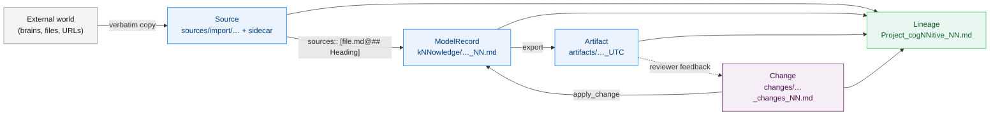
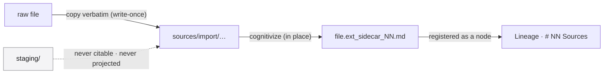
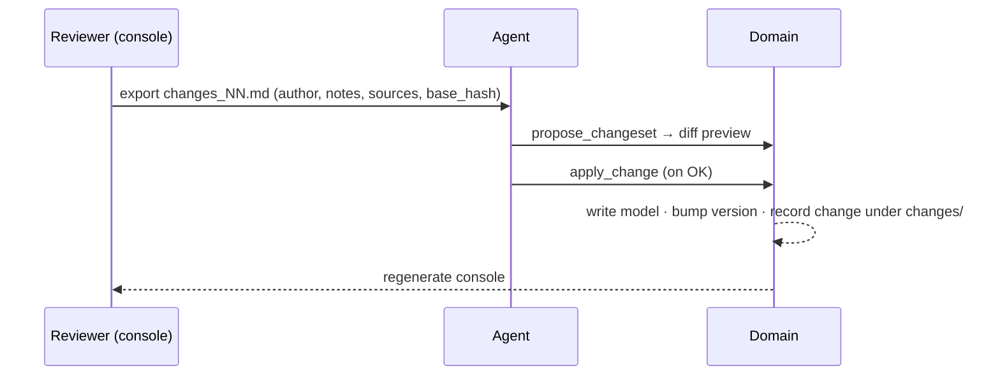
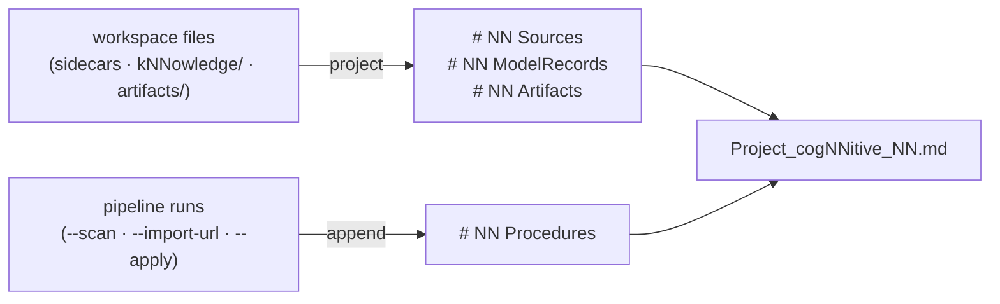
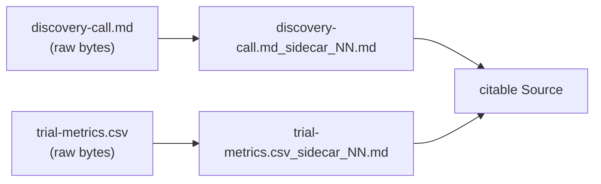
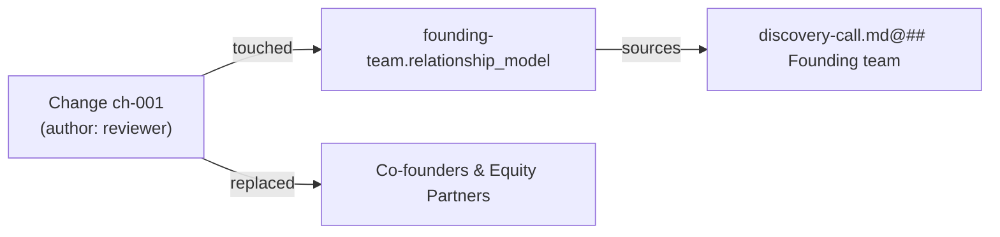

# iNNfo Technical Documentation — Master

> Concatenation of every documentation page in `docs/innfo/documentation/`,
> in sidebar order. The individual pages are the source of truth; this file is
> a single-file snapshot for offline reading and full-text search.

> Pages: 26.

## Contents

- [Home](#home) — iNNfo Documentation
- [nn-core](#nn-core) — Components
- [nn-mcp](#nn-mcp) — Components
- [OpenCode Agent](#opencode-agent) — Components
- [Ecosystem](#ecosystem) — Architecture
- [Specifications](#specifications) — Architecture
- [Discipline Overlaps](#discipline-overlaps) — Architecture
- [External Tooling & Integrations](#external-tooling-integrations) — Architecture
- [Why cogNNitive](#why-cognnitive) — Guides
- [Usage](#usage) — Guides
- [Relationships & Connections](#relationships-connections) — Guides
- [The Knowledge Lifecycle](#the-knowledge-lifecycle) — Guides
- [Sources, Citations & Lineage](#sources-citations-lineage) — Guides
- [Import Modes & Dynamic Sources](#import-modes-dynamic-sources) — Guides
- [Building a Domain from Scratch](#building-a-domain-from-scratch) — Guides
- [Lifecycle Walkthrough (Case Study)](#lifecycle-walkthrough-case-study) — Guides
- [Tags & Open Taxonomy](#tags-open-taxonomy) — Guides
- [Collaboration with Git](#collaboration-with-git) — Guides
- [Workspace Backup Strategies](#workspace-backup-strategies) — Guides
- [Editing Models by Hand](#editing-models-by-hand) — Guides
- [Overview](#overview) — Templates
- [Video App](#video-app) — Templates
- [Offline Consoles](#offline-consoles) — Runtime & Internals
- [Console Needs & Visuals](#console-needs-visuals) — Runtime & Internals
- [Console UI Kit](#console-ui-kit) — Runtime & Internals
- [Validator Behavior](#validator-behavior) — Runtime & Internals

---

<!-- begin: README.md -->

# iNNfo Documentation

Welcome to the iNNfo documentation. iNNfo is the monorepo (`@cognnitive/innfo`) that powers the cogNNitive **iNNfo** ecosystem.

## Quick Start

```bash
# Install dependencies
npm install

# Build nn-core and the MCP server
npm run build -w @cognnitive/nn-core
npm run build -w @cognnitive/nn-mcp
```

## Sections

### [Offline consoles](offline-consoles)
The **domain console** — one self-contained `domaiNN_console.html` per domaiNN, generated locally. It shows the domain's kNNowledge and reviews it through changesets.

### [nn-core](nn-core)
`@cognnitive/nn-core` is the framework-agnostic TypeScript library shared across the ecosystem: parser, model types, validator, IO drivers, and the spec-chain resolver.

### [nn-mcp](nn-mcp)
`@cognnitive/nn-mcp` is an MCP server that exposes iNNfo models and operations to AI coding agents (Claude Code, OpenCode, and others) over stdio.

### [Ecosystem](ecosystem)
The four-level specification chain:

| Level | Name | Description |
|-------|------|-------------|
| 0 | **defiNNe** | Meta-specification: structure, SemVer, RFC 2119 |
| 1 | **iNNfo** | Central spec — single-file `_NN.md` documents |
| 2 | **Apps** | business, procedures, organization |
| 3 | **Models** | Concrete instances (Ghostbusters, Code Review Process, Engineering Team) |

### [Specifications](specifications)
Complete listing of all specs and models at every level, with links to source files.

### [Open Knowledge Format (OKF)](ecosystem?id=open-knowledge-format-compatibility)
iNNfo is **compatible** with OKF v0.1 by Google Cloud Platform. Every iNNfo document is a valid OKF knowledge bundle.

### [Usage](usage)
How to create iNNfo models, use apps, and work with the ecosystem.

### [iNNfo Agent (OpenCode)](opencode-nn-agent)
Connect the iNNfo MCP agent to OpenCode Desktop for natural-language model editing.

<!-- end: README.md -->

---

<!-- begin: nn-core.md -->

# @cognnitive/nn-core

Framework-agnostic TypeScript library shared across the cogNNitive ecosystem. Used by `nn-mcp` and the domain console tooling.

## Features

- **Parser** — unified frontmatter, concept, and matrix parsing for `_NN.md` iNNfo documents
- **Model** — type definitions for Concept, Element, Field, Marker, Matrix, Relationship
- **Validator** — `validateModel`, `validateFormatContent`, `validateFormatSyntax`, and `validateReferences`, validating model instances against template schemas
- **IO Drivers** — drivers for reading and writing iNNfo documents, including a browser driver for the File System Access API
- **Resolver** — resolves the parent chain from level 3 (model) up to level 0 (defiNNe), downloading specs as needed and caching them locally

## API

```typescript
import { parseFrontmatter, validateModel } from '@cognnitive/nn-core'

// Parse YAML frontmatter from an iNNfo document
const fm = parseFrontmatter(content)
// Returns: { title, level, parent, ... }

// Validate a parsed model against its resolved template and spec chain
const result = validateModel(model, template, formatSpec)
```

## Usage

```bash
# Build the library
npm run build -w @cognnitive/nn-core

# Run tests
npm run test -w @cognnitive/nn-core
```

<!-- end: nn-core.md -->

---

<!-- begin: nn-mcp.md -->

# nn-mcp

`@cognnitive/nn-mcp` is an MCP (Model Context Protocol) server that wraps `@cognnitive/nn-core` and exposes iNNfo models over the stdio transport, so AI coding agents — Claude Code, OpenCode, and others — can read, validate, and edit iNNfo models through structured tool calls instead of freeform file edits.

## Why an MCP server

- Validation stays **deterministic** — the `nn-core` validator decides validity, not the calling LLM.
- Specification and template content is never duplicated into agent rules or config — it is always resolved live via `get_spec` / `get_template`.
- Spec and template resolution follows the model's `parent_spec` chain or an explicit URL — no hardcoded spec URLs.

## Tools

<!-- generated:mcp-tools (source: nn-mcp TOOL_REGISTRY; run node scripts/generate-docs-facts.mjs) -->
**22** tools

| Tool | Description |
|------|-------------|
| `list_knowledge` | Scan the knowledge directory and list all iNNfo knowledge documents |
| `read_knowledge` | Parse and return an iNNfo knowledge document's full structure by its id. For surgical work prefer bounded slices: pass concept (+ element) with max_lines (default 150); slices over the cap truncate with truncated=true unless override_reason records a manual override |
| `get_spec` | Resolve the iNNfo specification (level-1) from an explicit url or from a loaded knowledge document. Provide either url or knowledge_id — the URL is never taken from an internal constant |
| `get_blueprint` | Resolve an iNNfo blueprint (level-2) from an explicit url or from a loaded knowledge document. Provide either url or knowledge_id — blueprint names/URLs are never hardcoded |
| `validate_knowledge` | Validate an iNNfo knowledge document against its blueprint. Provide id (file on disk) or content (raw text). The blueprint is resolved from the knowledge parent_spec.url, or from an optional blueprint_url |
| `apply_change` | Apply an intent-level change or changeset to knowledge documents and re-validate. Supports two-phase execution (validate, then persist atomically) from changes/ documents or bare intent operations. Every operation that mutates a Level-3 kNNowledge model (including freeze_slugs and bump_version) is synthesized into a sealed, recorded changeset; only generate_index and the Level-2 bluepriNNt authoring operations (add_concept, add_field, bump_version on a bluepriNNt) write directly. After an applied or partially applied changeset the domain console is regenerated and opened in a browser tab (pass open: false to skip). The result carries console (the regeneration outcome) and next_steps: you MUST relay next_steps.notice to the user. |
| `regenerate_console` | Regenerate the domain console (or one model-scoped console) and open it in a browser tab. Idempotent: an up-to-date console is reported as unchanged. Also the retry path after an apply whose console regeneration failed. The result carries console and next_steps: you MUST relay next_steps.notice to the user. |
| `propose_changeset` | Write a sealed changeset with status proposed under changes/ from a structured list of operations, then regenerate and open the domain console so the user can review it. It never applies the changeset. You derive the operations (update_field, add_element, remove_element, rename_element, rename_concept, update_matrix_cell, update_concept_text, remove_matrix, add_matrix, comment, add_model, freeze_slugs, bump_version); the tool does not interpret conversations. Validation runs before any write: an unknown model, an add_model on an existing model, or an operation missing required keys returns errors and writes nothing. The result carries changeset, console and next_steps: you MUST relay next_steps.notice to the user. When the user replies OK, call apply_change with next_steps.approve.changeset. |
| `init_domain` | Create an empty, conformant domaiNN container in a new directory: the canonical folders (kNNowledge/, sources/import/, sources/conversations/, conversations/, artifacts/, procedures/, staging/, changes/), a .gitattributes with * -text and a domaiNN_NN.md manifest listing no models. Refuses a directory that exists and is not empty. It is not a changeset; add models afterwards with an add_model changeset (propose_changeset) or init_knowledge. Migration recipe: init_domain for a NEW domain, import the old domain as a source (migrate-domain.js --import-as-source), derive add_model/add_element changes that cite it through sources::, propose_changeset, review, apply_change. |
| `validate_knowledge_url` | Validate an iNNfo knowledge document fetched from a URL without writing to disk. Accepts a knowledge URL and optional blueprint_url. Returns validation results. |
| `validate_blueprint` | Validate a Level 2 blueprint against its Level 1 parent spec with frontmatter level-2 auto-detection and parent resolution failure diagnostics |
| `init_knowledge` | Create a new level-3 knowledge document. Create-only: it is a wrapper over a one-change add_model changeset (written to changes/ and applied), so the creation is recorded as a change. It scaffolds canonical YAML frontmatter and a starter body (one section per Concept, no index block: taxonomy lives in the blueprint) from the resolved blueprint schema; an unresolvable blueprint fails and writes nothing. The model id is `<name>_<blueprint>` and carries no version (the version lives in knowledge_version): the server canonicalizes the id you pass (drops any `_V_x-y-z` token, appends `_<blueprint>` when missing) and returns the canonical id. An existing id fails with MODEL_EXISTS and the file is untouched (it never repairs or rewrites a document). Returns filePath, content and changeset on success (none of them on failure), plus console and next_steps: you MUST relay next_steps.notice to the user. |
| `list_blueprints` | List all available Level 2 spec blueprints across local domain, global environment, and installed skills |
| `hydrate_blueprint` | Hydrate (copy) a Level 2 spec blueprint from global or skill store into active domain blueprints directory |
| `sync_domain_manifest` | Reconcile the domain manifest ## NN Knowledge entries against discovered Level-3 knowledge files: additively appends new entries, archives entries whose file disappeared, and reactivates tool-owned entries whose file returned. Never touches hand-authored entries lacking the <!-- nn:auto --> ownership marker. Defaults to a dry run. |
| `check_domain` | Run one consolidated domain integrity pass over every Level-3 knowledge document: validate each against its blueprint and traceability, self-heal missing blueprint packages/specs (write-once hydration), classify each pinned blueprint version against the published catalog, compare the managed sections of the lineage record with a fresh projection (error LINEAGE_DRIFT in the lineage field of the report; read-only), and return one report with a per-knowledge status and a domain aggregate. Non-blocking and informational — validation failures never fail the tool. |
| `query_units` | Run a read-only content query over one workspace file and return matching knowledge-unit URIs: "path?filter=value[&filter...][&projection]". Filters use exact match (trimmed, case-insensitive); a trailing bare segment projects one column/field over the matches. Capped at 100 results with truncated=true. Pass max_values_chars to cap projected value characters for slice-only surgical reads. Never writes files. |
| `cognitivize` | Create or refresh the sidecar (`<file>_sidecar_NN.md`) of one raw file in place, so it can be cited. Markdown, CSV, and JSON files are handled directly; binary formats (PDF, DOCX, XLSX, images) are converted when the environment has converter adapters available. Paths outside the workspace, sidecars, and NN documents are rejected. |
| `sync_lineage` | Recompute the lineage projection from the workspace filesystem and regenerate the canonical lineage record (`<project>_cogNNitive_NN.md`) without requiring the CLI. Re-synchronizes # NN Sources, # NN ModelRecords, and # NN Artifacts sections. |
| `resolve_sources` | Read-only: resolve an element's citation-typed field(s) to their underlying file, anchor, and content. Returns one entry per citation reference: {path, anchor, exists, field, origin, author?, excerpt?, sha256?, version?, error?}. `origin` classifies who produced the cited content ("agent" \| "human" \| "document"), resolved from the `author::` of the `## NN Change:` block the citation anchors to. Omit fieldName to resolve across every citation-typed field on the element (name-based sources/source plus any schema-declared type:: citation field). Never writes files. |
| `list_blueprint_procedures` | List all procedures defined in a blueprint and its transitively included blueprints up to depth 10 |
| `list_blueprint_skills` | List all agent skills defined in a blueprint and its transitively included blueprints up to depth 10. Skills shipped inside a package under skills/<name>/SKILL.md are returned with embedded: true and a resolved absolute path. |
<!-- /generated:mcp-tools -->

### `apply_change` operations

`apply_change` accepts an `op` and operation-specific `args`:

- `add_concept`
- `add_field`
- `set_marker`
- `add_element`
- `update_field`
- `remove_element`
- `rename_concept`
- `rename_element`
- `generate_index`
- `bump_version`

Each call re-validates the model and returns either the updated model or the validation errors that blocked the change.

### Canonical unit addresses

Console badges, draft pips and review actions share one address grammar, built and
parsed by `nn-core`'s `unitAddress` / `parseUnitAddress`:

- `<modelId>@<element-slug>` — element
- `<modelId>@<element-slug>&<field>` — element value
- `<modelId>@concept:<concept-slug>` — concept section (and `&<field>` for a value)
- `<modelId>@<matrix-slug>&<row>&<col>` — matrix cell
- `specs/<family>@concept:<slug>` / `specs/<family>@matrix:<slug>` — definitions
- `domaiNN_NN.md` — domain; a bare model id — document; a path with extension — Source

Element, value and matrix-cell addresses stay byte-equal to a changeset `target::`,
so `update_matrix_cell` still resolves cells by row/column slug. Citation parsing
(`parseCitation`, `resolveUnitPath`) is deliberately unchanged.

## Architecture

```
AI coding agent (Claude Code, OpenCode, ...) → nn-mcp (MCP server, stdio) → @cognnitive/nn-core
                                                        ↓
                                    Public iNNfo spec/template URLs (single source of truth)
```

## Running

```bash
# Build the server
npm run build -w @cognnitive/nn-mcp

# The server communicates over stdio — register it with your MCP-compatible agent/client
```

By default the server scans models under the current working directory; override with the `INNFO_MODELS_DIR` environment variable.

See [OpenCode iNNfo Agent](opencode-nn-agent) for a full walkthrough of connecting nn-mcp to OpenCode Desktop.

<!-- end: nn-mcp.md -->

---

<!-- begin: opencode-nn-agent.md -->

# OpenCode Desktop iNNfo Agent (Legacy)

> **This agent definition has been superseded by the [agent skills bundle](/use).**
>
> Instead of maintaining agent rules in this repo, install the full skills suite — it includes the `nn-innfo` skill plus router, trannsform, workflow orchestrator, and more.

The agent definition files (`.opencode/agents/innfo.md`, `.opencode/rules/innfo.md`) have been removed from this repo. The MCP server registration remains for local development of `nn-core` and `nn-mcp`.

## For AI interaction with iNNfo models

See [bootstrap](/use) — install the agent skills bundle and the skills auto-load when you edit `_NN.md` files in OpenCode Desktop.

## For local development of iNNfo

The MCP server is still available locally for testing:

```bash
npm run build --workspace=packages/nn-mcp
```

This registers `nn-mcp` in OpenCode Desktop via `opencode.json`. No agent-level rules are needed — the installed skills provide those.

<!-- end: opencode-nn-agent.md -->

---

<!-- begin: ecosystem.md -->

# Ecosystem Architecture

The cogNNitive ecosystem is organized in four specification levels.

## Level 0: defiNNe

The meta-specification. Defines the structure, versioning conventions (SemVer with `V_MAJOR-MINOR-PATCH` format), RFC 2119 normative language, and the level/parent chain system. The root of the hierarchy.

## Level 1: iNNfo

The central specification. Every model is a single `_NN.md` document containing concepts, elements, fields, markers, and matrices, with optional structural children.

## Level 2: Apps

Domain-specific apps that declare which concepts, markers, and relationship types apply:

| App | Description |
|----------|-------------|
| business | Business strategy modeling |
| procedures | Workflows, SOPs, processes |
| organization | Organizational structure modeling |

## Level 3: Models

Concrete instances of an app. Lightweight — just data and a `parent` pointer to the app.

## Open Knowledge Format Compatibility

iNNfo is **compatible** with [OKF v0.1](https://github.com/GoogleCloudPlatform/knowledge-catalog/blob/main/okf/SPEC.md) (Open Knowledge Format) by Google Cloud Platform. The iNNfo specification satisfies OKF's conformance requirements while adding richer semantic structure.

### Why iNNfo meets every OKF conformance rule

OKF v0.1 defines three conformance requirements (§9). Here is the exact mapping:

| OKF Requirement | How iNNfo Satisfies It |
|---|---|
| **§9.1** Every non-reserved `.md` file contains a parseable YAML frontmatter block | iNNfo requires YAML frontmatter on every `_NN.md` document. The `---` delimited block is mandatory — unparseable frontmatter is a validation error. |
| **§9.2** Every frontmatter block contains a non-empty `type` field | iNNfo's `level` field (0–3) and app system provide equivalent type semantics. A model document's `parent` app name serves as its conceptual type. OKF's permissive consumption model tolerates any `type` value — iNNfo's structured approach exceeds what OKF requires. |
| **§9.3** Reserved filenames (`index.md`, `log.md`) follow OKF conventions | iNNfo has **no** literal `index.md`: the index is the `# NN kNNowledge` block inside `domaiNN_NN.md`, which fills OKF §6's progressive-disclosure role. iNNfo does not prescribe `log.md` usage, which is optional in OKF as well. No conflicts. |

### OKF's permissive consumption model

OKF explicitly states consumers MUST NOT reject a bundle because of:

- Missing optional frontmatter fields ✓
- Unknown `type` values ✓ — iNNfo's app names are valid OKF type values
- Unknown additional frontmatter keys ✓ — iNNfo adds `spec_version`, `level`, `parent`, `concepts`, `markers`, `matrices`, `relationship_declarations`, all tolerated
- Broken cross-links ✓ — iNNfo also tolerates broken wikilinks with warnings
- Missing index documents ✓ — iNNfo requires a `domaiNN_NN.md` entrypoint, which exceeds OKF's baseline

### Structural alignment

| OKF Concept | iNNfo Equivalent |
|---|---|
| Knowledge Bundle | A directory of `_NN.md` documents — an iNNfo workspace |
| Concept | A concept section within a `_NN.md` document |
| Concept ID | File path relative to workspace root (minus `_NN.md` suffix) |
| Frontmatter (`type`, `title`, `description`, `tags`, `timestamp`) | iNNfo frontmatter (`spec_version`, `level`, `parent`, `knowledge_version`, `title`) |
| Body (Markdown) | Body (Markdown + `_NN` structural markers + matrices) |
| Cross-linking (`/relative/path.md`) | Wikilinks (`[[target]]`) and standard Markdown links |
| `index.md` (progressive disclosure) | `domaiNN_NN.md` with wikilinks listing workspace kNNowledge |
| # Citations (optional) | Not prescribed but fully compatible |

### Bottom line

Any directory of `_NN.md` documents opened in an OKF consumer will be accepted as a conformant OKF v0.1 bundle. The reverse is not guaranteed — iNNfo adds structural requirements (parent chain, app validation, marker syntax) that OKF bundles may lack. But the **intersection is compatible**: every valid iNNfo document is a valid OKF document.

## Resolver Protocol

When a model is loaded:
1. Read the model's `parent` pointer
2. If not cached in `specs/`, download from the specification URL
3. Save to `specs/<parent.name>_NN.md`
4. Read the downloaded spec's `parent`, repeat until level 0
5. On subsequent loads, use cache
6. On version mismatch, re-download

<!-- end: ecosystem.md -->

---

<!-- begin: specifications.md -->

# Specifications

The cogNNitive ecosystem defines four specification levels. Each level builds on the one below it.

## Level 0 — Meta-specification

The root of the chain. Defines structure, versioning (SemVer), and RFC 2119 key words for the entire ecosystem.

Every spec artifact under `specs/` is immutable and filename-encoded — there is no
mutable "latest" alias. A version bump always creates a new file; the table below
lists the current file for each spec.

| Spec | Source |
|------|--------|
| **defiNNition** V 0.1.0 | [`specs/defiNNition_V_0-1-0_NN.md`](https://github.com/cogNNitive/cogNNitive-web/blob/main/iNNfo/specs/defiNNition_V_0-1-0_NN.md) |
| defiNNe V 0.1.0 | Superseded — frozen predecessor (`specs/defiNNe_V_0-1-0_NN.md`) |

## Level 1 — Central specification

The **iNNfo** specification. Every model is a single `_NN.md` document with optional structural children — concepts, elements, fields, markers, and matrices.

The `status` frontmatter field on a spec file uses the `defiNNition` vocabulary
`Draft | Stable | Deprecated`. `iNNfo_V_0-3-0` is the adopted L1 (`status: "Stable"`).
The **adopted** version is the highest published spec in `specs/`, not a mutation of older spec files:
`iNNfo_V_0-2-2_NN.md`, `iNNfo_V_0-2-1_NN.md`, `iNNfo_V_0-2-0_NN.md` and `iNNfo_V_0-1-0_NN.md` are immutable and keep whatever
`status` they were published with; they are simply no longer the default, and stay
resolvable forever for models authored against them.

| Spec | Role | Source |
|------|------|--------|
| **iNNfo** V 0.3.0 | Adopted (`status: "Stable"`) | [`specs/iNNfo_V_0-3-0_NN.md`](https://github.com/cogNNitive/cogNNitive-web/blob/main/iNNfo/specs/iNNfo_V_0-3-0_NN.md) |
| iNNfo V 0.2.2 | Superseded — frozen, still resolvable | [`specs/iNNfo_V_0-2-2_NN.md`](https://github.com/cogNNitive/cogNNitive-web/blob/main/iNNfo/specs/iNNfo_V_0-2-2_NN.md) |
| iNNfo V 0.2.1 | Superseded — frozen, still resolvable | [`specs/iNNfo_V_0-2-1_NN.md`](https://github.com/cogNNitive/cogNNitive-web/blob/main/iNNfo/specs/iNNfo_V_0-2-1_NN.md) |
| iNNfo V 0.2.0 | Superseded — frozen, still resolvable | [`specs/iNNfo_V_0-2-0_NN.md`](https://github.com/cogNNitive/cogNNitive-web/blob/main/iNNfo/specs/iNNfo_V_0-2-0_NN.md) |
| iNNfo V 0.1.0 | Superseded — frozen, still resolvable | [`specs/iNNfo_V_0-1-0_NN.md`](https://github.com/cogNNitive/cogNNitive-web/blob/main/iNNfo/specs/iNNfo_V_0-1-0_NN.md) |

## Level 2 — Apps

Domain-specific apps. Each declares concepts, markers, matrices, and relationship types for a specific domain, and its own `template_version` (independent of `spec_version`, which tracks L1 compliance). All apps are L1-compliant with `iNNfo_V_0-2-1`. `business_V_0-2-0` is a pure composite that `includes` `business-model` + `analysis`; `analysis` and `business-model` are first-revision apps carved out of the former monolithic `business` app, so they carry `spec_version: V_0-2-0` with `template_version: V_0-1-0`.

| App | `template_version` | Source |
|----------|--------------------|--------|
| **Blank** | V_0-2-0 | [`specs/bluepriNNts/blank/blank_V_0-2-0_NN.md`](https://github.com/cogNNitive/cogNNitive-web/blob/main/iNNfo/specs/bluepriNNts/blank/blank_V_0-2-0_NN.md) |
| **Business** (composite) | V_0-2-1 | [`specs/bluepriNNts/business/business_V_0-2-1_NN.md`](https://github.com/cogNNitive/cogNNitive-web/blob/main/iNNfo/specs/bluepriNNts/business/business_V_0-2-1_NN.md) |
| **Business Model** | V_0-1-0 | [`specs/bluepriNNts/business-model/business-model_V_0-1-0_NN.md`](https://github.com/cogNNitive/cogNNitive-web/blob/main/iNNfo/specs/bluepriNNts/business-model/business-model_V_0-1-0_NN.md) |
| **Analysis** | V_0-1-0 | [`specs/bluepriNNts/analysis/analysis_V_0-1-0_NN.md`](https://github.com/cogNNitive/cogNNitive-web/blob/main/iNNfo/specs/bluepriNNts/analysis/analysis_V_0-1-0_NN.md) |
| **Innovation** | V_0-2-0 | [`specs/bluepriNNts/innovation/innovation_V_0-2-0_NN.md`](https://github.com/cogNNitive/cogNNitive-web/blob/main/iNNfo/specs/bluepriNNts/innovation/innovation_V_0-2-0_NN.md) |
| **cogNNitive** | V_0-2-0 | [`specs/bluepriNNts/cogNNitive/cogNNitive_V_0-2-0_NN.md`](https://github.com/cogNNitive/cogNNitive-web/blob/main/iNNfo/specs/bluepriNNts/cogNNitive/cogNNitive_V_0-2-0_NN.md) |
| **Organization** | V_0-2-0 | [`specs/bluepriNNts/organization/organization_V_0-2-0_NN.md`](https://github.com/cogNNitive/cogNNitive-web/blob/main/iNNfo/specs/bluepriNNts/organization/organization_V_0-2-0_NN.md) |
| **Procedures** | V_0-2-0 | [`specs/bluepriNNts/procedures/procedures_V_0-2-0_NN.md`](https://github.com/cogNNitive/cogNNitive-web/blob/main/iNNfo/specs/bluepriNNts/procedures/procedures_V_0-2-0_NN.md) |
| **Projects** | V_0-2-0 | [`specs/bluepriNNts/projects/projects_V_0-2-0_NN.md`](https://github.com/cogNNitive/cogNNitive-web/blob/main/iNNfo/specs/bluepriNNts/projects/projects_V_0-2-0_NN.md) |
| **Video Script** | V_0-1-0 | [`specs/bluepriNNts/video-script/spec_NN.md`](https://github.com/cogNNitive/cogNNitive-web/blob/main/iNNfo/specs/bluepriNNts/video-script/spec_NN.md) |

Each app's `_V_0-1-0_` file (where one existed) stays frozen and resolvable for models still pinned to it.

## Level 3 — Sample models

Concrete data instances. Lightweight — just data and a parent pointer to their app. Each sample stays pinned to the app version it was authored against; a `_V_0-1-0_` sample remains valid after the adoption.

| Model | App | Source |
|-------|----------|--------|
| **Ghostbusters** | business V_0-2-1 | [`specs/bluepriNNts/business/samples/Ghostbusters_V_0-2-1_business_NN.md`](https://github.com/cogNNitive/cogNNitive-web/blob/main/iNNfo/specs/bluepriNNts/business/samples/Ghostbusters_V_0-2-1_business_NN.md) |
| **Ghostbusters** | business V_0-2-0 | [`specs/bluepriNNts/business/samples/Ghostbusters_V_0-2-0_business_NN.md`](https://github.com/cogNNitive/cogNNitive-web/blob/main/iNNfo/specs/bluepriNNts/business/samples/Ghostbusters_V_0-2-0_business_NN.md) |
| **Ghostbusters** | business V_0-1-0 | [`specs/bluepriNNts/business/samples/Ghostbusters_V_0-1-0_business_NN.md`](https://github.com/cogNNitive/cogNNitive-web/blob/main/iNNfo/specs/bluepriNNts/business/samples/Ghostbusters_V_0-1-0_business_NN.md) |
| **Ghostbusters** | analysis V_0-2-0 | [`specs/bluepriNNts/analysis/samples/Ghostbusters_V_0-2-0_analysis_NN.md`](https://github.com/cogNNitive/cogNNitive-web/blob/main/iNNfo/specs/bluepriNNts/analysis/samples/Ghostbusters_V_0-2-0_analysis_NN.md) |
| **Ghostbusters** | innovation V_0-2-0 | [`specs/bluepriNNts/innovation/samples/Ghostbusters_V_0-2-0_innovation_NN.md`](https://github.com/cogNNitive/cogNNitive-web/blob/main/iNNfo/specs/bluepriNNts/innovation/samples/Ghostbusters_V_0-2-0_innovation_NN.md) |
| **Ghostbusters** | organization V_0-2-0 | [`specs/bluepriNNts/organization/samples/Ghostbusters_V_0-2-0_organization_NN.md`](https://github.com/cogNNitive/cogNNitive-web/blob/main/iNNfo/specs/bluepriNNts/organization/samples/Ghostbusters_V_0-2-0_organization_NN.md) |
| **Ghostbusters** | procedures V_0-2-0 | [`specs/bluepriNNts/procedures/samples/Ghostbusters_V_0-2-0_procedures_NN.md`](https://github.com/cogNNitive/cogNNitive-web/blob/main/iNNfo/specs/bluepriNNts/procedures/samples/Ghostbusters_V_0-2-0_procedures_NN.md) |
| **Ghostbusters** | projects V_0-2-0 | [`specs/bluepriNNts/projects/samples/Ghostbusters_V_0-2-0_projects_NN.md`](https://github.com/cogNNitive/cogNNitive-web/blob/main/iNNfo/specs/bluepriNNts/projects/samples/Ghostbusters_V_0-2-0_projects_NN.md) |

## Traceability & change propagation

The format spec (L0 `defiNNe` → L1 `iNNfo` → L2 apps) is consumed by every other
part of the project. What reads it, and how a change flows through:

| Consumer | How it reads the spec | Source |
|---|---|---|
| `@cognnitive/innfo-core` | Parses the parent chain, extracts app schema, validates models | `packages/innfo-core/src/resolver.ts`, `schema.ts`, `validator/` |
| `innfo-mcp` (MCP server) | Wraps core. Resolves local `specs/` first, then network `fetch`, then persists write-once into `specs/` | `packages/innfo-mcp/src/tools/spec.ts`, `resolver-node.ts` |
| Domain console (UI) | Reads the schema and models embedded by `export-console.mjs` at generation time | `scripts/export-console.mjs`, `iNNfo/specs/bluepriNNts/console/` |
| Skills (`skills/nn-innfo`) | Delegates all resolution/validation to `innfo-mcp`; bundles a copy of `workspace_spec_NN` | `skills/nn-innfo/` |
| Bootstrap manifest | Pins skills and templates by `repo` + `path` + `version` + `commit`; CI validates | `docs/use/manifest.md` |
| Docs | Describe the resolver protocol and level system | `docs/innfo/documentation/ecosystem.md`, this page |

### Invariants

- **Immutable, filename-encoded.** Every file under `specs/` carries its version in the
  filename. A bump always creates a new file; a published file is never edited in place
  or deleted while a model still references it (`spec-versioning` R-SV-01/R-SV-02).
- **Single source of the version string.** The spec file itself (frontmatter `spec_version`
  and `blueprint_version`); no code file hardcodes it elsewhere.
- **`parent_spec.url` pins a versioned filename** — never a mutable alias (R-SV-08).
- **Write-once persistence is the whole integrity guarantee** — nothing is silently
  replaced, so there is nothing to hash-verify (`spec-resolution` R-LSR-02).

### When a format spec changes

The mechanical procedure lives in the dev skill
`.agents/skills/nn-dev-spec-version-propagator/`; the canonical detection tool is
`scripts/check-spec-version.mjs` (`npm run check:spec-version` / `check:spec-urls`).

1. **New file.** Author `specs/…_V_x-y-z_NN.md` (SemVer per `defiNNe` §7). The old file stays.
2. **Engine.** Update `innfo-core` (parser / `schema.ts` / validator) and its fixtures.
   `innfo-mcp` inherits core; rebuild the bundle.
3. **Version constant.** Update `DEFAULT_INNFO_VERSION` / `DEFAULT_TEMPLATE_VERSION`.
4. **Sweep stale references.**
   `node scripts/check-spec-version.mjs --version <old> --check --by-type --with-skills`
   lists every doc, sample, test, fixture and skill file still on the old version — update each.
5. **URLs.** `npm run check:spec-urls` must stay green (also gated in CI, job `spec-integrity`).
6. **Apps.** Each L2 app must be compliant with the new L1. Apps that only
   exist at the old version must get a new-version file before the L1 can be made the default.
7. **Skills.** Sync any bundled copy under `skills/` (today: `workspace_spec_NN`) from
   the canonical file here. Bump `version` + `commit` in the bootstrap manifest
   (`docs/use/manifest.md`).
8. **Docs.** Update this page's tables and `ecosystem.md`.
9. **Existing L3 models are not migrated.** They keep resolving their old, immutable parent
   until an author repoints `parent_spec.url`. No silent fallbacks.

> **V_0-2-0 adopted (2026-09-01).** L1 `iNNfo_V_0-2-0` is `status: Stable` and is the
> value of `DEFAULT_INNFO_VERSION`. `iNNfo_V_0-1-0_NN.md` is immutable (R-SV-02) and
> unchanged — it is simply no longer the default. Every shipped L2
> app resolves at `iNNfo_V_0-2-0`. The V_0-2-0 rule changes (the four
> frontmatter-block forms `concepts:` / `markers:` / `matrices:` removed in favour of
> body-element definitions; `includes` duplicate-name entries with AST-identical bodies
> merged instead of erroring; `model` added to the `Concept Definition` and
> `Field Definition` `type` enums) are all in the engine. Existing L3 models pinned to
> `iNNfo_V_0-1-0` apps keep resolving unchanged.

## Related Standards

### Open Knowledge Format (OKF)

iNNfo is **compatible** with [OKF v0.1](https://github.com/GoogleCloudPlatform/knowledge-catalog/blob/main/okf/SPEC.md), the Open Knowledge Format by Google Cloud Platform. Every iNNfo document is a valid OKF knowledge bundle.

| OKF Conformance Rule (§9) | iNNfo Status |
|---|---|
| Parseable YAML frontmatter on every non-reserved `.md` file | ✅ Satisfied — every `_NN.md` has required frontmatter |
| Non-empty `type` field in every frontmatter block | ✅ Satisfied — `level` + app name provides type semantics |
| Reserved filenames follow OKF conventions | ✅ Satisfied — no literal `index.md`; the `# NN kNNowledge` block in `domaiNN_NN.md` is the directory listing |

**Why the compatibility holds:**

1. **Same substrate**: Both use Markdown + YAML frontmatter. OKF's "if you can `cat` a file, you can read OKF" applies to iNNfo verbatim.
2. **OKF tolerates extensions**: OKF explicitly allows unknown frontmatter keys and unknown `type` values. iNNfo's additional fields (`spec_version`, `level`, `parent`, `concepts`, `markers`, `matrices`) are fully tolerated.
3. **A directory of `_NN.md` documents = an OKF knowledge bundle**: a workspace of iNNfo models produces the exact directory-of-Markdown-files structure OKF defines as a knowledge bundle (§3). Each `_NN.md` is an OKF concept document (§4), with the `# NN kNNowledge` block in `domaiNN_NN.md` as the directory listing (§6).
4. **Cross-linking**: OKF uses standard Markdown links; iNNfo supports wikilinks (`[[target]]`) and standard links — both work for cross-referencing concepts.

See the [Ecosystem page](ecosystem) for the full compatibility mapping.

<!-- end: specifications.md -->

---

<!-- begin: discipline-overlaps.md -->

# Disciplines cogNNitive Overlaps With

cogNNitive does not invent a new discipline: it **recombines several well-established ones** on a shared substrate — plain Markdown, Git version control, and deterministic validation. This document maps those overlaps and explains what each shares.

---

## Core Overlaps

### 1. Model-Driven Engineering / Metamodeling (MDE · MDA · MOF)

iNNfo's four-level cascade (`defiNNe` → `iNNfo` → apps → models) is a formal **metamodeling architecture**: a meta-specification (Level 0) defines the language used to describe apps (Level 2), which in turn are the metamodels against which concrete instances (Level 3) are validated. The resolver walks the parent chain, validation is deterministic, and references are immutable (*write-once*). Structurally, this is the same problem solved by **OMG MOF/MDA** (M3→M0 layers) and DSL engineering tooling (Eclipse EMF, Xtext).

Unlike MOF/MDA, iNNfo does not generate code or PIM→PSM transformations: its output is validated knowledge models and derived artifacts (dashboards, summaries), not executable artifacts.

### 2. Knowledge Management (KM)

The commercial positioning is explicit: a *Knowledge Evolution Framework* that turns **tacit** knowledge (what lives in the team's heads) and **explicit** knowledge (PDFs, DOCX, spreadsheets, meetings) into a living base that is validated and enriched on every pass. This is Nonaka–Takeuchi's tacit↔explicit cycle, with the addition of deterministic validation and AI-agent consumption. The `A ⇄ K` paradigm makes the cycle explicit: any file goes in, is decomposed into structured knowledge, and is recomposed into another artifact, reversibly.

Classic KM usually stops at capture, classification, and search; cogNNitive adds a verifiable contract (validation against an app) and origin traceability.

### 3. Enterprise Architecture (EA)

The Level 2 apps (`business`, `organization`, `procedures`) operate as domain *viewpoints*, and intersection matrices (for example `WORK → ROLES`) act as relationship matrices between domains. Together —metamodel + viewpoints + typed relationships + matrices— they reproduce the conceptual scaffolding of frameworks such as **TOGAF** and notations such as **ArchiMate**.

cogNNitive does not implement an ADM (Architecture Development Method) or a governed EA repository; it provides the *language* to model the architecture, not the corporate governance process.

### 4. Ontology Engineering / Knowledge Graphs

iNNfo defines itself as a **Knowledge Network** with five formal levels of relationships (hierarchical/taxonomic, structural via matrix, by attribute, contextual via mention, and submodel composition), plus WikiLinks and an open taxonomy with progressive enhancement. Concepts, elements, typed fields, and references compose a directed graph with backlinks, structurally analogous to an RDF/OWL graph and to SKOS schemas for controlled vocabularies. It is also 100% compatible with Google Cloud's **OKF v0.1** (Open Knowledge Format).

It is a *descriptive* graph, with no inference engine or automated reasoning: there are no axioms, subsumption, or OWL-DL-style reasoners.

---

## Direct Overlaps

### 5. Docs as Code

Documentation is treated as source code: plain text (Markdown) versioned in Git, reviewed through branches and pull requests, built and published automatically, with the repository as the single source of truth. cogNNitive's own public website is a Jekyll site generated from `docs/`, and the design deliberately favors readable Git diffs and write-once versioned artifacts over real-time collaboration.

Docs as Code optimizes the *authoring and publishing* of documentation; cogNNitive layers a validated semantic model and an agent-consumption channel (`innfo-mcp`) on top, which Docs as Code does not prescribe.

### 6. Personal Knowledge Management (PKM) — Obsidian, Logseq and peers

There is a category of tools —**Personal Knowledge Management (PKM)**, also called *networked note-taking* or *Tools for Thought*— whose best-known exponent is **Obsidian**, alongside **Logseq**, Roam Research, Notion, Tana, Dendron, Foam, and Athens. Their core mechanic is **bidirectional linking (backlinks)** over local Markdown, with a graph view, block references, and atomic notes, often following Niklas Luhmann's **Zettelkasten** method. iNNfo shares their substrate (local-first Markdown, WikiLinks `[[...]]`, navigable graph, index notes of the *Map of Content* kind) and, in fact, **learns from their limitations**: the specification explicitly cites Obsidian and Dendron to justify decisions such as making each element a self-contained node robust to refactoring.

PKM is personal and atomic: loose notes meant to be understood by a person, with no mandatory schema and no validation. cogNNitive scales it to the team and the agent: the same act of linking, but with a **mandatory schema, deterministic validation, source traceability, and MCP consumption**. Put another way, iNNfo is to PKM what a metamodel is to a pile of notes: the same network intuition, but with a verifiable contract.

---

## The Differentiator

The value of cogNNitive does not lie in any one of these disciplines on its own, but in their **intersection**: formal metamodeling + knowledge management + deterministic validation + Git/Markdown substrate + AI-agent consumption. None of the disciplines above covers all five at once.

<!-- end: discipline-overlaps.md -->

---

<!-- begin: integrations.md -->

---
layout: default
title: Cognitive Ecosystem — External Tooling & Integrations
description: Arquitectura de integración de herramientas independientes en cogNNitive, analizando el caso de estudio de generación de imágenes con WaveSpeed (MCP frente a CLI).
---

# Cognitive Ecosystem & External Tooling

El ecosistema **cogNNitive** está diseñado con una arquitectura modular y desacoplada centrada en el conocimiento estructurado (**iNNfo**) y las capacidades de los agentes de IA (**ageNNt**). Para conocer el ciclo de vida completo de la información (`IMPORT` ➔ `MANAGE` ➔ `EXPORT` + Feedback Loop), consulta el [**Lifecycle Walkthrough**](lifecycle-walkthrough.md).

Este documento explora la integración con herramientas y servicios externos independientes mediante casos de estudio prácticos (como renderizado multimedia con WaveSpeed).

---

## 1. Filosofía de Integración: Núcleo Desacoplado y Herramientas Externas

En una plataforma de conocimiento vivo, el procesamiento lógico de modelos y especificaciones reside en el motor local (`innfo-core` y `innfo-mcp`), mientras que las capacidades pesadas de cómputo en la nube (como renderizado gráfico, síntesis de voz, generación de vídeo o modelos 3D) se delegan en servicios especializados de terceros.

Para conectar estas capacidades con nuestros agentes de IA (en OpenCode, Claude Desktop, Cursor, etc.), existen fundamentalmente dos aproximaciones técnicas: **Model Context Protocol (MCP)** y **Command Line Interface (CLI)**.

---

## 2. Caso de Estudio: Generación de Imágenes con WaveSpeed

WaveSpeed (`wavespeed.ai`) provee una plataforma en la nube para ejecutar modelos generativos en catálogo abierto (imagen, vídeo, audio, 3D). Analizaremos las dos alternativas para integrarlo en el flujo de trabajo de Cognnitive.

### Opción A: WaveSpeed MCP (Recomendado)
El servidor MCP oficial (`@wavespeed/mcp`) expone las capacidades de WaveSpeed directamente como herramientas nativas al agente de IA (ej. `list_models`, `run_model`, `get_price`, `get_model_schema`).

* **Cómo funciona:** El servidor corre como un proceso hijo independiente gestionado por el cliente de IA (configurado globalmente en `mcp.json`). Cuando el usuario solicita generar una imagen, el agente realiza introspección de esquemas del modelo, evalúa precios o parámetros y ejecuta la llamada de forma autónoma y estructurada mediante JSON-RPC.

### Opción B: WaveSpeed CLI (`@wavespeed/cli`)
El paquete de línea de comandos tradicional que permite ejecutar tareas mediante la terminal (`wavespeed run ...`).

* **Cómo funciona:** El agente o un script de shell ejecuta comandos monolíticos en la terminal del sistema operativo, parseando la salida estándar (stdout/stderr).

---

## 3. Análisis Comparativo: MCP vs. CLI

| Eje de Evaluación | WaveSpeed MCP (Opción A) | WaveSpeed CLI (Opción B) |
| :--- | :--- | :--- |
| **Interoperabilidad Multi-Agente** | **Nativa y Estructurada:** Soportada automáticamente en OpenCode, Claude Desktop, Cursor, Cline y Roo Code con un único archivo de configuración (`mcp.json`). | **Limitada para Agentes Conversacionales:** Requiere que el agente ejecute comandos de shell y maneje salidas de texto de forma heurística, sin tipado estricto de herramientas (*tool use*). |
| **Complejidad de Instalación** | Se instala de forma global vía `npx` o paquete de Node y se declara en la configuración del cliente. | Requiere instalación global del CLI (`npm install -g @wavespeed/cli`) y wrappers de automatización en shell. |
| **Autonomía del Modelo (IA)** | **Alta:** El modelo de lenguaje lee los esquemas de entrada antes de escribir la solicitud, validando parámetros y evitando errores de sintaxis. | **Baja/Media:** Depende de la destreza del agente construyendo argumentos de comandos en la terminal de texto. |
| **Seguridad de la Clave API** | Aislada en el entorno de ejecución del proceso MCP o inyectada por el cliente de IA mediante la propiedad `env` del archivo `mcp.json`. | Expuesta en variables de entorno de la sesión de shell o pasada por argumentos de comandos. |
| **Control de Costes y Precios** | Acceso a herramientas de introspección de precios (`get_price`) previas a la ejecución del modelo. | Ejecución directa sin pre-validación estructurada de costes a menos que se implemente script adicional. |

---

## 4. Recomendación Arquitectónica para Cognnitive

Para el desarrollo dentro de **Cognnitive**, la recomendación definitiva es **adoptar WaveSpeed MCP** como estándar para los flujos asistidos por IA.

### Razones clave:
1. **Autonomía guiada por esquemas:** Al utilizar MCP, el agente no adivina los parámetros que acepta un modelo en la nube; consulta dinámicamente el esquema en vivo (`get_model_schema`), garantizando que la generación de recursos gráficos cumpla exactamente con lo esperado.
2. **Centralización multi-cliente:** Configurar el servidor en `C:\Users\<usuario>\.opencode\mcp.json` (o equivalente en otros clientes) permite compartir la herramienta de generación gráfica instantáneamente en cualquier proyecto del monorepo sin duplicar código ni dependencias.
3. **Respeto por el paradigma de seguridad:** La separación de procesos mediante el protocolo MCP aísla la lógica de red y las credenciales de API del código fuente de la aplicación principal.

<!-- end: integrations.md -->

---

<!-- begin: value-proposition.md -->

# Why cogNNitive

cogNNitive turns knowledge scattered across human minds, documents, spreadsheets
and data drops into a **living, structured knowledge base made of plain-text
Markdown files inside your own Git repository**. An AI agent does the
structuring; the artifacts are ordinary files you own and can open with any text
editor.

The pitch in one line:

> Instead of re-uploading documents to a chat every time, you import them once,
> normalise them once, and every future AI session reads exactly the slice it
> needs — with a citation back to the original.

---

## The problem with talking straight to a general model

Attaching files to a chat (GPT, Gemini, Claude, or an ad-hoc scripted pipeline)
works, but it costs you on every single session:

| Friction | What it costs you |
| :--- | :--- |
| You re-select context by hand | Time, and the risk of forgetting a relevant file |
| The model re-reads whole documents | Tokens, latency, and attention diluted by irrelevant text |
| Nothing records *which* paragraph justified *which* statement | Manual, unrepeatable verification |
| Answers drift as the corpus grows | No warning when a change breaks a downstream claim |
| The corpus lives in a vendor account | Lossy export, proprietary format, rented knowledge |

cogNNitive is the same workflow with those five frictions removed — not by a
smarter model, by **structure around the model**.

---

## The four pillars

| Pillar | What it means | Mechanism |
| :--- | :--- | :--- |
| **Efficiency** | Import once, reuse forever; feed the model only the slice it needs. | Source normalisation, a sources catalog of short summaries, and bounded model reads. |
| **Traceability** | Every model statement points to an exact heading in an exact source version. | `sources::` citations, write-once source families, the lineage record. |
| **Versatility & review comfort** | Review in a text editor, the domain console, or a conversation — same files. | Text editors, the domain console, AI agents; reviewer feedback re-ingests. |
| **No vendor lock-in** | Plain Markdown plus Git; the knowledge is yours forever. | Files on disk; Git is the copy-of-record and the collaboration layer. |

### Efficiency

The expensive work happens **once**. A raw file is copied verbatim, fingerprinted
with a hash, and cognitivized in place a single time — it is never
re-processed in later sessions. A catalog entry keeps a one-to-two-sentence
summary of every source, so an agent decides *what* to open from the summaries
instead of loading everything. Large sources can split into a cheap summary file
and a full-text file. Because the agent asks for a bounded slice rather than the
whole corpus, it reads less and answers with less noise.

### Traceability

Citations are anchored to a heading, never to a line range:
`sources:: [sources/import/pricing_memo.md@## Manhattan Rates]`. Each source keeps
its own version history inside the workspace as write-once family members,
answering *"what exact version did this model see at time T?"* even if no commit
was made. A lineage record ties Sources, ModelRecords, and Artifacts together, and
an impact check warns you when a living source changes in a way that breaks a
downstream citation.

### Versatility & review comfort

The same files are readable three ways without conversion — a plain editor, the
self-contained domain console, or an AI agent. Reviewer feedback is a first-class
input: reviewer consoles export structured feedback that re-enters the pipeline
and can be applied to the model with a diff preview.

### No vendor lock-in

The knowledge base is Markdown, the history is Git, the collaboration is
GitHub or GitLab. There is no proprietary store and no required cloud. Git gives
shared history, rollback, and release anchors; a native versioning convention
gives each artifact an immutable identity. The two are complementary — see
[Sources, Citations & Lineage](sources-citations-lineage) for the boundary.

---

## What cogNNitive is NOT

Clear boundaries keep the ecosystem honest:

- **Not a database engine** — models are Markdown files in your repository.
- **Not a closed SaaS platform** — it runs locally, or in your browser.
- **Not a script runner** — `_NN.md` documents are declarative data, nothing more.
- **Not a one-shot converter** — the lifecycle is continuous, verified, reversible.

---

## Where to go next

- [Import Modes & Dynamic Sources](import-modes) — what happens when a new file lands.
- [Sources, Citations & Lineage](sources-citations-lineage) — how provenance is tracked.
- [Lifecycle Walkthrough](lifecycle-walkthrough) — the end-to-end pipeline by example.

<!-- end: value-proposition.md -->

---

<!-- begin: usage.md -->

# Usage Guide

## Creating an iNNfo Model

An iNNfo model is a single Markdown file (`_NN.md`) with YAML frontmatter following the spec chain conventions.

```markdown
---
spec_version: "V_0-2-0"
level: 3
parent_spec:
  name: "business_V_0-2-1"
knowledge_version: "V_0-1-0"
title: "My Model"
---

# My Model

_NN Strategy

* _NN Strategy: Core Objective
  * type: text
  * value: "Build the next generation of..."

_NN Metrics

* _NN Metrics: KPI
  * type: text
  * value: "Monthly active users"
```

## Apps

Level 2 apps declare the concepts, markers, and relationship types available to a model:

- **business** — business strategy modeling
- **procedures** — workflows, SOPs, processes
- **organization** — organizational structure modeling

## Working with the ecosystem

1. Create or open a workspace folder and let your AI agent author the models through [nn-mcp](nn-mcp).
2. Generate the domain console (`domaiNN_console.html`) with `export-console.mjs` or the MCP `regenerate_console` tool and open it in a browser; see [offline consoles](offline-consoles).
3. Validation runs on every write through [nn-mcp](nn-mcp) (`validate_model`).
4. Reviewers send feedback as changesets; see the [reviewer guide](reviewer-guide).
5. Change models through the agent or a changeset, not by hand; see [editing models by hand](manual-editing-risks).

## Generating the console

```bash
# From the iNNfo repo root
node scripts/export-console.mjs <workspaceRoot> --domain
```

The command writes `domaiNN_console.html` at the domain root; open it in a browser.

<!-- end: usage.md -->

---

<!-- begin: relationships.md -->

# Relaciones y Conexiones en iNNfo

El modelo de datos de **iNNfo** no se limita a almacenar bloques jerárquicos o páginas independientes: constituye una **Red de Conocimiento (Knowledge Graph)** donde las entidades interactúan entre sí.

En iNNfo, las relaciones entre elementos y conceptos se clasifican en **5 niveles formales** (alineados con la Especificación Nivel 1 `iNNfo_V_0-2-1_NN.md`), dependiendo de su origen y grado de estructuración.

---

## Los 5 Niveles de Relaciones

```
                                  ┌─────────────────────────────────────────────────────────┐
                                  │                  RED DE CONOCIMIENTO                    │
                                  └────────────────────────────┬────────────────────────────┘
                                                               │
         ┌───────────────────────────────┬─────────────────────┼─────────────────────────────┬───────────────────────────────┐
         ▼                               ▼                     ▼                             ▼                               ▼
┌───────────────────┐         ┌───────────────────┐ ┌───────────────────┐         ┌───────────────────┐         ┌───────────────────┐
│ 1. JERÁRQUICA     │         │ 2. ESTRUCTURAL    │ │ 3. ATRIBUTO       │         │ 4. CONTEXTUAL     │         │ 5. SUBMODELO      │
│    (Taxonomía)    │         │    (Matriz)       │ │    (Campo)        │         │    (Mención)      │         │  (type:: knowledge) │
└────────┬──────────┘         └────────┬──────────┘ └────────┬──────────┘         └────────┬──────────┘         └────────┬──────────┘
         │                             │                     │                             │                             │
  Anidamiento de árbol        Matriz de Dominio       Campo referencial             Wikilink libre                Composición modular
  (# NN index)                (ej. WORK → ROLES)      (key:: [[target]])            ([[Target Element]])          (campo:: [[sub_NN.md]])
```

### 1. Relaciones Jerárquicas / Taxonómicas (`hierarchy`)

- **Origen**: Bloque `# NN index` al inicio del modelo Nivel 3.
- **Sintaxis**: Listas Markdown anidadas usando sintaxis WikiLink (`* [[Padre]]` → `  * [[Hijo]]`).
- **Icono Visual**: 🌳 `FolderTree` / Árbol lateral
- **Ejemplo**: `Salón-Comedor` anidado dentro de `Casa`.

### 2. Relaciones Estructurales (`evaluable_matrix`)

- **Origen**: Celdas de intersección declaradas en matrices formales del metamodelo (ej. `WORK → ROLES` o `WORK → ARTIFACT`).
- **Sintaxis**: Declaración centralizada en cabecera de metamodelo (`matrices`) o bloques `# NN matrices:` e intersecciones en bloques.
- **Icono Visual**: 📊 `LayoutGrid`
- **Ejemplo**: Un procedimiento `Solicitud de Visado` asignado con el rol `Responsible` hacia `Inés (viajera)`.

### 3. Relaciones por Atributo (Campos Referenciales)

- **Origen**: Campos estructurados en los bloques cuyos valores hacen referencia explícita a otro elemento mediante corchetes WikiLink.
- **Sintaxis**: `campo:: [[nombre_del_elemento]]` (campos con `type:: reference` en su definición).
- **Icono Visual**: 🏷️ `Tag`
- **Ejemplo**: `location:: [[Salón-Comedor]]` o `depends_on:: [[Verificación de Pasaporte]]`.
- **Nota importante**: Los campos referenciales NUNCA deben escribirse como texto plano (`location:: Salón-Comedor`); el uso de `[[...]]` es obligatorio para que el motor de iNNfo resuelva la conexión en la red.

### 4. Relaciones Contextuales (Menciones & Wikilinks)

- **Origen**: Menciones informales y enlaces de hipertexto escritos libremente en el cuerpo Markdown de la descripción de un bloque.
- **Sintaxis**: `[[Nombre del Elemento]]` dentro del texto explicativo.
- **Icono Visual**: 📝 `FileText`
- **Ejemplo**: _"...para completar este paso es necesario revisar el [[Formulario DS-2019]] emitido por el patrocinador."_

### 5. Composición de Submodelos (`type:: knowledge`)

La composición de submodelos permite desacoplar arquitecturas complejas subdividiendo el dominio en múltiples documentos físicos Nivel 3 (`*_NN.md`), manteniendo una relación formal de pertenencia y navegación entre un elemento padre y un modelo hijo especializado.

- **Origen**: Definición formal en el metamodelo con `type:: knowledge` y restricción opcional `target_blueprint:: <bluepriNNt>`.
- **Sintaxis de Campo**: `campo:: [[ruta/al/submodelo_NN.md]]` o `campo:: ruta/al/submodelo_NN.md`.
- **Icono Visual**: 📦 `Boxes` / Píldora interactiva de submodelo con badge de plantilla.
- **Comportamiento en Árbol**: El submodelo no flota como raíz independiente en el espacio de trabajo; se anida bajo el elemento que lo declara y se excluye de las raíces globales.

#### Ejemplo Canónico: Ghostbusters Innovation → Business Model

Un modelo de cartera de innovación (`Ghostbusters_innovation_NN.md`) contiene la iniciativa de expansión municipal, la cual instancia su propio modelo de negocio dedicado (`Ghostbusters_business_NN.md`):

##### 1. Definición en Metamodelo (`innovation_V_0-2-0_NN.md`)

```markdown
## NN Field Definition: business_model

concept:: Initiative
type:: knowledge
target_blueprint:: business
```

##### 2. Instanciación en el Modelo Padre (`Ghostbusters_innovation_NN.md`)

```markdown
# NN Initiative

## NN Initiative: Ghostbusters Municipal Franchise Expansion

initiativeName:: "Ghostbusters Municipal Franchise Expansion"
initiativeType:: "Commercial Service Expansion"
business_model:: [[kNNowledge/Ghostbusters_business_NN.md]]
tags:: [initiative, franchise, commercial, expansion]
```

##### 3. Submodelo Hijo Scaffolded (`Ghostbusters_business_NN.md`)

```markdown
---
level: 3
parent_spec:
  name: "business"
knowledge_version: "V_0-1-0"
title: "Ghostbusters Inc. Municipal Franchise Business Model"
---

# NN Business Model
```

#### Experiencia Visual e Interactiva

1. **Creación en un Clic**: Desde el editor del campo en `FieldModel.vue`, el botón `[+ Create & bind new model]` crea automáticamente el documento hijo con cabeceras estándar Nivel 3 y la plantilla esperada.
2. **Jerarquía Limpia en la Barra Lateral**: En la vista de espacio de trabajo, el submodelo se excluye de las raíces no adjuntas y se muestra anidado directamente bajo el elemento que lo declara (`ConceptTreeNode.vue`), acompañado del icono 📦 `Boxes` y la etiqueta de la plantilla.
3. **Navegación Fluida**: Al hacer clic en el submodelo hijo (en la píldora del campo o en el árbol lateral), `uiStore.focusModel` activa el modo enfocado y despliega la ruta de migas de pan (`Workspace > Ghostbusters Innovation > Ghostbusters Business`).

---

## Direccionalidad de las Conexiones

Todas las relaciones en el editor se presentan con un indicador claro de dirección según la posición del elemento actual:

### Conexión Saliente (`outgoing`)

Indica que el elemento actual **inicia o apunta** la relación hacia un elemento destino:
$$\text{> ( Rol / Campo ) > [Píldora Destino]}$$

- **Ejemplo**: `> ( 🏷️ location ) > [Salón-Comedor]`

### Conexión Entrante (`incoming`)

Indica que otro elemento fuente **apunta o referencia** al elemento actual (Backlinks / Participación como destino):
$$\text{[Píldora Fuente] < ( Rol / Campo ) <}$$

- **Ejemplo**: `[Sofás salón] < ( 🏷️ location ) <`

### Conexión Completa (`full`)

En vistas globales, reportes de validación o tablas completas:
$$\text{[Píldora Fuente] — ( Rol / Campo ) → [Píldora Destino]}$$

---

## Componente `ConnectionPill`

La interfaz visual de iNNfo estandariza todas estas relaciones mediante el componente **`ConnectionPill`**, el cual reúne:

1. El **icono del tipo de relación** (📊 Matriz, 🏷️ Campo, 📝 Mención).
2. El **rol o nombre de la relación** en un badge destacado.
3. El **bloque interactivo (`BlockPill`)** del nodo conectado con su icono de concepto, color y soporte de navegación al hacer click.

<!-- end: relationships.md -->

---

<!-- begin: knowledge-lifecycle.md -->

# The Knowledge Lifecycle

A knowledge base is not a document you finish; it is a base you keep alive. cogNNitive is built around one promise: **every statement you can read can be traced back to the exact piece of evidence it came from, and every change to that statement is recorded.** This page explains the lifecycle that delivers that promise — where knowledge enters, how it is modelled, how it leaves, how it changes, and how it is traced.

It is the explanatory companion to two reference pages: [Sources, Citations & Lineage](sources-citations-lineage) holds the field-level rules, and the [Reviewer Guide](reviewer-guide) holds the review interface. This page explains the *shape* and the *why*; those pages hold the *exact* and the *how*.

---

## 1. The lifecycle in one picture



The lifecycle has one **entry** (a raw file), one **representation** (the knowledge model), one **exit** (a deliverable), one **way back in** (a change), and one **watchful map** over all of it (the lineage record).

---

## 2. Four node kinds and one map

Everything in a domaiNN is one of four node kinds, plus a single record that maps them:

| Node | Lives in | What it is |
| :--- | :--- | :--- |
| **Source** | `sources/import/` (and `sources/conversations/`) | A raw, **immutable** file plus its co-located `<file>.<ext>_sidecar_NN.md` carrying origin metadata. The citation target. |
| **ModelRecord** | `kNNowledge/*_NN.md` | A Level-3 knowledge document: the human/agent-readable model whose assertions carry `sources::` citations. |
| **Artifact** | `artifacts/` | A generated or curated deliverable (report, dashboard, console, curated CSV), itself write-once and citable. |
| **Change** | `changes/` | A proposed mutation to a model — the **only** way model content changes. A change is also a lineage node. |
| **Lineage** | `<Project>_cogNNitive_NN.md` | The map: projected view sections (`# NN Sources`, `# NN ModelRecords`, `# NN Artifacts`) plus an append-only journal (`# NN Procedures`). |

The naming contract decides the role — a file with a co-located sidecar is a Source, a `knowledge` document is a ModelRecord, a timestamped or `sources`-declaring file under `artifacts/` is an Artifact. Nothing is classified by where it sits; it is classified by what it is.

---

## 3. Stage 1 — Elicitation

Knowledge does not start in the tool. It starts in a meeting, an interview, a spreadsheet export, a URL, a voice memo. The team keeps working exactly as before and produces ordinary files. cogNNitive's job is to capture those files **without asking anyone to change their habits** — which is why the first stage is deliberately outside the software.

---

## 4. Stage 2 — Ingestion: a file becomes a Source

Ingestion answers one question: *how does a raw file become something a model can cite?*



Three decisions define this stage:

1. **In place, never mirrored.** The scanner walks `sources/import/` and `sources/conversations/` and writes a sidecar *next to* each raw file through a single `cognitivize` operation. The raw bytes and the file's path are never changed. There is no `sources/nn/` mirror to keep in sync, because a mirror is one more thing that can drift.
2. **Immutable, so citations stay true.** A citation like `sources/import/interview.md@## Priorities` means *"the text under this heading, in this file."* If a file could be overwritten, that citation would silently change meaning. So it cannot: when new bytes arrive, they become a **new write-once family member** (`<stem>_<YYYYMMDDTHHmmssZ>.<ext>`), and the previous member keeps its exact bytes. Identical bytes deduplicate to no write.
3. **Binary content is reached through the sidecar.** Markdown, CSV and JSON are cited directly; a PDF, DOCX, XLSX, image, audio or video file is cited through the normalized body its sidecar carries (`sources/import/report.pdf_sidecar_NN.md@## Findings`). The binary itself is never a citation target.

A transient `staging/` buffer (Whisper SRTs, raw OCR) is ignored by the scanner, Git and the projection, and is **never** a valid citation target.

A pack of external folders can be watched without a daemon: a scan classifies each change (`NEW`, `EVOLVED_DYNAMIC`, `STATIC_ALERT`, `DISCONNECTED`) and imports new content as immutable snapshots. See [Import Modes & Dynamic Sources](import-modes) for that machinery.

---

## 5. Stage 3 — Modelling: every assertion points at its evidence

A ModelRecord is where raw material becomes a decision. The defining property is that **a claim and its evidence travel together**: a knowledge unit's `sources::` field names the exact upstream unit it was derived from.

Three rules keep the graph honest — they are the heart of the system, so they are worth stating plainly:

1. **Direct citations only (single edge).** A model cites its immediate upstream inputs directly. There are no intermediate ID schemes (`src-NNN`), no synthetic proxy edges, no duplicated provenance layers. The graph is as short as the truth allows.
2. **One provenance path.** A derived artifact cites *its* source knowledge document by a file-level citation; it does not copy every transitive upstream citation into itself. Follow one edge, then the next, and you arrive at the raw Source.
3. **Sources are optional.** A terminal, self-contained deliverable simply omits the citation — the absence is meaningful, not an error.

Ingestion and modelling are kept **separate on purpose**: sources are append-only and immutable, while knowledge is convergent. Absorbing what a changed source now says is a modelling decision (a reviewable change), never a silent file edit. See [Import Modes & Dynamic Sources](import-modes) for convergence strategies.

---

## 6. Stage 4 — Export: a deliverable cites its model

An export produces an **Artifact** under `artifacts/`. Artifacts are **write-once**: each output gets a UTC suffix, so running a producer twice on unchanged input writes nothing, and changed input writes a new member beside the old. "Latest" is a query over names, never a mutable `_latest` pointer.

By the single-provenance rule, an artifact cites the knowledge document it was generated from (`meta.sources: ["kNNowledge/…_NN.md"]`) rather than restating that document's own upstream sources. An artifact can, in turn, be cited by a model ("this conclusion comes from last week's report"), which closes a loop instead of opening a parallel one.

---

## 7. Stage 5 — Change: the model is never edited in place

The counter-intuitive rule that makes the whole lifecycle auditable: **model content does not change by editing a file.** It changes by a **changeset** — a proposed, reviewable, recorded mutation.



A change is not just a diff: it is itself a **lineage node**. A field's `sources` points at the change that last touched it (`changes/<cs>@## NN Change: <id>`), that change carries the evidence it derived from (`sources::`) and, when it displaced an earlier citation, the value it replaced (`replaced_sources::`). The chain runs field → change → (`sources` | `replaced_sources`) → … until it reaches a Source or a change with neither. Git keeps the file history; the model needs no snapshots.

Two properties follow. **Attribution:** every change is signed with an author and recorded as a changeset under `changes/` — there is no parallel ledger. **Propose/decide separation:** the console can only *propose*; the outcome (`applied`, `partially_applied`, `conflict`, `rejected`) and the version transition are written by the engine on apply.

The mechanics of producing and applying a change from the console live in the [Reviewer Guide](reviewer-guide).

---

## 8. Stage 6 — Lineage: the map is a projection, not a hand-kept log

The lineage record never becomes stale because it is **derived**, not maintained:



The three view sections are a pure function of the file snapshot, so they are recomputed from scratch on every scan, cognitivize, import, or explicit `--lineage` run. The `# NN Procedures` journal is the opposite: an append-only log of what ran, never rewritten. Because the record is derived, the only thing that can go wrong is **drift** — the persisted text disagreeing with a fresh projection — and that is a checkable condition, not a maintenance burden. The drift gate recomputes the projection and compares the managed sections byte for byte, in three sites: `nn-sources --lineage --check`, `node scripts/verify.js`, and the MCP `check_domain` tool. Fixing drift is a regeneration (`--lineage`, or the MCP `sync_lineage`), never a hand edit.

---

## 9. The invariants that make it trustworthy

The lifecycle is not a workflow bolted onto a wiki; it is a set of invariants the code enforces:

- **Immutability.** A source version is never overwritten; a changed source is a new family member. Older citations keep resolving against the exact bytes they were written against.
- **Single edge.** One citation points at one upstream unit. Shortest honest path, no proxy layers.
- **Hash-based staleness.** Every raw file is fingerprinted (SHA-256 in its sidecar). A write whose input hash no longer matches is refused (`HASH_MISMATCH`), and an anchor that moved is reported, not swallowed.
- **Drift gate.** The lineage record must equal a fresh projection, byte for byte, or the gate fails loudly.
- **Zero unilateral mutation.** Non-interactive runs (`--scan`, CI, `verify`) never mutate source content; deletion (`--unlink`, `--gc`) requires explicit, per-path user consent.

Together these turn "trust me" into "check me": any reader can walk a claim to its source, and any gate can prove the map still matches the territory.

---

## 10. Where to go next

- [Sources, Citations & Lineage](sources-citations-lineage) — the exact citation grammar, sidecar fields, and rendered record fields.
- [Import Modes & Dynamic Sources](import-modes) — ingestion strategies, watch roots, impact checking, and convergence.
- [Building a Domain from Scratch](domain-from-scratch) — the whole lifecycle as a hands-on worked example.
- [Reviewer Guide](reviewer-guide) — the console's review surface and the change export/apply loop.

<!-- end: knowledge-lifecycle.md -->

---

<!-- begin: sources-citations-lineage.md -->

# Sources, Citations & Lineage

The cogNNitive pipeline tracks where knowledge comes from with **three** words,
one meaning each:

| Term | What it is |
| :--- | :--- |
| **Source** | A raw citable file with a co-located sidecar `<file>.<ext>_sidecar_NN.md` next to it. The sidecar carries the **origin metadata** (`source_file`, `sha256`, `size_bytes`, `source_format`, `normalized_at`, `normalized_by`, and, for web imports, `source_url` / `downloaded_at`). One Source per cognitivized file; the raw file is never moved or renamed. |
| **Citation** | A pointer from a consumer to a Source or knowledge unit. Two altitudes: a **model citation** uses the unified `@` grammar (e.g. `sources:: sources/import/<path>.md@## Heading`, `sources/import/<path>.csv@RowID&col`, or `sources/import/<path>.json@/items/0`) or a file-level citation (e.g. `kNNowledge/<Doc>_NN.md`); an **artifact citation** is `[^1]` / APA / IEEE / … inside a generated deliverable. |
| **Lineage** | The single living record `<Project>_cogNNitive_NN.md` consisting of **projected view sections** (`# NN Sources`, `# NN ModelRecords`, `# NN Artifacts`) and an **append-only journal** (`# NN Procedures`). It is a single living file and carries **no version key** of its own; `knowledge_version` lives on each ModelRecord, never in the name. |

```
sources/import/        ──►   co-located sidecar    ──►   kNNowledge/*_NN.md  ──►   artifacts/
sources/conversations/       (<file>.<ext>_sidecar_NN.md) (model Citations:          (deliverables +
                                  + origin metadata)       sources:: [a.md@## H])      artifact Citations)
        └──────────────────────── recorded in the Lineage record ───────────────────────┘
```

---

## 1. Sources — In-Place Cognition & Origin Metadata

`nn-sources` scans the active source subtrees (`sources/import/` and
`sources/conversations/`), and for each file writes a co-located sidecar
`<file>.<ext>_sidecar_NN.md` through the single `cognitivize` operation. The raw
file's bytes and path are never changed, and there is no `sources/nn/` mirror.
The sidecar carries a flat, deterministic YAML frontmatter:

- `sha256` of the **raw** file's bytes — the change-detection key. Hashing uses
  raw bytes only (no line-ending normalization), and the domaiNN ships a
  `.gitattributes` with `* -text` so the hash stays byte-stable across checkouts.
  Git is the *repo-wide* history mechanism; per-source versions are the
  write-once family members themselves (see §5).
- `source_file`, `sha256`, `size_bytes`, `source_format`, `normalized_at`,
  `normalized_by`.
- `source_type:` — set to `conversation_transcript` on promoted transcripts under
  `sources/conversations/`. (The former `feedback` value is retired: no sidecar
  records a reviewer-feedback source type.)
- `sources` — the upstream citations of the subject, used for binary subjects
  that cannot declare their own.
- `canonical:` — this document's own bibliographic identity (title, author,
  year, DOI, a BibTeX block), when known.
- `cited_works:` — the external works **this Source cites** (`id`, `citation`,
  `doi`, `is_primary`). *Named `cited_works`, not `references`, so it does not
  collide with the iNNfo `reference` field type, which is a cross-model link.*
  `references:` is still accepted as a deprecated input alias.

A transient extraction buffer, `staging/` (Whisper SRTs, raw OCR), is ignored by
the scanner and git and is **never a valid Citation target**. It is never
discovered, cited, or projected as a lineage node, and write-once rules do not
apply to it.

For markdown, CSV, and JSON files the sidecar has no normalized body; the raw
file is the citation target. For every other (binary) format the sidecar carries
the normalized markdown body produced by the injected normalizer, so headings
stay citable.

### Supported formats

| Format | Extension | Converter | Output |
| :--- | :--- | :--- | :--- |
| Subtitles / transcripts | `.srt`, `.vtt` | `convertSubtitles` | A `# <base name>` title with timestamp-chunked paragraphs under `## NN Section: [<hh:mm:ss>]` headings |
| Tabular data | `.csv` | `convertCsv` | `# NN Dataset Schema` + `## NN Summary Statistics`, then rows |
| Data / structured records | `.json` | `convertJson` | `# NN Dataset Schema` profile for arrays of objects; fenced json block for general objects |
| Word | `.docx` | `convertDocx` (mammoth) | Markdown, heading hierarchy + tables preserved |
| Spreadsheets | `.xlsx`, `.xls` | `convertXlsx` (xlsx) | One Markdown table per sheet |
| PDF | `.pdf` | `convertPdf` (pdf-parse) | Extracted text |
| Text / Markdown | `.txt`, `.md`, `.html`, `.htm` | direct | Content preserved, third-party frontmatter stripped |

A legacy binary format with no converter (e.g. `.doc`) is not ingested silently:
the scanner flags it and asks whether to register a minimal `## NN Sources:` entry
(file name, format, and a note that content was not extracted) so nothing becomes
untraceable.

Raw imports (external files, watch roots, URL fetches) copy bytes verbatim into
`sources/import/` — the only canonical raw-import location — through the
write-once path, then cognitivize the copy. Identical bytes dedupe to no write.

---

## 2. Model Citations & The Unified `@` Grammar

Level 3 knowledge elements point at Sources with `sources::` using canonical `@` grammar:

```markdown
## NN Stakeholders: Enterprise Clients
sources:: [sources/import/interview.md@## Key Clients, sources/import/notes/kickoff.md@## Priorities]
```

### The Three Lineage Rules

1. **Direct citations only (Single Edge)**: Downstream models and artifacts cite their immediate upstream inputs directly. There are no intermediate ID schemes (`src-NNN`), synthetic proxy edges, or duplicated provenance layers.
2. **Single provenance path**: Downstream derived artifacts (such as HTML consoles) cite their source knowledge document via a file-level citation (`meta.sources: ["kNNowledge/Client_business_NN.md"]`) rather than duplicating all transitive upstream source citations.
3. **Optional sources on deliverables**: If an artifact or CSV has no external source inputs, the `sources` field/column is simply omitted, denoting a terminal or self-contained artifact.

### Citation Grammar

- **Markdown heading citation**: `sources/import/report.md@## Executive Summary`
- **CSV row and column citation**: `sources/import/pricing.csv@R12&rate`
- **JSON Pointer citation (RFC 6901)**: `sources/import/data.json@/items/0/name`
- **File-level citation (bare path)**: `kNNowledge/Client_business_NN.md`
- **Binary source**: cite the sidecar body, `sources/import/report.pdf_sidecar_NN.md@## Findings`.
- **Path resolution**: every citation path is **workspace-relative with no implicit prefix**. `report.md@## Overview` resolves only if `report.md` exists at the workspace root; there is no default under a retired folder.
- **Retired-prefix paths** (`sources/nn/`, `sources/original/`, `sources/export/`, `export/`, `models/`) have no special handling: they simply do not exist and dangle (`KU_DANGLING_FILE`). An existing file under `sources/archive/` resolves for citation validation as a plain path, but `archive/` is excluded from lineage projection, so it never becomes a lineage node.
- **Legacy `#slug` read path**: Legacy `#slug` citations (`sources/import/report.md#overview`) remain readable for frozen historical specs with a deprecation warning (`KU_DEPRECATED_HASH`). All active producers write `@` citations.

Line numbers (`#L10-L20`) and `src-NNN` wrappers are strictly forbidden; a citation carrying either is rejected as `KU_MALFORMED`.

---

## 3. The Lineage Record: View + Journal

The workspace Lineage record (`<Project>_cogNNitive_NN.md`) is maintained by pure projection in `@cognnitive/nn-core`:

```
Record = Projected View Sections + Append-Only Journal
```

### Projected View Sections (Dynamic)

The view sections are pure functions of the workspace file snapshot. Node roles
come from the naming contract: a file with a co-located sidecar is a Source, a
`knowledge` document is a ModelRecord, and any other non-`_NN.md` file is an
Artifact node only if it is a timestamped family member or declares upstream
`sources` (a hand-written markdown file with neither is not projected). Sidecars,
the record itself, and `staging/` never appear as nodes.

| Section | Synced from | Rendered fields |
| :--- | :--- | :--- |
| `# NN Sources` | Every raw file with a co-located sidecar | `raw_filename, raw_hash, size, source_format, normalized_content, normalized_at, normalized_by, version, superseded_by, derived_from` |
| `# NN ModelRecords` | `kNNowledge/*_NN.md` | `model_ref, knowledge_version, model_template, derived_from` |
| `# NN Artifacts` | `artifacts/**/*.{md,html,csv,json}` | `artifact_ref, artifact_format, derived_from` |

`derived_from` fields are typed `citation` and carry exact upstream `@` or file-level references. `version` is `V<rank>` (the 1-based position in the family order) and `superseded_by` holds the next member's path; the latest member carries neither `superseded_by` nor any archive field.

### The Console Lineage Tab & the Changeset Chain

In the generated console, each element modal exposes a **Lineage** tab with two
sections: **History** (the changesets that touched the element) and **Citations**
(the Sources it derives from). A per-field **Origin** control opens the Citation
for that field. The canonical nouns are **Source**, **Citation** and **Lineage**
— never "provenance", "traceability" or "grounding".

A changeset is itself a lineage node. A field's `sources` points at the change
that last touched it (`changes/<cs>@## NN Change: <id>`); that change carries the
evidence it derives from (`sources::`, sealed with the proposal) and, when it
replaced an earlier citation, the value it displaced (`replaced_sources::`). The
chain is followed field → change → (`sources` | `replaced_sources`) → … until a
Source or a change with neither. Git keeps the file history; no model snapshot is
needed.

### Drift gate

The persisted record is only trustworthy if its managed view sections equal a
fresh projection. The drift gate recomputes the projection and compares the
on-disk text of `# NN Sources`, `# NN ModelRecords`, and `# NN Artifacts` byte by
byte. It runs in three sites — `nn-sources --lineage --check`,
`node scripts/verify.js`, and the MCP `check_domain` tool — and never compares
the `# NN Procedures` journal, hand-authored blocks, or frontmatter. Fixing drift
is the job of `--lineage` (regeneration; the MCP `sync_lineage` tool does the same), never of the gate.

### Append-Only Journal

- **`# NN Procedures`** is an **append-only run log**. Each pipeline execution appends one `## NN Procedures: <command> @ <run_at>` entry (`command`, `flags`, `run_at`, `inputs`, `outputs`). A standalone `--import-url` that does not also scan appends nothing. Existing procedure entries are never rewritten or lost on resync.

---

## 4. Artifact Citations & Deliverables

`nn-sources` derives deliverables into `artifacts/` (reports, dashboards,
summaries). Every output is **write-once**: it gets a UTC suffix
`_YYYYMMDDTHHmmssZ` before the extension, with `-2`, `-3`… as a same-second
tie-break. Running a producer twice on unchanged input writes nothing (dedup
against the latest member); changed input writes a new member and leaves earlier
bytes identical. "Latest" is a query over names, never a moving `_latest` alias.
Validation reports go to the same folder.

The retired `export/` folder is replaced by `artifacts/` in a single rename, with
no fallback.

Supported deliverable citation styles:
- `[a]` **Standard Markdown Footnotes** (`[^1]`) — the recommended default.
- `[b]` Simple inline attribution — `— Source: <filename>, section <name>`.
- `[c]`–`[g]` APA 7th / MLA 9th / Chicago / IEEE / Vancouver.
- `[h]` BibTeX — a clean body plus a companion `.bib` file.
- `[i]` No sources — a clean, unannotated deliverable.

---

## 5. Versioning & The Staleness Principle

cogNNitive uses **two complementary versioning systems**:

1. **Git / GitHub**: Whole-repository history, branches, diffs, and release tags (`blueprints-v*`, `skills-v*`, `nn-mcp-v*`, `nn-console-v*`).
2. **Write-once families & content hashing**: Each source version is an immutable family member named with a UTC suffix (`_YYYYMMDDTHHmmssZ`), and every raw file is fingerprinted with SHA-256 (`sha256` in its sidecar and `meta.sha256` in consoles). The `_V_` filename form is retired for kNNowledge; the version lives in frontmatter.

### The Staleness Principle

- Upstream source updates are detected by comparing sidecar `sha256` hashes against the raw file's current bytes; `writeOnce` refuses to write when an input's sidecar hash no longer matches (`HASH_MISMATCH`).
- Downstream models audit anchor freshness: if a source heading changes or moves, `validateWorkspaceSources` and impact checkers report missing or altered targets with diagnostic suggestions.
- Consoles verify currency via `meta.sha256` of their parent knowledge document.

---

## 6. Retention: Write-Once Families & Consent-Gated GC

A changed source is not snapshotted; it becomes a **new family member**. The
previous member keeps its bytes, so existing citations keep resolving. The V-chain
is the family ordered by name, not an archive directory.

Garbage collection only *proposes*: `nn-sources --gc` (dry run) lists the
non-latest, uncited members, and only `--gc --apply --yes --paths <list>` deletes
the intersection of the user-confirmed list and a freshly recomputed plan. Cited
members, the latest member, and the lineage record are never proposed. Deleting a
member also deletes its sidecar. Non-interactive runs (CI, `verify`) never pass
`--apply`.

<!-- end: sources-citations-lineage.md -->

---

<!-- begin: import-modes.md -->

# Import Modes & Dynamic Sources

A knowledge base is only alive if new information can enter it. This page
explains **what happens when a file lands**, and how the base stays coherent when
a source an existing model already cites changes over time.

There are two distinct questions, and conflating them is the source of most
confusion:

1. **Ingestion** — how does a raw file become a citable source?
2. **Convergence** — how does the knowledge model absorb what that source says?

cogNNitive keeps these separate on purpose: sources are **append-only and
immutable**, while knowledge is **convergent**.

---

## 1. Where a file lands

```
external file ─► sources/import/   (immutable verbatim copy + UTC-suffixed name)
                       │
                       └─ <file>.<ext>_sidecar_NN.md   (co-located origin metadata; the raw
                                                          file is the citation target)
                       │
staging/               (ephemeral extraction buffer — never citable)
```

- The **verbatim original is never mutated, moved, or deleted** by the scanner.
- The sidecar is **co-located** with its raw file. There is no `sources/nn/`
  mirror tree and no `sources/archive/`.
- `staging/` is *optional* — it only holds intermediate output when a separate
  tool (speech-to-text for audio, OCR for scans) produced one. It is ignored by
  scanners, Git, and models, and is **never a valid citation target**.
- The **raw file** is citable for markdown, CSV, and JSON; a **binary** file is
  cited through the body of its co-located sidecar
  (`sources/import/report.pdf_sidecar_NN.md@## Findings`).

## 2. Watched folders (External Watch Roots)

A domaiNN can watch external folders without daemons or background processes. The
folders are declared in the lineage record:

```markdown
## NN External Watch Roots:
- Root: "D:/External_Drops/Client_Inputs"
  Cadence: "dynamic"
  Recursive: true
  Filter: ["*.pdf", "*.docx", "*.xlsx", "*.csv", "*.json"]
- Root: "Z:/Vault/Legal"
  Cadence: "static"
  Recursive: false
  Filter: ["*.pdf"]
```

A scan uses file metadata (mtime, size) as a fast path, hashes only the files
that changed, and classifies each change:

| Class | Meaning |
| :--- | :--- |
| `NEW` | A file appeared that was never ingested. |
| `EVOLVED_DYNAMIC` | A file in a `dynamic` root changed. |
| `STATIC_ALERT` | A file in a `static` root changed — unexpected, human review advised. |
| `DISCONNECTED` | A watched root is no longer reachable. |

Dynamic drops are ingested as **immutable write-once members**
(`<stem>_<YYYYMMDDTHHmmssZ>`), which form a *source family*. Existing citations
stay permanently valid because a new member never overwrites an old one. The
`static`/`dynamic` cadence only controls how often a watch root is re-checked; it
does not change whether imports are suffixed. Watch roots are only ever read —
an import never writes to a watch root.

### Session-start digest

Watching is not only an on-demand scan: when a session opens in a domaiNN that
declares watch roots, cogNNitive offers a single digest of what changed and lets
you decide per item:

- **ignore** — suppress that exact content; it is never offered again.
- **postpone** — leave it for now; it is offered again next session (the default).
- **import** — bring it in as an immutable timestamped snapshot.

Decisions are remembered per file **content** (by hash), so an edited file is
offered again while an unchanged, ignored one is not. The digest is read-only:
producing it never touches `sources/`, and it does nothing at all when a domaiNN
declares no watch roots — so it can never delay or block a session.

## 3. Ingestion strategies

| Strategy | Behaviour | Available today |
| :--- | :--- | :--- |
| **One-off** | Copy verbatim, normalise once, done. | Yes — the default scan. |
| **Snapshot series** | Each new drop in a dynamic root becomes a new immutable, timestamped source in a family. | Yes — `--scan-external`. |
| **Reviewer feedback** | Structured feedback JSON from a reviewer console ingests as a normalised source you can cite item by item (`#fb-001`). | Yes — `sources/import/feedback/`. |

## 4. Dynamic sources and impact checking

When a source that models cite changes over time (quarterly metrics, edited
interview notes, updated price lists):

1. The scan detects the change by hash and imports it as a **new write-once
   family member**; the previous member keeps its immutable bytes.
2. Existing citations keep resolving against the bytes they were written
   against — the old member is never rewritten or archived.
3. It compares the cited unit (heading, CSV row, or JSON Pointer) against the
   latest member. If a downstream citation's unit no longer resolves in the
   latest member, it prints an `[IMPACT WARNING]` naming the affected models.
4. Running the impact audit on demand re-checks the whole workspace and suggests
   the closest matching heading for any broken anchor.

This is the mechanism that keeps a living base from silently rotting.

## 5. Why a source is never edited in place

It can be tempting to "just append the new rows" or "just overwrite the file with
corrected data". In cogNNitive that is deliberately not how it works, because a
source is a **citation target**:

- A citation like `sources:: [sources/import/sales.md@## Q1]` means *"the numbers under this
  heading, in this file"*. Overwriting the file silently changes what that
  citation yields — no diff, no warning, no error.
- The write-once family answers *"what did the model see at time T?"*: every
  version has its own immutable path. Overwriting would destroy the "previous"
  side of the comparison, so the impact warning can never fire.
- Re-importing an *unchanged* file is a no-op (the hash is identical), so the
  family model costs nothing when nothing changed.

The safe pattern is therefore: **the source is superseded, never rewritten**, and
any change to the *meaning* is proposed as a reviewable update to the knowledge
model — with a diff, a confirmation, and a version bump.

## 6. Tabular data and row-level citation

A spreadsheet or CSV normalises into a **profile** (schema plus summary
statistics). The profile is an ingestion aid and is **not** a citation target. To
cite individual rows you curate the CSV with the row-key command, which writes an
RFC-4180 CSV as a write-once artifact under `artifacts/` with a unique key in the
first column. You then cite a row directly:

```markdown
sources:: [sources/import/sales.csv@2026-03]
```

The editor highlights the cited row when the source is opened.

## 7. Convergence strategies

The convergence step is now explicit and declarative. A source **family** (the
timestamped snapshot series sharing a filename stem) declares, in the domaiNN
manifest, how a new snapshot should converge into the model:

```markdown
## NN Source Family: youtube_analytics_monthly
strategy:: upsert
key:: video_id
concept:: VideoMetric
model:: youtube
```

- `cite-only` (default) — the family behaves exactly as before: new snapshots are
  citable, and changing the model is a normal agent-guided edit.
- `upsert` — a new snapshot yields a read-only *proposal* that **adds** new keys
  and **flags** changed values for review; applying it does not overwrite a value
  without a decision.
- `replace-values` — same, but applying overwrites the changed values.

`key` is required for a non-default strategy: a single column/field that is
unique and non-empty across the snapshot. A missing, empty, or duplicated key
aborts with a non-zero exit and no proposal.

The proposal is produced by:

```bash
node skills/nn-sources/scripts/index.js --converge youtube_analytics_monthly --src <workspace>
```

It is **read-only**: it compares the two newest members of the family and never
writes `sources/import/` or the model. It reuses the session-start
watch-digest state (`.cognnitive/watch-digest.json`), so an item the user already
`ignore`d is not re-proposed, and it is **idempotent**: an already-applied
proposal yields an empty one.

Adding `--plan` turns the proposal into ONE `propose_changeset` payload
(`operations`: one `add_element` per new key, one `update_field` per changed value
for `replace-values`, each citing the target snapshot through `sources`, and at
most one trailing `bump_version` whose `to` names the level); it requires the
family to declare a target `concept::` and the `model::` slug. Inside one
changeset the `bump_version` replaces the default patch bump, so the model is
bumped once. `upsert` never overwrites a changed value — those
values arrive under `review` for an explicit decision.

Applying the plan is a normal reviewed mutation — a diff preview, a
confirmation, and one changeset (`propose_changeset`, then `apply_change` on
OK) that bumps the model once — the same shape as reviewer feedback. After applying, mark the family applied so re-running
`--converge` is a no-op:

```bash
node skills/nn-sources/scripts/index.js --converge-mark youtube_analytics_monthly --version <model-version> --src <workspace>
```

Removed keys are **flag-only**: convergence lists them but never deletes or
archives a model element. Prose and unstructured families stay `cite-only` —
convergence applies to keyed tabular data only.

<!-- end: import-modes.md -->

---

<!-- begin: domain-from-scratch.md -->

# Building a Domain from Scratch

This is the [Knowledge Lifecycle](knowledge-lifecycle) as a hands-on example. We start with an empty folder and end with a traceable, reviewable domain: two raw sources, one knowledge model that cites them, an exported deliverable, an applied change, and a lineage record that proves the whole chain.

The example is small on purpose — **Aurora Roasters**, a two-person coffee subscription business — so every file fits on screen and every step stays checkable.

---

## What you'll build

```text
Aurora/
├── domaiNN_NN.md                                # the manifest: what this domain is
├── .gitattributes                               # * -text  → keeps source hashes byte-stable
├── kNNowledge/
│   └── Aurora_business_NN.md                    # the model (Level 3)
├── sources/
│   └── import/
│       ├── discovery-call.md                    # raw source
│       ├── discovery-call.md_sidecar_NN.md      # its origin metadata
│       ├── trial-metrics.csv                    # raw source
│       └── trial-metrics.csv_sidecar_NN.md      # its origin metadata
├── artifacts/
│   └── Aurora_Monthly_Review_..._<UTC>.md       # a write-once deliverable
├── changes/
│   └── Aurora_reviewer_..._changes_NN.md        # the record of a change
└── Aurora_cogNNitive_NN.md                      # the lineage record (the map)
```

The rest of the folders (`sources/conversations/`, `conversations/`, `procedures/`, `staging/`) exist from step 1 but stay empty in this example.

---

## Step 1 — Create the empty domaiNN

An empty domain is scaffolded, not hand-built. The MCP tool `init_domain` creates the manifest, the folder skeleton, and the `.gitattributes` that pins source hashes:

```text
init_domain  name: "Aurora"
```

`domaiNN_NN.md` is generated, and it already states the house rule:

```markdown
---
level: 3
parent_spec:
  name: "domaiNN"
  url: "https://raw.githubusercontent.com/cogNNitive/cogNNitive-web/main/iNNfo/specs/bluepriNNts/domaiNN/spec_NN.md"
knowledge_version: "V_0-1-0"
title: "Aurora"
workspace_id: "aurora"
---

# NN domaiNN

## NN domaiNN: Aurora
knowledge_dir:: kNNowledge/
blueprints_dir:: specs/bluepriNNts/
Aurora — an empty domaiNN. Add models with an add_model changeset; every change to its content goes through a changeset.
```

> **Why `.gitattributes` ships `* -text`:** a source's SHA-256 is its change-detection key. If Git rewrote line endings on checkout, the hash would move even though the content did not. Pinning the bytes keeps the fingerprint stable across machines.

---

## Step 2 — Drop in raw knowledge

Knowledge starts outside the tool. Two ordinary files land in `sources/import/` — untouched originals, exactly as the team produced them:

`sources/import/discovery-call.md`

```markdown
# Discovery call — Aurora Roasters (2026-10-12)

## Founding team
Maya Ortiz (head roaster) and Tomás Reyes (operations) are equal co-founders.
Maya owns sourcing and roast profiles; Tomás owns logistics and billing.

## The offer
Two 250 g bags a month, roaster's choice, chosen by a short roast-profile quiz
at signup. 32 USD per month, shipping included.

## Why subscribers stay
The quiz is the retention hook: subscribers feel the roast is "theirs", and
pausing feels like losing a personal relationship with Maya.
```

`sources/import/trial-metrics.csv`

```csv
cohort,subscribers,conversion_rate,churn_rate
2026-07,148,0.31,0.08
2026-08,203,0.34,0.07
2026-09,261,0.38,0.06
```

Nothing has touched these files: they have no sidecar yet. They are bytes on disk, not yet a Source.

---

## Step 3 — Ingest: the scan writes the sidecars

Ingestion turns each raw file into a citable Source by writing a sidecar **next to it** — in place, never a mirror copy:

```console
$ node skills/nn-sources/scripts/index.js --scan --src Aurora
✔ cognitivize  sources/import/discovery-call.md   → sources/import/discovery-call.md_sidecar_NN.md
✔ cognitivize  sources/import/trial-metrics.csv   → sources/import/trial-metrics.csv_sidecar_NN.md
Lineage: Aurora_cogNNitive_NN.md refreshed (2 sources)
```

The raw files are untouched. The generated sidecar carries only origin metadata for text-like formats (Markdown, CSV, JSON) — the raw file is the citation target:

`sources/import/discovery-call.md_sidecar_NN.md`

```markdown
---
source_file: "discovery-call.md"
sha256: "3f9c1d0b7a42e5c8d6f1a2b3c4d5e6f708192a3b4c5d6e7f8091a2b3c4d5e6f7"
size_bytes: 712
source_format: "md"
normalized_at: "2026-10-14T09:12:00Z"
normalized_by: "nn-sources"
---
```

A binary (PDF, DOCX, XLSX, image, audio, video) would instead carry the normalized Markdown *body* in its sidecar, and only that body is citable (`report.pdf_sidecar_NN.md@## Findings`).



---

## Step 4 — Model the knowledge

Now the raw material becomes a decision. We create one Level-3 model, `kNNowledge/Aurora_business_NN.md`, where every assertion carries a `sources::` citation to the exact unit it came from:

```markdown
---
level: 3
parent_spec:
  name: "business_V_0-5-0"
  url: "https://raw.githubusercontent.com/cogNNitive/cogNNitive-web/main/iNNfo/specs/bluepriNNts/business/spec_NN.md"
knowledge_version: "V_1-0-0"
title: "Aurora Roasters Business Model"
---

# NN Business summary
Aurora Roasters is a two-person specialty coffee roaster selling a monthly
subscription of two 250 g bags at 32 USD per month, shipping included.

# NN Stakeholders

## NN Stakeholders: Founding Team
slug:: founding-team
relationship_model:: Co-founders & Equity Partners
tags:: [internal, founders]
sources:: [sources/import/discovery-call.md@## Founding team]
Maya Ortiz (head roaster) and Tomás Reyes (operations) are equal co-founders:
Maya owns sourcing and roast profiles, Tomás owns logistics and billing.

## NN Stakeholders: Subscribers
slug:: subscribers
relationship_model:: Monthly Subscribers
tags:: [external, customers]
sources:: [sources/import/discovery-call.md@## Why subscribers stay]
Subscribers self-select a roast profile at signup, which is the retention hook.

# NN Offerings

## NN Offerings: Two-Bag Monthly Subscription
slug:: two-bag-monthly-subscription
pricing_model:: Recurring Subscription (USD 32 / month)
components_list:: Two 250 g bags, Roast-profile quiz, Free shipping
tags:: [subscription, core]
sources:: [sources/import/discovery-call.md@## The offer]
The single core offer; everything else is a variation of it.

# NN Metrics

## NN Metrics: Trial Conversion Rate
slug:: trial-conversion-rate
sources:: [sources/import/trial-metrics.csv@R4&conversion_rate]
Share of trial signups that become paying subscribers. Latest cohort: 38%.

## NN Metrics: Monthly Churn Rate
slug:: monthly-churn-rate
sources:: [sources/import/trial-metrics.csv@R4&churn_rate]
Share of subscribers who cancel in a month. Latest cohort: 6%.
```

Notice the citation shapes already in play: `@## Heading` for a Markdown unit and `@R4&column` for a CSV cell (row 4 = the 2026-09 cohort). The **single-edge rule** means each citation points at its immediate upstream unit — there is no proxy layer in between.

---

## Step 5 — Validate the graph

Before trusting anything, validate. The MCP `validate_knowledge` tool checks one model; `check_domain` runs the workspace integrity pass (dangling citations, drift, orphans):

```text
validate_knowledge  path: kNNowledge/Aurora_business_NN.md
→ 0 errors, 5 citations resolved

check_domain  domain: Aurora
→ sources: 2 · model records: 1 · artifacts: 0 · drift: none
```

If a heading were renamed, the citation would resolve to nothing and surface a `KU_DANGLING_FILE`; if a legacy `#slug` form slipped in, it would warn `KU_DEPRECATED_HASH`; a line range or a `src-NNN` wrapper would be rejected as `KU_MALFORMED`.

---

## Step 6 — Export a deliverable

An export writes a write-once Artifact under `artifacts/`: its name carries a UTC stamp, and it cites the model it came from rather than restating the model's own upstream sources.

`artifacts/Aurora_Monthly_Review_20261014T093000Z.md`

```markdown
---
title: "Aurora — Monthly Review"
sources: ["kNNowledge/Aurora_business_NN.md"]
generated_at: "2026-10-14T09:30:00Z"
---

# Aurora — Monthly Review

Trial conversion climbed to 38% while churn fell to 6% — the roast-profile
quiz is doing its job. The single core offer is stable.[^1]

[^1]: kNNowledge/Aurora_business_NN.md@## NN Metrics
```

Run the producer twice on unchanged input and it writes nothing; change the input and it writes a new member beside the old. The previous artifact keeps its bytes, so any citation to it still resolves.

---

## Step 7 — Record a change

Here is the rule that makes the whole lifecycle auditable: **the model is not edited in place.** A reviewer opens the generated console, edits an element, and exports the change; the agent applies it.

The exported change is itself a document:

`changes/Aurora_reviewer_20261015T101500Z_changes_NN.md`

```markdown
---
level: 3
parent_spec:
  name: changes
  url: "https://raw.githubusercontent.com/cogNNitive/cogNNitive-web/main/iNNfo/specs/bluepriNNts/changes/spec_NN.md"
status: proposed
title: Aurora Domain
author: reviewer
---

# NN Change

## NN Change: ch-001
op:: update_field
target:: kNNowledge/Aurora_business_NN@founding-team&relationship_model
from:: Co-founders & Equity Partners
to:: Equal Co-founders (50/50)
notes:: The equity split is now confirmed as 50/50 in the shareholder agreement.
author:: reviewer
```

Applying it is a reviewed mutation — a diff preview, a confirmation, then one apply that writes the model, bumps its version, and records the change:

```text
propose_changeset  → 1 operation, diff preview
apply_change       → applied 1/1 · Aurora_business_NN V_1-0-0 → V_1-0-1
```

Because a change is a **lineage node**, the edited field's `sources` now points at the change that last touched it (`changes/Aurora_reviewer_20261015T101500Z_changes_NN.md@## NN Change: ch-001`), and that change carries the evidence and the value it displaced (`replaced_sources::`). Follow field → change → source, and you reach the original discovery call.



---

## Step 8 — Read the lineage record

Every scan, import, cognitivize and apply keeps `Aurora_cogNNitive_NN.md` in sync. It is the map of the domain — three **projected** sections plus an **append-only** journal:

```markdown
# NN Sources

## NN Sources: discovery-call.md
raw_filename:: sources/import/discovery-call.md
raw_hash:: 3f9c1d0b7a42e5c8d6f1a2b3c4d5e6f708192a3b4c5d6e7f8091a2b3c4d5e6f7
size:: 712
source_format:: md
normalized_at:: 2026-10-14T09:12:00Z
normalized_content:: sources/import/discovery-call.md_sidecar_NN.md
version:: V1

## NN Sources: trial-metrics.csv
raw_filename:: sources/import/trial-metrics.csv
raw_hash:: 9b1e4f2a3c5d6e7f8091a2b3c4d5e6f708192a3b4c5d6e7f8091a2b3c4d5e6f7
size:: 118
source_format:: csv
normalized_at:: 2026-10-14T09:12:00Z
normalized_content:: sources/import/trial-metrics.csv_sidecar_NN.md
version:: V1

# NN ModelRecords

## NN ModelRecords: Aurora business
model_ref:: kNNowledge/Aurora_business_NN.md
model_template:: business
derived_from:: [sources/import/discovery-call.md@## The offer]

# NN Artifacts

## NN Artifacts: Aurora_Monthly_Review_20261014T093000Z
artifact_ref:: artifacts/Aurora_Monthly_Review_20261014T093000Z.md
artifact_format:: document
derived_from:: [kNNowledge/Aurora_business_NN.md]

# NN Procedures

<!-- Append-only. One entry per pipeline run (--scan, --import-url, --apply). Never regenerated. -->
## NN Procedures: --scan @ 2026-10-14T09:12:00Z
command:: --scan
flags::
run_at:: 2026-10-14T09:12:00Z
inputs:: sources/import/discovery-call.md, sources/import/trial-metrics.csv
outputs:: 2 sidecars, 1 lineage refresh
```

The three view sections are a pure function of the files on disk: add a source, and it appears; remove one, and it drops out. The `# NN Procedures` journal is the opposite — append-only, never rewritten.

---

## Step 9 — Keep it honest: drift

Because the record is derived, the only failure mode is **drift**: the persisted text disagreeing with a fresh projection. That happens if someone edits a managed section by hand. The gate catches it:

```console
$ node scripts/index.js --lineage --check --src Aurora
✖ LINEAGE_DRIFT  # NN Sources differs from a fresh projection
```

The fix is always regeneration, never a hand edit:

```text
sync_lineage  domain: Aurora     # or: node scripts/index.js --lineage --src Aurora
→ record regenerated; # NN Procedures preserved
```

The same drift is reported by `node scripts/verify.js` in CI and by the MCP `check_domain` tool, so a hand-edited map cannot slip through unnoticed.

---

## Where everything lives

| Path | Role | Mutability |
| :--- | :--- | :--- |
| `domaiNN_NN.md` | Domain manifest (Level 3 container). | Changes via a changeset. |
| `sources/import/` | Raw, immutable sources + co-located sidecars. | Write-once; new members, never edits. |
| `kNNowledge/*_NN.md` | Level-3 knowledge models with `sources::` citations. | Changes via a changeset. |
| `artifacts/` | Generated/curated deliverables. | Write-once (UTC-suffixed). |
| `changes/` | The record of every proposed/applied change. | Append-only. |
| `<Project>_cogNNitive_NN.md` | The lineage record: projected views + run journal. | Derived; never hand-edited. |
| `staging/` | Ephemeral extraction buffer. | Never citable, never projected. |

---

## Where to go next

- [The Knowledge Lifecycle](knowledge-lifecycle) — the same journey explained as a lifecycle.
- [Sources, Citations & Lineage](sources-citations-lineage) — the exact citation grammar and sidecar/record fields.
- [Import Modes & Dynamic Sources](import-modes) — watch roots, impact checking, and convergence.
- [Reviewer Guide](reviewer-guide) — producing and exporting a change from the console.

<!-- end: domain-from-scratch.md -->

---

<!-- begin: lifecycle-walkthrough.md -->

# Knowledge Lifecycle Walkthrough (Ghostbusters Inc. Case Study)

This guide walks through the end-to-end **cogNNitive Knowledge Lifecycle** (`IMPORT` ➔ `MANAGE` ➔ `EXPORT` + Feedback Loop) using the canonical **Ghostbusters Inc.** universe.

You can inspect the entire sample workspace directly on disk or in the repository under [`docs/innfo/samples/lifecycle-ghostbusters/`](../samples/lifecycle-ghostbusters/).

---

## 1. Walkthrough Architecture at a Glance

```mermaid
flowchart LR
    subgraph P0["0. External World"]
        E["🧠 Egon & Ray (Brainstorm)"] -->|"Audio / SRT"| F1["containment_debrief.srt"]
        V["🧠 Peter Venkman (Strategy)"] -->|"Markdown Memo"| F2["commercial_pricing_memo.md"]
    end

    subgraph P1["1. IMPORT"]
        F1 & F2 -->|"Verbatim + SHA-256"| IMP["sources/import/"]
        IMP -->|"Intermediate Buffer"| STG["staging/"]
        IMP -->|"Cognitivize in place"| SC["<file>.<ext>_sidecar_NN.md"]
    end

    subgraph P2["2. MANAGE (iNNfo Model)"]
        SC -->|"sources:: [file.md@## Heading]"| M["kNNowledge/Ghostbusters_Operations_NN.md"]
    end

    subgraph P3["3. EXPORT & Feedback"]
        M -->|"Generate"| EXP["artifacts/Paranormal_Containment_Brief_<UTC suffix>.md"]
        EXP -.->|"EPA Inspector Review"| FB["sources/import/feedback/"]
        FB -.->|"Re-ingestion"| IMP
    end

    classDef p0 fill:#F4F4F6,stroke:#8E8E93,color:#1C1C1E;
    classDef p1 fill:#EBF3FF,stroke:#007AFF,color:#003D82;
    classDef p2 fill:#F6EEF6,stroke:#4D0E4E,color:#4D0E4E;
    classDef p3 fill:#E8F8F0,stroke:#34C759,color:#105C29;

    class E,V,F1,F2 p0;
    class IMP,STG,SC p1;
    class M p2;
    class EXP,FB p3;
```



---

## 2. Phase 0: External Knowledge Elicitation

Knowledge originates outside the software in human minds. The team creates digital files without changing their existing workflows:

* [**`containment_debrief.srt`**](../samples/lifecycle-ghostbusters/0_external_world/containment_debrief.srt): Subtitle transcript from an operational voice recording where Dr. Egon Spengler notes that the laser containment grid is running at **94% capacity** and Dr. Ray Stantz requests grid expansion.
* [**`commercial_pricing_memo.md`**](../samples/lifecycle-ghostbusters/0_external_world/commercial_pricing_memo.md): Strategic rate memo written by Dr. Peter Venkman establishing Manhattan commercial rates ($5,000 elimination + $1,000/mo storage) and hazardous slime surcharges ($1,500).

---

## 3. Phase 1: Ingestion & Normalization (`IMPORT`)

The raw files are imported into the workspace:

```text
workspace/
├── sources/
│   ├── import/
│   │   ├── containment_debrief.srt          # Immutable verbatim copy (SHA-256 tracked)
│   │   ├── containment_debrief.srt_sidecar_NN.md  # Co-located sidecar (normalized body)
│   │   ├── commercial_pricing_memo.md       # Immutable verbatim copy
│   │   └── commercial_pricing_memo.md_sidecar_NN.md  # Co-located sidecar (no body)
│   └── staging/
│       └── pke_audio_buffer.tmp             # Ephemeral transcription buffer (never cited)
```

Run the scanner:
```bash
node skills/nn-sources/scripts/index.js --scan --src "docs/innfo/samples/lifecycle-ghostbusters/workspace"
```

Each co-located sidecar carries flat, deterministic traceability frontmatter:
```yaml
---
level: 3
parent_spec:
  name: sidecar
source_file: "sources/import/commercial_pricing_memo.md"
sha256: "b4c2...f8a1"
size_bytes: 382
source_format: md
normalized_at: "2026-09-12T12:00:00Z"
normalized_by: "traNNsform v1.0.0"
---
```

---

## 4. Phase 2: Semantic Modeling (`MANAGE`)

With normalized sources available, the team structures the knowledge into an **iNNfo Level 3 Semantic Model** ([`models/Ghostbusters_Operations_V_1-0-0_NN.md`](../samples/lifecycle-ghostbusters/workspace/models/Ghostbusters_Operations_V_1-0-0_NN.md)):

```markdown
# NN ServiceTier

## NN ServiceTier: Standard Class IV Elimination
sources:: [sources/import/commercial_pricing_memo.md@## Manhattan Commercial Rates]
base_fee:: $5,000
monthly_storage:: $1,000
target_market:: Manhattan Commercial

Full spectral neutralization and physical containment for non-anchored entities.

# NN FacilityCapacity

## NN FacilityCapacity: Basement Containment Grid
sources:: [sources/import/containment_debrief.srt_sidecar_NN.md@## NN Section 000001]
status:: Critical Load (94%)
expansion_required:: true
laser_lock_frequency:: 14.8 MHz
```

### Citation Invariants
1. **Heading-level anchors**: Citations point directly to `@## <Heading>`, guaranteeing precision down to individual paragraphs.
2. **Auditability**: Running `node skills/nn-sources/scripts/index.js --check-impact` validates that all model pointers resolve accurately.

---

## 5. Phase 3: Deliverables & Closed-Loop Feedback (`EXPORT`)

The model produces client- and regulatory-facing deliverables:

1. **Generated Brief**: [**`export/Paranormal_Containment_Brief_V_1-0-0.md`**](../samples/lifecycle-ghostbusters/workspace/export/Paranormal_Containment_Brief_V_1-0-0.md) embeds lineage metadata:
   ```yaml
   ---
   type: deliverable
   derived_from: [Ghostbusters_Operations_V_1-0-0_NN]
   exported_at: "2026-09-12T12:00:00Z"
   ---
   ```
2. **Human Review Loop**: Walter Peck (EPA) reviews the compiled console and exports a changeset (`<model>_<reviewer>_<stamp>_changes_NN.md`).
3. **Apply**: The agent applies the reviewer's changeset with `apply_change`, which validates and persists each change atomically and records the outcome in the changeset — no separate feedback import exists.

---

## 6. Dynamic Sources & Impact Checking (Drift Detection)

When an existing source changes over time:
1. **Source Update**: If Dr. Peter Venkman updates `commercial_pricing_memo.md` (e.g. renaming `## Manhattan Commercial Rates` to `## Downtown Commercial Rates`).
2. **New Family Member**: `--scan` imports the changed file as a new write-once member; the previous member keeps its immutable bytes and co-located sidecar.
3. **Scan Warning**: The terminal immediately alerts:
   ```text
   ⚠️  [IMPACT WARNING] A newer member of "sources/import/commercial_pricing_memo" affects downstream models:
       - kNNowledge/Ghostbusters_Operations_NN.md (Standard Class IV Elimination): cites "commercial_pricing_memo.md@## Manhattan Commercial Rates" [unit_missing_in_latest]
   ```
4. **On-Demand Audit**: Running `node skills/nn-sources/scripts/index.js --check-impact` highlights the exact missing citation and suggests the closest matching heading:
   ```text
   ❌ kNNowledge/Ghostbusters_Operations_NN.md (Standard Class IV Elimination): references missing heading "## Manhattan Commercial Rates" in "sources/import/commercial_pricing_memo_<UTC suffix>.md" (Did you mean: ## Downtown Commercial Rates?).
   ```

---

## 7. Key Takeaways

* **Zero Vendor Lock-in**: All files are plain Markdown and standard JSON/SRT stored locally on your filesystem and Git.
* **Radical Provenance**: Every entity in your model is traceable back to the exact meeting or memo heading it derived from.
* **Continuous Integrity**: Automated snapshots and impact checking prevent silent documentation rot.

<!-- end: lifecycle-walkthrough.md -->

---

<!-- begin: tags-and-taxonomy.md -->

# Tags & Open Taxonomy

cogNNitive models support open-ended tagging across all architectural layers. This document outlines the **Open Taxonomy with Progressive Enhancement** pattern, which combines lightweight ad-hoc labeling at the model level with structured, visually enhanced taxonomies defined at the workspace root.

---

## 1. Concepts: Tags vs. Markers vs. Releases

To maintain clean architectural boundaries, cogNNitive cleanly distinguishes three dimensions of classification:

| Mechanism | Purpose | Scope | Schema Requirement |
| :--- | :--- | :--- | :--- |
| **Tags (`tags::`)** | Cross-cutting categorization, ad-hoc taxonomy, and multi-dimensional view filtering (e.g. `strategy-a`, `enterprise`, `q4`). | Model Elements and Concepts | **None** (ad-hoc, open vocabulary). |
| **Markers** | Quantitative evaluation, matrix intersections, and lifecycle scoring with formal widgets (`scale`, `cycle`, `boolean`). | Specific matrices and elements | **Mandatory** definition in Level 2 app (`spec_NN.md`). |
| **Releases / Snapshots** | Immutable point-in-time milestones for frozen baselines, pipeline inputs, and public distribution. | Whole model repository | Defined via version tags (`V_1-0-0`) and git tags. |

> [!TIP]
> **CONCEPTS > CODE**: Use **Tags** to filter the dimensional space (what elements belong to which strategy); use **Releases** to freeze the timeline (a verified baseline of the whole model).

---

## 2. Using Tags in Models (Ad-hoc / Open Vocabulary)

At the model level (Level 3), you can attach `tags::` to any Element or Concept heading without declaring them upfront in your app:

```markdown
# NN Oferta

## NN Oferta: Enterprise Cloud Platform
tags:: strategy-growth, b2b, enterprise
precio:: 12000
status:: active

## NN Oferta: Community Starter
tags:: [strategy-plg, open-source]
precio:: 0
status:: active

## NN Oferta: Premium Onboarding
tags:: strategy-growth, strategy-plg
precio:: 2500
status:: optional
```

### Syntax Rules
* **Comma-separated**: `tags:: strategy-a, b2b, core`
* **Bracket array**: `tags:: [strategy-a, b2b, core]`
* The parser normalizes tags to trimmed, lowercase strings (`string[]`).
* Elements can belong to one, multiple, or zero tags.

---

## 3. The Workspace Catalog: Progressive Enhancement

While tags can be created on-the-fly, workspaces (`workspace_NN.md`) can provide a centralized **Tag Catalog** to give semantic meaning, standardized colors, and icons to common tags.

### Workspace Specification (`workspace_spec_NN.md`)
The `workspace_spec` defines the `Tag` Concept and its fields:
* `color`: Hex code (e.g. `#10b981`) or design token for badge styling.
* `icon`: Lucide icon name (e.g. `rocket`, `layers`, `shield`).
* `description`: Semantic definition and strategic intent.

### Declaring Workspace Tags (`workspace_NN.md`)
```markdown
# NN Tag

## NN Tag: strategy-growth
color:: #10b981
icon:: trending-up
description:: Initiatives focused on enterprise revenue expansion and corporate accounts.

## NN Tag: strategy-plg
color:: #6366f1
icon:: users
description:: Product-Led Growth and community self-serve adoption.

## NN Tag: enterprise
color:: #f59e0b
icon:: building
description:: Mission-critical features required for Fortune 500 deployments.
```

---

## 4. Progressive Resolution in the Console & Procedures

When the domain console or an agent procedure encounters a tag:

1. **Workspace Hit**: If the tag matches an entry in `workspace_NN.md`, it renders as an enriched badge with its designated color, icon, and a hover tooltip showing its description.
2. **Graceful Fallback**: If the tag was created ad-hoc in the model and has no workspace entry, it renders as a neutral gray badge. It remains completely valid and never triggers validation warnings.

---

## 5. View Projection and Filtering

In the domain console, the search and filter controls in the header narrow the view:

* **Conceptos Tab**: Filters models by domain structure (e.g. show only `Offerings` or `Stakeholders`).
* **Etiquetas Tab**: Displays all tags present in the workspace and active models.
  * Toggling tags dynamically filters the view to show only elements matching the selected tags.
  * Multi-tag filtering allows projecting specific strategic combinations (e.g., all offerings belonging to both `strategy-growth` AND `enterprise`).
  * Convenient **Todas** and **Ninguna** buttons enable rapid filter switching.

<!-- end: tags-and-taxonomy.md -->

---

<!-- begin: collaboration-git.md -->

# Collaboration with Git

## Overview

iNNfo models are the system of record (SSOT). Git is a review-only layer: it carries
branches and pull requests so humans can review workspace changes, but it never replaces
model versions. The `/nn-domain-git` skill owns this workflow. It activates only via
explicit invocation and aborts with zero side effects when Git or authentication is missing.

## Prerequisites

- Git installed and reachable (`git --version` succeeds).
- Authenticated access to the remote (`git ls-remote <remote-url> HEAD` succeeds).
- A technician with prior Git experience. This is an alpha workflow — if any prerequisite
  is missing, the skill aborts before creating repos, branches, or remotes.

## Private-by-Default Repositories

New workspace remotes default to **private**. If the host defaults to public, stop and flip
visibility to private before pushing anything. Workspaces routinely contain drafts and
source material that must not leak through a public default.

## Opinionated `.gitignore`

The skill writes this `.gitignore` at the workspace root:

```gitignore
# Workspace review layer — generated by /nn-domain-git
staging/
original/
specs/
*.env
*.token
*.pem
*.key
secrets/
```

- `staging/` — scratch review output, never reviewed.
- `original/` — heavy source inputs stay local.
- `specs/` — generated cache output, not reviewed.
- `*.env`, `*.token`, `*.pem`, `*.key`, `secrets/` — credentials are never tracked.

Verify with `git status`: ignored paths must never appear as staged.

## Branch-per-Change and PR Gates

Each change uses its own branch cut from a clean `main`:

```bash
git checkout -b <change>/<short-slug>
```

Push the branch only after double confirmation: the skill restates the exact operation,
target, and irreversibility, then asks again. One confirmation is never enough for remote
or destructive operations.

Open a pull request targeting `main`. The PR must pass BOTH gates before merge:

- `validate` — model validation.
- `check_workspace` — workspace integrity check.

`main` is protected and requires at least 1 approval. A PR missing any gate result or
approval is blocked.

## Version Map (`V_x-y-z` vs Commit)

Model versions (`V_x-y-z`) are the system of record. Git commits are a separate review
layer. A version never equals a commit — the skill maintains an explicit map:

| Model version | Git commit | Date |
|---------------|------------|------|
| V_0-2-0 | `a1b2c3d` | 2026-09-09 |

Record one row per released version. Consulting the map returns the corresponding commit
and restates that the version is not the commit.

## Offline Backup

Before any deep change, write a timestamped filesystem copy OUTSIDE the workspace:

```bash
node scripts/backup-workspace.js --workspace-dir <dir>
```

If automation fails, copy the whole workspace folder to a backups directory on disk
(e.g. `xcopy /E /I <dir> <dir>-backup-<timestamp>` on Windows) and confirm it exists
before continuing. The backup must predate the first mutation. Never rely on Git alone.

## Boundary

The Git workflow never touches `nn-innfo`, Level-2 apps, or spec canonical URLs.
It reads models and writes only Git-layer artifacts (branches, PRs, map rows, backups).
If a change needs an app or spec edit, that happens in the iNNfo workflow — not here.

<!-- end: collaboration-git.md -->

---

<!-- begin: workspace-backups.md -->

# Workspace Backup Strategies & Safety Model

## Overview

In the cogNNitive ecosystem, workspaces consist of plain-text Markdown kNNowledge documents (`kNNowledge/*_NN.md`), cognitivized sources, procedures, and specifications. Protecting user data against accidental corruption or breaking migrations is handled through a layered approach:

1. **User-Led Workspace Snapshots** (Primary baseline)
2. **Automated Migration Out-of-Tree Backups** (`backup-workspace.js`)
3. **Optional Git Collaboration Layer** (`/nn-domain-git` for technicians)

---

## 1. User-Led Session Backup Protocol

The recommended and simplest safety practice is for the user to make a local copy of their workspace folder before initiating a major modeling or transformation session:

```text
C:\Projects\
├── my-workspace\                 <-- Active workspace
└── my-workspace-backup-2026-09\   <-- Manual snapshot
```

### Why this is the baseline
- **Zero tooling dependency**: Works across all platforms, editors, and operating systems without running scripts or installing tools.
- **Context efficiency**: Instructing the user once at the start of a session removes the need for repetitive and verbose manual backup instructions (`xcopy`, command lines) inside individual agent skills.

---

## 2. Automated Migration Backup (`backup-workspace.js`)

For automated, potentially breaking schema migrations (such as upgrading models between template versions with `nn-upgrade`), cogNNitive provides an out-of-tree backup script:

- **Location**: `skills/nn-upgrade/scripts/backup-workspace.js`
- **Execution**: `node backup-workspace.js --workspace-dir <dir>`

### Scope & Behavior
- Selectively copies migration-relevant assets:
  - `kNNowledge/`
  - `specs/`
  - `sources/import/` (and `sources/conversations/`)
  - `procedures/`
  - `domaiNN_NN.md`
- Target directory is created as a timestamped sibling **outside** the workspace (e.g. `<workspace-dir>-backup-YYYY-MM-DD_HHMMSS`).
- **"Never Half-Migrate" Guarantee**: If model validation fails during an automated template upgrade, `nn-upgrade` programmatically rolls back the workspace from this backup without requiring human intervention.

> [!WARNING]
> **Sandbox Boundary Note**: The automated backup script explicitly requires writing outside the workspace root (`isInside(target, ws)` check). In restricted execution environments or sandboxed AI agents confined strictly to the workspace directory, out-of-tree write operations require appropriate host filesystem permissions.

---

## 3. Optional Git Review Layer (`nn-domain-git`)

For technicians and engineering teams, the `/nn-domain-git` skill provides a gated review workflow:

- **SSOT Boundary**: iNNfo models remain the single source of truth; Git serves solely as a review and branch/PR gating mechanism.
- **Gated PRs**: Pull requests must pass `innfo-mcp_validate_model` and workspace integrity checks before merging.
- **Offline Backup Fallback**: Step 3d in `nn-domain-git` triggers an out-of-tree backup before deep modifications.

---

## 4. User Workspace vs Maintainer Infrastructure

To avoid architectural confusion, cogNNitive maintains a strict separation between user workspace tools and monorepo maintainer infrastructure:

| Mechanism | Target Audience | Scope |
| :--- | :--- | :--- |
| **Manual Folder Copy** | End Users & AI Sessions | Entire workspace snapshot prior to major edits |
| **`backup-workspace.js`** | End Users / `nn-upgrade` | Automated recovery during template upgrades |
| **`nn-domain-git`** | Technicians (Alpha) | Branch & PR review workflows |
| **Engram Persistent Memory** | Maintainer AI Agents | Internal session memory within the `cogNNitive` repo |
| **Git Restore Points & Checkpoints** | Maintainer AI Agents | Monorepo branch hygiene (`nn-dev-development`) |

<!-- end: workspace-backups.md -->

---

<!-- begin: manual-editing-risks.md -->

# Editing Models by Hand

iNNfo models are plain Markdown, so you *can* open a `_NN.md` file in a text editor and change it.
Nothing blocks that, but it is **unsupported for routine changes**: a hand edit bypasses the checks and
the change record that every supported path keeps for you. You own that risk. This page says what can
go wrong silently and what to do instead.

## What can go wrong

| Hand edit | What happens |
| :--- | :--- |
| Copy-pasting an element section (`## NN Concept: Name`) | The copy repeats the original's immutable `slug::`. The validator reports `DUPLICATE_SLUG` as an **error**, so the model no longer validates, and nothing downstream can tell the two elements apart. |
| Renaming an element or concept | List references, matrix entries and wikilinks that name it are not updated and dangle. In a model whose slugs are not frozen, the element also gets a new derived slug, so citations to it break. `apply_change` with `rename_element` updates the header, references, matrix entries and wikilinks in one transaction. |
| Changing a value | The element's content hash changes. A console built earlier is stale, a reviewer's *reviewed* mark turns into *changed*, and open review drafts are flagged *target changed*. No changeset records who changed what, or why, so the lineage History tab has nothing to show. |
| Editing a source, a sidecar, or an older member of a write-once family | Sidecar `sha256` values no longer match the raw bytes, and writes that depend on them stop with `HASH_MISMATCH`. Sources are fingerprinted so that drift is detectable; hand-fixing the hash hides the drift instead of resolving it. |
| Editing a changeset under `changes/` | A proposed changeset is sealed with `proposal_sha`. A tampered proposal is refused with `PROPOSAL_TAMPERED` and nothing is applied. |

Several of these fail only later, when something else reads the model: a stale console, a dangling
citation, or a rejected changeset. That distance between the edit and the symptom is the real hazard.

## What to do instead

Route every graph change through a changeset, which is validated before it is written and recorded
afterwards:

1. **Ask your AI agent.** It proposes the change with `propose_changeset`, the domain console opens so
   you can review it, and on your approval it applies it with `apply_change`.
2. **Review in the console.** Edit elements, then use **Export changes**. Hand
   the exported `_changes_NN.md` file to the agent, which applies it with `apply_change`. See the
   [reviewer guide](reviewer-guide).
3. **Use the typed operations** (`update_field`, `add_element`, `remove_element`, `rename_element`,
   `rename_concept`, `update_matrix_cell`) rather than copying sections. See [nn-mcp](nn-mcp).

If you do edit by hand:

- Never copy an element's `slug::` line. Delete it on the copy and give the copy a unique name.
- Run `validate_knowledge` on the model straight afterwards, then `regenerate_console` so the console
  matches.
- Review the Git diff before you commit; see [collaboration with Git](collaboration-git).
- Leave sources, sidecars and `changes/` files alone: they are write-once.

For validator messages and how to resolve them, see the [validator behavior](validator-behavior) page.

<!-- end: manual-editing-risks.md -->

---

<!-- begin: templates.md -->

# Templates (Apps) Overview

iNNfo templates (Level 2 Specifications) define domain-specific schemas, concepts, fields, and procedures for modeling structured knowledge in a cogNNitive workspace.

All templates are validated against Level 1 (`iNNfo_V_0-2-1`) and are declared in the central catalog [`docs/innfo/templates/catalog.json`](https://github.com/cogNNitive/cogNNitive/blob/main/docs/innfo/templates/catalog.json).

---

## Shipped Level 2 Templates

| Template / App | Adopted Version | Description & Scope | Source Spec |
|---|---|---|---|
| **Video Script** | `V_0-1-0` | Native iNNfo video scripting: Scenes, Layers, Templates, TTS voiceover & talking avatars | [`specs/bluepriNNts/video-script/spec_NN.md`](https://github.com/cogNNitive/cogNNitive-web/blob/main/iNNfo/specs/bluepriNNts/video-script/spec_NN.md) |
| **Business** | `V_0-2-5` | Composite template combining Business Model and Analysis | [`specs/bluepriNNts/business/spec_NN.md`](https://github.com/cogNNitive/cogNNitive-web/blob/main/iNNfo/specs/bluepriNNts/business/spec_NN.md) |
| **Business Model** | `V_0-2-3` | Value propositions, segments, and channels | [`specs/bluepriNNts/business-model/spec_NN.md`](https://github.com/cogNNitive/cogNNitive-web/blob/main/iNNfo/specs/bluepriNNts/business-model/spec_NN.md) |
| **Analysis** | `V_0-2-1` | Strategic analysis, SWOT, and evaluable matrices | [`specs/bluepriNNts/analysis/spec_NN.md`](https://github.com/cogNNitive/cogNNitive-web/blob/main/iNNfo/specs/bluepriNNts/analysis/spec_NN.md) |
| **Documentation** | `V_0-2-1` | Technical specifications and manual authoring | [`specs/bluepriNNts/documentation/spec_NN.md`](https://github.com/cogNNitive/cogNNitive-web/blob/main/iNNfo/specs/bluepriNNts/documentation/spec_NN.md) |
| **Design Presets** | `V_0-1-0` | Color palettes, typography presets, and visual styles | [`specs/bluepriNNts/design-presets/spec_NN.md`](https://github.com/cogNNitive/cogNNitive-web/blob/main/iNNfo/specs/bluepriNNts/design-presets/spec_NN.md) |
| **Procedures** | `V_0-2-2` | Step-by-step operational playbooks and workflows | [`specs/bluepriNNts/procedures/spec_NN.md`](https://github.com/cogNNitive/cogNNitive-web/blob/main/iNNfo/specs/bluepriNNts/procedures/spec_NN.md) |
| **Projects** | `V_0-2-2` | Deliverables, milestones, tasks, and roadmaps | [`specs/bluepriNNts/projects/spec_NN.md`](https://github.com/cogNNitive/cogNNitive-web/blob/main/iNNfo/specs/bluepriNNts/projects/spec_NN.md) |
| **Organization** | `V_0-2-2` | Org charts, teams, roles, and responsibilities | [`specs/bluepriNNts/organization/spec_NN.md`](https://github.com/cogNNitive/cogNNitive-web/blob/main/iNNfo/specs/bluepriNNts/organization/spec_NN.md) |
| **Innovation** | `V_0-2-1` | Ideas, research hypotheses, and experimentation | [`specs/bluepriNNts/innovation/spec_NN.md`](https://github.com/cogNNitive/cogNNitive-web/blob/main/iNNfo/specs/bluepriNNts/innovation/spec_NN.md) |
| **Metrics** | `V_0-2-1` | Key Performance Indicators and quantitative tracking | [`specs/bluepriNNts/metrics/spec_NN.md`](https://github.com/cogNNitive/cogNNitive-web/blob/main/iNNfo/specs/bluepriNNts/metrics/spec_NN.md) |
| **Repository** | `V_0-1-1` | Source code repositories and package tracking | [`specs/bluepriNNts/repository/spec_NN.md`](https://github.com/cogNNitive/cogNNitive-web/blob/main/iNNfo/specs/bluepriNNts/repository/spec_NN.md) |
| **Sources** | `V_0-1-0` | External citations and reference catalogs | [`specs/bluepriNNts/sources/spec_NN.md`](https://github.com/cogNNitive/cogNNitive-web/blob/main/iNNfo/specs/bluepriNNts/sources/spec_NN.md) |
| **Workspace** | `V_0-6-0` | Top-level workspace layout and metadata | [`specs/bluepriNNts/workspace_spec_NN.md`](https://github.com/cogNNitive/cogNNitive-web/blob/main/iNNfo/specs/bluepriNNts/workspace_spec_NN.md) |
| **Blank** | `V_0-2-0` | Minimal starter schema | [`specs/bluepriNNts/blank/spec_NN.md`](https://github.com/cogNNitive/cogNNitive-web/blob/main/iNNfo/specs/bluepriNNts/blank/spec_NN.md) |
| **Visual Catalog** | `V_0-1-0` | Image-derived entries with witness evidence and traceability to normalized sources | [`specs/bluepriNNts/visual-catalog/spec_NN.md`](https://github.com/cogNNitive/cogNNitive-web/blob/main/iNNfo/specs/bluepriNNts/visual-catalog/spec_NN.md) |

---

## Three-Pathway Authorship & Review Architecture

iNNfo supports three complementary pathways for knowledge modeling, curation, and asynchronous stakeholder review:

1. **Pathway 1: Conversational AI (Pair Programming & Agents)**
   - Knowledge architects and developers converse with AI agents (Claude, Copilot, Antigravity) to generate, refine, and evolve Level 3 models from unstructured documentation, interviews, and source code.
2. **Pathway 2: Direct App GUI (Visual Workspace Editor)**
   - Interactive visual modeling through the Vue 3 workspace editor, allowing direct schema exploration, element graph manipulation, and rich data entry.
3. **Pathway 3: Asynchronous Console Review (Three-Tier Consoles)**
   - Domain experts and non-technical stakeholders review compiled standalone HTML consoles (`<Model>_V_<Version>_console.html`).
   - Features zero-build offline `file://` execution, persistent reviewer identity (`localStorage['innfo_reviewer_name']`), visual review badges on cards/rails, and a Universal Review Tab.
   - Stakeholders annotate in place and export a changeset (`<model>_<reviewer>_<timestamp>_changes_NN.md`) which the agent applies to the domain with `apply_change` for automated model updates.

---

## Detailed Template Guides

- [Video App & Voice/Avatar Catalog](template-video)
- [Reviewer Guide & Asynchronous Consoles](reviewer-guide)

<!-- end: templates.md -->

---

<!-- begin: template-video.md -->

# Video Script Blueprint

The **`video-script` blueprint** (`iNNfo/specs/bluepriNNts/video-script/spec_NN.md`) is the Level-2 schema for video scripting as native iNNfo knowledge. A video script is a Level-3 kNNowledge document that adopts this blueprint; there is no bespoke script format.

---

## 1. Model Hierarchy

The blueprint models production as a Concept hierarchy plus a top-level Template concept:

1. **Video** — the document root (exactly one per document; no versioning).
2. **Scene** — a child of Video. Its free-form **body prose is the narration**; there is no `narration` field.
3. **Layer** — a child of Scene, discriminated by its `type::` field (see §3).
4. **Template** — top-level; instances (tool, voice, model) live in the owning Series' Level-3 Template-data document and are referenced from a Scene via `template::`.

Order is list order: Scenes and Layers are compiled in the order they appear, with no declared `order::`/`index::` fields. Every element carries the reserved immutable `slug::` used to derive stable engine IDs.

---

## 2. Series

A Series is a blueprint that `includes: [video-script]` and adds only series-specific fields (for example `tone`, `sound_tags`), plus an L3 Template-data document that declares its `Template` instances. A script references a Template through a `template::` field:

```
template:: [[Series :: narrator-en]]
```

Voice and model are never declared inline in a script.

---

## 3. Layers and Overlays

Overlays are native Layer kinds, discriminated by `type::`. Text overlays carry their content in the Layer's `text::` field:

| `type::` | Rendered as |
|---|---|
| `presenter` | talking-avatar frame |
| `background` | scene background (image/video) |
| `b-roll` | B-Roll overlay |
| `title` | kinetic title |
| `lower-third` | lower-third overlay |
| `caption` | captions |
| `brand` | brand image layer |
| `quote` | quote overlay |
| `watermark` | persistent text notice (e.g. AI disclosure) |

Ephemeral overlays (`quote`, `lower-third`, `b-roll`) are scheduled sequentially in list order, with configurable `enter_animation` / `exit_animation`.

Optional per-element fields (documents that omit them behave exactly as before):

| Field | On | Effect |
|---|---|---|
| `model::` | `presenter` Layer | Avatar / lip-sync model id for that Layer (default model when absent). It does not affect the TTS cache key. |
| `fit::` | `b-roll` Layer | `cover` (default) fills and crops; `contain` shows the whole asset with a margin on a rounded card, with a gentle zoom-in. |
| `music_volume::` | Scene | Volume (0-1) of the Scene's `music::` track; the engine default applies when absent. |

---

## 4. Audio & Voice Synthesis

Narration prose (the Scene body) is synthesized via Text-to-Speech using the voice and model resolved from the Scene's `template::` instance. Timing is derived from the measured audio duration; a script never declares duration or timing.

Supported TTS providers:

| Provider | Model ID | Tier | Characteristics |
|---|---|---|---|
| **Replicate** | `replicate/minimax/speech-2.8-hd` | Cinematic | State-of-the-art prosody, rich vocal depth, high naturalism |
| **WaveSpeed** | `wavespeed/minimax/speech-2.5-hd-preview` | Fast Inference | Low-latency synthesis, emotional inflection support |

---

## 5. Digital Talking Avatars

A `presenter` Layer supplies a source portrait and synchronizes facial movement and lip gestures with the Scene's narration.

| Model ID | Provider | Tier | Description |
|---|---|---|---|
| `replicate/wan-2.1-s2v` | Replicate | Cinematic | Speech-to-video diffusion model delivering high photorealism and natural head movements. |
| `wavespeed/infinitetalk` | WaveSpeed | Performance | Ultra-fast inference with realistic lip-sync and configurable face scaling. |

---

## 6. Example Script Document

```markdown
# NN index
* [[Welcome Clip]]
  * [[Hook]]

# NN Video
## NN Video: Welcome Clip
slug:: welcome-clip
title:: Welcome Clip

# NN Scene
## NN Scene: Hook
slug:: hook
template:: [[Series :: narrator-en]]
music:: assets/theme.mp3

(the free-form prose body is the narration)

# NN Layer
## NN Layer: Narrator
slug:: narrator
type:: presenter
prompt:: talking avatar, medium shot
```

---

## 7. Benchmark Video Showcase

The sample video below demonstrates the audio clarity and facial lip-sync synchronization generated through the video-script pipeline across **Wan 2.1** and **InfiniteTalk** avatar engines:

<video width="100%" controls>
  <source src="assets/video_benchmark_sample.mp4" type="video/mp4">
  Your browser does not support the video tag.
</video>

---

## 8. Rendering Engine, Assembly & Licensing

The engine compiles a Level-3 script into a composition manifest and renders it headlessly to MP4. Audio duration is measured with `@remotion/media-parser`; synthesized assets are content-addressed (SHA-256) and cached.

### 8.1 Rendering engine

The renderer is **Remotion**, a third-party, source-available product.

- The user installs it on **their own account** via `scripts/ensure-engine.mjs` (an idempotent, consent-gated `npm install`). cogNNitive does **not** bundle, distribute, or host Remotion.
- **Licensing follows the user of Remotion**, not cogNNitive. Remotion is **free for individuals and organizations of up to 3 people — automation included**. Larger organizations building automations need a Company License.
- Review the terms before commercial use: <https://www.remotion.dev/docs/license>.

### 8.2 Final clip assembly

When some segments are produced outside Remotion (pass-through or externally rendered clips), `scripts/assemble-video.mjs` joins an ordered list of clips into one master with the FFmpeg concat demuxer in **stream-copy** mode (`-f concat -c copy`, `+faststart`).

- This is **assembly only**: no re-encode and **no scene effects**. FFmpeg scene effects (e.g. `zoompan`, burned-in `.ass` captions) are out of scope — they produce glitching and are not used.
- Clips must already share video codec, resolution, and frame rate. An `ffprobe` precheck refuses a mismatched set with a named error before ffmpeg runs.

### 8.3 Format variants from a square master

When the same episode must ship in several aspect ratios and crop-fill would cut the square composition, `scripts/render-formats.mjs` derives the variants from a square master in a single post-process (no re-render):

```bash
node scripts/render-formats.mjs --master renders/{ref}/master_1080x1080.mp4 [--out-dir renders/{ref}] [--formats square,vertical,horizontal]
```

- It emits `<slug>_1080x1080.mp4` (a stream copy of the master), `<slug>_1080x1920.mp4` (vertical) and `<slug>_1920x1080.mp4` (horizontal), named by their dimensions.
- Each non-square variant shows the square **whole**, centered, over a Gaussian-blurred fill of the source; the audio is copied untouched and every output is remuxed with `+faststart`.
- The step re-encodes only the variant video — it never touches the square master (a master already named `<slug>_1080x1080.mp4` skips the square copy rather than overwriting itself). Pass `--dry-run` to print the ffmpeg filter graphs without writing anything.

<!-- end: template-video.md -->

---

<!-- begin: offline-consoles.md -->

# Offline Console Artifacts

A generated console is a **frozen snapshot**: an HTML shell plus two JSON slots
(`#innfo-schema`, `#innfo-model`). The shell carries no inline runtime logic — a
shared UMD bundle is loaded through **static `<script>` tags only**: no server, no
`fetch()`, no `type="module"`. That is what lets a generated console run by
double-clicking the file from `file://`.

---

## How a console boots

1. The shell declares its capabilities in `#innfo-config` (`needs[]`) and embeds
   the schema and model JSON in the two slots.
2. **Three** static tags load the same bundle, in order:

   | Order | Source | Purpose |
   | :--- | :--- | :--- |
   | 1 | `cdn.jsdelivr.net` pinned to tag `innfo-console-v0.1.0` | Primary |
   | 2 | `raw.githubusercontent.com/…/main/…` | Mirror fallback |
   | 3 | `./innfo-console.bundle.js` (vendored next to the artifact) | Offline fallback |

3. **Offline**, the two remote tags fail to load and the **vendored third tag is
   what makes the double-click work**. Online, all three tags resolve and the
   bundle can execute up to three times: `boot(doc)` has no idempotency guard, so
   each execution re-runs it and re-attaches its `input` / `click` listeners
   (only the download button is guarded, via `data-innfo-bound`). The tags are
   **fallbacks**, not a mechanism that guarantees a single boot — do not assume
   re-execution is a strict no-op.

One shell is canonical: `console/artifact_shell.html`. It declares the two JSON
slots (`#innfo-schema`, `#innfo-model`) and the DOM anchors
`#innfo-banner` / `#innfo-rail` / `#innfo-search` / `#innfo-content` /
`#innfo-matrices` / `#innfo-export-modal`. The retired
`workspace/assets/model_console.html` shell and its `InnfoModelViewer` are gone:
every console is the domain console, optionally scoped. The procedures stepper
is not a shell either: it is the registered `procedure` view
(`procedures/assets/console-view-procedure.js`), which builds its own scoped
DOM inside the view container and never uses global ids.

### What is in the bundle

`console/innfo-console.bundle.js` is a single self-contained file built from four
sources, concatenated in order:

| Order | Source | Global |
| :--- | :--- | :--- |
| 1 | `visuals.js` | `InnfoVisuals` |
| 2 | `innfo-runtime.js` | `InnfoConsole` |
| 3 | `render-procedure-stepper.js` | `InnfoProcedureStepper` |

---

## The `file://` invariant is test-enforced

`innfo-core/tests/console-shell.test.ts` pins the offline contract:

- the shell contains **no** `type="module"` and **no** `fetch(`;
- the UMD runtime and the single-file bundle keep the same no-fetch /
  no-module hygiene;
- the bundle **contains** all four globals (each asserted with `toContain`) and
  matches the `0.1.0` version stamp. The concatenation order is fixed by
  construction in `scripts/build-console-bundle.mjs`, but the test does **not**
  assert order.

If a change reintroduces a module import or a network fetch into a shell or the
bundle, this test fails.

---

## Distribution pinning is by tag + commit

The bundle is distributed as the `console-assets` block of the bootstrap
manifest and pinned by both a **tag** (`ref`) and a **40-char commit**:

| Artifact | Pins |
| :--- | :--- |
| `docs/use/manifest.md` (`console-assets`) | `version: "0.1.0"`, `ref: "innfo-console-v0.1.0"`, `commit`, and the raw `url` containing that commit |
| `manifest/source.yaml` (`console_assets` + `channels.stable.refs`) | the same tag under the `innfo-console` ref key |
| `scripts/manifest/lib/manifest-rules.js` | resolves a manifest ref to the declared commit (`checkRefResolvesInDeclaredRepo`), checks that a pinned URL contains that commit (`checkMcpUrlPinned`), and validates console assets via `validateConsoleAsset` (release provenance through `checkReleaseProvenance`) |

The stable channel requires a tag-shaped ref and verifies release provenance;
the preview channel tracks `main`.

> **Convention, not enforcement.** Not editing a published bundle in place is a
> **convention** applied by the release flow. The manifest rules validate that a
> console pin resolves and carries release provenance; the content-coherence
> check (`checkTemplateMainCoherence`) applies to **apps only**. None of
> these enforce write-once immutability on the published artifact. Treat
> immutability as a discipline, not a runtime guarantee.

---

## Older reference assets use the pre-bundle runtime

Not every HTML asset uses the three-tag bundle boot. The older reference shells
still load the pre-bundle `innfo-runtime.js` from the CDN and the mirror **only**
— no vendored third tag and no `innfo-console.bundle.js`:

| Asset | Runtime loaded |
| :--- | :--- |
| `business/assets/model_viewer.html` | `innfo-runtime.js` (CDN + mirror) |

Do not assume every artifact uses the bundle. `innfo-runtime.js` is a legacy
per-shell runtime, **not** the canonical runtime.

The legacy `business/assets/model_viewer.html` and the `Compile Model Viewer`
procedure that targeted it (removed in `template_version` `V_0-2-6`) are frozen
history. Model consultation now lives in the single console shell
(`console/artifact_shell.html`), which renders origin-typed citation icons per
field; there is no separate model console asset.

---

## See also

- [Sources, Citations & Lineage](sources-citations-lineage) §5 — Git vs. the native
  semantic-versioning system: history/release anchors vs. the write-once
  per-artifact contract.
- [Collaboration with Git](collaboration-git) — the workspace-to-Git review layer
  and its version map.

<!-- end: offline-consoles.md -->

---

<!-- begin: console-needs-and-visuals.md -->

# Console Needs & Visual Identity

What a generated console can do is **declared, not inferred**. A console opts into
capabilities by listing them in `innfo-config.needs[]`; the shared runtime reads
that list through `hasNeed()` and only wires the matching UI. Concept color and
icon are a separate concern: they are **data from the active app**, not a
hard-coded app palette.

---

## Needs registry (v0.1.0)

`console/needs-registry.json` declares the available needs and the runtime pins.

| Need | What it enables |
| :--- | :--- |
| `feedback-export` | Reviewer suggest/edit drafts in `localStorage` plus the Export modal (identifier gate, instructions, agent prompt, timestamped JSON download). |
| `concept-rail` | Left rail of app concepts with per-concept element counts. |
| `fulltext-search` | Search box filtering element names and field values. |
| `matrix-grids` | Matrix sections rendered as rows-by-columns tables from the model slots. |
| `hash-routing` | In-page relationship links resolving to element anchors via the location hash. |
| `reference-popup` | `reference`-typed values render as pills that open a detail dialog. |
| `document-view` | Generic readable-document renderer: builds a tree from parent/next fields and renders each root chain (root + steps with concept colors and step-type icons). |
| `guided-procedure` | Guided procedure execution (fsm-stepper): navigable tree of root `Work` elements and their step chains, with condition guards, I/O, tools, and role assignment. Carries `renderer: "procedure-stepper"`. |

### Opt-in and gating

- A console lists the needs it wants inside `#innfo-config`:

  ```json
  { "needs": ["concept-rail", "fulltext-search", "matrix-grids"] }
  ```

- `hasNeed(config, need)` returns `true` only when `config.needs` is an array that
  contains the need. A missing config or a missing `needs[]` array means no needs
  are enabled.
- Needs that are not listed are simply never matched — there is no implicit
  default set. The list is **configuration, not UI**: it drives `hasNeed()` and is
  never rendered into the console banner.

### Default view

On a fresh load the console opens on the **Model Explorer** (the domain's primary
content), not on the first registered view — a blueprint's `procedure` view would
otherwise land first. Precedence is: a `--view`-scoped console opens on its scoped
view; otherwise `#innfo-config.defaultView` if it names a real tab; otherwise
`explorer`; otherwise the first tab. `defaultView` is a string tab id:

---

## Caveats: registry vs. what actually boots

Two mismatches are worth stating plainly.

- **The registry still pins pre-bundle files.** Its `runtime.cdn` / `fallback` /
  `vendored` entries point at `innfo-runtime.js`, and `renderers.*` list
  `render-procedure-stepper.js` and `visuals.js`
  individually. The shipped shells, however, load the single
  `innfo-console.bundle.js`. The registry is therefore **not** a literal manifest
  of what the current shells load.
- **`guided-procedure` does not gate the stepper.** The stepper is the registered
  `procedure` view (`procedures/assets/console-view-procedure.js`, order 20): the
  view registry starts it through `InnfoProcedureStepper.mount(container, payload)`
  when its tab is first activated. The `guided-procedure` entry carries a
  `renderer` hint, but the runtime need gate is not what starts the stepper —
  the view registration is. `render-procedure-stepper.js` no longer auto-boots
  and creates no global ids.

---

## App-driven visual identity

Concept color and icon come from the **active app's concept definitions**
(`innfo-schema.concepts[].color` / `.icon`), never from the app's own palette. A
color is stored as a name (for example `blue`) and translated to a hex value by
the shared visuals module's `COLOR_HEX`.

| Surface | Resolver | Source |
| :--- | :--- | :--- |
| Editor | `useConceptVisuals.ts` `getConceptMeta()` → `{ icon, color }`; `resolveColor()` maps via `getHexColor()` | effective metamodel's `concepts` |
| Console (procedures) | `render-procedure-stepper.js` `conceptColor(name)` | `innfo-schema.concepts[]`, translated by `InnfoVisuals.getHexColor` |
| Console (runtime) | `innfo-runtime.js` builds `conceptColorByName` from `concepts[]` | same schema slot |

A concept with no declared color falls back rather than erroring — the console
uses `#171717`, the editor falls back to slate.

---

## Where the visual layer is not unified

The shared visuals module is **not** the single source of truth, and steps do not
use concept icons. These nuances matter when a color or icon looks wrong in one
surface but not another.

- **Steps use `step_type` icons, not concept icons.** `render-procedure-stepper.js`
  renders `STEP_TYPE_ICONS[step_type]` (`task`, `decision`, `event`) for step
  nodes. Concept color drives the concept rail and element tags, not the step
  icon.
- **`visuals.js` is not the only palette.** The editor duplicates the palette as
  `COLOR_HEX` in `useConceptVisuals.ts`; `visuals.js` mirrors the editor palette
  but is not imported by every renderer.

<!-- end: console-needs-and-visuals.md -->

---

<!-- begin: console-ui-kit.md -->

# Console UI Kit (`InnfoUI`)

`ui-kit.js` is the single source of truth for console **design tokens** and
**presentational components**. It is one UMD source in the console bundle
(global `InnfoUI`) and ships **before** `innfo-runtime.js`, which consumes it
through UMD factory injection.

- Tokens are injected once as `<style data-innfo-tokens="<VERSION>">`.
- Theming is driven solely by `data-theme` on `<html>` (`light` / `dark` / absent
  = follow the OS). There is no `.dark` class mechanism.
- Components create DOM, keep no module state, and write text via `textContent`.
  No shadow DOM.

## Public API

```js
InnfoUI = {
  VERSION,
  TOKEN_VALUES,          // { light: {...}, dark: {...} }
  TOKENS,                // token names
  generateTokenCss(values?) -> string,
  ensureTokens(doc?) -> HTMLStyleElement,
  setTheme(doc, 'light' | 'dark' | null),
  icon(name, size?, cls?) -> string,
  slug(s) -> string,
  conceptSlot({ index, color? }) -> 1..12,
  ORIGIN_VARIANTS,       // ['error','agent','human','reviewer','document']
  CITATION_ORIGIN_LABELS,
  StatusBadge(data), CitationIcon(data, opts?),
  Toast(data, opts?), RailProgress(data),
  describeUnit(kind, ref, index?) -> descriptor,
  Ku(kind, ref, opts?) -> span.innfo-ku-wrap,
  createKu({ doc, onAction }) -> { destroy },
  KuInfoPanel(descriptor) -> dialog,
  FieldRow(data, opts?), ElementCard(data, opts?),
  DraftList(data, opts?), RelList(data, opts?),
  KpiGrid(data, opts?), defineCustomElements(doc?),
  DataTable(data, opts?), MatrixGrid(data, opts?), Timeline(data, opts?),
  FilterSelect(data, opts?),
}
```

Every component root carries `data-innfo-component="<kebab-name>"`. Invalid
`data` throws `TypeError('InnfoUI.<Name>: <reason>')`.

### Components

| Component | Root | Key `data-*` |
|---|---|---|
| `Ku(kind, ref, { variant?, body? })` | `span.innfo-ku-wrap` > `[data-innfo-component="ku-unit"]` | `data-ku-kind`, `data-ku-nature`, `data-ku-home`, `data-ku-address`; action cluster is a sibling `.innfo-ku-actions` |
| `describeUnit(kind, ref, index?)` | pure descriptor | `{ kind, nature, home, address, label, slot, vtype?, editability, facts }` |
| `KuInfoPanel(descriptor)` | `dialog[data-innfo-component="ku-info-panel"]` | focus moves to the heading; Escape restores focus |
| `StatusBadge({ status, count?, label?, title? })` | `span` | `data-status` (`local`\|`proposed`\|`applied`\|`conflict`); `label` sets the visible word, `title` the tooltip |
| `Toast({ title, body }, { onClose })` | `div.innfo-change-toast` | `data-innfo-component="toast"`, `role="status"`; dismiss control calls `onClose` |
| `RailProgress({ total, pending })` | `span.innfo-rail-progress` | `data-total`, `data-pending`; text `pending/total` |
| `CitationIcon({ variant, field }, { onOpen? })` | `button` | `data-origin`, `data-field`; click stops propagation |
| `FieldRow({ name, value, citations?, ref?, inherited? }, { model?, element?, onRef?, onCite? })` | `ku-unit` (kind `value`) | `data-ku-kind="value"`, `data-field`; inherited values render `inherited from <Concept>` with editability `none` |
| `ElementCard({ id, name, conceptId?, description?, fields, inherited? }, opts)` | `article` | `data-element-id`, `data-concept-id`, `data-open`; name is an `element` unit, fields are `value` units |
| `DraftList({ drafts, byId }, { modelId })` / `RelList({ relations, byId }, { modelId })` | `ul` | each chip is a `ku-unit` addressed by canonical address |
| `KpiGrid({ items: [{ label, value, concept?, hint? }] }, { doc? })` | `div.innfo-kpi-grid` | `data-innfo-component="kpi-grid"`; responsive grid of KPI cards |
| `DataTable({ columns, rows, emptyText? }, { doc, modelId?, onEdit?, onSelect? })` | `div.innfo-grid-scroll` | `data-innfo-component="data-table"`; element-oriented columns (`kind: 'element' \| 'field' \| 'text'`) |
| `MatrixGrid({ rowHeader?, columns, rows, pinFirstColumn?, emptyText? }, { doc })` | `div.innfo-grid-scroll` | `data-innfo-component="matrix-grid"`, `data-pin-first`; rows × columns of arbitrary cells |
| `Timeline({ rowHeader?, periods, lanes, pinFirstColumn?, emptyText? }, { doc })` | `div.innfo-grid-scroll` | `data-innfo-component="timeline"`, `data-pin-first`; a matrix whose columns are periods |
| `FilterSelect({ label, options, selected?, quick? }, { doc, onChange? })` | `details.innfo-filter` | `data-innfo-component="filter-select"`; multi-select checkbox facet with quick actions |

### FilterSelect: the reusable facet

`FilterSelect` is the same control the console filter bar uses for
Models / Concepts / Fields, packaged so any view can drop it in (state, months,
tags) instead of hand-rolling a menu. It is a token-styled `<details>` facet:

- `options`: `[{ value, label, count?, selected? }]` (a bare string is allowed
  and becomes both value and label).
- initial `selected` is a `{ value: true }` map or a `[value]` array; per-option
  `selected: true` also counts.
- the summary reads `label: todos (n)`, `label: ninguno`, `label: <one>` or
  `label: k/n` as the selection changes.
- `quick`: `[{ label, values }]` buttons; `values` is an array, or `'all'` /
  omitted for "select everything".
- `onChange(values)` fires with the next selection (an array of values) on every
  user toggle and quick action. The element also exposes `getSelection()` and
  `setSelection(values, silent?)` for programmatic control.

### Data surfaces: one grid, three façades

`DataTable`, `MatrixGrid` and `Timeline` are the same object at three zoom levels — a
grid of cells addressed by `(row, column)` with a sticky header row and an
optional sticky first column. ONE internal builder (`buildGrid`) paints all
three; the public functions only adapt their input shape, so layout, sticky
behaviour, empty state and cell coercion live in a single place.

- **Cell values** may be a DOM node (a renderer returned one) or a primitive.
  Strings are written with `textContent` — never `innerHTML`.
- **Row shape**: `{ key?, header?, cell?, cells? }`. `header` may be a string,
  a DOM node, or `(row, i) => node|string`; the cell is `cells[col.key]`, a
  `(col, rowIndex, colIndex) => node|string` function, or nothing.
- **`DataTable`** renders an element: `columns[].kind` is `'element'` (a canonical
  `Ku` element badge, clickable when `onEdit`/`onSelect` is given), `'field'` /
  `'value'` (the declared field value via `FieldValue`, falling back to its
  text), or anything else (plain text). It is the shape the `table` scaffold
  template already calls.
- **`MatrixGrid`** and **`Timeline`** share the row-header + pinned-first-column
  path; `Timeline` only relabels the columns as periods and centres them.
- **Horizontal scroll is owned by the component** (`.innfo-grid-scroll` carries
  `overflow:auto`, `max-width:100%`, `min-width:0`). A wide matrix never widens
  the page — do NOT wrap these in a Tailwind `overflow-x-auto`, which the
  bundle does not ship.

Domain views and the `table` scaffold template use these instead of
hand-rolled `<table>` markup. When a view needs a legend, a filter toolbar or a
summary line, it renders them as siblings above the returned surface.

### Declarative Web Components

When running in browser contexts, `ui-kit.js` registers a legacy `<innfo-ku>`
custom element that delegates to `Ku`:
- `<innfo-ku kind="value" model="m" name="horas" label="120"></innfo-ku>`
- `<innfo-ku kind="element" model="m" id="el-1" label="Bootcamp"></innfo-ku>`

### View Scaffolding CLI

Use `export-console.mjs` to scaffold new views for domains or blueprints:
```bash
# Domain custom view (<workspaceRoot>/consoles/views/<slug>.js)
node scripts/export-console.mjs <workspaceRoot> --new-view mi-resumen --template table --title "Mi Resumen"

# Blueprint view (<blueprintDir>/assets/console-view-<slug>.js)
node scripts/export-console.mjs <workspaceRoot> --new-view timeline --blueprint metrics --template kpi
```
Templates: `table` (default), `kpi`, `blank`.

### Knowledge units (`Ku`)

`Ku` is the single builder for every knowledge unit: one grammar, one presentation
per canonical address. Allowed kinds: `domain`, `document`, `section`, `element`,
`value`, `concept`, `field`, `matrix`, `source`. Every badge carries
`data-ku-kind`, `data-ku-nature` (`container` / `structure` / `content`),
`data-ku-home` (`domain` / `blueprint` / `knowledge` / `source`) and
`data-ku-address` (parsed by `innfo-core`'s `parseUnitAddress`).

- `Ku(kind, ref, { variant?, body? })`: `ref` carries the identity facts
  (`model`, `family`, `id`, `concept`, `name`, `field`, `element`, `row`, `col`,
  `address`). Sections and definitions are prefixed with `concept:` / `matrix:`;
  element, value and cell addresses stay equal to changeset `target::`.
- Visual grammar: container = double border, structure = dashed + mono, content =
  solid, source = warm `--innfo-source-paper` fill, concept identity via slots.
- The action cluster (`span.innfo-ku-actions`) is always OUTSIDE the badge root.
  Info is always present; edit appears when `describeUnit(...).editability !== 'none'`.
  CSS hides edit under `html:not([data-innfo-review=on])` and structure pencils
  under `html:not([data-innfo-structure=on])`.
- `createKu({ doc, onAction })` installs ONE delegated listener per document and
  forwards `(action, descriptor)`; the kit owns no review state.
- A pending-change pip (`button[data-innfo-component="ku-change-pip"]`) sits beside
  the badge and is keyed by canonical address (`data-ku-changes` holds the count).

`ElementCard` opts: `domId`, `collapsible`, `open`, `head[]` (into
`.innfo-card-head`), `body[]` (into `.innfo-card-body`), `concept` (concept
color/icon/index for the name badge), `onRef`, `onCite`.

### Edit modal widgets (`EditModal`)

`EditModal(data, { doc, onSave, onCancel })` is the one shared value editor (the
review controller owns it). It never changes the type of the value it edits:

- `type: 'number'` → `input[type=number]`; Save proposes `Number(input)`. An
  empty or non-finite input shows an inline error (`.innfo-edit-error`) and does
  not call `onSave`.
- `type: 'select'` → `select[data-innfo-widget=select]` whose first option is
  blank (value `""`). When the current value is not among `options`, one extra
  option carrying it is added and selected, marked `data-not-in-options="true"`,
  so an unchanged save proposes the original value.
- `type: 'boolean'` / `'multiselect'` / `'reference'` / `'markdown'` keep their
  dedicated widgets (`data-innfo-widget`).
- a string containing a newline **or** longer than 70 characters edits in a
  `textarea` and is proposed verbatim; other strings keep the single-line input.
- an array or object value opens the modal comment-only: the Propose control is
  disabled, a note (`List and object values are proposed as a comment.`) is
  shown, and the value is never `String()`-coerced or passed to a text control.
  A `commentOnly` target (an element-level comment) hides the mode toggle
  entirely instead.

### Read rendering of declared field types (`FieldValue`)

The caller resolves the declared type from (concept, field) and passes it as `type`.

- `select` renders a pill (`.innfo-field-select`, `data-value`); an empty value renders nothing.
  The edit modal offers exactly the declared options plus the blank option and the preserved
  current value.
- `image` / `video` / `audio` render a preview or a native player followed by the path. A media
  `src` is set only for a relative path or an `http(s)` URL; any other value (`javascript:`,
  `data:`, ...) is shown as text.
- `knowledge` renders a document pill. It is clickable only when the caller passes
  `opts.onKnowledge` (and `opts.isKnowledgeBound(value)` returns true); the runtime binds it to the
  `model:` filter of the model the value names. An unbound pill is inert; the console never
  creates or binds a model.
- `reference` edits against the same model's elements, narrowed to the field's
  `target_concepts` when declared, and always proposes `[[Display Name]]`.

### Markdown (`InnfoUI.Markdown`)

`Markdown(text, { doc })` renders a fixed subset by building DOM nodes only; it never parses
markup, so raw HTML is shown as text. `markdown` and `markdown_inline` fields use it;
`markdown_file` stays a path pill.

Supported subset: `#`-`######` headings, `-`/`*`/`+` and `1.` lists, `> ` block quotes and
`> [!NOTE]`-style callouts (NOTE, TIP, IMPORTANT, WARNING, CAUTION), paragraphs with line breaks,
`**strong**`, `*em*` / `_em_`, `` `code` `` and `[text](url)`. A link is an `a` (with
`target="_blank"` and `rel="noopener noreferrer"`) only for `http(s)` or a relative path; control
characters, `//` and `\` prefixes and every other scheme render the whole `[text](url)` as text.
Anything else (tables, images, nested lists, HTML) is literal text, so nothing is lost.
`InnfoUI.safeHref(url)` exposes the same link check.

### Tags and the filter

`ElementCard` renders `TagRow` from `element.tags` only when it is non-empty (the review
controller adds its own row for "+ tag" on untagged cards). With `opts.onTag` each chip is a
button; the runtime wires it to add `tag:<t>` to the active filter.

`element.tags` is the only tag source (a field merely named `tags` is not one). Filter facets
combine as follows:

| Token | Meaning |
|---|---|
| `tag:a tag:b` | AND, exact and case-insensitive: the element carries both |
| `tag-any:a tag-any:b` | OR group: the element carries at least one |
| `concept:` / `model:` (repeated) | OR within the facet |
| different facets, text | AND |

The search box tooltip states the asymmetry (tags narrow, concepts and models widen).

### Open original

A citation entry with an `href` (written by `export-console.mjs`, relative to the console file)
shows an "Open original" link in the citation dialog when the `href` is a relative path or an
`http(s)` URL. Error entries and unsafe hrefs show none; there is no preview, code or lineage mode
for the file.

## Tokens

`TOKEN_VALUES` holds a light and a dark value for every `--innfo-*` token:
surfaces (`--innfo-bg`/`-surface`/`-surface-2`), text (`--innfo-text`/`-muted`/
`-border`), `--innfo-accent`/`-link`/`-focus`, 12 `--innfo-concept-N` plus a
matching `--innfo-concept-N-bg` tint for tinted badge fills, status
(`--innfo-status-{pending,applied,rejected,stale}` + `-bg`), origin
(`--innfo-origin-{agent,human,reviewer,document,error}`), radii, `--innfo-font`,
`--innfo-mono`, `--innfo-shadow`. `generateTokenCss` is the only place the CSS is
produced; nothing is hand-written twice.

**Contrast**: status foregrounds meet WCAG AA (>= 4.5:1) against their own `-bg`
in both themes, the allowed text pairs meet 4.5:1, and origin icons meet 3:1 on
`--innfo-surface`. These are enforced by `console-ui-kit-contrast.test.ts` with an
independent luminance function. Light `--innfo-muted` is **not** allowed on
`--innfo-surface-2` (chips use `--innfo-text`).

## Build and check

```bash
npm run build:console        # regenerate the committed bundle
npm run check:console-bundle # fail (exit 1) on drift between sources and bundle
```

`scripts/lib/console-bundle.js` owns `SOURCES`, composition and the drift check;
`scripts/build-console-bundle.mjs` is a thin entry. The drift suite
(`console-bundle.test.js`) asserts the bundle equals a fresh build, that one
altered byte fails and names the file, and that the bundle contains no `fetch(`
and no `type=module`.

Shells must consume `var(--innfo-*)` and hold **no** `:root` color literals;
`scripts/lib/console-shell-guard.js#findRootColorDeclarations` enforces this for
every discovered console shell.

## Frozen copies

The export/sample console bundles under `metrics/samples/`,
`procedures/**/export/**`, and the test fixtures (`simulacro-refactorizacion`) are **permanent history**. They keep their own inlined CSS, are
never migrated to tokens, and are excluded from the shell guard (it skips
`/samples/` and `/export/`).

## Hand-off to review UX

- One card commit point per renderer: `InnfoConsole.refresh` -> `mountElementCards`
  and the viewer's `render()`.
- Stable hooks: `[data-innfo-component=element-card][data-element-id]`,
  `[data-innfo-component=ku-badge][data-ku-kind=field][data-field]` inside it,
  `[data-innfo-component=concept-pill][data-concept-id]`, the `ku-actions` cluster
  (`[data-ku-action]`), the change pip (`[data-innfo-component=ku-change-pip]`),
  and the `.innfo-card-head` / `.innfo-card-body` containers.
- `TOKEN_VALUES`, `TEXT_PAIRS`, `StatusBadge` (with `stale`) and the review
  components are exported for the review UX layer.

<!-- end: console-ui-kit.md -->

---

<!-- begin: validator-behavior.md -->

# Validator Behavior

Validation is **deterministic**: the same input produces the same diagnostics. Two
knobs shape what a run reports — a baseline that suppresses known errors, and
severities that decide whether a diagnostic fails the run.

---

## Deterministic diagnostics

- A diagnostic carries a severity of `error`, `warning`, or `info`
  (`innfo-core/src/types/validation.ts`).
- `Diagnostics` (`innfo-core/src/diagnostics.ts`) routes each diagnostic into an
  errors bucket or a warnings bucket by its severity. `info` lands in the warnings
  bucket but keeps `severity: 'info'` so reporters can tell it apart.
- **Only `error` fails validation.** `warning` and `info` never affect the
  `valid` flag.

---

## Differential validation (`baseline_path`)

Pass `baseline_path` to `validate_model` to compare the current run against a
versioned baseline of known errors. Only **new** errors surface in the main
output; known errors are suppressed and counted with a `backlog` link.

The core logic is a pure module, `innfo-core/src/validator/baseline.ts`:

| Export | Role |
| :--- | :--- |
| `normalizeBaselinePath` | Normalizes a file path to forward slashes so fingerprints are OS-stable. |
| `fingerprint` | Stable key: file path + diagnostic path + rule code + normalized message. |
| `loadBaseline` | Parses raw baseline content; `null`/empty → `null` (full output). |
| `diffNewOnly` | Partitions current errors into new vs. suppressed, and reports stale entries. |

Behavior:

- **Fingerprint stability.** Rewording a hint does not move the fingerprint; a
  code change does — rule codes are frozen once shipped.
- **Suppression + backlog.** With a baseline, suppressed errors are hidden from the
  main output and counted (`Suppressed N known error(s) (backlog: …)`).
- **Stale entries.** A baseline entry matching no current error is reported as
  `info` (`BASELINE_STALE`) and **never fails** validation.
- **No baseline → full output.** A missing file, no `baseline_path`, or empty
  content yields every error as new and nothing as stale.
- **Malformed baseline → hard error.** A present-but-invalid baseline throws
  `BASELINE_INVALID` rather than silently suppressing nothing.

---

## Version inference at scaffold time

`innfo-mcp/src/tools/init-model.ts` infers a new model's version from the resolved
**parent app's own `spec_version`**:

- Omitting `knowledge_version` inherits the bluepriNNt's `spec_version`.
- An explicit `knowledge_version` wins only when it does not contradict the inferred
  one.
- When both exist and differ, init refuses to write and returns
  `VERSION_MISMATCH` instead of emitting a differing version.

The document is validated before it is written. The write is gated on
`templateErrors.length > 0 || (templateResolved && !doc.valid)`, so a schema
failure aborts the write — **unless** the parent template could not be resolved
(`templateResolved === false`), in which case the frontmatter-only document is
still written and the failure is reported as a warning.

---

## Resolver: workspace-first, temp writes

`innfo-mcp/src/tools/resolver-node.ts` resolves a parent chain in a fixed order:

1. **Direct local read** — when the parent URL is a local path or `file://`
   URI, it is read directly.
2. **4-tier package resolution** (`resolveTemplatePackage`) — Tier 1 workspace
   package (`specs/bluepriNNts/<base>/<version>/`), Tier 2 workspace flat
   (`specs/` + `templates/`), Tier 3 global cache, Tier 4 installed skills.
   There is no standalone local-`specs/` step ahead of this: the workspace
   `specs/` tree **is** Tier 2.
3. **OS temp cache** — a previous default run's fetched specs.
4. **Network** — download and hydrate.

Fetch-and-save writes go to the **OS temp directory by default**, not the
workspace:

- `defaultCacheDir()` returns `INNFO_CACHE_DIR` when set, otherwise
  `join(tmpdir(), 'innfo-specs')`.
- Setting `in_place: true` restores in-tree writes under `specs/`.

So a default run leaves the workspace tree clean; nothing is written into `specs/`
unless `in_place` is requested.

---

## Version numbers

Do not copy version strings from `specifications.md` — it can lag the code. Read
the authoritative version from `catalog.json` or the artifact's own frontmatter
(`spec_version`, `blueprint_version`, `knowledge_version`).

<!-- end: validator-behavior.md -->

---
