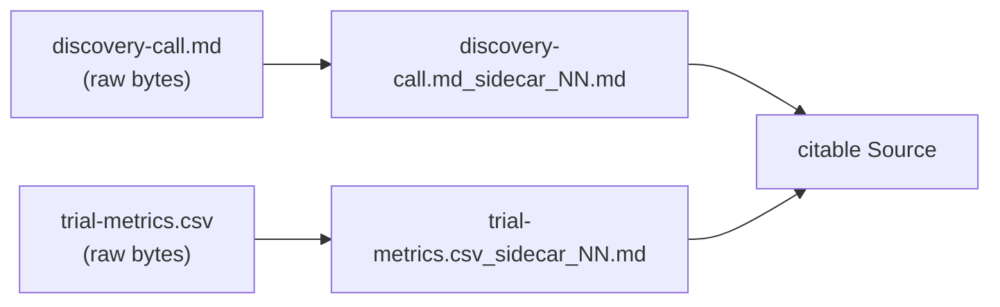
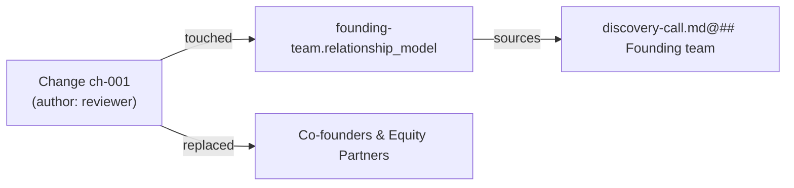

# Building a Domain from Scratch

This is the [Knowledge Lifecycle](knowledge-lifecycle) as a hands-on example. We start with an empty folder and end with a traceable, reviewable domain: two raw sources, one knowledge model that cites them, an exported deliverable, an applied change, and a lineage record that proves the whole chain.

The example is small on purpose — **Aurora Roasters**, a two-person coffee subscription business — so every file fits on screen and every step stays checkable.

---

## What you'll build

```text
Aurora/
├── domaiNN_NN.md                                # the manifest: what this domain is
├── .gitattributes                               # * -text  → keeps source hashes byte-stable
├── kNNowledge/
│   └── Aurora_business_NN.md                    # the model (Level 3)
├── sources/
│   └── import/
│       ├── discovery-call.md                    # raw source
│       ├── discovery-call.md_sidecar_NN.md      # its origin metadata
│       ├── trial-metrics.csv                    # raw source
│       └── trial-metrics.csv_sidecar_NN.md      # its origin metadata
├── artifacts/
│   └── Aurora_Monthly_Review_..._<UTC>.md       # a write-once deliverable
├── changes/
│   └── Aurora_reviewer_..._changes_NN.md        # the record of a change
└── Aurora_cogNNitive_NN.md                      # the lineage record (the map)
```

The rest of the folders (`sources/conversations/`, `conversations/`, `procedures/`, `staging/`) exist from step 1 but stay empty in this example.

---

## Step 1 — Create the empty domaiNN

An empty domain is scaffolded, not hand-built. The MCP tool `init_domain` creates the manifest, the folder skeleton, and the `.gitattributes` that pins source hashes:

```text
init_domain  name: "Aurora"
```

`domaiNN_NN.md` is generated, and it already states the house rule:

```markdown
---
level: 3
parent_spec:
  name: "domaiNN"
  url: "https://raw.githubusercontent.com/cogNNitive/cogNNitive-web/main/iNNfo/specs/bluepriNNts/domaiNN/spec_NN.md"
knowledge_version: "V_0-1-0"
title: "Aurora"
workspace_id: "aurora"
---

# NN domaiNN

## NN domaiNN: Aurora
knowledge_dir:: kNNowledge/
blueprints_dir:: specs/bluepriNNts/
Aurora — an empty domaiNN. Add models with an add_model changeset; every change to its content goes through a changeset.
```

> **Why `.gitattributes` ships `* -text`:** a source's SHA-256 is its change-detection key. If Git rewrote line endings on checkout, the hash would move even though the content did not. Pinning the bytes keeps the fingerprint stable across machines.

---

## Step 2 — Drop in raw knowledge

Knowledge starts outside the tool. Two ordinary files land in `sources/import/` — untouched originals, exactly as the team produced them:

`sources/import/discovery-call.md`

```markdown
# Discovery call — Aurora Roasters (2026-10-12)

## Founding team
Maya Ortiz (head roaster) and Tomás Reyes (operations) are equal co-founders.
Maya owns sourcing and roast profiles; Tomás owns logistics and billing.

## The offer
Two 250 g bags a month, roaster's choice, chosen by a short roast-profile quiz
at signup. 32 USD per month, shipping included.

## Why subscribers stay
The quiz is the retention hook: subscribers feel the roast is "theirs", and
pausing feels like losing a personal relationship with Maya.
```

`sources/import/trial-metrics.csv`

```csv
cohort,subscribers,conversion_rate,churn_rate
2026-07,148,0.31,0.08
2026-08,203,0.34,0.07
2026-09,261,0.38,0.06
```

Nothing has touched these files: they have no sidecar yet. They are bytes on disk, not yet a Source.

---

## Step 3 — Ingest: the scan writes the sidecars

Ingestion turns each raw file into a citable Source by writing a sidecar **next to it** — in place, never a mirror copy:

```console
$ node skills/nn-sources/scripts/index.js --scan --src Aurora
✔ cognitivize  sources/import/discovery-call.md   → sources/import/discovery-call.md_sidecar_NN.md
✔ cognitivize  sources/import/trial-metrics.csv   → sources/import/trial-metrics.csv_sidecar_NN.md
Lineage: Aurora_cogNNitive_NN.md refreshed (2 sources)
```

The raw files are untouched. The generated sidecar carries only origin metadata for text-like formats (Markdown, CSV, JSON) — the raw file is the citation target:

`sources/import/discovery-call.md_sidecar_NN.md`

```markdown
---
source_file: "discovery-call.md"
sha256: "3f9c1d0b7a42e5c8d6f1a2b3c4d5e6f708192a3b4c5d6e7f8091a2b3c4d5e6f7"
size_bytes: 712
source_format: "md"
normalized_at: "2026-10-14T09:12:00Z"
normalized_by: "nn-sources"
---
```

A binary (PDF, DOCX, XLSX, image, audio, video) would instead carry the normalized Markdown *body* in its sidecar, and only that body is citable (`report.pdf_sidecar_NN.md@## Findings`).



---

## Step 4 — Model the knowledge

Now the raw material becomes a decision. We create one Level-3 model, `kNNowledge/Aurora_business_NN.md`, where every assertion carries a `sources::` citation to the exact unit it came from:

```markdown
---
level: 3
parent_spec:
  name: "business_V_0-5-0"
  url: "https://raw.githubusercontent.com/cogNNitive/cogNNitive-web/main/iNNfo/specs/bluepriNNts/business/spec_NN.md"
knowledge_version: "V_1-0-0"
title: "Aurora Roasters Business Model"
---

# NN Business summary
Aurora Roasters is a two-person specialty coffee roaster selling a monthly
subscription of two 250 g bags at 32 USD per month, shipping included.

# NN Stakeholders

## NN Stakeholders: Founding Team
slug:: founding-team
relationship_model:: Co-founders & Equity Partners
tags:: [internal, founders]
sources:: [sources/import/discovery-call.md@## Founding team]
Maya Ortiz (head roaster) and Tomás Reyes (operations) are equal co-founders:
Maya owns sourcing and roast profiles, Tomás owns logistics and billing.

## NN Stakeholders: Subscribers
slug:: subscribers
relationship_model:: Monthly Subscribers
tags:: [external, customers]
sources:: [sources/import/discovery-call.md@## Why subscribers stay]
Subscribers self-select a roast profile at signup, which is the retention hook.

# NN Offerings

## NN Offerings: Two-Bag Monthly Subscription
slug:: two-bag-monthly-subscription
pricing_model:: Recurring Subscription (USD 32 / month)
components_list:: Two 250 g bags, Roast-profile quiz, Free shipping
tags:: [subscription, core]
sources:: [sources/import/discovery-call.md@## The offer]
The single core offer; everything else is a variation of it.

# NN Metrics

## NN Metrics: Trial Conversion Rate
slug:: trial-conversion-rate
sources:: [sources/import/trial-metrics.csv@R4&conversion_rate]
Share of trial signups that become paying subscribers. Latest cohort: 38%.

## NN Metrics: Monthly Churn Rate
slug:: monthly-churn-rate
sources:: [sources/import/trial-metrics.csv@R4&churn_rate]
Share of subscribers who cancel in a month. Latest cohort: 6%.
```

Notice the citation shapes already in play: `@## Heading` for a Markdown unit and `@R4&column` for a CSV cell (row 4 = the 2026-09 cohort). The **single-edge rule** means each citation points at its immediate upstream unit — there is no proxy layer in between.

---

## Step 5 — Validate the graph

Before trusting anything, validate. The MCP `validate_knowledge` tool checks one model; `check_domain` runs the workspace integrity pass (dangling citations, drift, orphans):

```text
validate_knowledge  path: kNNowledge/Aurora_business_NN.md
→ 0 errors, 5 citations resolved

check_domain  domain: Aurora
→ sources: 2 · model records: 1 · artifacts: 0 · drift: none
```

If a heading were renamed, the citation would resolve to nothing and surface a `KU_DANGLING_FILE`; if a legacy `#slug` form slipped in, it would warn `KU_DEPRECATED_HASH`; a line range or a `src-NNN` wrapper would be rejected as `KU_MALFORMED`.

---

## Step 6 — Export a deliverable

An export writes a write-once Artifact under `artifacts/`: its name carries a UTC stamp, and it cites the model it came from rather than restating the model's own upstream sources.

`artifacts/Aurora_Monthly_Review_20261014T093000Z.md`

```markdown
---
title: "Aurora — Monthly Review"
sources: ["kNNowledge/Aurora_business_NN.md"]
generated_at: "2026-10-14T09:30:00Z"
---

# Aurora — Monthly Review

Trial conversion climbed to 38% while churn fell to 6% — the roast-profile
quiz is doing its job. The single core offer is stable.[^1]

[^1]: kNNowledge/Aurora_business_NN.md@## NN Metrics
```

Run the producer twice on unchanged input and it writes nothing; change the input and it writes a new member beside the old. The previous artifact keeps its bytes, so any citation to it still resolves.

---

## Step 7 — Record a change

Here is the rule that makes the whole lifecycle auditable: **the model is not edited in place.** A reviewer opens the generated console, edits an element, and exports the change; the agent applies it.

The exported change is itself a document:

`changes/Aurora_reviewer_20261015T101500Z_changes_NN.md`

```markdown
---
level: 3
parent_spec:
  name: changes
  url: "https://raw.githubusercontent.com/cogNNitive/cogNNitive-web/main/iNNfo/specs/bluepriNNts/changes/spec_NN.md"
status: proposed
title: Aurora Domain
author: reviewer
---

# NN Change

## NN Change: ch-001
op:: update_field
target:: kNNowledge/Aurora_business_NN@founding-team&relationship_model
from:: Co-founders & Equity Partners
to:: Equal Co-founders (50/50)
notes:: The equity split is now confirmed as 50/50 in the shareholder agreement.
author:: reviewer
```

Applying it is a reviewed mutation — a diff preview, a confirmation, then one apply that writes the model, bumps its version, and records the change:

```text
propose_changeset  → 1 operation, diff preview
apply_change       → applied 1/1 · Aurora_business_NN V_1-0-0 → V_1-0-1
```

Because a change is a **lineage node**, the edited field's `sources` now points at the change that last touched it (`changes/Aurora_reviewer_20261015T101500Z_changes_NN.md@## NN Change: ch-001`), and that change carries the evidence and the value it displaced (`replaced_sources::`). Follow field → change → source, and you reach the original discovery call.



---

## Step 8 — Read the lineage record

Every scan, import, cognitivize and apply keeps `Aurora_cogNNitive_NN.md` in sync. It is the map of the domain — three **projected** sections plus an **append-only** journal:

```markdown
# NN Sources

## NN Sources: discovery-call.md
raw_filename:: sources/import/discovery-call.md
raw_hash:: 3f9c1d0b7a42e5c8d6f1a2b3c4d5e6f708192a3b4c5d6e7f8091a2b3c4d5e6f7
size:: 712
source_format:: md
normalized_at:: 2026-10-14T09:12:00Z
normalized_content:: sources/import/discovery-call.md_sidecar_NN.md
version:: V1

## NN Sources: trial-metrics.csv
raw_filename:: sources/import/trial-metrics.csv
raw_hash:: 9b1e4f2a3c5d6e7f8091a2b3c4d5e6f708192a3b4c5d6e7f8091a2b3c4d5e6f7
size:: 118
source_format:: csv
normalized_at:: 2026-10-14T09:12:00Z
normalized_content:: sources/import/trial-metrics.csv_sidecar_NN.md
version:: V1

# NN ModelRecords

## NN ModelRecords: Aurora business
model_ref:: kNNowledge/Aurora_business_NN.md
model_template:: business
derived_from:: [sources/import/discovery-call.md@## The offer]

# NN Artifacts

## NN Artifacts: Aurora_Monthly_Review_20261014T093000Z
artifact_ref:: artifacts/Aurora_Monthly_Review_20261014T093000Z.md
artifact_format:: document
derived_from:: [kNNowledge/Aurora_business_NN.md]

# NN Procedures

<!-- Append-only. One entry per pipeline run (--scan, --import-url, --apply). Never regenerated. -->
## NN Procedures: --scan @ 2026-10-14T09:12:00Z
command:: --scan
flags::
run_at:: 2026-10-14T09:12:00Z
inputs:: sources/import/discovery-call.md, sources/import/trial-metrics.csv
outputs:: 2 sidecars, 1 lineage refresh
```

The three view sections are a pure function of the files on disk: add a source, and it appears; remove one, and it drops out. The `# NN Procedures` journal is the opposite — append-only, never rewritten.

---

## Step 9 — Keep it honest: drift

Because the record is derived, the only failure mode is **drift**: the persisted text disagreeing with a fresh projection. That happens if someone edits a managed section by hand. The gate catches it:

```console
$ node scripts/index.js --lineage --check --src Aurora
✖ LINEAGE_DRIFT  # NN Sources differs from a fresh projection
```

The fix is always regeneration, never a hand edit:

```text
sync_lineage  domain: Aurora     # or: node scripts/index.js --lineage --src Aurora
→ record regenerated; # NN Procedures preserved
```

The same drift is reported by `node scripts/verify.js` in CI and by the MCP `check_domain` tool, so a hand-edited map cannot slip through unnoticed.

---

## Where everything lives

| Path | Role | Mutability |
| :--- | :--- | :--- |
| `domaiNN_NN.md` | Domain manifest (Level 3 container). | Changes via a changeset. |
| `sources/import/` | Raw, immutable sources + co-located sidecars. | Write-once; new members, never edits. |
| `kNNowledge/*_NN.md` | Level-3 knowledge models with `sources::` citations. | Changes via a changeset. |
| `artifacts/` | Generated/curated deliverables. | Write-once (UTC-suffixed). |
| `changes/` | The record of every proposed/applied change. | Append-only. |
| `<Project>_cogNNitive_NN.md` | The lineage record: projected views + run journal. | Derived; never hand-edited. |
| `staging/` | Ephemeral extraction buffer. | Never citable, never projected. |

---

## Where to go next

- [The Knowledge Lifecycle](knowledge-lifecycle) — the same journey explained as a lifecycle.
- [Sources, Citations & Lineage](sources-citations-lineage) — the exact citation grammar and sidecar/record fields.
- [Import Modes & Dynamic Sources](import-modes) — watch roots, impact checking, and convergence.
- [Reviewer Guide](reviewer-guide) — producing and exporting a change from the console.
