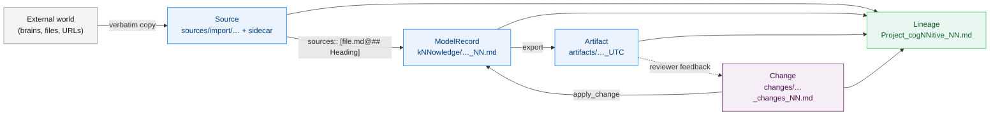
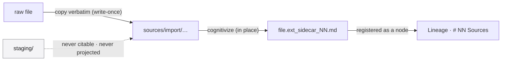
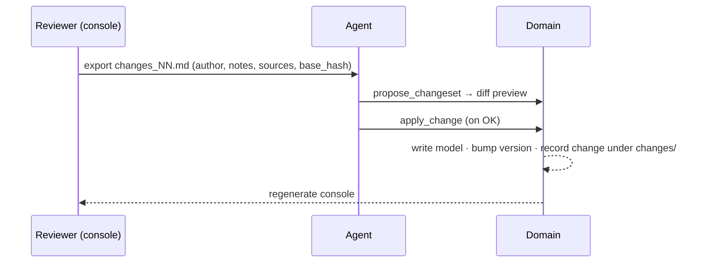
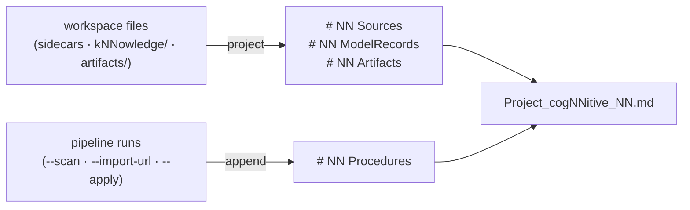

# The Knowledge Lifecycle

A knowledge base is not a document you finish; it is a base you keep alive. cogNNitive is built around one promise: **every statement you can read can be traced back to the exact piece of evidence it came from, and every change to that statement is recorded.** This page explains the lifecycle that delivers that promise — where knowledge enters, how it is modelled, how it leaves, how it changes, and how it is traced.

It is the explanatory companion to two reference pages: [Sources, Citations & Lineage](sources-citations-lineage) holds the field-level rules, and the [Reviewer Guide](reviewer-guide) holds the review interface. This page explains the *shape* and the *why*; those pages hold the *exact* and the *how*.

---

## 1. The lifecycle in one picture

The lifecycle has one **entry** (a raw file), one **representation** (the knowledge model), one **exit** (a deliverable), one **way back in** (a change), and one **watchful map** over all of it (the lineage record).

---

## 2. Four node kinds and one map

Everything in a domaiNN is one of four node kinds, plus a single record that maps them:

| Node | Lives in | What it is |
| :--- | :--- | :--- |
| **Source** | `sources/import/` (and `sources/conversations/`) | A raw, **immutable** file plus its co-located `<file>.<ext>_sidecar_NN.md` carrying origin metadata. The citation target. |
| **ModelRecord** | `kNNowledge/*_NN.md` | A Level-3 knowledge document: the human/agent-readable model whose assertions carry `sources::` citations. |
| **Artifact** | `artifacts/` | A generated or curated deliverable (report, dashboard, console, curated CSV), itself write-once and citable. |
| **Change** | `changes/` | A proposed mutation to a model — the **only** way model content changes. A change is also a lineage node. |
| **Lineage** | `<Project>_cogNNitive_NN.md` | The map: projected view sections (`# NN Sources`, `# NN ModelRecords`, `# NN Artifacts`) plus an append-only journal (`# NN Procedures`). |

The naming contract decides the role — a file with a co-located sidecar is a Source, a `knowledge` document is a ModelRecord, a timestamped or `sources`-declaring file under `artifacts/` is an Artifact. Nothing is classified by where it sits; it is classified by what it is.

---

## 3. Stage 1 — Elicitation

Knowledge does not start in the tool. It starts in a meeting, an interview, a spreadsheet export, a URL, a voice memo. The team keeps working exactly as before and produces ordinary files. cogNNitive's job is to capture those files **without asking anyone to change their habits** — which is why the first stage is deliberately outside the software.

---

## 4. Stage 2 — Ingestion: a file becomes a Source

Ingestion answers one question: *how does a raw file become something a model can cite?*

Three decisions define this stage:

1. **In place, never mirrored.** The scanner walks `sources/import/` and `sources/conversations/` and writes a sidecar *next to* each raw file through a single `cognitivize` operation. The raw bytes and the file's path are never changed. There is no `sources/nn/` mirror to keep in sync, because a mirror is one more thing that can drift.
2. **Immutable, so citations stay true.** A citation like `sources/import/interview.md@## Priorities` means *"the text under this heading, in this file."* If a file could be overwritten, that citation would silently change meaning. So it cannot: when new bytes arrive, they become a **new write-once family member** (`<stem>_<YYYYMMDDTHHmmssZ>.<ext>`), and the previous member keeps its exact bytes. Identical bytes deduplicate to no write.
3. **Binary content is reached through the sidecar.** Markdown, CSV and JSON are cited directly; a PDF, DOCX, XLSX, image, audio or video file is cited through the normalized body its sidecar carries (`sources/import/report.pdf_sidecar_NN.md@## Findings`). The binary itself is never a citation target.

A transient `staging/` buffer (Whisper SRTs, raw OCR) is ignored by the scanner, Git and the projection, and is **never** a valid citation target.

A pack of external folders can be watched without a daemon: a scan classifies each change (`NEW`, `EVOLVED_DYNAMIC`, `STATIC_ALERT`, `DISCONNECTED`) and imports new content as immutable snapshots. See [Import Modes & Dynamic Sources](import-modes) for that machinery.

---

## 5. Stage 3 — Modelling: every assertion points at its evidence

A ModelRecord is where raw material becomes a decision. The defining property is that **a claim and its evidence travel together**: a knowledge unit's `sources::` field names the exact upstream unit it was derived from.

Three rules keep the graph honest — they are the heart of the system, so they are worth stating plainly:

1. **Direct citations only (single edge).** A model cites its immediate upstream inputs directly. There are no intermediate ID schemes (`src-NNN`), no synthetic proxy edges, no duplicated provenance layers. The graph is as short as the truth allows.
2. **One provenance path.** A derived artifact cites *its* source knowledge document by a file-level citation; it does not copy every transitive upstream citation into itself. Follow one edge, then the next, and you arrive at the raw Source.
3. **Sources are optional.** A terminal, self-contained deliverable simply omits the citation — the absence is meaningful, not an error.

Ingestion and modelling are kept **separate on purpose**: sources are append-only and immutable, while knowledge is convergent. Absorbing what a changed source now says is a modelling decision (a reviewable change), never a silent file edit. See [Import Modes & Dynamic Sources](import-modes) for convergence strategies.

---

## 6. Stage 4 — Export: a deliverable cites its model

An export produces an **Artifact** under `artifacts/`. Artifacts are **write-once**: each output gets a UTC suffix, so running a producer twice on unchanged input writes nothing, and changed input writes a new member beside the old. "Latest" is a query over names, never a mutable `_latest` pointer.

By the single-provenance rule, an artifact cites the knowledge document it was generated from (`meta.sources: ["kNNowledge/…_NN.md"]`) rather than restating that document's own upstream sources. An artifact can, in turn, be cited by a model ("this conclusion comes from last week's report"), which closes a loop instead of opening a parallel one.

---

## 7. Stage 5 — Change: the model is never edited in place

The counter-intuitive rule that makes the whole lifecycle auditable: **model content does not change by editing a file.** It changes by a **changeset** — a proposed, reviewable, recorded mutation.

A change is not just a diff: it is itself a **lineage node**. A field's `sources` points at the change that last touched it (`changes/<cs>@## NN Change: <id>`), that change carries the evidence it derived from (`sources::`) and, when it displaced an earlier citation, the value it replaced (`replaced_sources::`). The chain runs field → change → (`sources` | `replaced_sources`) → … until it reaches a Source or a change with neither. Git keeps the file history; the model needs no snapshots.

Two properties follow. **Attribution:** every change is signed with an author and recorded as a changeset under `changes/` — there is no parallel ledger. **Propose/decide separation:** the console can only *propose*; the outcome (`applied`, `partially_applied`, `conflict`, `rejected`) and the version transition are written by the engine on apply.

The mechanics of producing and applying a change from the console live in the [Reviewer Guide](reviewer-guide).

---

## 8. Stage 6 — Lineage: the map is a projection, not a hand-kept log

The lineage record never becomes stale because it is **derived**, not maintained:

The three view sections are a pure function of the file snapshot, so they are recomputed from scratch on every scan, cognitivize, import, or explicit `--lineage` run. The `# NN Procedures` journal is the opposite: an append-only log of what ran, never rewritten. Because the record is derived, the only thing that can go wrong is **drift** — the persisted text disagreeing with a fresh projection — and that is a checkable condition, not a maintenance burden. The drift gate recomputes the projection and compares the managed sections byte for byte, in three sites: `nn-sources --lineage --check`, `node scripts/verify.js`, and the MCP `check_domain` tool. Fixing drift is a regeneration (`--lineage`, or the MCP `sync_lineage`), never a hand edit.

---

## 9. The invariants that make it trustworthy

The lifecycle is not a workflow bolted onto a wiki; it is a set of invariants the code enforces:

- **Immutability.** A source version is never overwritten; a changed source is a new family member. Older citations keep resolving against the exact bytes they were written against.
- **Single edge.** One citation points at one upstream unit. Shortest honest path, no proxy layers.
- **Hash-based staleness.** Every raw file is fingerprinted (SHA-256 in its sidecar). A write whose input hash no longer matches is refused (`HASH_MISMATCH`), and an anchor that moved is reported, not swallowed.
- **Drift gate.** The lineage record must equal a fresh projection, byte for byte, or the gate fails loudly.
- **Zero unilateral mutation.** Non-interactive runs (`--scan`, CI, `verify`) never mutate source content; deletion (`--unlink`, `--gc`) requires explicit, per-path user consent.

Together these turn "trust me" into "check me": any reader can walk a claim to its source, and any gate can prove the map still matches the territory.

---

## 10. Where to go next

- [Sources, Citations & Lineage](sources-citations-lineage) — the exact citation grammar, sidecar fields, and rendered record fields.
- [Import Modes & Dynamic Sources](import-modes) — ingestion strategies, watch roots, impact checking, and convergence.
- [Building a Domain from Scratch](domain-from-scratch) — the whole lifecycle as a hands-on worked example.
- [Reviewer Guide](reviewer-guide) — the console's review surface and the change export/apply loop.
